

# CtrS · SSA-MRN 성능 개선 연구

[연구 소개](#연구-소개) · [팀원](#팀원) · [구조](#ssa-mrn-구조) · [기준 모델](#기준-모델) · [결과 이미지](#기준-모델-결과-이미지) · [원본 대비 개선](#원본-대비-개선) · [다른 모델과 비교](#compare) · [다른 실험](#experiments) · **[결과 비교 사이트](https://biyonghiyon.github.io/CtrS-viewer/)**

## 연구 소개

고해상도 흑백 위성영상 **PAN**의 공간 정보와 저해상도 다중분광영상 **MS**의 색·분광 정보를 결합해 고해상도 MS를 복원하는 팬샤프닝 연구입니다. SSA-MRN을 기반으로 성능 개선 연구를 진행합니다. SSAI 개선과 가변 배율 확장 연구는 종료했습니다.

## 팀원

| 이름 | GitHub | 전공 | 역할 |
|---|---|---|---|
| 이병현 | [BIYONGHIYON](https://github.com/BIYONGHIYON) | 멀티미디어공학과 | 팀장 |
| 김경찬 | [erickks2y-jpg](https://github.com/erickks2y-jpg) | 멀티미디어공학과 | 팀원 |
| 송준현 | [choco-ssalbbang](https://github.com/choco-ssalbbang) | 멀티미디어공학과 | 팀원 |
| 김윤지 | [kimrose1015-max](https://github.com/kimrose1015-max) | 데이터사이언스전공 | 팀원 |

## SSA-MRN 구조

원본 SSA-MRN은 PAN·축소 후 재확대한 PAN(LRPAN)·확대한 MS(LMS)에서 특징을 추출하고, 전체·절반·1/4 크기에서 밴드별 SSAI로 융합한 뒤 작은 크기부터 복원합니다. 현재 기준 모델 **C2MS-SP**의 네트워크는 이전 기준 모델 C2MS와 같습니다(원본 + 초기 특징에서 갈라지는 **W2 병렬 가지**, 원래 학습 쌍과 **2배 거친 학습 쌍을 섞은** 학습). 바뀐 것은 두 가지입니다. ① 손실을 **L1 + 분광 손실**로 바꿔 학습했고, ② 추론 뒤에 출력을 다시 관측했을 때 입력 MS와 정확히 맞도록 고치는 **관측 일치 사영**(파라미터 없음)을 붙였습니다.

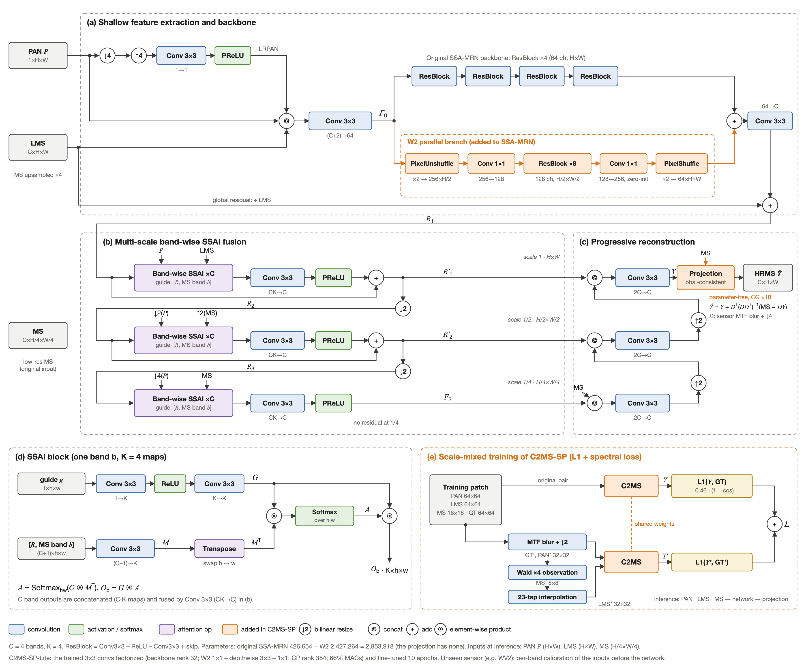

C2MS-SP 구조입니다. 주황색이 원본 SSA-MRN에 더한 부분(W2 병렬 가지, 출력 뒤 관측 일치 사영, L1·분광 손실을 쓰는 축척 혼합 학습)이며, 나머지는 원본과 같습니다. 입력은 고해상도 PAN, 4배 확대한 MS(LMS), 저해상도 MS(1/4 크기)입니다. C2MS-SP-Lite는 같은 구조에서 학습된 3×3 합성곱을 분해한 경량판입니다.

- **관측 일치 사영:** `D`는 센서의 관측 연산(MTF 블러 + 4배 축소)입니다. 출력을 줄였을 때 입력 MS와 같아지는 영상 중 원래 출력에 가장 가까운 것으로 옮깁니다([성능 66·81번](SSA-MRN/experiments/performance/81_l1_spectral_loss_projection/README.md)).
- **C2MS-SP-Lite:** 원래 해상도 backbone의 3×3 합성곱을 랭크 32 병목으로, W2 가지의 3×3 합성곱을 1×1 · depthwise 3×3 · 1×1로 분해한 뒤 짧게 미세조정했습니다([성능 83번](SSA-MRN/experiments/performance/83_factorized_c2ms_finetuning/README.md)).
- **밴드별 센서 보정:** 학습하지 않은 센서에 쓸 때만 입력 밴드의 밝기 비율을 학습 센서에 맞추고 출력을 되돌립니다([성능 82번](SSA-MRN/experiments/performance/82_cross_sensor_band_calibration/README.md)). 학습한 센서에는 쓰지 않습니다.

원본 SSA-MRN 구조 보기

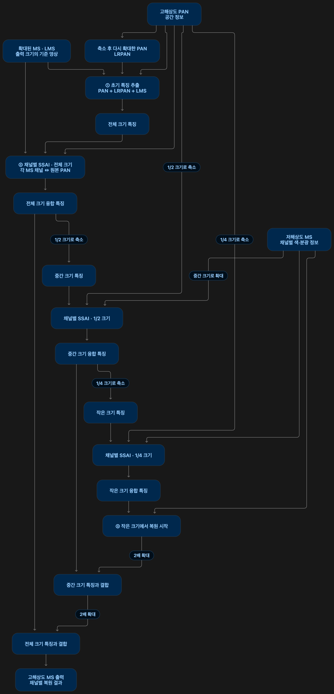

## 기준 모델

| 항목 | 내용 |
|---|---|
| 모델 | **C2MS-SP** = C2MS(원본 SSA-MRN K=4 + W2 병렬 가지, 축척 혼합 학습)를 L1·분광 손실로 학습 + 추론 시 관측 일치 사영 |
| 학습 | 원래 학습 쌍 L1 + 2배 거친 쌍 L1 + 0.46 × 분광 손실(1 − cos), 150에폭 ([성능 65번](SSA-MRN/experiments/performance/65_l1_spectral_loss/README.md)) |
| 추론 | 네트워크 출력 → 관측 일치 사영(공액 기울기법 10회). 학습하지 않은 센서에는 밴드별 센서 보정을 함께 적용 |
| 파라미터 | 2,853,918개(실사용 2,735,610개), 256² 합성곱 59.6 GMAC (원본 426,654개) |
| 경량판 | **C2MS-SP-Lite**: 실사용 파라미터 1,873,402개(68%), 39.1 GMAC(66%). C2MS-SP보다 RR PSNR 0.01-0.03 dB 낮음. RTX 3060 Ti에서는 depthwise 합성곱 때문에 실제 시간이 C2MS-SP보다 깁니다 |
| 채택 | 2026-11-14, [성능 81번](SSA-MRN/experiments/performance/81_l1_spectral_loss_projection/README.md) QB·GF2·WV3 3시드(42·43·44) 모두 이전 기준 C2MS 대비 개선 |
| 이전 기준 | C2MS(2026-10-21) → C2MS-SP. C2MS 대비 3시드 평균 RR PSNR QB +0.072 dB, GF2 +0.191 dB, WV3 +0.130 dB, SAM·ERGAS도 모두 개선 |

### 기준 모델 발전 과정

| 단계 | 실험 | 한 일 | 결과와 다음 단계로 이어진 점 |
|---:|---|---|---|
| 0 | [성능 2번](SSA-MRN/research/performance/2_paper_setting_reproduction/README.md) 외 | 원본 SSA-MRN 재현, K=4를 연구 기본값으로 확정(2026-10-09) | 이후 모든 비교의 출발점(원본) |
| 1 | [성능 29번](SSA-MRN/experiments/performance/29_capacity_refinement/README.md) | 원본 backbone 옆에 저해상도 병렬 가지 **W2**를 처음 붙임 | RR PSNR +0.72 dB로 큰 이득이지만 RR2(더 거친 시험)가 나빠짐 |
| 2 | [성능 43번](SSA-MRN/experiments/performance/43_normalized_parallel_capacity/README.md) | 원본+W2(**C2**)를 같은 절차로 3시드 재현 | RR +0.70 dB가 재현됐지만 축척을 바꾸면 무너지는 약점 확인 |
| 3 | [성능 50번](SSA-MRN/experiments/performance/50_w2_branch_inference_scaling/README.md) | 학습 없이 W2 출력 세기를 줄여 보는 진단 | 약점의 원인은 **축척에 따라 맞지 않는 세부 주입 세기** |
| 4 | [성능 53번](SSA-MRN/experiments/performance/53_scale_mixed_training/README.md)·[54번](SSA-MRN/experiments/performance/54_multi_sensor_scale_mixed_training/README.md) | 구조는 C2 그대로, **2배 거친 학습 쌍을 섞어** 학습(**C2MS**) | 원본 대비 RR QB +0.873, GF2 +2.045, WV3 +1.007 dB → **기준 모델 채택(2026-10-21)** |
| 5 | [성능 65번](SSA-MRN/experiments/performance/65_l1_spectral_loss/README.md) | 손실을 **L1 + 분광 손실**로 바꿔 학습 | SAM이 3시드 60/60장에서 줄었지만 원래 해상도 관측 일치가 나빠지고 WV2 전이에서 흐려짐 |
| 6 | [성능 66번](SSA-MRN/experiments/performance/66_observation_error_projection_analysis/README.md)·[81번](SSA-MRN/experiments/performance/81_l1_spectral_loss_projection/README.md) | 추론 뒤 **관측 일치 사영**을 붙이고 정식 판정(**C2MS-SP**) | 세 센서 모두 C2MS 대비 3시드 개선, 사영은 10회 반복이면 충분 → **기준 모델 채택(2026-11-14)** |
| 7 | [성능 82번](SSA-MRN/experiments/performance/82_cross_sensor_band_calibration/README.md) | 학습하지 않은 센서에 **밴드별 센서 보정** | WV2 흐림의 원인(센서 간 밴드 밝기 척도 차이)을 찾아 재학습 없이 +2 dB 회복 |
| 8 | [성능 83번](SSA-MRN/experiments/performance/83_factorized_c2ms_finetuning/README.md) | 학습된 가중치를 **분해 + 짧은 미세조정**(**C2MS-SP-Lite**) | 연산 66%로 세 센서 모두 C2MS 대비 3시드 개선, C2MS-SP와 0.01-0.03 dB 차이 |

기준 모델은 원본 → F1([성능 49번](SSA-MRN/experiments/performance/49_observation_refinement_seed_repeat/README.md), 2026-10-20) → C2MS(2026-10-21) → C2MS-SP(2026-11-14) 순서로 바뀌었습니다.

## 기준 모델 결과 이미지

**학습하지 않은 센서에서도 C2MS-SP와 C2MS-SP-Lite는 원본보다 선명하고 색이 정확합니다.** 아래는 세 모델을 WV3로만 학습한 뒤, 한 번도 학습하지 않은 **WV2** test에 적용한 결과입니다. 학습한 센서(QB·GF2·WV3)에서는 세 모델 모두 정답에 가까워 장면 전체로 보면 차이가 잘 드러나지 않지만, 처음 보는 센서에서는 원본이 흐려지고 색이 틀어집니다. C2MS-SP·SP-Lite에는 우리가 개발한 밴드별 센서 보정([성능 82번](SSA-MRN/experiments/performance/82_cross_sensor_band_calibration/README.md))을 함께 적용했고, 원본은 발표된 방식 그대로입니다.

| 정답 대비 (WV2 test 20장, 3시드 평균) | 원본 SSA-MRN | C2MS-SP | C2MS-SP-Lite | 참고: C2MS-SP, 보정 없이 |
|---|---:|---:|---:|---:|
| RR PSNR | 28.59 dB | **31.54 dB** | **31.55 dB** | 29.58 dB |
| 선명도 (출력 고주파 세기 ÷ 정답, 1이 정답) | 0.33 | **0.52** | **0.52** | 0.40 |
| 넣은 세부와 실제 세부의 상관 | 0.70 | **0.84** | **0.84** | 0.76 |
| 밴드별 평균 밝기 치우침 (가장 큰 밴드) | 7.2% | **0.1%** | **0.1%** | 1.8% |

세 시드 모두 C2MS-SP·SP-Lite가 원본보다 선명하고 PSNR이 높았습니다(시드별 원본 대비 C2MS-SP +2.77 · +2.80 · +3.28 dB). 시드별 가장 큰 색 치우침은 원본 4.1-11.4%, C2MS-SP 0.1-0.2%였습니다. 원본은 화면에 쓰는 파랑 밴드가 밝게 나와 전체가 회보라색으로 보입니다. 보정 없이 C2MS-SP를 쓰면 원본보다는 낫지만 여전히 흐립니다(선명도 0.40). 학습한 센서 WV3에서는 세 모델 모두 색 치우침이 작습니다. 측정 방법과 시드별 값은 [baseline_metrics.json](SSA-MRN/docs/images/c2ms_sp/baseline_metrics.json)에 있습니다.

### WV2 장면별 결과 (seed 42, RGB 밴드 [4,2,1])

| 장면 | 장면 PSNR 원본 | C2MS-SP | C2MS-SP-Lite | 확대 영역 PSNR 원본 / SP / SP-Lite |
|---:|---:|---:|---:|---|
| 0 | 27.80 | 30.90 (+3.11) | 30.92 (+3.13) | 24.19 / 27.56 / 27.62 |
| 1 | 26.02 | 29.44 (+3.41) | 29.42 (+3.40) | 23.00 / 27.77 / 27.74 |
| 3 | 33.71 | 36.91 (+3.20) | 36.84 (+3.13) | 27.19 / 30.70 / 30.67 |
| 7 | 28.38 | 30.67 (+2.29) | 30.69 (+2.31) | 24.03 / 26.51 / 26.51 |
| 14 | 27.91 | 30.55 (+2.64) | 30.57 (+2.67) | 25.65 / 29.38 / 29.40 |
| 17 | 28.43 | 30.95 (+2.52) | 30.98 (+2.55) | 27.33 / 30.43 / 30.40 |

장면은 QB에서 정답 영상만 보고 정한 고정 번호(0·1·3·7·14·17)이고, 여섯 장면 모두 C2MS-SP·SP-Lite가 원본보다 높았습니다.

- **원본 크기 비교:** 위 줄은 LR MS(최근접 확대) · PAN 입력 · 원본 · C2MS-SP · C2MS-SP-Lite · 정답, 아래 줄은 세 모델의 |예측 − 정답| 지도입니다(원본 오차의 99퍼센타일을 공통 색 척도로 사용, 밝을수록 오차가 큼).
- **확대 비교:** C2MS-SP의 개선이 가장 큰 64×64 영역을 4배 확대한 정답 전체(노란 상자) · 원본 · C2MS-SP · C2MS-SP-Lite · 정답 · 세 모델의 오차입니다. C2MS-SP에 유리하게 고른 영역이므로 전체 차이는 표의 장면 PSNR로 확인합니다.

**장면 0**

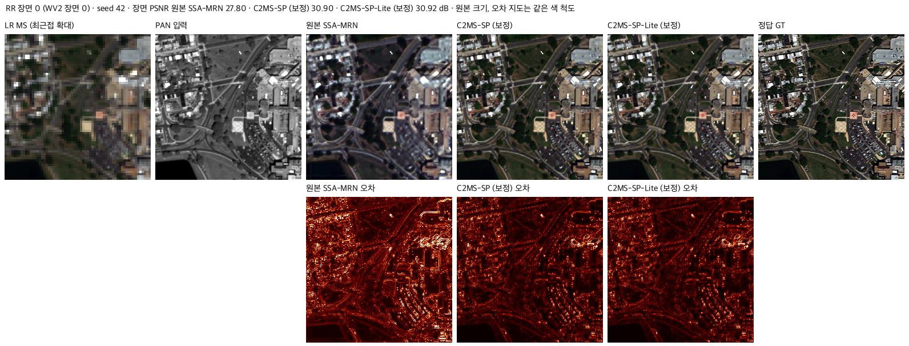

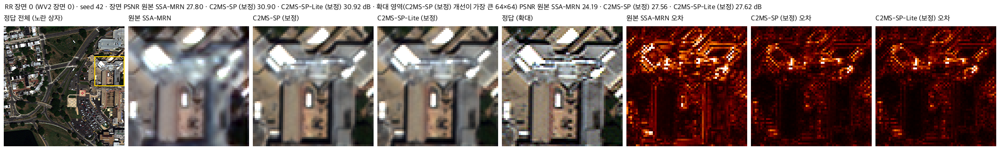

<b>WV2 나머지 5장면 펼치기</b> (1·3·7·14·17)

**장면 1**

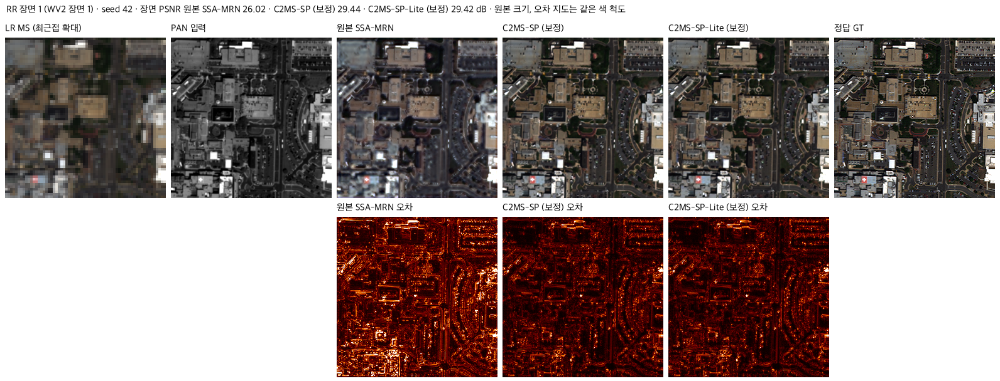

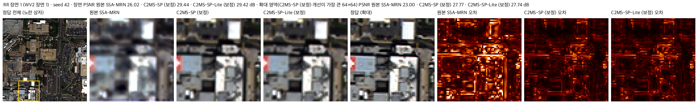

**장면 3**

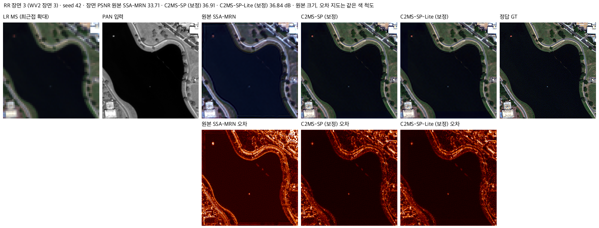

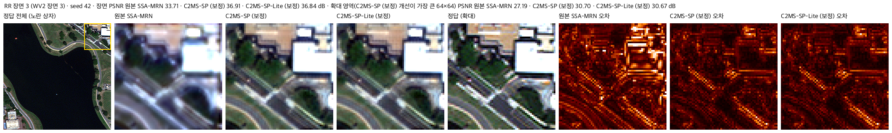

**장면 7**

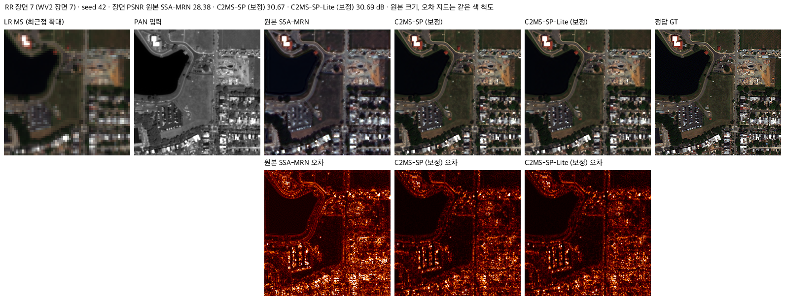

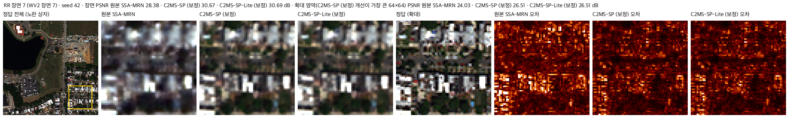

**장면 14**

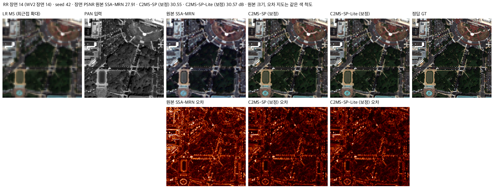

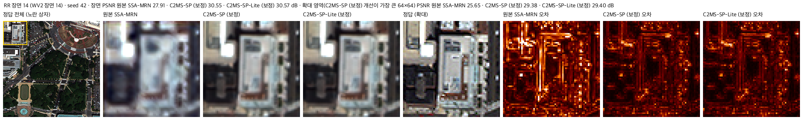

**장면 17**

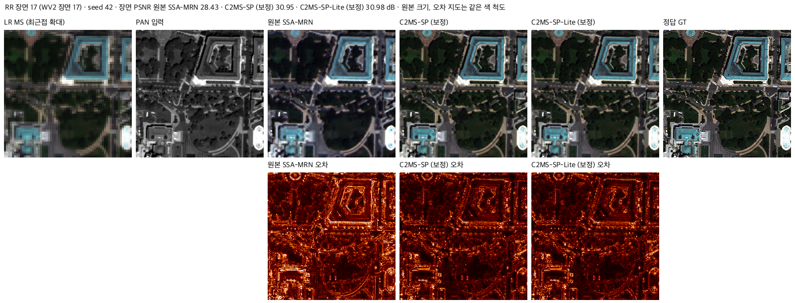

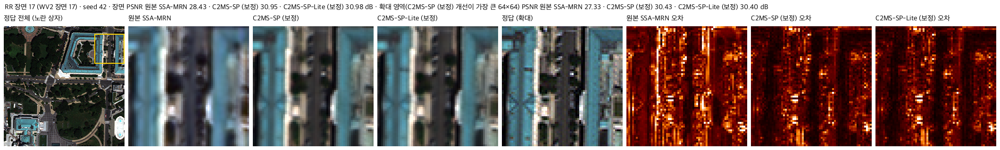

**[더 많은 이미지 보기 →](SSA-MRN/docs/c2ms_sp_result_images.md)** QB·GF2·WV3·WV2의 6장면 전체(원본 크기·확대 비교). 장면을 직접 골라 확대하며 비교하려면 [결과 비교 사이트](https://biyonghiyon.github.io/CtrS-viewer/)를 씁니다.

## 원본 대비 개선

test 20장, 같은 시드(42·43·44) 원본과 짝지은 3시드 평균 차이입니다. 원본은 발표된 방식 그대로이고, C2MS-SP·SP-Lite는 사영(공액 기울기법 10회)을 포함하며 WV2에서는 밴드별 센서 보정도 포함합니다.

| 데이터셋 | 모델 | RR PSNR | 원본 대비 PSNR | SAM | ERGAS | 판정 |
|---|---|---:|---:|---:|---:|:---:|
| QB | 원본 SSA-MRN | 37.429 | | | | |
|  | C2MS-SP | 38.373 | +0.944 dB | −0.467° | −0.439 | 개선 |
|  | C2MS-SP-Lite | 38.353 | +0.924 dB | −0.466° | −0.431 | 개선 |
| GF2 | 원본 SSA-MRN | 46.549 | | | | |
|  | C2MS-SP | 48.785 | +2.235 dB | −0.190° | −0.204 | 개선 |
|  | C2MS-SP-Lite | 48.751 | +2.202 dB | −0.187° | −0.201 | 개선 |
| WV3 | 원본 SSA-MRN | 37.536 | | | | |
|  | C2MS-SP | 38.673 | +1.137 dB | −0.509° | −0.330 | 개선 |
|  | C2MS-SP-Lite | 38.662 | +1.126 dB | −0.504° | −0.328 | 개선 |
| WV2 전이 | 원본 SSA-MRN | 28.586 | | | | |
|  | C2MS-SP | 31.535 | +2.950 dB | −1.190° | −1.382 | 참고 |
|  | C2MS-SP-Lite | 31.546 | +2.960 dB | −1.188° | −1.385 | 참고 |

학습한 세 데이터셋(QB·GF2·WV3) 모두 두 모델이 원본보다 세 지표가 좋았고, 시드별로도 모두 원본보다 높았습니다(C2MS-SP QB +0.90-1.03 dB, GF2 +2.20-2.26 dB, WV3 +1.08-1.20 dB). WV2는 WV3로 학습한 모델을 학습하지 않은 센서에 적용한 결과로 판정에 쓰지 않는 참고 수치입니다. 수치는 `common/baseline_images.py`로 다시 계산했고, 실험 보고서(81·83번)의 기록과 0.0003 dB 이내로 같습니다. 이전 기준 모델 C2MS의 시드별 수치는 [C2MS 평가 수치](SSA-MRN/docs/c2ms_evaluation_tables.md)에 있습니다.

## 다른 팬샤프닝 모델과 비교 (QB RR test 20장)

C2MS-SP·SP-Lite는 3시드 가중치를 저장소 평가 코드(`common/metrics`, DLPan-Toolbox 정의, PSNR은 밴드 평균)로 잰 값입니다. 이 코드는 이전 기준 C2MS에서 공식 DLPan MATLAB 재평가([값](SSA-MRN/docs/c2ms_matlab_evaluation_tables.md))와 PSNR·SAM·ERGAS·Q4가 소수점 셋째 자리까지 같았습니다. 다른 모델은 각 논문이 보고한 값이며, PSNR을 보고한 QB 결과를 PSNR 순으로 정렬했습니다.

다른 모델을 우리 환경(같은 분할·test 장면·정규화·지표 코드)에서 직접 학습·평가한 결과는 [다른 팬샤프닝 모델 평가](SSA-MRN/benchmarks/README.md)에 모읍니다. 3시드 평가가 끝난 모델은 이 표에 `모델 (Ours 환경 재현)` 행으로 추가하고, 논문 보고값 행과 구분합니다.

[QB·GF2·WV3·WV2 팬샤프닝 성능 조사 전체 보기 →](SSA-MRN/docs/pansharpening_survey/QB_GF_WV2_WV3_팬샤프닝_성능조사_2026-10-27.md) 2026-10-27 기준 논문 보고값을 센서·학습 경로(같은 센서, 다중 센서, 미학습 센서 전이)별로 정리했습니다. [QB 조사](SSA-MRN/docs/pansharpening_survey/QB_팬샤프닝_성능조사_2026-10-27.md)에는 이 표에 없는 방법과 출처별 원표가 있습니다.

| 모델 | PSNR ↑ | SAM ↓ | ERGAS ↓ | Q4 ↑ | 출처 |
|---|---:|---:|---:|---:|---|
| SRINO | 38.864 | 4.351 | 3.542 | 0.940 | [SRINO 보충자료](https://openaccess.thecvf.com/content/CVPR2026/supplemental/Huang_Spatial-Spectral_Residuals_Informed_CVPR_2026_supplemental.pdf) |
| ABFNet | 38.830 | 4.060 | 3.410 | — | [ABFNet](https://proceedings.mlr.press/v306/wang26hx.html) |
| SSO-PGA | 38.807 | 4.312 | 3.493 | 0.938 | [SSO-PGA](https://arxiv.org/html/2510.23362v1) |
| LFormer | 38.674 | 4.382 | 3.616 | 0.939 | [SRINO 보충자료](https://openaccess.thecvf.com/content/CVPR2026/supplemental/Huang_Spatial-Spectral_Residuals_Informed_CVPR_2026_supplemental.pdf) |
| MSFFusion | 38.653 | 4.419 | 3.568 | — | [MSFFusion](https://www.mdpi.com/2072-4292/18/18/3236) |
| PanDiff | 38.538 | 4.524 | 3.688 | 0.937 | [SRINO 보충자료](https://openaccess.thecvf.com/content/CVPR2026/supplemental/Huang_Spatial-Spectral_Residuals_Informed_CVPR_2026_supplemental.pdf) |
| S2WMamba | 38.533 | 4.445 | 3.679 | 0.938 | [S2WMamba](https://arxiv.org/html/2512.06330v1) |
| DCPNet | 38.531 | 4.426 | 3.622 | — | [MSFFusion](https://www.mdpi.com/2072-4292/18/18/3236) |
| OTPNet | 38.521 | 4.415 | 3.624 | — | [OTPNet](https://ojs.aaai.org/index.php/AAAI/article/download/33048/35203) |
| U2Net + PAKAN | 38.520 | 4.439 | 3.698 | 0.939 | [PAKAN](https://arxiv.org/html/2603.15109v1) |
| SSMNet | 38.506 | 4.423 | 3.635 | — | [MSFFusion](https://www.mdpi.com/2072-4292/18/18/3236) |
| CANNet | 38.488 | 4.496 | 3.698 | 0.937 | [S2WMamba](https://arxiv.org/html/2512.06330v1) |
| ADWM | 38.466 | 4.450 | 3.705 | 0.937 | [ADWM](https://arxiv.org/html/2503.13214v1) |
| DCINN | 38.430 | 4.220 | 3.570 | — | [ABFNet](https://proceedings.mlr.press/v306/wang26hx.html) |
| **C2MS-SP (현재 기준, 3시드 평균)** | **38.373** | **4.474** | **3.685** | **0.935** | [Ours](SSA-MRN/docs/images/c2ms_sp/baseline_metrics.json) |
| **C2MS-SP-Lite (경량판, 3시드 평균)** | **38.353** | **4.476** | **3.693** | **0.935** | [Ours](SSA-MRN/docs/images/c2ms_sp/baseline_metrics.json) |
| HFIN | 38.247 | 4.542 | 3.813 | 0.934 | [SRINO 보충자료](https://openaccess.thecvf.com/content/CVPR2026/supplemental/Huang_Spatial-Spectral_Residuals_Informed_CVPR_2026_supplemental.pdf) |
| HOIF | 38.242 | 4.521 | 3.825 | 0.933 | [SRINO 보충자료](https://openaccess.thecvf.com/content/CVPR2026/supplemental/Huang_Spatial-Spectral_Residuals_Informed_CVPR_2026_supplemental.pdf) |
| ProtoFormer | 38.238 | 4.568 | 3.768 | — | [MSFFusion](https://www.mdpi.com/2072-4292/18/18/3236) |
| LAGNet | 38.209 | 4.534 | 3.812 | 0.934 | [ADWM](https://arxiv.org/html/2503.13214v1) |
| U2Net | 38.065 | 4.642 | 3.987 | 0.931 | [S2WMamba](https://arxiv.org/html/2512.06330v1) |
| PanDiM | 38.012 | 4.344 | 3.594 | 0.939 | [PanDiM](https://www.mdpi.com/2072-4292/18/14/2299) |
| FusionMamba | 37.986 | 4.610 | 4.054 | 0.930 | [S2WMamba](https://arxiv.org/html/2512.06330v1) |
| SSA-MRN 원 논문 | 37.665 | 4.848 | 4.073 | 0.924 | [SSA-MRN](https://ieeexplore.ieee.org/abstract/document/10902025) |
| FusionNet | 37.540 | 4.904 | 4.156 | 0.925 | [ADWM](https://arxiv.org/html/2503.13214v1) |
| 원본 SSA-MRN (우리 재현, 3시드 평균) | 37.429 | 4.941 | 4.124 | 0.923 | [MATLAB 재평가](SSA-MRN/docs/c2ms_matlab_evaluation_tables.md) |
| PNN | 36.942 | 5.181 | 4.468 | 0.918 | [ADWM](https://arxiv.org/html/2503.13214v1) |
| MTF-GLP-FS (고전 방법) | 32.709 | 7.792 | 7.373 | 0.835 | [ADWM](https://arxiv.org/html/2503.13214v1) |

비교 출처와 주의점

- 다른 모델의 값은 출처 열의 논문이 보고한 값입니다. 비교군으로 다시 학습·보고된 값(예: LFormer·PanDiff·HFIN·HOIF는 SRINO 보충자료, LAGNet·FusionNet·PNN은 ADWM)도 포함하므로, 같은 모델이 논문마다 다른 값으로 보고될 수 있습니다.
- 논문마다 데이터 분할·정규화·PSNR 구현·학습 예산이 다를 수 있어 같은 조건의 공인 순위가 아닙니다. 순위는 참고로만 봅니다.
- PSNR을 보고하지 않은 방법(CC-Pan SAM 4.198, HMPNet SAM 4.617 등)은 표에서 제외했습니다. PSNR 37.99 dB 미만에서는 SSA-MRN 원 논문과 대표 비교군(FusionNet·PNN·MTF-GLP-FS)만 남겼습니다. —는 해당 논문이 Q4를 보고하지 않았다는 뜻입니다.
- 우리 값은 3시드 평균이고, 다른 논문은 대부분 1회 학습 값입니다. 같은 20장 test를 여러 실험에서 반복해 썼습니다.

## 다른 실험

실험 표와 각 실험 보고서는 연구 페이지에 있습니다(최근 실험부터).

- [성능 개선](SSA-MRN/research/performance/README.md) · 진행 중

종료된 연구

- [SSAI 개선](SSA-MRN/research/ssai/README.md) · 2026-10-16 1-12번 정리 후 종료
- [가변 배율 확장](SSA-MRN/research/variable_scale/README.md) · 2026-10-27 실용성이 낮아 종료

### 판정 기준 ([v2.4](SSA-MRN/docs/judgement_criteria.md))

실험 표의 개선 여부는 같은 조건 대조군과 짝지은 RR test(정답이 있는 시험)만으로 판정합니다. 2026-11-04부터 이전 보조 판정 3개(RR2·FR_WALD·FR 관측 일치)는 기준에서 삭제했습니다.

| 판정 | 조건 |
|---|---|
| **개선** | RR PSNR·SAM·ERGAS 모두 개선, PSNR 이득 ≥ 잡음 문턱 |
| **부분 개선** | RR 지표 일부만 개선, 또는 세 지표가 모두 좋아졌지만 PSNR 이득이 잡음 문턱 미만 |
| **개선 없음** | RR PSNR·SAM·ERGAS 모두 개선 없음 |
| **판단 보류** | 같은 조건 대조군과 짝지은 RR test 평가가 없음 |
| 비교 기준·성능 비교 아님 | 판정 대상 아님(기준선, 학습 없는 사전 검증·분석) |

| 구분 | 시험 | 조건 |
|---|---|---|
| 판정 | RR test 20장 | PSNR·SAM·ERGAS 모두 개선, PSNR 이득 ≥ 잡음 문턱(단일 시드 0.06 dB, 2시드 이상 0.04 dB) |
| 참고 | WV2 전이(WV3 학습 모델을 학습하지 않은 WV2에 적용) | 판정에 쓰지 않고 보고만 함 |
| 참고 | FR QNR·Dλ·Ds | [정답 순위 검사](SSA-MRN/experiments/performance/46_fr_spatial_index_validity/README.md)를 통과하지 못해 보고만 함 |

판정 세부 규칙

- 여러 시드는 같은 조건 대조군과 짝지은 전체 시드의 평균으로 판정하고, 시드 수와 시드별 결과를 함께 보고합니다. 단일 시드도 RR 판정을 통과하면 개선으로 표기합니다.
- 47번 이전 실험은 [성능 47번 재평가](SSA-MRN/experiments/performance/47_ground_truth_criteria_reevaluation/README.md)의 보존된 측정값을 v2.4로 다시 집계한 판정을 표에 씁니다. 원래 v2 판정과 v2.3 집계는 기록으로 보존합니다.
- 여러 센서로 학습한 실험은 센서별 판정을 확인된 결과에 적고, 학습한 센서가 모두 개선일 때만 실험 전체를 개선으로 표기합니다. WV2 전이는 판정에서 빼고 참고로 보고합니다.
- 현재 표의 판정 범위는 QB이며 다른 센서·배율로 확대하지 않습니다.
- 개선 표기와 기준 모델 교체는 구분합니다. 기준 모델 교체에는 3시드 이상의 개선이 필요하고, FR 비교 이미지도 함께 확인합니다.

