

# CtrS · SSA-MRN 성능 개선 연구

[연구 소개](#연구-소개) · [팀원](#팀원) · [구조](#ssa-mrn-구조) · [기준 모델](#기준-모델) · [결과 이미지](#기준-모델-결과-이미지) · [원본 대비 개선](#원본-대비-개선) · [다른 모델과 비교](#compare) · [다른 실험](#experiments)

## 연구 소개

고해상도 흑백 위성영상 **PAN**의 공간 정보와 저해상도 다중분광영상 **MS**의 색·분광 정보를 결합해 고해상도 MS를 복원하는 팬샤프닝 연구입니다. SSA-MRN을 기반으로 성능 개선 연구를 진행합니다. SSAI 개선과 가변 배율 확장 연구는 종료했습니다.

## 팀원

| 이름 | GitHub | 전공 | 역할 |
|---|---|---|---|
| 이병현 | [BIYONGHIYON](https://github.com/BIYONGHIYON) | 멀티미디어공학과 | 팀장 |
| 김경찬 | [erickks2y-jpg](https://github.com/erickks2y-jpg) | 멀티미디어공학과 | 팀원 |
| 송준현 | [choco-ssalbbang](https://github.com/choco-ssalbbang) | 멀티미디어공학과 | 팀원 |
| 김윤지 | [kimrose1015-max](https://github.com/kimrose1015-max) | 데이터사이언스전공 | 팀원 |

## SSA-MRN 구조

원본 SSA-MRN은 PAN·축소 후 재확대한 PAN(LRPAN)·확대한 MS(LMS)에서 특징을 추출하고, 전체·절반·1/4 크기에서 밴드별 SSAI로 융합한 뒤 작은 크기부터 복원합니다. 현재 기준 모델 **C2MS**는 이 구조를 그대로 두고 초기 특징에서 갈라지는 **W2 병렬 가지**를 더한 뒤, 원래 학습 쌍과 **2배 거친 학습 쌍을 섞어** 학습했습니다. 추론 입력은 원본과 같습니다.

<table>
<tr><th>원본 SSA-MRN</th><th>C2MS (현재 기준 모델)</th></tr>
<tr>
<td align="center"></td>
<td align="center"></td>
</tr>
</table>

## 기준 모델

| 항목 | 내용 |
|---|---|
| 모델 | **C2MS** = 원본 SSA-MRN(K=4) + W2 병렬 가지, 축척 혼합 학습 |
| 학습 | 원래 학습 쌍 MSE + 같은 패치로 만든 2배 거친 쌍 MSE, 150에폭 |
| 파라미터 | 2,853,918개 (원본 426,654개) |
| 채택 | 2026-10-21, [성능 53번](SSA-MRN/experiments/performance/53_scale_mixed_training/README.md) QB 3시드(42·43·44) 개선. 2026-10-22 [성능 54번](SSA-MRN/experiments/performance/54_multi_sensor_scale_mixed_training/README.md)에서 GF2·WV3·WV2 전이도 3시드 모두 원본 대비 개선 |
| 이전 기준 | F1(2026-10-20) → C2MS. F1 대비 3시드 평균 RR PSNR +0.679 dB, 세 시드 모두 개선 |

### C2MS 발전 과정

| 단계 | 실험 | 한 일 | 결과와 다음 단계로 이어진 점 |
|---:|---|---|---|
| 0 | [성능 2번](SSA-MRN/research/performance/2_paper_setting_reproduction/README.md) 외 | 원본 SSA-MRN 재현, K=4를 연구 기본값으로 확정(2026-10-09) | 이후 모든 비교의 출발점(원본) |
| 1 | [성능 29번](SSA-MRN/experiments/performance/29_capacity_refinement/README.md) | 원본 backbone 옆에 저해상도 병렬 가지 **W2**를 처음 붙임 | RR PSNR +0.72 dB로 큰 이득이지만 보조 판정 미달(부분 개선) |
| 2 | [성능 43번](SSA-MRN/experiments/performance/43_normalized_parallel_capacity/README.md) | 원본+W2(**C2**)를 같은 절차로 3시드 재현 | RR +0.70 dB가 재현됐지만 RR2(더 거친 시험)에서 미달 → 축척을 바꾸면 무너지는 약점 확인 |
| 3 | [성능 47번](SSA-MRN/experiments/performance/47_ground_truth_criteria_reevaluation/README.md)·[48번](SSA-MRN/experiments/performance/48_parallel_capacity_observation_refinement/README.md) | 정답 기반 판정 기준(v2)으로 재평가, W2 뒤에 관측 오차 보정기를 붙여 봄 | RR 이득이 큰 후보는 대부분 RR2에서 미달, 보정기로는 RR2가 고쳐지지 않음 |
| 4 | [성능 50번](SSA-MRN/experiments/performance/50_w2_branch_inference_scaling/README.md) | 학습 없이 W2 출력 세기를 줄여 보는 진단 | RR2 미달의 원인은 **축척에 따라 맞지 않는 세부 주입 세기**(고주파 오차 증가) |
| 5 | [성능 52번](SSA-MRN/experiments/performance/52_w2_frequency_selective_attenuation/README.md) | W2 고주파를 샘플별 게이트로 줄이는 구조 변경(송준현) | 게이트가 축척을 구분하지 못해 RR2 미달 유지 → 구조만으로는 부족 |
| 6 | [성능 53번](SSA-MRN/experiments/performance/53_scale_mixed_training/README.md) | 구조는 C2 그대로, 학습에 **2배 거친 학습 쌍을 섞음**(**C2MS**) | RR2 약점 해소, 원본 대비 RR +0.873 dB, 3시드 모두 개선 → **기준 모델 채택(2026-10-21)** |
| 7 | [성능 54번](SSA-MRN/experiments/performance/54_multi_sensor_scale_mixed_training/README.md) | 같은 C2MS를 **GF2·WV3**로 학습하고, WV3 모델을 학습하지 않은 **WV2**에 적용 | 세 데이터셋 모두 원본 대비 개선(RR +2.045·+1.007·+0.828 dB, 3시드) → **QB 밖에서도 기준 모델의 이득 확인(2026-10-22)** |
| 8 | [성능 59번](SSA-MRN/experiments/performance/59_extended_cosine_training/README.md) | 같은 C2MS를 학습 일정만 **150에폭 → 300에폭**으로 늘려 새로 학습(seed 42) | GF2 +0.205·WV3 +0.366 dB로 개선됐지만 QB −0.284 dB, WV2 전이 −1.760 dB로 나빠짐(부분 개선) → **기준 모델은 150에폭 유지(2026-10-26)** |

기준 모델은 원본 → F1([성능 49번](SSA-MRN/experiments/performance/49_observation_refinement_seed_repeat/README.md), 원본 + 관측 오차 보정기, 2026-10-20) → C2MS 순서로 바뀌었습니다. 같은 크기 섞기를 작은 F1에 적용한 F1MS는 개선이 없어서, C2MS의 이득은 큰 W2 가지와 크기 섞기를 함께 쓴 결과입니다.

## 기준 모델 결과 이미지

**학습하지 않은 센서에서도 C2MS는 원본보다 선명하고 색이 정확합니다.** 아래는 두 모델을 WV3로만 학습한 뒤, 한 번도 학습하지 않은 **WV2** test에 그대로 적용한 결과입니다. 학습한 센서(QB·GF2·WV3)에서는 두 모델 모두 정답에 가까워 장면 전체로 보면 차이가 잘 드러나지 않지만, 처음 보는 센서에서는 원본이 흐려지고 색이 틀어지는 반면 C2MS는 선명도와 색을 더 잘 유지합니다.

| 정답 대비 (WV2 test 20장, 3시드 평균) | 원본 SSA-MRN | C2MS |
|---|---:|---:|
| 선명도 (출력 고주파 세기 ÷ 정답, 1이 정답) | 0.34 | **0.47** |
| 넣은 세부와 실제 세부의 상관 | 0.70 | **0.74** |
| 밴드별 평균 밝기 치우침 (가장 큰 밴드) | 7.2% | **1.0%** |

세 시드 모두 C2MS가 더 선명했고, 시드별 가장 큰 색 치우침은 원본 4.0-11.4%, C2MS 1.7-3.0%였습니다. 원본은 화면에 쓰는 파랑 밴드가 평균 7.2% 밝게 나와 전체가 회보라색으로 보입니다. 같은 모델을 학습한 센서 WV3에 쓰면 선명도는 원본 0.84·C2MS 0.88, 색 치우침은 둘 다 0.2% 이하로 비슷합니다. 측정 방법과 시드별 값은 [성능 54번 전이 분석](SSA-MRN/experiments/performance/54_multi_sensor_scale_mixed_training/results/transfer_detail.json)에 있습니다.

### WV2 장면별 결과 (seed 42, RGB 밴드 [4,2,1])

| 장면 | 장면 PSNR 원본 → C2MS | 확대 영역 PSNR 원본 → C2MS |
|---:|---|---|
| 0 | 27.80 → 28.69 dB (+0.89) | 26.15 → 27.76 dB |
| 1 | 26.02 → 26.82 dB (+0.79) | 24.14 → 25.29 dB |
| 3 | 33.71 → 34.94 dB (+1.23) | 27.19 → 28.56 dB |
| 7 | 28.38 → 29.18 dB (+0.80) | 24.03 → 25.14 dB |
| 14 | 27.91 → 28.93 dB (+1.02) | 26.07 → 27.92 dB |
| 17 | 28.43 → 29.39 dB (+0.96) | 26.41 → 27.86 dB |

장면은 QB에서 정답 영상만 보고 정한 고정 번호(0·1·3·7·14·17)이고, 여섯 장면 모두 C2MS가 높았습니다. 장면 번호 순서로 보입니다.

- **원본 크기 비교:** 위 줄은 LR MS(최근접 확대) · PAN 입력 · 원본 · C2MS · 정답, 아래 줄은 원본과 C2MS의 |예측 − 정답| 지도입니다(원본 오차의 99퍼센타일을 공통 색 척도로 사용, 밝을수록 오차가 큼).
- **확대 비교:** C2MS의 개선이 가장 큰 64×64 영역을 4배 확대한 정답 전체(노란 상자) · 원본 · C2MS · 정답 · 원본 오차 · C2MS 오차입니다. C2MS에 유리하게 고른 영역이므로 전체 차이는 표의 장면 PSNR로 확인합니다.

**장면 0**

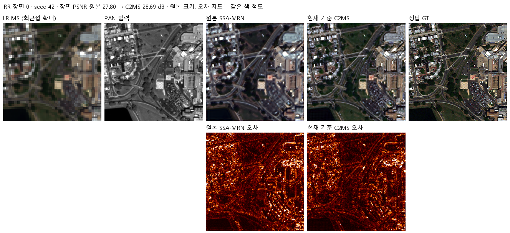

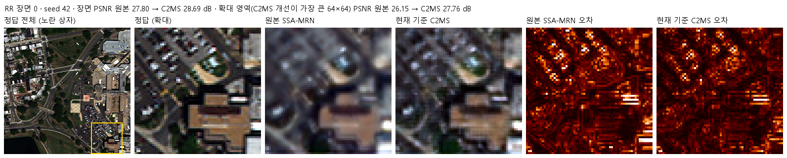

<b>WV2 나머지 5장면 펼치기</b> (1·3·7·14·17)

**장면 1**

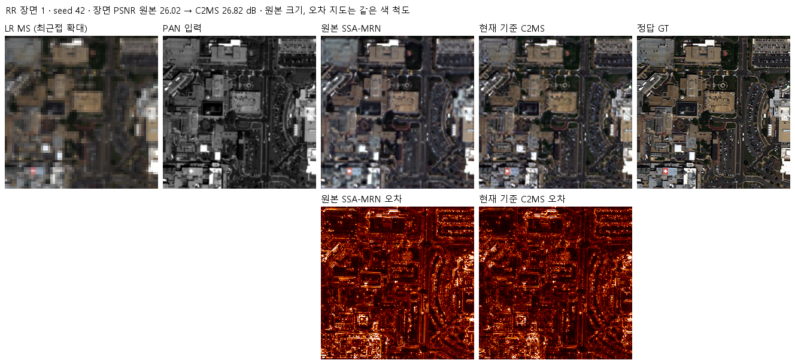

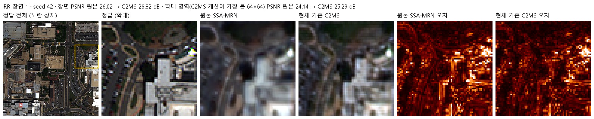

**장면 3**

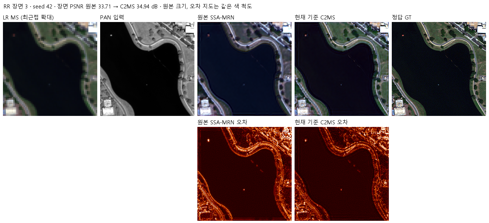

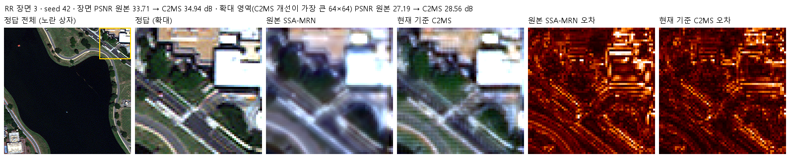

**장면 7**

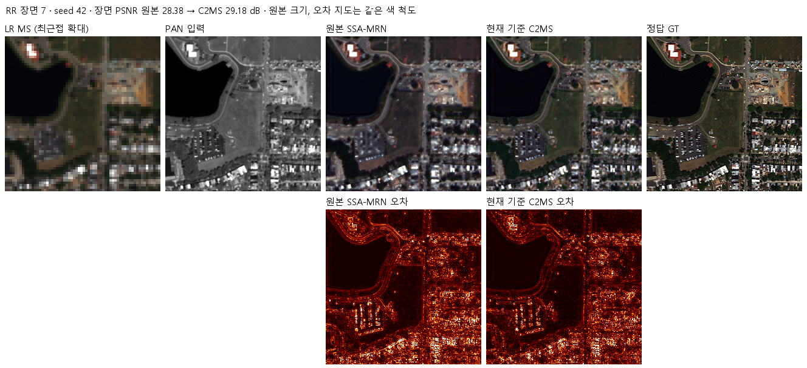

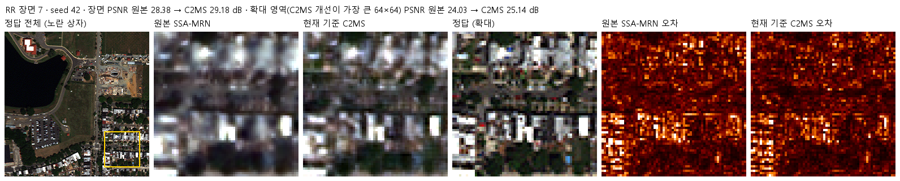

**장면 14**

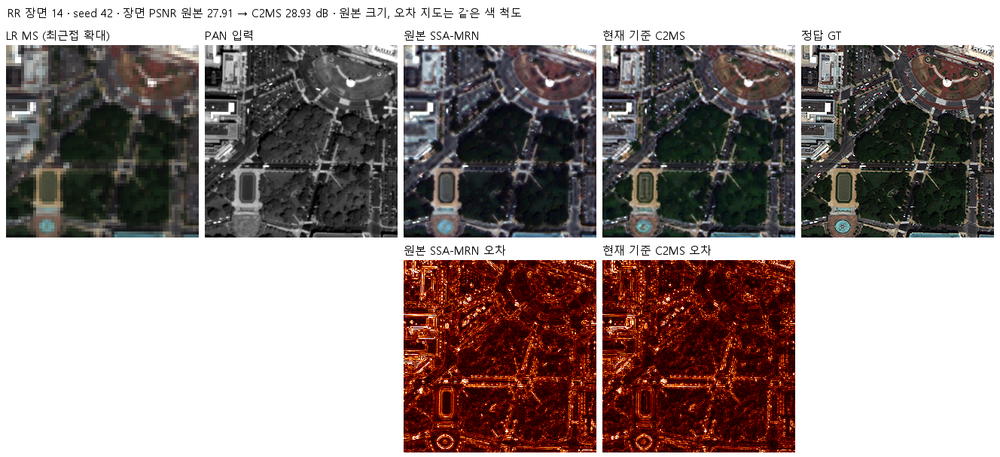

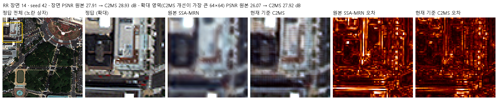

**장면 17**

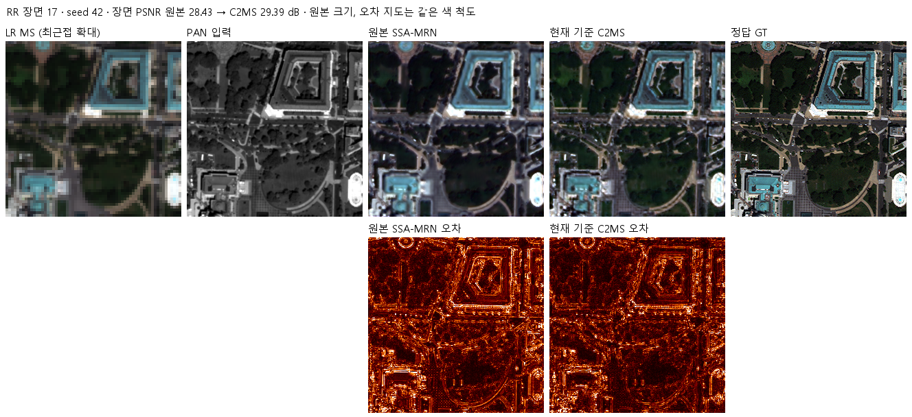

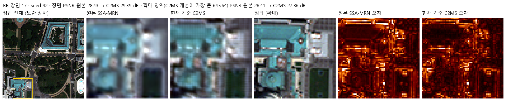

**[더 많은 이미지 보기 →](SSA-MRN/docs/c2ms_result_images.md)** QB·GF2·WV3·WV2의 6장면 전체(원본 크기·확대 비교). FR(정답 없음)·RR2 비교 패널과 이전 기준 모델 F1과의 비교는 [성능 53번 보고서](SSA-MRN/experiments/performance/53_scale_mixed_training/README.md)에 있습니다.

## 원본 대비 개선

test 20장, 같은 시드(42·43·44) 원본과 짝지은 3시드 평균 차이입니다.

[데이터셋·시드별 전체 평가 수치 보기 →](SSA-MRN/docs/c2ms_evaluation_tables.md) 성능 53·54번의 원본·C2MS 절대 수치와 시드별 차이, 3시드 평균을 정리했습니다.

| 데이터셋 | RR PSNR | RR SAM | RR ERGAS | FR_WALD PSNR | RR2 PSNR | FR 관측 오차 | 판정 |
|---|---:|---:|---:|---:|---:|---:|:---:|
| QB ([성능 53번](SSA-MRN/experiments/performance/53_scale_mixed_training/README.md)) | +0.873 dB | −0.365° | −0.413 | +1.635 dB | +1.125 dB | 0.63배 | 개선 |
| GF2 ([성능 54번](SSA-MRN/experiments/performance/54_multi_sensor_scale_mixed_training/README.md)) | +2.045 dB | −0.163° | −0.188 | +2.423 dB | +2.271 dB | 0.59배 | 개선 |
| WV3 ([성능 54번](SSA-MRN/experiments/performance/54_multi_sensor_scale_mixed_training/README.md)) | +1.007 dB | −0.419° | −0.313 | +0.966 dB | +4.606 dB | 0.68배 | 개선 |
| WV2 전이 ([성능 54번](SSA-MRN/experiments/performance/54_multi_sensor_scale_mixed_training/README.md)) | +0.828 dB | −0.399° | −0.426 | +0.764 dB | +1.131 dB | 0.57배 | 개선 |

네 데이터셋 모두 판정 기준 v2.3의 모든 항목을 통과했고, RR PSNR은 각각 20장 모두에서 원본보다 높았습니다. WV2는 WV3로 학습한 모델을 학습하지 않은 센서에 그대로 적용한 결과입니다. 학습에 2배 거친 쌍을 넣어 RR2(더 거친 시험)는 처음 보는 축척이 아니며, FR(원래 해상도) 방향의 일반화는 직접 확인하지 못했습니다.

## 다른 팬샤프닝 모델과 비교 (QB RR test 20장)

C2MS는 성능 53번 3시드 가중치를 공식 DLPan MATLAB 코드로 재평가한 [값](SSA-MRN/docs/c2ms_matlab_evaluation_tables.md)입니다(PSNR은 밴드 평균 정의). 다른 모델은 각 논문이 보고한 값이며, PSNR을 보고한 QB 결과를 PSNR 순으로 정렬했습니다.

| 모델 | PSNR ↑ | SAM ↓ | ERGAS ↓ | Q4 ↑ | 출처 |
|---|---:|---:|---:|---:|---|
| SRINO | 38.864 | 4.351 | 3.542 | 0.940 | [SRINO 보충자료](https://openaccess.thecvf.com/content/CVPR2026/supplemental/Huang_Spatial-Spectral_Residuals_Informed_CVPR_2026_supplemental.pdf) |
| ABFNet | 38.830 | 4.060 | 3.410 | — | [ABFNet](https://proceedings.mlr.press/v306/wang26hx.html) |
| SSO-PGA | 38.807 | 4.312 | 3.493 | 0.938 | [SSO-PGA](https://arxiv.org/html/2510.23362v1) |
| LFormer | 38.674 | 4.382 | 3.616 | 0.939 | [SRINO 보충자료](https://openaccess.thecvf.com/content/CVPR2026/supplemental/Huang_Spatial-Spectral_Residuals_Informed_CVPR_2026_supplemental.pdf) |
| MSFFusion | 38.653 | 4.419 | 3.568 | — | [MSFFusion](https://www.mdpi.com/2072-4292/18/18/3236) |
| PanDiff | 38.538 | 4.524 | 3.688 | 0.937 | [SRINO 보충자료](https://openaccess.thecvf.com/content/CVPR2026/supplemental/Huang_Spatial-Spectral_Residuals_Informed_CVPR_2026_supplemental.pdf) |
| S2WMamba | 38.533 | 4.445 | 3.679 | 0.938 | [S2WMamba](https://arxiv.org/html/2512.06330v1) |
| DCPNet | 38.531 | 4.426 | 3.622 | — | [MSFFusion](https://www.mdpi.com/2072-4292/18/18/3236) |
| OTPNet | 38.521 | 4.415 | 3.624 | — | [OTPNet](https://ojs.aaai.org/index.php/AAAI/article/download/33048/35203) |
| U2Net + PAKAN | 38.520 | 4.439 | 3.698 | 0.939 | [PAKAN](https://arxiv.org/html/2603.15109v1) |
| SSMNet | 38.506 | 4.423 | 3.635 | — | [MSFFusion](https://www.mdpi.com/2072-4292/18/18/3236) |
| CANNet | 38.488 | 4.496 | 3.698 | 0.937 | [S2WMamba](https://arxiv.org/html/2512.06330v1) |
| ADWM | 38.466 | 4.450 | 3.705 | 0.937 | [ADWM](https://arxiv.org/html/2503.13214v1) |
| DCINN | 38.430 | 4.220 | 3.570 | — | [ABFNet](https://proceedings.mlr.press/v306/wang26hx.html) |
| **C2MS (현재 기준, 3시드 평균)** | **38.302** | **4.576** | **3.712** | **0.934** | [MATLAB 재평가](SSA-MRN/docs/c2ms_matlab_evaluation_tables.md) |
| HFIN | 38.247 | 4.542 | 3.813 | 0.934 | [SRINO 보충자료](https://openaccess.thecvf.com/content/CVPR2026/supplemental/Huang_Spatial-Spectral_Residuals_Informed_CVPR_2026_supplemental.pdf) |
| HOIF | 38.242 | 4.521 | 3.825 | 0.933 | [SRINO 보충자료](https://openaccess.thecvf.com/content/CVPR2026/supplemental/Huang_Spatial-Spectral_Residuals_Informed_CVPR_2026_supplemental.pdf) |
| ProtoFormer | 38.238 | 4.568 | 3.768 | — | [MSFFusion](https://www.mdpi.com/2072-4292/18/18/3236) |
| LAGNet | 38.209 | 4.534 | 3.812 | 0.934 | [ADWM](https://arxiv.org/html/2503.13214v1) |
| U2Net | 38.065 | 4.642 | 3.987 | 0.931 | [S2WMamba](https://arxiv.org/html/2512.06330v1) |
| PanDiM | 38.012 | 4.344 | 3.594 | 0.939 | [PanDiM](https://www.mdpi.com/2072-4292/18/14/2299) |
| FusionMamba | 37.986 | 4.610 | 4.054 | 0.930 | [S2WMamba](https://arxiv.org/html/2512.06330v1) |
| SSA-MRN 원 논문 | 37.665 | 4.848 | 4.073 | 0.924 | [SSA-MRN](https://ieeexplore.ieee.org/abstract/document/10902025) |
| FusionNet | 37.540 | 4.904 | 4.156 | 0.925 | [ADWM](https://arxiv.org/html/2503.13214v1) |
| 원본 SSA-MRN (우리 재현, 3시드 평균) | 37.429 | 4.941 | 4.124 | 0.923 | [MATLAB 재평가](SSA-MRN/docs/c2ms_matlab_evaluation_tables.md) |
| PNN | 36.942 | 5.181 | 4.468 | 0.918 | [ADWM](https://arxiv.org/html/2503.13214v1) |
| MTF-GLP-FS (고전 방법) | 32.709 | 7.792 | 7.373 | 0.835 | [ADWM](https://arxiv.org/html/2503.13214v1) |

비교 출처와 주의점

- 다른 모델의 값은 출처 열의 논문이 보고한 값입니다. 비교군으로 다시 학습·보고된 값(예: LFormer·PanDiff·HFIN·HOIF는 SRINO 보충자료, LAGNet·FusionNet·PNN은 ADWM)도 포함하므로, 같은 모델이 논문마다 다른 값으로 보고될 수 있습니다.
- 논문마다 데이터 분할·정규화·PSNR 구현·학습 예산이 다를 수 있어 같은 조건의 공인 순위가 아닙니다. 순위는 참고로만 봅니다.
- PSNR을 보고하지 않은 방법(CC-Pan SAM 4.198, HMPNet SAM 4.617 등)은 표에서 제외했습니다. PSNR 37.99 dB 미만에서는 SSA-MRN 원 논문과 대표 비교군(FusionNet·PNN·MTF-GLP-FS)만 남겼습니다. —는 해당 논문이 Q4를 보고하지 않았다는 뜻입니다.
- 우리 값은 3시드 평균이고, 다른 논문은 대부분 1회 학습 값입니다. 같은 20장 test를 여러 실험에서 반복해 썼습니다.

## 다른 실험

실험 표와 각 실험 보고서는 연구 페이지에 있습니다(최근 실험부터).

- [성능 개선](SSA-MRN/research/performance/README.md) · 진행 중

종료된 연구

- [SSAI 개선](SSA-MRN/research/ssai/README.md) · 2026-10-16 1-12번 정리 후 종료
- [가변 배율 확장](SSA-MRN/research/variable_scale/README.md) · 2026-10-27 실용성이 낮아 종료

### 판정 기준 ([v2.3](SSA-MRN/docs/judgement_criteria.md))

실험 표의 개선 여부는 같은 조건 대조군과 정답이 있는 시험으로만 판정합니다.

| 판정 | 조건 |
|---|---|
| **개선** | 주 판정과 보조 판정 3개를 모두 통과 |
| **부분 개선** | 주 판정만 통과, RR 지표 일부만 개선, 또는 모든 항목을 통과했지만 PSNR 이득이 잡음 문턱 미만 |
| **개선 없음** | RR PSNR·SAM·ERGAS 모두 개선 없음 |
| **판단 보류** | 최종 평가 또는 보조 판정 자료가 부족 |
| 비교 기준·성능 비교 아님 | 판정 대상 아님(기준선, 학습 없는 사전 검증·분석) |

| 구분 | 시험 | 통과 조건 |
|---|---|---|
| 주 판정 | RR test 20장 | PSNR·SAM·ERGAS 모두 개선, PSNR 이득 ≥ 잡음 문턱(단일 시드 0.06 dB, 2시드 이상 0.04 dB) |
| 보조 1 | RR2: RR 입력을 한 번 더 1/4 축소 | ΔPSNR ≥ −0.05 dB, ΔSAM ≤ +0.06°. QB는 57번 재학습 C2MS seed 42의 RR2를 고정 대조값으로 사용([2026-10-27 결정](SSA-MRN/docs/judgement_criteria.md#qb-rr2-고정-대조값-2026-10-27)) |
| 보조 2 | FR_WALD: 원래 해상도를 1/4 축소, 실제 MS가 정답 | ΔPSNR ≥ −0.07 dB, ΔSAM ≤ +0.04° |
| 보조 3 | FR 관측 일치: 출력을 관측 연산으로 줄인 값과 입력 MS의 차이 | 관측 RMSE 비율 ≤ 1.10 |

판정 세부 규칙

- 여러 시드는 같은 조건 대조군과 짝지은 전체 시드의 평균으로 판정하고, 시드 수와 시드별 결과를 함께 보고합니다. 단일 시드도 모든 항목을 통과하면 개선으로 표기합니다.
- FR QNR·Dλ·Ds는 [정답 순위 검사](SSA-MRN/experiments/performance/46_fr_spatial_index_validity/README.md)를 통과하지 못해 참고로만 보고합니다.
- 47번 이전 실험은 [성능 47번 재평가](SSA-MRN/experiments/performance/47_ground_truth_criteria_reevaluation/README.md)의 보존된 측정값을 v2.3으로 다시 집계한 판정을 표에 씁니다. 원래 v2 판정은 47번 보고서에 보존합니다.
- 현재 표의 판정 범위는 QB이며 다른 센서·배율로 확대하지 않습니다.
- 개선 표기와 기준 모델 교체는 구분합니다. 기준 모델 교체에는 3시드 이상의 개선과 FR·RR2 비교 이미지 확인이 필요합니다.

