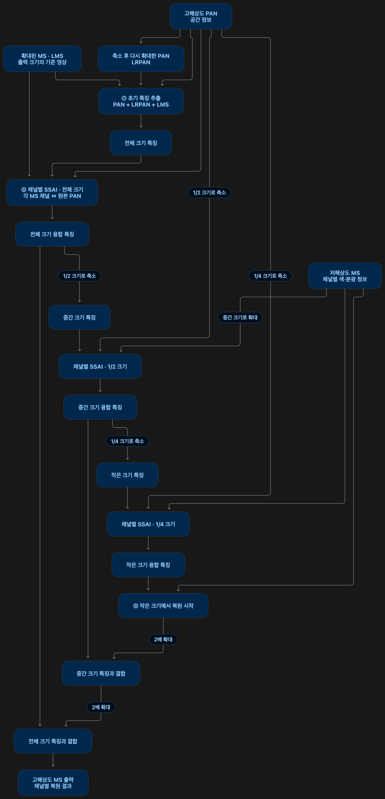
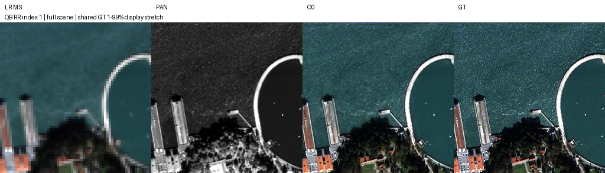
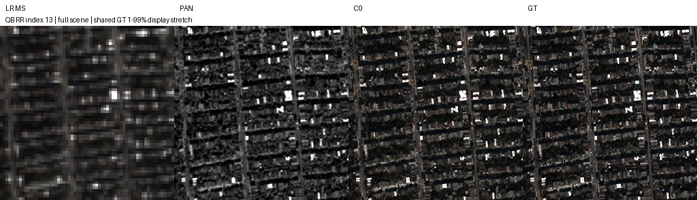

# CtrS · SSA-MRN 성능 개선 연구

## 연구 소개

고해상도 흑백 위성영상 **PAN**의 공간 정보와 저해상도 다중분광영상 **MS**의 색·분광 정보를 결합해 고해상도 MS를 복원하는 팬샤프닝 연구입니다. SSA-MRN을 재현하고 구조·손실·데이터 증강을 바꿔 복원 성능을 개선합니다.

## 팀원

| 이름 | GitHub | 전공 | 역할 |
|---|---|---|---|
| 이병현 | [BIYONGHIYON](https://github.com/BIYONGHIYON) | 멀티미디어공학과 | 팀장 |
| 김경찬 | [erickks2y-jpg](https://github.com/erickks2y-jpg) | 멀티미디어공학과 | 팀원 |
| 송준현 | [choco-ssalbbang](https://github.com/choco-ssalbbang) | 멀티미디어공학과 | 팀원 |
| 김윤지 | [kimrose1015-max](https://github.com/kimrose1015-max) | 데이터사이언스전공 | 팀원 |

## 현재 연구 기준

기준 모델은 **원본 SSA-MRN, 내부 특징 차원 K=4, 기본 MSE 손실**입니다. 동일 환경의 세 센서 validation 비교에서 다수결로 선택했습니다. 모든 센서에서 우세하다는 뜻은 아닙니다.

## SSA-MRN 구조

PAN·축소 후 재확대한 PAN(LRPAN)·확대한 MS(LMS)에서 특징을 추출합니다. 전체·절반·1/4 크기에서 밴드별 SSAI로 융합하고, 작은 크기부터 복원하며 이전 크기의 특징을 결합합니다. 아래는 **원본 SSA-MRN의 단일 복원 구조**입니다.

## 기준 모델 결과 이미지

**원본 SSA-MRN(K=4)의 단일 복원 결과**입니다. 아래 5개는 같은 실험의 QB 고정 장면으로, 왼쪽부터 **LR MS · PAN · 예측 · 정답**입니다. MS 표시에는 확대·대비 조정을 적용했으며, 수치 평가는 원래 값으로 수행했습니다.

### 장면 1

### 장면 8

### 장면 11

### 장면 13

### 장면 19

## 다른 실험

RR은 정답이 있는 축소 해상도 평가, FR은 고해상도 정답이 없는 원래 해상도 평가입니다. 수치 차이는 각 실험의 대조군 대비이며, 서로 다른 조건의 실험끼리 순위를 매기지 않습니다.

실험은 **오래된 순서부터 최근 순서**로 정렬했습니다. 같은 날의 기록은 보고서에 확인된 완료·보관 순서를 따릅니다.

| 실험 | 변경한 내용 | 확인된 결과 | 상⁠태 | 개⁠선⁠ ⁠여⁠부 |
|---|---|---|:---:|:---:|
| [1. 공개 코드 재현](SSA-MRN/experiments/1_public_code_reproduction/README.md) | 공개 코드 설정을 재현해 초기 기준을 확보했습니다. | RR·FR 재현 결과 확보; 구조 개선 실험이 아님 | 평⁠가⁠ ⁠완⁠료 | 비⁠교⁠ ⁠기⁠준 |
| [2. 논문 설정 재현](SSA-MRN/experiments/2_paper_setting_reproduction/README.md) | 논문의 내부 특징 차원 설정으로 재현했습니다. | RR·FR 재현 결과 확보; 공개 코드 재현과 장치 조건이 다름 | 평⁠가⁠ ⁠완⁠료 | 비⁠교⁠ ⁠기⁠준 |
| [3. MS 관측 연산자 구현](SSA-MRN/experiments/3_ms_observation/README.md) | 센서 MTF·샘플링 위상·경계 처리를 구성했습니다. | 관측 구현 대응 확인; 학습 성능 비교가 아님 | 사⁠전⁠ ⁠검⁠증⁠ ⁠완⁠료 | 성⁠능⁠ ⁠비⁠교⁠ ⁠아⁠님 |
| [4. 23탭 확대·저해상도 보정·고주파 경로](SSA-MRN/experiments/4_interpolation_correction_detail/README.md) | 확대 연산, 출력 보정, PAN 고주파 경로를 개별 변경했습니다. | 23탭: PSNR +0.0557 dB, SAM −0.0429°, 잠정 QNR +0.0031; 다른 후보 이득 혼재 | 평⁠가⁠ ⁠완⁠료 | 부⁠분⁠ ⁠개⁠선 |
| [5. 23탭 확대 위치와 센서 확장](SSA-MRN/experiments/5_interpolation_scope_sensors/README.md) | 23탭 적용 위치를 분리하고 시드·센서를 확장했습니다. | RR 이득이 있으나 FR·센서별 결과가 엇갈림 | 평⁠가⁠ ⁠완⁠료 | 부⁠분⁠ ⁠개⁠선 |
| [6. 23탭 확대의 반복 시드 비교](SSA-MRN/experiments/6_interpolation_seed_repeat/README.md) | 전체 확대 및 입력 확대 후보를 추가 시드로 반복했습니다. | 전체 확대의 GF2 PSNR·QNR 개선 반복; SAM 및 QB QNR 혼재 | 평⁠가⁠ ⁠완⁠료 | 부⁠분⁠ ⁠개⁠선 |
| [7. 밴드별 게이트 고주파 주입](SSA-MRN/experiments/7_band_gated_detail/README.md) | 밴드별 게이트로 PAN 고주파 주입량을 조절했습니다. | RR 악화로 후보 채택 보류 | 평⁠가⁠ ⁠완⁠료 | 개⁠선⁠ ⁠없⁠음 |
| [8. MTF 변화량 데이터 증강](SSA-MRN/experiments/8_mtf_augmentation/README.md) | 센서 열화 특성의 변화량을 학습 데이터에 추가했습니다. | MTF: PSNR -0.0064 dB, SAM -0.0061°; 잠정 QNR -0.0014 | 평가⁠ ⁠완료 | 부분⁠ ⁠개선 |
| [9. SSAI 내부 융합 연산 변경](SSA-MRN/experiments/9_ssai_fusion/README.md) | SSAI 핵심 융합 연산을 네 구조로 비교했습니다. | A1: SAM -0.0058°, 잠정 QNR +0.0127; 모든 후보의 PSNR은 하락 | 평가⁠ ⁠완료 | 부분⁠ ⁠개선 |
| [10. 반복 복원에 MS 관측 오차 전달](SSA-MRN/experiments/10_recurrent_observation/README.md) | 반복 단계에 입력 MS와 관측한 출력의 차이를 전달했습니다. | PSNR +0.1158 dB, SAM −0.0183°, 잠정 QNR −0.0182 | 평⁠가⁠ ⁠완⁠료 | 부⁠분⁠ ⁠개⁠선 |
| [11. Haar 대역별 단계 복원과 게이트](SSA-MRN/experiments/11_haar_reconstruction/README.md) | Haar 대역별 복원에 밴드·방향·위치 게이트를 적용했습니다. | 원본 대비 RR 큰 폭 악화; 학습 게이트의 추가 이득도 없음 | 평⁠가⁠ ⁠완⁠료 | 개⁠선⁠ ⁠없⁠음 |
| [12. SSAI 내부 특징 차원 비교](SSA-MRN/experiments/12_feature_dimension/README.md) | 같은 환경에서 내부 특징 차원 4와 6을 비교했습니다. | K4: 세 센서 RR PSNR·SAM 우세; WV3 잠정 QNR은 K6 우세 | 평가⁠ ⁠완료 | 비교⁠ ⁠기준 |
| [13. 반복 복원·관측 오차 전달의 재개 학습](SSA-MRN/experiments/13_recurrent_observation_resume/README.md) | 반복 복원과 관측 오차 후보를 재개해 기준선과 비교했습니다. | 기준선 대비 RR 개선·잠정 QNR 하락; 별도 세션 비교 | 평⁠가⁠ ⁠완⁠료 | 부⁠분⁠ ⁠개⁠선 |
| [14. 분광·관측 일치·경계 손실 추가](SSA-MRN/experiments/14_auxiliary_losses/README.md) | 기본 MSE에 보조 손실을 하나씩 추가했습니다. | edge 0.1: PSNR −0.0661 dB, SAM −0.0119°, 잠정 QNR +0.0098 | 평⁠가⁠ ⁠완⁠료 | 부⁠분⁠ ⁠개⁠선 |
| [15. 단일 복원과 3단계 공유 복원](SSA-MRN/experiments/15_shared_reconstruction/README.md) | 동일 초기값과 학습 조건에서 복원 횟수를 변경했습니다. | 반복 복원: PSNR +0.3000 dB, SAM −0.1078°, 잠정 QNR −0.0393 | 평⁠가⁠ ⁠완⁠료 | 부⁠분⁠ ⁠개⁠선 |
| [16. 반복 복원의 축소 전 저역통과 필터](SSA-MRN/experiments/16_bandlimited_downsampling/README.md) | 축소 전에 고정 Gaussian 필터를 추가했습니다. | PSNR −0.0196 dB, SAM +0.0022°, 잠정 QNR −0.0686 | 평⁠가⁠ ⁠완⁠료 | 개⁠선⁠ ⁠없⁠음 |
| [17. SSAI 단계·잔차 복원·초기 입력 변경](SSA-MRN/experiments/17_structural_ablation/README.md) | SSAI 단계, 복원 잔차, LRPAN 입력을 분리해 비교했습니다. | LRPAN 제거: PSNR +0.1297 dB, SAM −0.0704°, 잠정 QNR −0.0111 | 평⁠가⁠ ⁠완⁠료 | 부⁠분⁠ ⁠개⁠선 |
| [18. 작은 크기 특징 보존과 PAN 기여량 조절](SSA-MRN/experiments/18_coarse_feature_fusion/README.md) | 작은 특징을 병렬 전달하고 PAN 기여량을 학습했습니다. | N3: PSNR +0.1875 dB, SAM −0.0134°, 잠정 QNR −0.0147 | 평⁠가⁠ ⁠완⁠료 | 부⁠분⁠ ⁠개⁠선 |
| [19. 반복 복원과 PAN·MS 분리 경로](SSA-MRN/experiments/19_dual_stream_reconstruction/README.md) | 3단계 공유 복원과 분리 특징 경로를 비교했습니다. | C1: PSNR +0.2442 dB, SAM −0.1883°, 잠정 QNR +0.0250. 새 분리 경로 C5는 RR 악화 | 평⁠가⁠ ⁠완⁠료 | 부⁠분⁠ ⁠개⁠선 |
| [20. 반복 복원의 단계 간 특징 전달과 관측·PAN 차이](SSA-MRN/experiments/20_recurrent_guidance/README.md) | 밴드별 SSAI를 유지하며 단계 간 정보 전달을 비교했습니다. | D3: PSNR +0.0956 dB; D4·D5 관측 오차 감소; D6 잠정 QNR +0.0166, RR 악화 | 평⁠가⁠ ⁠완⁠료 | 부⁠분⁠ ⁠개⁠선 |
| [21. 특징 선택·복원 후 관측 보정·고주파 PAN 차이](SSA-MRN/experiments/21_guidance_refinement/README.md) | 공간·밴드별 특징 gate, 복원 후 관측 보정, 고주파 PAN 차이를 비교합니다. | E1: PSNR +0.3345 dB, SAM -0.2219°; E7: 잠정 QNR +0.0437, 지표별 이득 상이 | 평⁠가⁠ ⁠완⁠료 | 부⁠분⁠ ⁠개⁠선 |

**판정 기준:** 개선 = 같은 조건에서 주요 RR·FR 지표가 함께 개선, 부분 개선 = 지표·후보·센서별 결과 혼재, 개선 없음 = 평가에서 향상을 확인하지 못함, 판단 보류 = 최종 평가 부족입니다. 비교 기준·성능 비교 아님은 개선 판정 대상에서 제외합니다. 모든 FR QNR은 구현 대응 검증이 끝나지 않은 잠정 지표이며, 단일 실험의 개선은 최종 채택을 뜻하지 않습니다.
