

# CtrS · SSA-MRN 성능 개선 연구

[최종 개선 모델](#최종-개선-모델) · [결과](#결과) · [다른 모델과 비교](#compare) · [실험과 문서](#experiments) · [팀원](#팀원) · **[결과 비교 사이트](https://biyonghiyon.github.io/CtrS/)**

고해상도 흑백 위성영상 **PAN**과 저해상도 다중분광영상 **MS**를 합쳐 고해상도 MS를 복원하는 팬샤프닝 연구입니다. [SSA-MRN](https://ieeexplore.ieee.org/abstract/document/10902025)을 기반으로 성능을 개선합니다.

## 최종 개선 모델

**SMOC**는 이 연구의 최종 개선 모델로, 원본 SSA-MRN에 다섯 가지를 더한 모델입니다(구조도의 주황색).

1. **W2 병렬 가지:** 초기 특징에서 갈라지는 절반 해상도 가지. 입·출력은 2×2 합성곱입니다.
2. **데이터셋 방식 축소·확대:** 모델 안의 고정 축소·확대를 데이터를 만든 연산(센서 MTF 블러 + 솎음, 23탭 보간)으로 맞췄습니다. 학습할 파라미터는 늘지 않습니다.
3. **축척 혼합 학습:** 원래 학습 쌍과 2배 거친 학습 쌍(가중치 0.25)을 섞고, 손실은 L1 + 1.2 × 분광 손실입니다.
4. **분해 후 감쇠:** 원래 크기로 학습률 1e-4에서 120에폭 학습한 뒤, backbone과 W2의 3×3 합성곱을 가벼운 합성곱 조합으로 분해(K2)하고 30에폭 감쇠합니다. 분해하지 않은 모델과 성능은 같고 연산은 66%입니다.
5. **관측 일치 사영:** 출력을 다시 관측했을 때 입력 MS와 맞도록 추론 뒤에 고치는 단계(파라미터 없음)

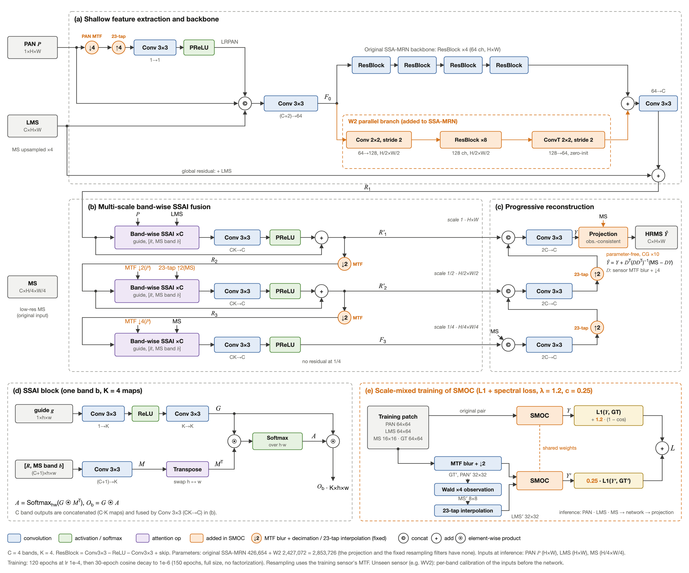

| 항목 | SMOC |
|---|---|
| 구성 | [90번](SSA-MRN/experiments/performance/90_dataset_matched_internal_resampling/README.md) `CK` 가중치 + 사영(공액 기울기법 10회) |
| 파라미터(실사용) | 1,873,210개 (분해 전 2,735,418개, 원본 426,654개) |
| 연산(256²) | 39.1 GMAC (분해 전 59.6 GMAC의 66%, 고정 축소·확대 필터 제외) |
| 근거 | 원본 대비 3시드 RR PSNR QB +0.935, GF2 +2.925, WV3 +1.571 dB, 분해 전 모델과 0.04 dB 안에서 같음, 2026-11-24 최종 확정 |

학습하지 않은 센서에 쓸 때는 입력 밴드의 밝기 비율을 학습 센서에 맞추는 **밴드별 센서 보정**([82번](SSA-MRN/experiments/performance/82_cross_sensor_band_calibration/README.md))을 함께 붙입니다. 모델 안의 MTF 축소는 학습 센서의 MTF를 그대로 씁니다.

원본 SSA-MRN 구조와 개선 과정

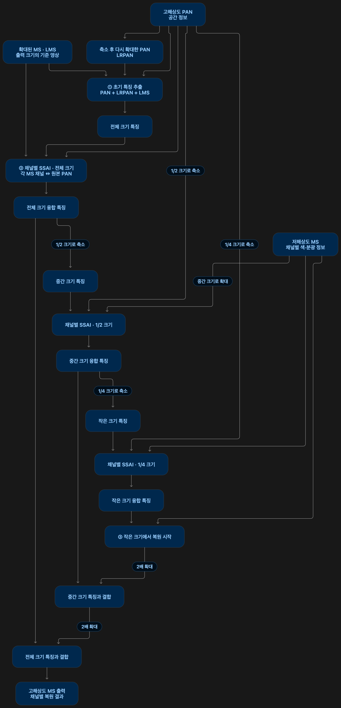

| 단계 | 실험 | 한 일 | 결과와 다음 단계로 이어진 점 |
|---:|---|---|---|
| 0 | [성능 2번](SSA-MRN/experiments/performance/2_paper_setting_reproduction/README.md) 외 | 원본 SSA-MRN 재현, K=4를 연구 기본값으로 확정(2026-10-09) | 이후 모든 비교의 출발점(원본) |
| 1 | [성능 29번](SSA-MRN/experiments/performance/29_capacity_refinement/README.md) | 원본 backbone 옆에 저해상도 병렬 가지 **W2**를 처음 붙임 | RR PSNR +0.72 dB로 큰 이득이지만 RR2(더 거친 시험)가 나빠짐 |
| 2 | [성능 43번](SSA-MRN/experiments/performance/43_normalized_parallel_capacity/README.md) | 원본+W2(**C2**)를 같은 절차로 3시드 재현 | RR +0.70 dB가 재현됐지만 축척을 바꾸면 무너지는 약점 확인 |
| 3 | [성능 50번](SSA-MRN/experiments/performance/50_w2_branch_inference_scaling/README.md) | 학습 없이 W2 출력 세기를 줄여 보는 진단 | 약점의 원인은 **축척에 따라 맞지 않는 세부 주입 세기** |
| 4 | [성능 53번](SSA-MRN/experiments/performance/53_scale_mixed_training/README.md)·[54번](SSA-MRN/experiments/performance/54_multi_sensor_scale_mixed_training/README.md) | 구조는 C2 그대로, **2배 거친 학습 쌍을 섞어** 학습(**C2MS**) | 원본 대비 RR QB +0.873, GF2 +2.045, WV3 +1.007 dB → **기준 모델 채택(2026-10-21)** |
| 5 | [성능 65번](SSA-MRN/experiments/performance/65_l1_spectral_loss/README.md) | 손실을 **L1 + 분광 손실**로 바꿔 학습 | SAM이 3시드 60/60장에서 줄었지만 원래 해상도 관측 일치가 나빠지고 WV2 전이에서 흐려짐 |
| 6 | [성능 66번](SSA-MRN/experiments/performance/66_observation_error_projection_analysis/README.md)·[81번](SSA-MRN/experiments/performance/81_l1_spectral_loss_projection/README.md) | 추론 뒤 **관측 일치 사영**을 붙이고 정식 판정(**C2MS-SP**) | 세 센서 모두 C2MS 대비 3시드 개선, 사영은 10회 반복이면 충분 → **기준 모델 채택(2026-11-14)** |
| 7 | [성능 82번](SSA-MRN/experiments/performance/82_cross_sensor_band_calibration/README.md) | 학습하지 않은 센서에 **밴드별 센서 보정** | WV2 흐림의 원인(센서 간 밴드 밝기 척도 차이)을 찾아 재학습 없이 +2 dB 회복 |
| 8 | [성능 83번](SSA-MRN/experiments/performance/83_factorized_c2ms_finetuning/README.md) | 학습된 가중치를 **분해 + 짧은 미세조정**(**C2MS-SP-Lite**) | 연산 66%로 세 센서 모두 C2MS 대비 3시드 개선, C2MS-SP와 0.01-0.03 dB 차이 |
| 9 | [성능 88번](SSA-MRN/experiments/performance/88_factorization_at_decay_start/README.md) | 학습률을 120에폭 고정한 뒤 감쇠 구간을 분해 모델로 학습(K2D) | C2MS-SP 대비 QB +0.036, GF2 +0.154, WV3 +0.310 dB(1시드) |
| 10 | [성능 89번](SSA-MRN/experiments/performance/89_spectral_coarse_loss_weights/README.md) | 분광 손실 계수 λ와 2배 거친 쌍 계수 c를 다시 찾고, W2 입·출력을 2×2 합성곱으로 | λ = 1.2, c = 0.25. 88번 대비 GF2·WV3 개선, QB 개선 없음(1시드) |
| 11 | [성능 90번](SSA-MRN/experiments/performance/90_dataset_matched_internal_resampling/README.md) | 모델 안의 bilinear 축소·확대를 데이터셋 방식(MTF 블러 + 솎음, 23탭 보간)으로 바꾸고 120에폭 뒤 분해해 30에폭 감쇠(**SMOC**) | C2MS-SP 대비 3시드 GF2 +0.690, WV3 +0.434 dB, QB −0.009 dB(부분 개선). 분해하지 않은 150에폭 모델과 0.04 dB 안에서 같고 연산 66%, 300에폭으로 늘려도 test가 좋아지지 않음 → **최종 개선 모델 확정(2026-11-24)** |

연구 중 비교 기준(기준 모델)은 원본 → F1([성능 49번](SSA-MRN/experiments/performance/49_observation_refinement_seed_repeat/README.md), 2026-10-20) → C2MS(2026-10-21) → C2MS-SP(2026-11-14) 순서로 바뀌었고, 최종 개선 모델은 SMOC(2026-11-24, 분해 전 모델은 2026-11-23)입니다. C2MS-SP 구조도는 [ssa-mrn-c2ms.png](SSA-MRN/docs/images/ssa-mrn-c2ms.png)에 남겼습니다.

## 결과

### 원본 대비 개선

test 20장, 같은 시드(42·43·44) 원본과 짝지은 3시드 평균입니다.

| 데이터셋 | 모델 | RR PSNR (dB) | SAM (°) | ERGAS | FR QNR / Dλ / Ds (참고) | 판정 |
|---|---|---:|---:|---:|:---:|:---:|
| QB | 원본 SSA-MRN | 37.429 | 4.941 | 4.124 | 0.914 / 0.044 / 0.045 | |
|  | **SMOC** | **38.364** (+0.935) | **4.497** (−0.444) | **3.692** (−0.432) | 0.887 / 0.025 / 0.090 | 개선 |
| GF2 | 원본 SSA-MRN | 46.549 | 0.953 | 0.896 | 0.907 / 0.036 / 0.059 | |
|  | **SMOC** | **49.475** (+2.925) | **0.708** (−0.245) | **0.638** (−0.257) | 0.967 / 0.020 / 0.013 | 개선 |
| WV3 | 원본 SSA-MRN | 37.536 | 3.494 | 2.571 | 0.948 / 0.018 / 0.035 | |
|  | **SMOC** | **39.107** (+1.571) | **2.864** (−0.630) | **2.127** (−0.444) | 0.938 / 0.029 / 0.034 | 개선 |
| WV2 전이 | 원본 SSA-MRN | 28.586 | 6.253 | 5.046 | 0.916 / 0.043 / 0.043 | |
|  | **SMOC** | **32.006** (+3.420) | **4.954** (−1.299) | **3.458** (−1.588) | 0.919 / 0.041 / 0.042 | 참고 |

학습한 세 데이터셋 모두 시드별로도 원본보다 높았습니다. 괄호는 원본 대비 차이입니다.

- **WV2 전이:** WV3로 학습한 모델을 학습하지 않은 센서에 적용한 참고 수치입니다. SMOC는 밴드별 센서 보정을 포함합니다.
- **FR 지표:** 정답이 없는 원래 해상도 test 20장의 3시드 평균이며 판정에 쓰지 않습니다(QNR은 높을수록, Dλ·Ds는 낮을수록 좋음). 이 지표들은 [정답을 모델 출력보다 나쁘게 채점](SSA-MRN/docs/judgement_criteria.md#fr-지표를-판정에-쓰지-않는-이유)해 참고로만 봅니다.
- **수치 원본:** RR은 [baseline_metrics.json](SSA-MRN/docs/images/smoc/baseline_metrics.json), FR은 [90번](SSA-MRN/experiments/performance/90_dataset_matched_internal_resampling/results/)(SMOC)과 [83번](SSA-MRN/experiments/performance/83_factorized_c2ms_finetuning/results/summary.json)의 원본(`C0`) 결과입니다.

### 결과 이미지 (WV2 전이, seed 42)

학습한 센서에서는 두 모델이 모두 정답에 가까워 차이가 잘 보이지 않습니다. 학습하지 않은 WV2에서는 원본이 흐려지고 색이 틀어집니다.

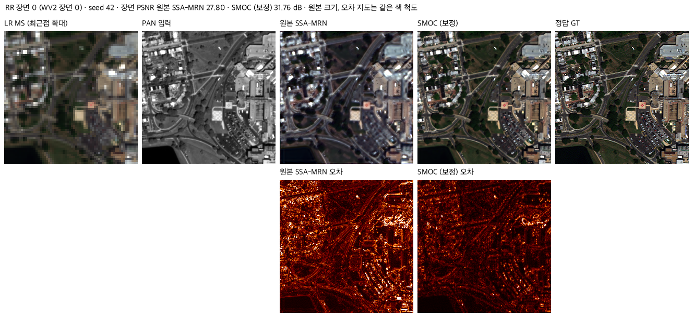

위 줄은 LR MS · PAN · 원본 · SMOC · 정답, 아래 줄은 두 모델의 오차 지도입니다(밝을수록 오차가 큼).

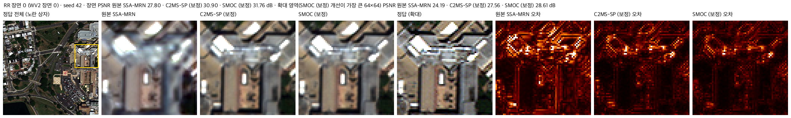

SMOC의 개선(원본 대비)이 가장 큰 64×64 영역을 4배 확대했습니다. SMOC에 유리하게 고른 영역이므로 전체 차이는 장면 PSNR로 확인합니다.

WV2 선명도·색 치우침 수치와 장면별 PSNR

| 정답 대비 (WV2 test 20장, 3시드 평균) | 원본 SSA-MRN | SMOC | 참고: SMOC, 보정 없이 |
|---|---:|---:|---:|
| RR PSNR | 28.59 dB | **32.01 dB** | 29.81 dB |
| 선명도 (출력 고주파 세기 ÷ 정답, 1이 정답) | 0.33 | **0.54** | 0.41 |
| 넣은 세부와 실제 세부의 상관 | 0.70 | **0.86** | 0.77 |
| 밴드별 평균 밝기 치우침 (가장 큰 밴드) | 7.2% | **0.1%** | 1.3% |

| 장면 | 장면 PSNR 원본 | SMOC | 확대 영역 PSNR 원본 / SMOC |
|---:|---:|---:|---|
| 0 | 27.80 | 31.76 (+3.96) | 24.19 / 28.57 |
| 1 | 26.02 | 29.95 (+3.92) | 23.00 / 28.06 |
| 3 | 33.71 | 37.22 (+3.51) | 27.19 / 31.06 |
| 7 | 28.38 | 31.90 (+3.52) | 24.03 / 27.93 |
| 14 | 27.91 | 31.51 (+3.61) | 25.65 / 30.67 |
| 17 | 28.43 | 31.74 (+3.31) | 25.77 / 29.70 |

장면은 QB에서 정답 영상만 보고 정한 고정 번호(0·1·3·7·14·17)입니다.

WV2 나머지 5장면 (1·3·7·14·17)

**장면 1**

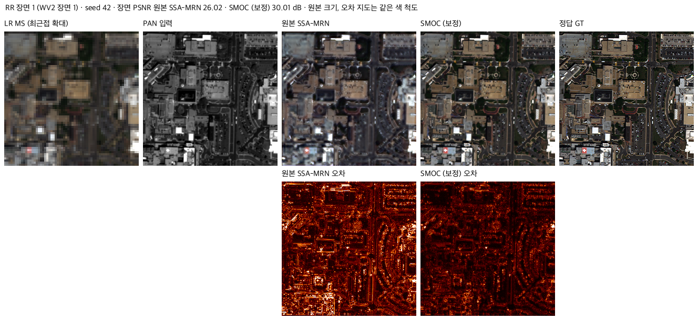

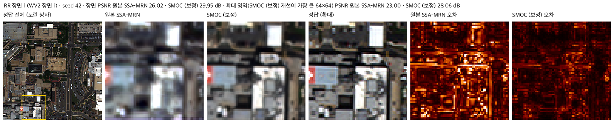

**장면 3**

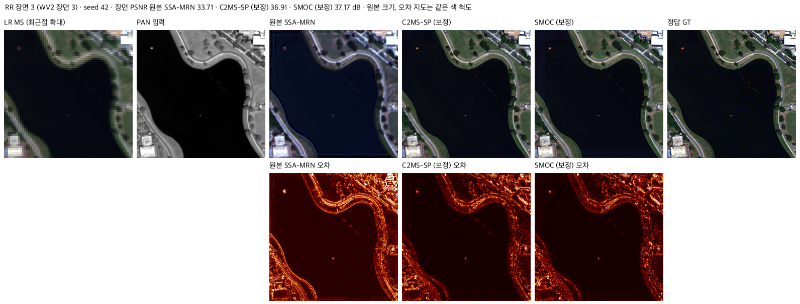

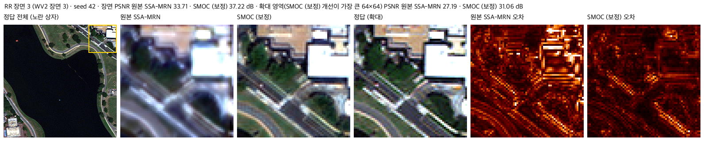

**장면 7**

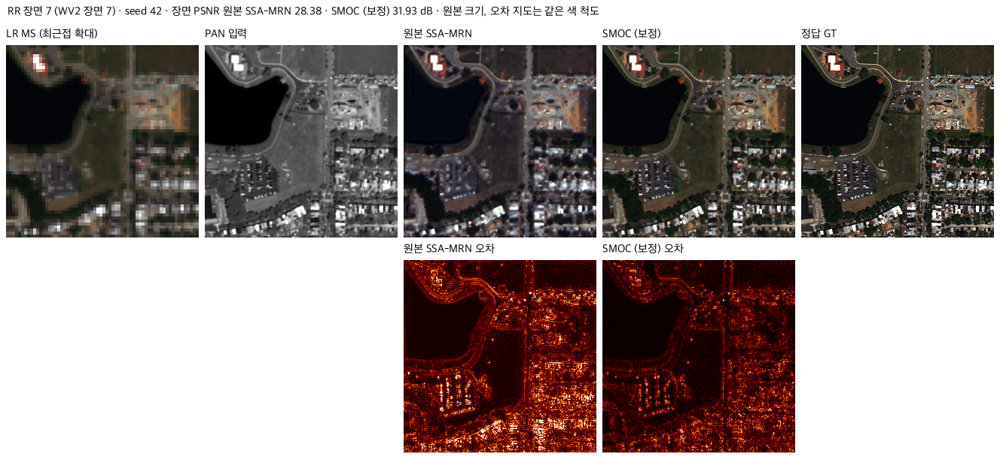

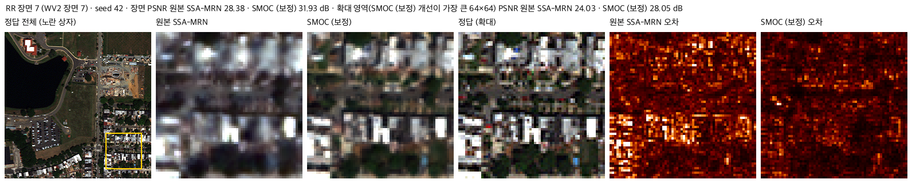

**장면 14**

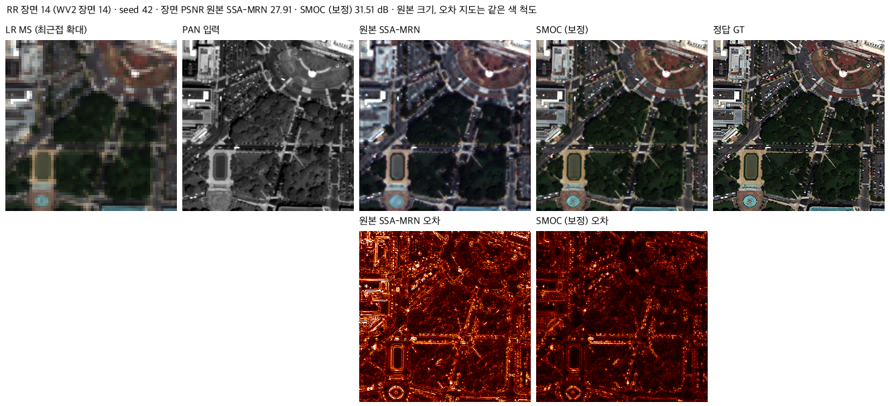

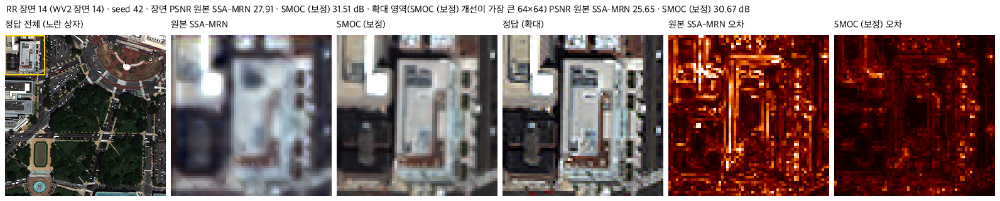

**장면 17**

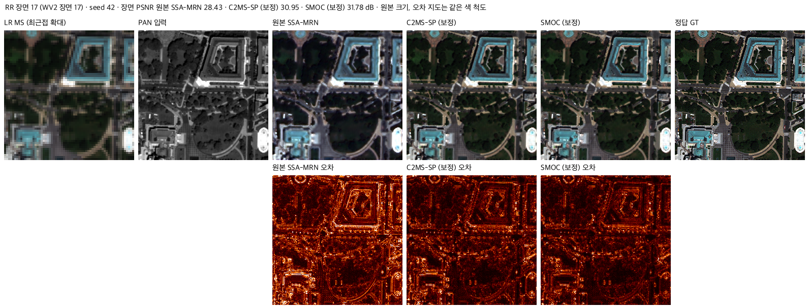

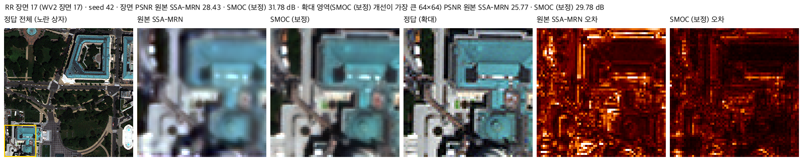

**[네 데이터셋의 6장면 전체 보기 →](SSA-MRN/docs/smoc_result_images.md)** · [결과 비교 사이트](https://biyonghiyon.github.io/CtrS/)에서 장면을 골라 확대해 볼 수 있습니다.

## 다른 팬샤프닝 모델과 비교 (QB RR test 20장)

우리 값은 3시드 평균을 저장소 평가 코드로 잰 값이고, 다른 모델은 각 논문이 보고한 값입니다. 조건이 달라 공인 순위가 아니며 참고로만 봅니다.

| 모델 | PSNR ↑ | SAM ↓ | ERGAS ↓ | Q4 ↑ | 출처 |
|---|---:|---:|---:|---:|---|
| SRINO | 38.864 | 4.351 | 3.542 | 0.940 | [SRINO 보충자료](https://openaccess.thecvf.com/content/CVPR2026/supplemental/Huang_Spatial-Spectral_Residuals_Informed_CVPR_2026_supplemental.pdf) |
| ADWM | 38.466 | 4.450 | 3.705 | 0.937 | [ADWM](https://arxiv.org/html/2503.13214v1) |
| **SMOC (최종 개선 모델, 3시드 평균)** | **38.364** | **4.497** | **3.692** | **0.935** | [Ours](SSA-MRN/docs/images/smoc/baseline_metrics.json) |
| HFIN | 38.247 | 4.542 | 3.813 | 0.934 | [SRINO 보충자료](https://openaccess.thecvf.com/content/CVPR2026/supplemental/Huang_Spatial-Spectral_Residuals_Informed_CVPR_2026_supplemental.pdf) |
| LAGNet | 38.209 | 4.534 | 3.812 | 0.934 | [ADWM](https://arxiv.org/html/2503.13214v1) |
| U2Net | 38.065 | 4.642 | 3.987 | 0.931 | [S2WMamba](https://arxiv.org/html/2512.06330v1) |
| FusionMamba | 37.986 | 4.610 | 4.054 | 0.930 | [S2WMamba](https://arxiv.org/html/2512.06330v1) |
| SSA-MRN 원 논문 | 37.665 | 4.848 | 4.073 | 0.924 | [SSA-MRN](https://ieeexplore.ieee.org/abstract/document/10902025) |
| MTF-GLP-FS (고전 방법) | 32.709 | 7.792 | 7.373 | 0.835 | [ADWM](https://arxiv.org/html/2503.13214v1) |

전체 비교 표 (PSNR 순, 32행)와 주의점

| 모델 | PSNR ↑ | SAM ↓ | ERGAS ↓ | Q4 ↑ | 출처 |
|---|---:|---:|---:|---:|---|
| SRINO | 38.864 | 4.351 | 3.542 | 0.940 | [SRINO 보충자료](https://openaccess.thecvf.com/content/CVPR2026/supplemental/Huang_Spatial-Spectral_Residuals_Informed_CVPR_2026_supplemental.pdf) |
| ABFNet | 38.830 | 4.060 | 3.410 | — | [ABFNet](https://proceedings.mlr.press/v306/wang26hx.html) |
| SSO-PGA | 38.807 | 4.312 | 3.493 | 0.938 | [SSO-PGA](https://arxiv.org/html/2510.23362v1) |
| LFormer | 38.674 | 4.382 | 3.616 | 0.939 | [SRINO 보충자료](https://openaccess.thecvf.com/content/CVPR2026/supplemental/Huang_Spatial-Spectral_Residuals_Informed_CVPR_2026_supplemental.pdf) |
| MSFFusion | 38.653 | 4.419 | 3.568 | — | [MSFFusion](https://www.mdpi.com/2072-4292/18/18/3236) |
| PanDiff | 38.538 | 4.524 | 3.688 | 0.937 | [SRINO 보충자료](https://openaccess.thecvf.com/content/CVPR2026/supplemental/Huang_Spatial-Spectral_Residuals_Informed_CVPR_2026_supplemental.pdf) |
| S2WMamba | 38.533 | 4.445 | 3.679 | 0.938 | [S2WMamba](https://arxiv.org/html/2512.06330v1) |
| DCPNet | 38.531 | 4.426 | 3.622 | — | [MSFFusion](https://www.mdpi.com/2072-4292/18/18/3236) |
| ADWM (Ours 환경 재현, QB 직접 학습 seed 42) | 38.523 | 4.471 | 3.628 | 0.936 | [MATLAB 평가](SSA-MRN/benchmarks/adwm/README.md) |
| OTPNet | 38.521 | 4.415 | 3.624 | — | [OTPNet](https://ojs.aaai.org/index.php/AAAI/article/download/33048/35203) |
| U2Net + PAKAN | 38.520 | 4.439 | 3.698 | 0.939 | [PAKAN](https://arxiv.org/html/2603.15109v1) |
| SSMNet | 38.506 | 4.423 | 3.635 | — | [MSFFusion](https://www.mdpi.com/2072-4292/18/18/3236) |
| CANNet | 38.488 | 4.496 | 3.698 | 0.937 | [S2WMamba](https://arxiv.org/html/2512.06330v1) |
| ADWM | 38.466 | 4.450 | 3.705 | 0.937 | [ADWM](https://arxiv.org/html/2503.13214v1) |
| DCINN | 38.430 | 4.220 | 3.570 | — | [ABFNet](https://proceedings.mlr.press/v306/wang26hx.html) |
| **SMOC (최종 개선 모델, 3시드 평균)** | **38.364** | **4.497** | **3.692** | **0.935** | [Ours](SSA-MRN/docs/images/smoc/baseline_metrics.json) |
| HFIN | 38.247 | 4.542 | 3.813 | 0.934 | [SRINO 보충자료](https://openaccess.thecvf.com/content/CVPR2026/supplemental/Huang_Spatial-Spectral_Residuals_Informed_CVPR_2026_supplemental.pdf) |
| HOIF | 38.242 | 4.521 | 3.825 | 0.933 | [SRINO 보충자료](https://openaccess.thecvf.com/content/CVPR2026/supplemental/Huang_Spatial-Spectral_Residuals_Informed_CVPR_2026_supplemental.pdf) |
| ProtoFormer | 38.238 | 4.568 | 3.768 | — | [MSFFusion](https://www.mdpi.com/2072-4292/18/18/3236) |
| LAGNet | 38.209 | 4.534 | 3.812 | 0.934 | [ADWM](https://arxiv.org/html/2503.13214v1) |
| U2Net | 38.065 | 4.642 | 3.987 | 0.931 | [S2WMamba](https://arxiv.org/html/2512.06330v1) |
| PanDiM | 38.012 | 4.344 | 3.594 | 0.939 | [PanDiM](https://www.mdpi.com/2072-4292/18/14/2299) |
| FusionMamba | 37.986 | 4.610 | 4.054 | 0.930 | [S2WMamba](https://arxiv.org/html/2512.06330v1) |
| ADKNet | 37.918 | 4.881 | 3.912 | — | [MSFFusion](https://www.mdpi.com/2072-4292/18/18/3236) |
| SSA-MRN 원 논문 | 37.665 | 4.848 | 4.073 | 0.924 | [SSA-MRN](https://ieeexplore.ieee.org/abstract/document/10902025) |
| FusionNet | 37.540 | 4.904 | 4.156 | 0.925 | [ADWM](https://arxiv.org/html/2503.13214v1) |
| PanMamba | 37.356 | 4.625 | 4.277 | 0.929 | [ADWM](https://arxiv.org/html/2503.13214v1) |
| TDNet | 37.170 | 4.580 | 4.150 | — | [ABFNet](https://proceedings.mlr.press/v306/wang26hx.html) |
| PNN | 36.942 | 5.181 | 4.468 | 0.918 | [ADWM](https://arxiv.org/html/2503.13214v1) |
| U2Net (Ours 환경 재학습, seed42·micro4×누적4) | 36.500 | 4.808 | 4.662 | 0.920 | [실제 MATLAB·학습법 차이](SSA-MRN/benchmarks/u2net/README.md) |
| MTF-GLP-FS (고전 방법) | 32.709 | 7.792 | 7.373 | 0.835 | [ADWM](https://arxiv.org/html/2503.13214v1) |
| FusionNet (Ours 환경 재현, 저자 QB 가중치) | 31.485 | 7.372 | 8.291 | 0.805 | [MATLAB 평가](SSA-MRN/benchmarks/fusionnet/README.md) |

- 다른 모델의 값은 출처 열의 논문이 보고한 값입니다. 비교군으로 다시 학습·보고된 값(예: LFormer·PanDiff·HFIN·HOIF는 SRINO 보충자료, LAGNet·FusionNet·PNN은 ADWM)도 포함하므로, 같은 모델이 논문마다 다른 값으로 보고될 수 있습니다.
- 논문마다 데이터 분할·정규화·PSNR 구현·학습 예산이 다를 수 있어 같은 조건의 공인 순위가 아닙니다. 순위는 참고로만 봅니다.
- PSNR을 보고하지 않은 방법(CC-Pan SAM 4.198, HMPNet SAM 4.617 등)은 표에서 제외했습니다. 조사표에서 대표 모델을 추려 실었으며 전체 모델 목록은 아래 논문 보고값 조사에 있습니다. —는 해당 논문이 Q4를 보고하지 않았다는 뜻입니다.
- 우리 값은 3시드 평균이고, 다른 논문은 대부분 1회 학습 값입니다. 같은 20장 test를 여러 실험에서 반복해 썼습니다.

- [논문 보고값 조사](SSA-MRN/docs/pansharpening_survey/QB_GF_WV2_WV3_팬샤프닝_성능조사_2026-10-27.md): 센서·학습 경로별 정리 ([QB 원표](SSA-MRN/docs/pansharpening_survey/QB_팬샤프닝_성능조사_2026-10-27.md))
- [다른 팬샤프닝 모델 평가](SSA-MRN/benchmarks/README.md): 다른 모델을 우리 환경에서 직접 학습·평가한 결과. 실제 MATLAB 평가와 결과 보관이 끝나면 위 표에 `모델 (Ours 환경 재현)` 행으로 넣습니다(RGB 3밴드 생성형 모델은 별도 보고).

## 실험과 문서

| 문서 | 내용 |
|---|---|
| [성능 개선 실험](SSA-MRN/experiments/performance/README.md) | 진행 중인 연구의 실험 표와 보고서 |
| [SSAI 개선](SSA-MRN/experiments/ssai/README.md) · [가변 배율 확장](SSA-MRN/experiments/variable_scale/README.md) | 종료된 연구의 기록 |
| [판정 기준 v2.4](SSA-MRN/docs/judgement_criteria.md) | 같은 조건 대조군과 짝지은 RR test의 PSNR·SAM·ERGAS로 개선 여부를 판정 |
| [연구 설명](SSA-MRN/docs/research.md) | 팬샤프닝, SSA-MRN 처리 흐름, 지표 |
| [실행 안내](SSA-MRN/README.md) | 폴더 구조, 환경, 평가·검증 명령 |
| [작업 규칙](AGENTS.md) | Git, 실험 등록, 문서 작성, 보관 규칙 |

## 팀원

| 이름 | GitHub | 전공 | 역할 |
|---|---|---|---|
| 이병현 | [BIYONGHIYON](https://github.com/BIYONGHIYON) | 멀티미디어공학과 | 팀장 |
| 김경찬 | [erickks2y-jpg](https://github.com/erickks2y-jpg) | 멀티미디어공학과 | 팀원 |
| 송준현 | [choco-ssalbbang](https://github.com/choco-ssalbbang) | 멀티미디어공학과 | 팀원 |
| 김윤지 | [kimrose1015-max](https://github.com/kimrose1015-max) | 데이터사이언스전공 | 팀원 |
