

# CtrS · SSA-MRN 성능 개선 연구

## 연구 소개

고해상도 흑백 위성영상 **PAN**의 공간 정보와 저해상도 다중분광영상 **MS**의 색·분광 정보를 결합해 고해상도 MS를 복원하는 팬샤프닝 연구입니다. SSA-MRN을 기반으로 SSAI 개선, 가변 배율 확장, 기존 성능 개선을 나누어 연구합니다.

## 팀원

| 이름 | GitHub | 전공 | 역할 |
|---|---|---|---|
| 이병현 | [BIYONGHIYON](https://github.com/BIYONGHIYON) | 멀티미디어공학과 | 팀장 |
| 김경찬 | [erickks2y-jpg](https://github.com/erickks2y-jpg) | 멀티미디어공학과 | 팀원 |
| 송준현 | [choco-ssalbbang](https://github.com/choco-ssalbbang) | 멀티미디어공학과 | 팀원 |
| 김윤지 | [kimrose1015-max](https://github.com/kimrose1015-max) | 데이터사이언스전공 | 팀원 |

## 연구 분담

연구 분야를 선택하면 해당 분야의 목적과 실험 표를 바로 확인할 수 있습니다. SSAI 개선은 1-12번 결과를 정리했으며 신규 실험은 계획하지 않습니다. 이병현은 기존 성능 개선 연구로 이동했습니다. 가변 배율 확장은2·3·4배 학습과 RR 평가를 마쳤으며 FR·장면 출처 검증이 남았습니다.

| 연구 | 담당 | 목표 | 현재 단계 |
|---|---|---|---|
| [SSAI 개선](SSA-MRN/research/ssai/README.md) | 이병현 | 밴드별 공간·분광 특징을 결합하는 SSAI의 연산과 구조를 개선합니다. | SSAI 1-12 평가·정리 완료 · 신규 실험 없음 |
| [가변 배율 확장](SSA-MRN/research/variable_scale/README.md) | 김윤지 | 기존 고정 4배 복원을 여러 배율에서 동작하도록 확장합니다. | 학습 완료·일부 평가 |
| [기존 성능 개선](SSA-MRN/research/performance/README.md) | 김경찬·송준현·이병현 | 기존 연구의 구조·학습·손실 변경을 이어서 비교합니다. | 기존 결과 보유 · 후속 연구 계속 |

## SSA-MRN 구조

PAN·축소 후 재확대한 PAN(LRPAN)·확대한 MS(LMS)에서 특징을 추출합니다. 전체·절반·1/4 크기에서 밴드별 SSAI로 융합하고, 작은 크기부터 복원하며 이전 크기의 특징을 결합합니다. 현재 기준 모델 **C2MS**는 이 원본 구조를 그대로 두고, 초기 특징에서 갈라지는 **W2 병렬 가지**를 더했습니다(성능 43번 C2와 같은 구조). 그리고 원래 학습 쌍에 같은 패치로 만든 **2배 거친 학습 쌍을 섞어** 학습했습니다(축척 혼합 학습). 추론할 때는 원본과 같은 입력을 그대로 넣습니다.

<table>
<tr><th>원본 SSA-MRN</th><th>C2MS = 원본 SSA-MRN + W2 병렬 가지, 축척 혼합 학습 (현재 기준 모델)</th></tr>
<tr>
<td align="center"></td>
<td align="center">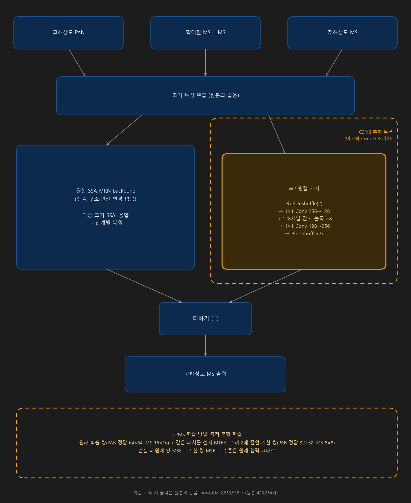</td>
</tr>
</table>

## 기준 모델

기준 모델은 **C2MS**입니다. 원본 SSA-MRN(내부 특징 차원 K=4, MSE 손실)에 W2 병렬 가지를 더하고, 원래 학습 쌍과 2배 거친 학습 쌍의 MSE를 함께 줄이도록 학습했습니다. 파라미터는 2,853,918개입니다(원본 426,654개). 2026-10-21 [성능 53번](SSA-MRN/experiments/performance/53_scale_mixed_training/README.md)의 QB 3시드(42·43·44) 결과로 채택했습니다. 이전 기준 모델 F1(2026-10-20 채택) 대비로도 3시드 평균 RR PSNR +0.679 dB로 세 시드 모두 개선이었습니다.

| 원본 대비 (3시드 평균) | RR PSNR | RR SAM | RR ERGAS | FR_WALD PSNR | RR2 PSNR | FR 관측 오차 |
|---|---:|---:|---:|---:|---:|---:|
| C2MS − 원본 | +0.873 dB | -0.365° | -0.413 | +1.635 dB | +1.125 dB | 0.63배 |

판정 기준 v2.3의 모든 항목을 통과했고, RR PSNR은 20장 모두에서 원본보다 높았습니다(세 시드 평균 기준). 채택 근거는 QB 결과이며 다른 센서에서는 확인하지 않았습니다. 학습에 2배 거친 쌍을 넣었기 때문에 더 거친 시험(RR2)은 처음 보는 축척이 아니며, 원래 해상도(FR)보다 세밀한 방향의 일반화는 직접 확인하지 못했습니다. 원본 SSA-MRN(K=4)은 비교 기준으로 보존하며, 이전 실험의 대조군과 판정은 그대로입니다.

## 기준 모델 결과 이미지

**C2MS와 원본 SSA-MRN의 결과(seed 42)**입니다. QB RR test에서 정답 영상만 보고 풍경 종류로 고른 6장면을 씁니다. RGB 밴드 [2,1,0], 장면별 정답 1-99% 공통 대비로 표시했으며 수치 평가는 원래 값으로 수행했습니다.

| 장면 | 풍경 | 장면 PSNR 원본 → C2MS | 확대 영역 PSNR 원본 → C2MS |
|---:|---|---|---|
| 0 | 바다·항구 방파제 | 41.45 → 42.81 dB (+1.36) | 35.30 → 37.38 dB |
| 1 | 부두·곡선 방파제·수목 | 42.44 → 43.18 dB (+0.74) | 39.45 → 40.76 dB |
| 3 | 요트 마리나·운동장 | 36.22 → 37.96 dB (+1.74) | 33.03 → 35.36 dB |
| 7 | 숲 공원 | 38.83 → 39.41 dB (+0.57) | 36.54 → 38.12 dB |
| 14 | 언덕 공원·곡선 주택가 | 37.62 → 38.47 dB (+0.85) | 35.68 → 36.97 dB |
| 17 | 산지 녹지·산책로 | 38.73 → 39.40 dB (+0.67) | 35.11 → 36.09 dB |

### 원본 크기 비교

256×256 장면 전체입니다. 위 줄은 왼쪽부터 **LR MS(최근접 확대) · PAN 입력 · 원본 SSA-MRN · C2MS · 정답**, 아래 줄은 원본과 C2MS의 |예측 − 정답| 지도입니다. 오차 지도는 원본 오차의 99퍼센타일을 두 모델의 공통 색 척도로 쓰며 밝을수록 오차가 큽니다.

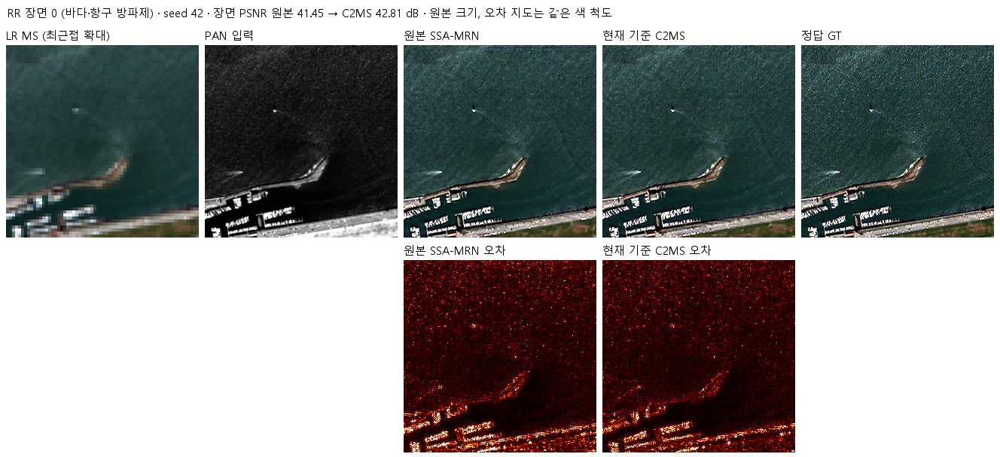

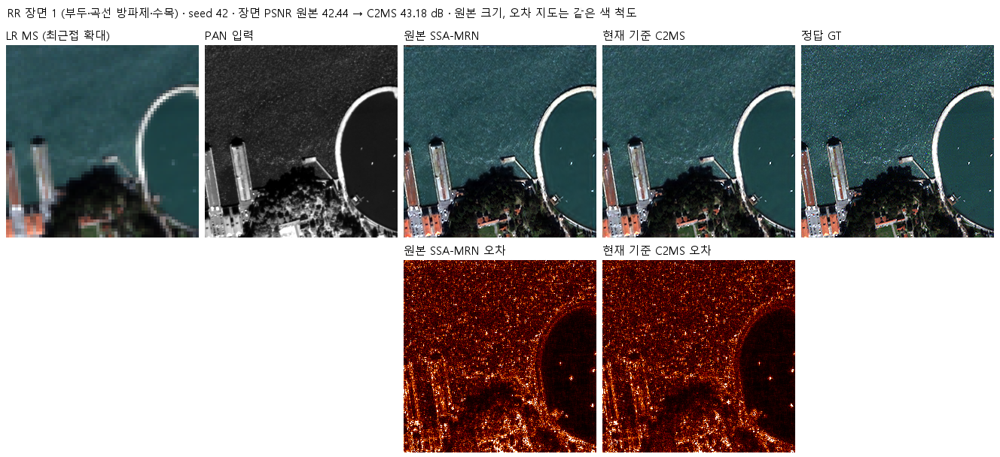

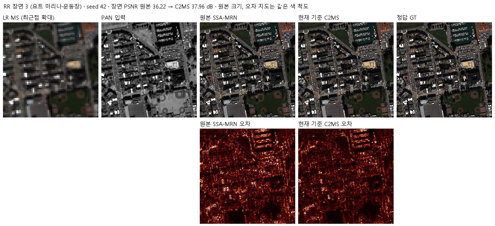

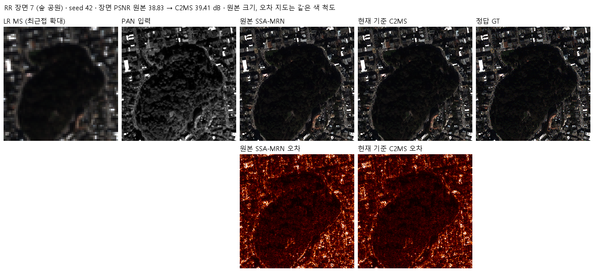

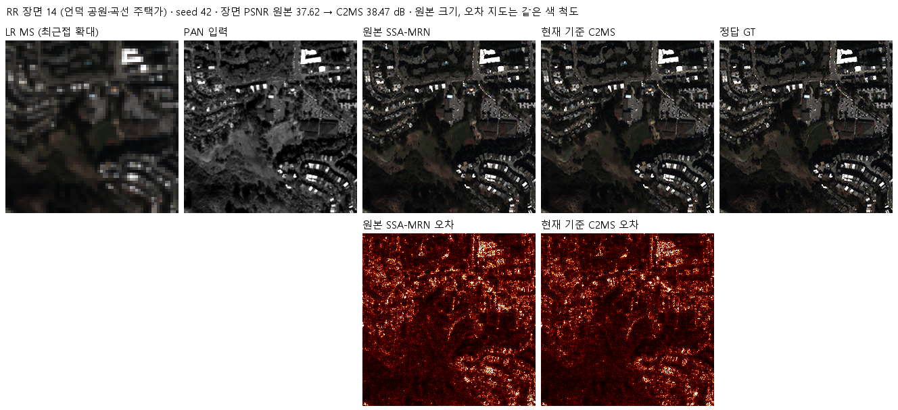

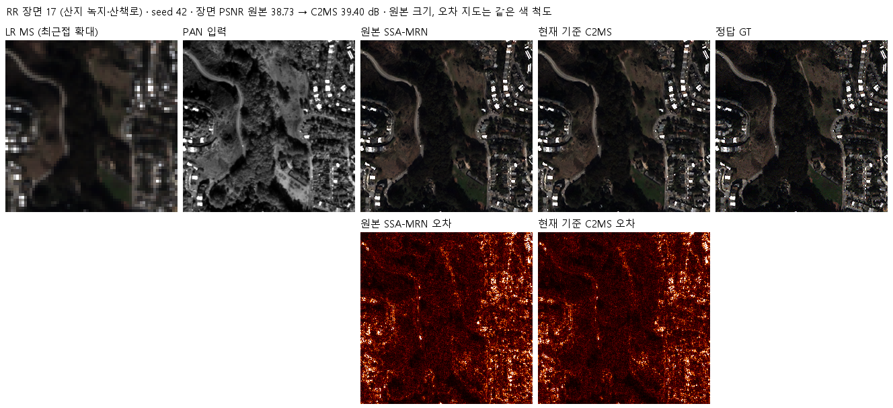

### 확대 비교

각 장면에서 **C2MS의 개선이 가장 큰 64×64 영역**(원본 오차 − C2MS 오차가 가장 큰 곳)을 4배 확대했습니다. C2MS가 무엇을 고치는지 보여 주기 위해 C2MS에 유리하게 고른 영역이므로, 장면 전체의 개선 폭은 위 표의 장면 PSNR로 확인합니다. 왼쪽부터 정답 전체(노란 상자가 확대 영역) · 정답 · 원본 · C2MS · 원본 오차 · C2MS 오차입니다.

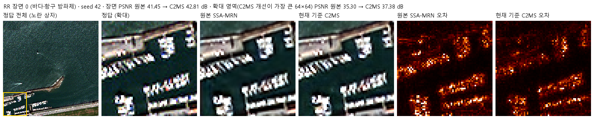

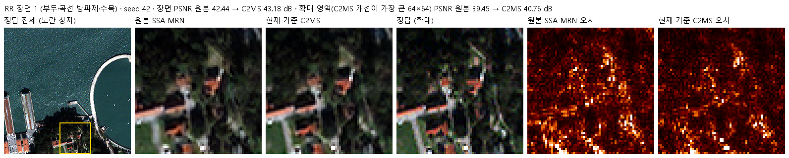

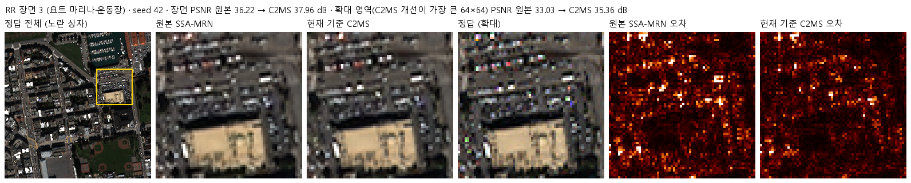

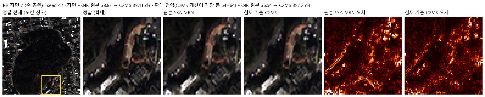

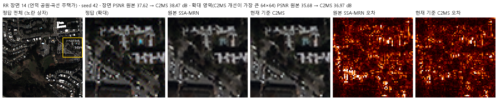

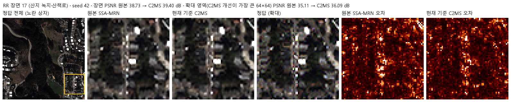

C2MS는 여섯 장면 모두에서 원본보다 PSNR이 높았고, 마리나·운동장과 바다·항구 장면에서 개선이 가장 컸습니다. 정박한 배, 방파제, 건물 경계 주변의 오차가 줄어든 것이 오차 지도에서 보입니다. 숲과 산지 장면은 개선 폭이 작습니다. FR(정답 없음)과 RR2의 비교 패널, 이전 기준 모델 F1과의 비교는 [성능 53번 보고서](SSA-MRN/experiments/performance/53_scale_mixed_training/README.md)에 있습니다.

## 다른 실험

RR은 정답이 있는 축소 해상도 평가, FR은 고해상도 정답이 없는 원래 해상도 평가입니다. 수치 차이는 각 실험의 대조군 대비이며, 서로 다른 조건의 실험끼리 순위를 매기지 않습니다.

실험은 연구별로 구분하며 각 표 안에서는 오래된 순서부터 최근 순서로 추가합니다.

### SSAI 개선

[연구 페이지](SSA-MRN/research/ssai/README.md) · 담당: **이병현** · 1-12번 정리 완료

SSAI 개선 실험 표 펼치기

| 실험 | 변경한 내용 | 확인된 결과 | 상태 | 개선 여부 |
|---|---|---|:---:|:---:|
| [1. 공간 좌표 정렬](SSA-MRN/experiments/ssai/1_spatial_alignment/README.md) [이병현] | 원본의 두 공간 전치를 제거해 같은 위치의 PAN·MS 특징을 결합했습니다. | QB seed42: A1 부분 개선(잡음 수준). 판정 항목을 모두 통과했지만 RR ΔPSNR +0.055dB가 단일 시드 잡음 문턱 0.06dB 미만입니다. ΔSAM -0.035°. | 평가&nbsp;완료 | 부분&nbsp;개선 |
| [2. 기준 면적 정규화](SSA-MRN/experiments/ssai/2_reference_area_normalization/README.md) [이병현] | 원본 SSAI 출력에 현재 면적/학습 기준 면적을 곱했습니다. | QB seed42: R1 개선 없음. RR ΔPSNR -0.000dB·ΔSAM +0.001°. RR 주 판정 미달입니다. | 평가&nbsp;완료 | 개선&nbsp;없음 |
| [3. 기준 크기 sigmoid 게이트](SSA-MRN/experiments/ssai/3_calibrated_sigmoid_gating/README.md) [이병현] | 원본 전치를 유지하고 공간 softmax를 기준 크기 sigmoid 게이트로 교체했습니다. | QB seed42: A2 부분 개선. RR ΔPSNR +0.023dB·ΔSAM -0.025°. RR2 미달입니다. | 평가&nbsp;완료 | 부분&nbsp;개선 |
| [4. 공간 좌표 정렬과 sigmoid 게이트 결합](SSA-MRN/experiments/ssai/4_aligned_sigmoid_gating/README.md) [이병현] | 좌표 정렬과 기준 크기 sigmoid를 결합하고 네 후보를 동일 조건으로 비교합니다. | QB seed42: A1·A2·A3 개선 없음. RR 주 판정 미달입니다. | 평가&nbsp;완료 | 개선&nbsp;없음 |
| [5. softmax와 sigmoid 혼합 게이트](SSA-MRN/experiments/ssai/5_mixed_gating/README.md) [이병현] | 원본 좌표에서 softmax와 기준 크기 sigmoid를 고정 비율로 혼합합니다. | QB seed42: M25·M50 개선 없음. RR 주 판정 미달입니다. | 평가&nbsp;완료 | 개선&nbsp;없음 |
| [6. MS 조건부 공간 세부정보 보정](SSA-MRN/experiments/ssai/6_ms_conditioned_detail/README.md) [이병현] | MS가 선택한 PAN 세부정보를 원본 출력에 잔차 보정합니다. | QB seed42: D6 개선 없음. RR ΔPSNR -0.002dB·ΔSAM +0.004°. RR 주 판정 미달입니다. | 평가&nbsp;완료 | 개선&nbsp;없음 |
| [7. MS–PAN 채널 관계 기반 세부정보 보정](SSA-MRN/experiments/ssai/7_channel_relation_detail/README.md) [이병현] | 4×4 MS–PAN 채널 관계로 PAN 세부정보를 선택·보정합니다. | QB seed42: D7 개선 없음. RR ΔPSNR -0.006dB·ΔSAM +0.016°. RR 주 판정 미달입니다. | 평가&nbsp;완료 | 개선&nbsp;없음 |
| [8. 공간 가중치 평균 정규화](SSA-MRN/experiments/ssai/8_spatial_mean_normalization/README.md) [이병현] | 원본 공간 softmax 평균을1로 맞추고 고정·학습 gamma를 비교합니다. | QB seed42: N2 부분 개선; N1 개선 없음. RR 주 판정 미달입니다. | 평가&nbsp;완료 | 부분&nbsp;개선 |
| [9. PAN 재구성 오차 기반 보정](SSA-MRN/experiments/ssai/9_pan_innovation_correction/README.md) [이병현] | PAN 직접 고주파와 PAN 재구성 오차를 같은 크기의 SSAI에서 비교했습니다. | QB seed42: A1·A2 개선 없음. RR 주 판정 미달입니다. | 평가&nbsp;완료 | 개선&nbsp;없음 |
| [10. 국소 창 교차 어텐션 SSAI](SSA-MRN/experiments/ssai/10_local_window_cross_attention/README.md) [이병현] | 전역 공간 softmax를 7×7 국소 창 어텐션으로 바꾸고 동일 파라미터 convolution 대조군과 비교합니다. | 같은 에폭 A0 대비 validation: L2 −0.81%(21에폭), C −1.15%(45에폭); test 미평가 | 학습&nbsp;중단 10-16&nbsp;01:20 | 판단&nbsp;보류 |
| [11. SSAI 경로 제거 분해와 PAN 기저 결합 상한·FR 대리 지표 검증](SSA-MRN/experiments/ssai/11_ssai_contribution_headroom/README.md) [이병현] | 학습 없이 A0 best에서 SSA 출력·SSAI 단계·coarse 경로·backbone 잔차를 제거하고, PAN 기저 결합 oracle 상한과 validation FR 대리 지표를 검증했습니다. | SSA 출력 제거 시 RR·FR 동일; SSAI 단계 제거 PSNR −1.55dB(상수 보정); oracle null 초과 설명량 11.3%; 대리 Ds 순위 상관 −0.18 | 사전&nbsp;검증&nbsp;완료 10-16&nbsp;03:02 | 성능&nbsp;비교&nbsp;아님 |
| [12. 관측 통계로 정합한 밴드별 PAN 입력](SSA-MRN/experiments/ssai/12_observation_matched_pan_guide/README.md) [이병현] | SSAI 8번 N1 블록에서 PAN 입력만 관측 LR MS 밴드의 국소 평균·표준편차로 정합한 PAN으로 바꾸고, 원 PAN(N1)·장면 전체 통계 정합과 비교합니다. | QB seed42: B3 부분 개선(잡음 수준, RR ΔPSNR +0.050dB); B2 개선 없음. B3는 진단 후보이며 최종 채택을 뜻하지 않습니다. | 평가&nbsp;완료 | 부분&nbsp;개선 |

### 가변 배율 확장

[연구 페이지](SSA-MRN/research/variable_scale/README.md) · 담당: **김윤지**

가변 배율 확장 실험 표 펼치기

| 실험 | 변경한 내용 | 확인된 결과 | 상태 | 개선 여부 |
|---|---|---|:---:|:---:|
| [1. 가변 배율 복원과 배율 조건](SSA-MRN/experiments/variable_scale/1_scale_conditioned_restoration/README.md) [김윤지] | 입력 배율과 피라미드를 분리하고 전용·공동 학습 및 FiLM을 비교했습니다. | 공동 모델은 전용 대비PSNR0.40-0.98dB 하락; FiLM3·4배 소폭 개선 | 학습&nbsp;완료·일부&nbsp;평가 | 판단&nbsp;보류 |
| [2. 배율별 학습 노출량 확장](SSA-MRN/experiments/variable_scale/2_scale_exposure_extension/README.md) [김윤지] | 공동 C/D를100에서200에포크로 연장 | 모든 배율의 RR 개선, 전용 PSNR 격차 유지 | 학습&nbsp;완료·일부&nbsp;평가 | 판단&nbsp;보류 |
| [3. 배율별 학습 노출량 통제](SSA-MRN/experiments/variable_scale/3_scale_exposure_control/README.md) [김윤지] | 배율별 표본 순서·53,600회 갱신을 맞춰 전용·공동·FiLM 비교 | D는 전용 대비3·4배 PSNR +0.1420/+0.1471dB,2배 -0.2256dB | 학습&nbsp;완료·일부&nbsp;평가 | 판단&nbsp;보류 |

### 기존 성능 개선

[연구 페이지](SSA-MRN/research/performance/README.md) · 담당: **김경찬·송준현·이병현**

기존 성능 개선 실험 표 펼치기

| 실험 | 변경한 내용 | 확인된 결과 | 상태 | 개선 여부 |
|---|---|---|:---:|:---:|
| [1. 공개 코드 재현](SSA-MRN/research/performance/1_public_code_reproduction/README.md) [이병현] | 공개 코드 설정을 재현해 초기 기준을 확보했습니다. | RR·FR 재현 결과 확보; 구조 개선 실험이 아님 | 평⁠가⁠ ⁠완⁠료 | 비⁠교⁠ ⁠기⁠준 |
| [2. 논문 설정 재현](SSA-MRN/research/performance/2_paper_setting_reproduction/README.md) [김경찬] | 논문의 내부 특징 차원 설정으로 재현했습니다. | RR·FR 재현 결과 확보; 공개 코드 재현과 장치 조건이 다름 | 평⁠가⁠ ⁠완⁠료 | 비⁠교⁠ ⁠기⁠준 |
| [3. MS 관측 연산자 구현](SSA-MRN/research/performance/3_ms_observation/README.md) [이병현] | 센서 MTF·샘플링 위상·경계 처리를 구성했습니다. | 관측 구현 대응 확인; 학습 성능 비교가 아님 | 사⁠전⁠ ⁠검⁠증⁠ ⁠완⁠료 | 성⁠능⁠ ⁠비⁠교⁠ ⁠아⁠님 |
| [4. 23탭 확대·저해상도 보정·고주파 경로](SSA-MRN/research/performance/4_interpolation_correction_detail/README.md) [이병현] | 확대 연산, 출력 보정, PAN 고주파 경로를 개별 변경했습니다. | QB seed42: interp23·lr_correction·high_frequency 부분 개선. RR 주 판정·RR2 미달입니다. | 평⁠가⁠ ⁠완⁠료 | 부분&nbsp;개선 |
| [5. 23탭 확대 위치와 센서 확장](SSA-MRN/research/performance/5_interpolation_scope_sensors/README.md) [이병현] | 23탭 적용 위치를 분리하고 시드·센서를 확장했습니다. | QB seed42: interp23_output 부분 개선. RR ΔPSNR -0.014dB·ΔSAM -0.004°. RR 주 판정 미달입니다. | 평⁠가⁠ ⁠완⁠료 | 부분&nbsp;개선 |
| [6. 23탭 확대의 반복 시드 비교](SSA-MRN/research/performance/6_interpolation_seed_repeat/README.md) [이병현] | 전체 확대 및 입력 확대 후보를 추가 시드로 반복했습니다. | QB 3시드 평균: interp23·interp23_input 부분 개선. RR2 미달입니다. | 평⁠가⁠ ⁠완⁠료 | 부분&nbsp;개선 |
| [7. 밴드별 게이트 고주파 주입](SSA-MRN/research/performance/7_band_gated_detail/README.md) [김윤지] | 밴드별 게이트로 PAN 고주파 주입량을 조절했습니다. | QB seed42: band_gated_hf 개선 없음. RR ΔPSNR -0.175dB·ΔSAM +0.009°. RR 주 판정 미달입니다. | 평⁠가⁠ ⁠완⁠료 | 개선&nbsp;없음 |
| [8. MTF 변화량 데이터 증강](SSA-MRN/research/performance/8_mtf_augmentation/README.md) [이병현] | 센서 열화 특성의 변화량을 학습 데이터에 추가했습니다. | QB seed46: mtf_aug 부분 개선. RR ΔPSNR -0.006dB·ΔSAM -0.006°. RR 주 판정 미달입니다. | 평가⁠ ⁠완료 | 부분&nbsp;개선 |
| [9. SSAI 내부 융합 연산 변경](SSA-MRN/research/performance/9_ssai_fusion/README.md) [이병현] | SSAI 핵심 융합 연산을 네 구조로 비교했습니다. | QB seed46: A1 부분 개선; A2·A3 개선 없음. RR 주 판정 미달입니다. | 평가⁠ ⁠완료 | 부분&nbsp;개선 |
| [10. 반복 복원에 MS 관측 오차 전달](SSA-MRN/research/performance/10_recurrent_observation/README.md) [김윤지] | 반복 단계에 입력 MS와 관측한 출력의 차이를 전달했습니다. | QB seed42: B2 부분 개선. RR ΔPSNR +0.116dB·ΔSAM -0.018°. RR2 미달입니다. | 평⁠가⁠ ⁠완⁠료 | 부분&nbsp;개선 |
| [11. Haar 대역별 단계 복원과 게이트](SSA-MRN/research/performance/11_haar_reconstruction/README.md) [김윤지] | Haar 대역별 복원에 밴드·방향·위치 게이트를 적용했습니다. | QB seed42: A1 개선 없음. RR ΔPSNR -0.254dB·ΔSAM +0.082°. RR 주 판정 미달입니다. | 평⁠가⁠ ⁠완⁠료 | 개선&nbsp;없음 |
| [12. SSAI 내부 특징 차원 비교](SSA-MRN/research/performance/12_feature_dimension/README.md) [이병현] | 같은 환경에서 내부 특징 차원 4와 6을 비교했습니다. | QB seed42: k6 개선 없음. RR ΔPSNR -0.034dB·ΔSAM +0.014°. RR 주 판정 미달입니다. | 평가⁠ ⁠완료 | 개선&nbsp;없음 |
| [13. 반복 복원·관측 오차 전달의 재개 학습](SSA-MRN/research/performance/13_recurrent_observation_resume/README.md) [김윤지] | 반복 복원과 관측 오차 후보를 재개해 기준선과 비교했습니다. | QB seed42: B2 개선 없음. RR ΔPSNR -0.120dB·ΔSAM +0.009°. RR 주 판정 미달입니다. | 평⁠가⁠ ⁠완⁠료 | 개선&nbsp;없음 |
| [14. 분광·관측 일치·경계 손실 추가](SSA-MRN/research/performance/14_auxiliary_losses/README.md) [이병현] | 기본 MSE에 보조 손실을 하나씩 추가했습니다. | QB seed42: edge_0.1 부분 개선. RR ΔPSNR -0.066dB·ΔSAM -0.012°. RR 주 판정 미달입니다. | 평⁠가⁠ ⁠완⁠료 | 부분&nbsp;개선 |
| [15. 단일 복원과 3단계 공유 복원](SSA-MRN/research/performance/15_shared_reconstruction/README.md) [김윤지] | 동일 초기값과 학습 조건에서 복원 횟수를 변경했습니다. | QB seed42: B1 부분 개선. RR ΔPSNR +0.300dB·ΔSAM -0.108°. RR2·FR_OBS 미달입니다. | 평⁠가⁠ ⁠완⁠료 | 부분&nbsp;개선 |
| [16. 반복 복원의 축소 전 저역통과 필터](SSA-MRN/research/performance/16_bandlimited_downsampling/README.md) [이병현] | 축소 전에 고정 Gaussian 필터를 추가했습니다. | QB seed42: B1_AA 개선 없음. RR ΔPSNR -0.020dB·ΔSAM +0.002°. RR 주 판정 미달입니다. | 평⁠가⁠ ⁠완⁠료 | 개선&nbsp;없음 |
| [17. SSAI 단계·잔차 복원·초기 입력 변경](SSA-MRN/research/performance/17_structural_ablation/README.md) [이병현] | SSAI 단계, 복원 잔차, LRPAN 입력을 분리해 비교했습니다. | QB seed42: S1·S2·S3·R1·M1·I1 부분 개선; R2·I2 개선 없음. S1(+0.019dB)·S2(+0.056dB)는 판정 항목을 모두 통과했지만 RR 이득이 잡음 문턱 0.06dB 미만입니다. | 평⁠가⁠ ⁠완⁠료 | 부분&nbsp;개선 |
| [18. 작은 크기 특징 보존과 PAN 기여량 조절](SSA-MRN/research/performance/18_coarse_feature_fusion/README.md) [이병현] | 작은 특징을 병렬 전달하고 PAN 기여량을 학습했습니다. | QB seed42: N2·N3·N4·N5 부분 개선; N1 개선 없음. RR 주 판정·RR2 미달입니다. | 평⁠가⁠ ⁠완⁠료 | 부분&nbsp;개선 |
| [19. 반복 복원과 PAN·MS 분리 경로](SSA-MRN/research/performance/19_dual_stream_reconstruction/README.md) [이병현] | 3단계 공유 복원과 분리 특징 경로를 비교했습니다. | QB seed42: C1 부분 개선; C2·C3·C4·C5 개선 없음. RR 주 판정·RR2·FR_WALD 미달입니다. | 평⁠가⁠ ⁠완⁠료 | 부분&nbsp;개선 |
| [20. 반복 복원의 단계 간 특징 전달과 관측·PAN 차이](SSA-MRN/research/performance/20_recurrent_guidance/README.md) [이병현] | 밴드별 SSAI를 유지하며 단계 간 정보 전달을 비교했습니다. | QB seed42: D1·D2·D3·D4·D5·D6 부분 개선. RR 주 판정·RR2·FR_WALD 미달입니다. | 평⁠가⁠ ⁠완⁠료 | 부분&nbsp;개선 |
| [21. 특징 선택·복원 후 관측 보정·고주파 PAN 차이](SSA-MRN/research/performance/21_guidance_refinement/README.md) [이병현] | 공간·밴드별 특징 gate, 복원 후 관측 보정, 고주파 PAN 차이를 비교합니다. | QB seed42: E6 개선; E1·E2·E3·E4·E5·E7 부분 개선. 개선 후보는 RR·보조 판정을 모두 통과했습니다. | 평⁠가⁠ ⁠완⁠료 | 개선 |
| [22. 단계별 갱신량·특징 변환·마지막 단계 PAN 주입](SSA-MRN/research/performance/22_stage_aware_restoration/README.md) [이병현] | 공유 복원기의 단계별 조절과 마지막 단계 PAN 차이를 비교했습니다. | QB seed42: F4 부분 개선; F1·F2·F3·F5 개선 없음. RR 주 판정 미달입니다. | 평⁠가⁠ ⁠완료 | 부분&nbsp;개선 |
| [23. 반복 복원·단계 간 특징 전달의 센서별 수렴 비교](SSA-MRN/research/performance/23_multi_sensor_comparison/README.md) [이병현] | 원본·3단계 공유 복원·특징 전달을 세 센서에서 150에포크 비교했습니다. | QB seed46: repeat·F0 부분 개선. RR2 미달입니다. | 평가&nbsp;완료 | 부분&nbsp;개선 |
| [24. 3단계 공유 복원의 보정 계수 범위 제한](SSA-MRN/research/performance/24_alpha_bounded_shared_reconstruction/README.md) [김윤지] | 공유 scalar α의 표현만 sigmoid(a)로 바꿨습니다. | QB seed42: B1_alpha_bounded 개선 없음. RR ΔPSNR -0.085dB·ΔSAM +0.010°. RR 주 판정 미달입니다. | 평가&nbsp;완료 | 개선&nbsp;없음 |
| [25. 중간 해상도 복원 목표와 보조 손실](SSA-MRN/research/performance/25_multiscale_supervision/README.md) [김윤지] | 기존 복원 지점에 GT 기반 보조 L1을 추가했습니다. | QB seed42: B0_DS 개선 없음. RR ΔPSNR -0.043dB·ΔSAM +0.026°. RR 주 판정 미달입니다. | 평가&nbsp;완료 | 개선&nbsp;없음 |
| [26. 평가 가중치의 지수 이동 평균](SSA-MRN/research/performance/26_ema_weight_averaging/README.md) [송준현] | 일반 MSE 학습을 유지하고 평가 가중치에 EMA를 적용했습니다. | QB seed42: ema 개선. RR ΔPSNR +0.089dB·ΔSAM -0.024°. 개선 후보는 RR·보조 판정을 모두 통과했습니다. | 평가&nbsp;완료 seed42 | 개선 |
| [27. Backbone 채널 어텐션 추가](SSA-MRN/research/performance/27_backbone_channel_attention/README.md) [김경찬] | Backbone 잔차 블록 4개에 채널 어텐션을 추가했습니다. | 모델 소스가 보존되지 않아 47번 재평가에서 제외됐으며 v2.3 보조 판정이 없습니다. | 평가&nbsp;완료 seed42 | 판단&nbsp;보류 |
| [28. 원본 복원 후 관측 오차 기반 잔차 보정](SSA-MRN/research/performance/28_residual_refinement/README.md) [이병현] | 원본 복원 후 두 번의 잔차 보정·오차 입력·가중치 공유를 비교했습니다. | QB seed46: G5 개선; G3·G4 부분 개선. 개선 후보는 RR·보조 판정을 모두 통과했습니다. | 평가&nbsp;완료 | 개선 |
| [29. 병렬 특징 용량 확장과 독립 잔차 보정](SSA-MRN/experiments/performance/29_capacity_refinement/README.md) [이병현] | 원본 backbone에 저해상도·원해상도 가지를 추가하고 독립 보정기·LRPAN 제거 결합을 비교했습니다. | QB seed42: F01·F11 개선; W2·W3 부분 개선. 개선 후보는 RR·보조 판정을 모두 통과했습니다. | 평가&nbsp;완료 | 개선 |
| [30. Focal Frequency Loss 추가](SSA-MRN/experiments/performance/30_focal_frequency_loss/README.md) [송준현] | 기존 MSE에 주파수 오차 가중 FFL을 추가했습니다. | QB seed42: final_ffl 부분 개선. RR ΔPSNR -0.055dB·ΔSAM -0.007°. RR 주 판정 미달입니다. | 평가&nbsp;완료 seed42 | 부분&nbsp;개선 |
| [31. 보정 잔차의 저주파 억제](SSA-MRN/experiments/performance/31_low_frequency_preserving_residual/README.md) [김경찬] | G5 두 보정기의 잔차에서 고정 Gaussian 저주파 성분을 제거했습니다. | 짧은 탐색 실험으로 47번 재평가에서 제외됐으며 v2.3 보조 판정이 없습니다. | 평가&nbsp;완료 | 판단&nbsp;보류 |
| [37. 병렬 추가 가지의 위치별 게이트](SSA-MRN/experiments/performance/37_spatial_gate_on_parallel_branch/README.md) [송준현] | W2 추가 특징에 1채널 sigmoid 게이트를 곱했습니다. | 독립 실행 가능한 모델 모듈이 없어 47번 재평가에서 제외됐으며 v2.3 보조 판정이 없습니다. | 평가&nbsp;완료 seed42 | 판단&nbsp;보류 |
| [32. PAN 조건 특징 변조와 국소 회귀 사전 정보의 빠른 선별](SSA-MRN/experiments/performance/32_feature_modulation_local_regression_screen/README.md) [이병현] | A0 best에서 PAN 조건 특징 변조(W1)·대조군(W1c)·국소 회귀 사전 정보(W2)를 10에폭 이어 학습해 선별했습니다. | 10에폭 validation 탐색이며 RR·FR 전체 test와 v2.3 보조 판정이 없습니다. | 사전&nbsp;검증&nbsp;완료 | 판단&nbsp;보류 |
| [33. MS 기준 가역 밝기·대비 정규화](SSA-MRN/experiments/performance/33_ms_anchored_reversible_normalization/README.md) [김경찬] | 원본 SSA-MRN 앞뒤에 LR MS 기준 공유 정규화·역변환을 추가했습니다. | QB 3시드 평균: N1 부분 개선. RR ΔPSNR +0.180dB·ΔSAM -0.074°. RR2 미달입니다. 33·38번을 합친 반복 시드 결과입니다. | 평가&nbsp;완료 3seed | 부분&nbsp;개선 |
| [34. 논문 채널 상관 어텐션과 다중 해상도 복원 재현](SSA-MRN/experiments/performance/34_paper_equation_reproduction/README.md) [이병현] | K6 채널 상관행렬·bicubic·세 단계 잔차를 본문 수식에 맞춰 재현했습니다. | 다른 구조·학습 조건이 함께 바뀌었고 같은 조건 대조군이 없어 47번 재평가에서 제외됐습니다. | 평가&nbsp;완료 | 판단&nbsp;보류 |
| [35. 교차 축척 일관성 학습](SSA-MRN/experiments/performance/35_cross_scale_consistency/README.md) [이병현] | 기존 30개 모델로 교차 축척 불일치와 FR Ds의 관계, 8방향 self-ensemble을 학습 없이 확인하고 FR 지표 구현을 toolbox와 대조했습니다. | I_cs↔Ds Spearman 0.58(기본)·0.39(전체)로 기준 미달, 학습 안 함; self-ensemble A0 PSNR −0.93dB; 지표 구조 toolbox와 동일 | 사전&nbsp;검증&nbsp;완료 | 성능&nbsp;비교&nbsp;아님 |
| [36. 저해상도 이득 지도 기반 세부정보 주입 제한](SSA-MRN/experiments/performance/36_gain_map_detail_injection/README.md) [이병현] | 출력 구조 제한의 전제(고전 MTF-GLP의 FR Ds)와 이론 상한을 학습 없이 확인했습니다. | MTF-GLP Ds +0.1275·PSNR −4.92dB(A0 대비); 상한 0.50 < A0 0.871로 두 관문 실패, 학습 안 함 | 사전&nbsp;검증&nbsp;완료 | 성능&nbsp;비교&nbsp;아님 |
| [38. MS 기준 가역 정규화의 반복 시드 검증](SSA-MRN/experiments/performance/38_ms_anchored_normalization_seed_repeat/README.md) [김경찬] | 33번의 정규화·역변환을 유지하고 seed43·44로 반복했습니다. | QB 3시드 평균: N1 부분 개선. RR ΔPSNR +0.180dB·ΔSAM -0.074°. RR2 미달입니다. 33·38번을 합친 반복 시드 결과입니다. | 평가&nbsp;완료 | 부분&nbsp;개선 |
| [39. 국소 MS 통계 기반 가역 정규화](SSA-MRN/experiments/performance/39_local_ms_anchored_reversible_normalization/README.md) [송준현] | N1 전체 MS 통계를 위치별5×5 공통 통계 지도로 바꿨습니다. | QB 3시드 평균: local 개선 없음. RR ΔPSNR -0.133dB·ΔSAM +0.068°. RR 주 판정 미달입니다. | 평가&nbsp;완료 3seed | 개선&nbsp;없음 |
| [40. MS 기준 평균 제거와 대비 정규화의 기여 분리](SSA-MRN/experiments/performance/40_ms_center_scale_ablation/README.md) [김경찬] | 전역 공유 정규화의 평균 제거·대비 조절을 네 군으로 분리했습니다. | QB seed42: A1·A2·A3 부분 개선. RR 주 판정·RR2 미달입니다. | 평가&nbsp;완료 | 부분&nbsp;개선 |
| [41. 공통 밝기·대비 증강](SSA-MRN/experiments/performance/41_joint_photometric_augmentation/README.md) [송준현] | 학습 PAN·LMS·MS에 공통 gain·offset, 원래 좌표의 MSE를 적용했습니다. | QB 3시드 평균: aug 부분 개선. RR ΔPSNR +0.024dB·ΔSAM -0.001°. RR2 미달입니다. | 평가&nbsp;완료 3seed | 부분&nbsp;개선 |
| [42. 백본 일부 합성곱의 dilation 확장](SSA-MRN/experiments/performance/42_dilated_backbone_context/README.md) [송준현] | res2·res4 conv21의 dilation·padding을1에서2로 변경했습니다. | QB 3시드 평균: dilated 부분 개선. RR ΔPSNR +0.122dB·ΔSAM -0.025°. RR2 미달입니다. | 평가&nbsp;완료 3seed | 부분&nbsp;개선 |
| [43. MS 기준 가역 정규화와 저해상도 병렬 특징 용량 확장](SSA-MRN/experiments/performance/43_normalized_parallel_capacity/README.md) [이병현] | 정규화와 W2 가지를 네 군·세 시드로 비교했습니다. | QB 3시드 평균: C1·C2·C3 부분 개선. RR2 미달입니다. C3는 FR_WALD PSNR +1.509dB·관측 RMSE 0.584배로 통과했고 RR2에서 미달했습니다. | 평가&nbsp;완료 3seed | 부분&nbsp;개선 |
| [44. 위상 보존 주파수 대역 안내](SSA-MRN/experiments/performance/44_phase_preserving_frequency_guidance/README.md) [이병현] | 전체 해상도 SSA의 PAN·고주파·중/고주파 보조 경로를 동일 용량으로 비교했습니다. | QB seed42: C0·F1·F2 부분 개선. F2는 판정 항목을 모두 통과했지만 RR ΔPSNR +0.021dB가 잡음 문턱 0.06dB 미만입니다. | 평가&nbsp;완료 | 부분&nbsp;개선 |
| [45. 추론 시 정확한 관측 일치 사영](SSA-MRN/experiments/performance/45_exact_observation_projection/README.md) [이병현] | 43번 가중치 12개 출력에 추론 시에만 관측 연산자 기준 최소 보정 사영을 적용해 학습 없이 RR·FR을 다시 평가했습니다. | 사영으로 RR 240/240장 개선(C0 PSNR +0.129dB)이나 C2 Ds +0.036·QNR −0.033(0/60장)으로 기준 미달, 학습 안 함 | 사전&nbsp;검증&nbsp;완료 | 성능&nbsp;비교&nbsp;아님 |
| [46. FR 공간 왜곡 지표의 축소 해상도 타당성 검증](SSA-MRN/experiments/performance/46_fr_spatial_index_validity/README.md) [이병현] | 정답이 있는 RR 입력을 FR 지표로 채점해, 정답·모델·혼합 결과 37개에 대해 Ds가 정답을 가장 좋게 채점하는지 확인했습니다. | 정답 Ds가 모델보다 나은 장면 1/20(Toolbox 1.0)·2-3/20(원 논문 방식), 오차와 Ds 나쁨의 순위 상관 −0.53에서 −0.54로 두 정의 모두 정확도와 충돌 | 사전&nbsp;검증&nbsp;완료 | 성능&nbsp;비교&nbsp;아님 |
| [47. 정답 기반 판정 기준(v2)과 기존 후보 재평가](SSA-MRN/experiments/performance/47_ground_truth_criteria_reevaluation/README.md) [이병현] | 측정 전에 고정한 정답 기반 판정 기준 v2(RR 주 판정 + RR2·FR_WALD·FR 관측 일치 보조 판정, QNR류는 참고)로 저장된 기존 후보 96개를 다시 채점했습니다. | 원래 v2: 개선 6·부분 개선 57·개선 없음 33. 같은 측정값의 현재 v2.3 표 판정: 개선 5·부분 개선 58·개선 없음 33(개선은 모두 단일 시드, v2.2 집계는 개선 10). ΔQNR과 FR_WALD ΔPSNR 순위 상관 −0.10, RR 이득 큰 후보는 주로 RR2에서 미달 | 평가&nbsp;완료 | 성능&nbsp;비교&nbsp;아님 |
| [48. 저해상도 병렬 특징 용량(W2)과 관측 오차 보정기(G5)의 결합](SSA-MRN/experiments/performance/48_parallel_capacity_observation_refinement/README.md) [이병현] | 43번 W2(C2) 뒤에 28번 G5 관측 오차 보정기 두 개를 붙인 WF를 43번과 같은 절차로 seed42 학습했습니다. | seed42 원본 대비 RR PSNR +0.650dB·FR_WALD +1.341dB·관측 RMSE 0.610배였으나 RR2 −0.266dB·SAM +0.204°로 미달했습니다. W2 단독과 RR2가 거의 같아 보정기가 RR2 미달을 없애지 못했습니다. | 평가&nbsp;완료 seed42 | 부분&nbsp;개선 |
| [49. 관측 오차 보정기(G5) 계열의 3시드 재현](SSA-MRN/experiments/performance/49_observation_refinement_seed_repeat/README.md) [이병현] | 원본 뒤에 28번 G5 관측 오차 보정기 두 개를 붙인 F1을 43번과 같은 절차로 seed 42·43·44 학습해 43번 C0 3시드와 비교했습니다. | 3시드 평균 원본 대비 RR PSNR +0.194dB·SAM −0.139°, FR_WALD +0.283dB, 관측 RMSE 0.81배, RR2 −0.014dB로 판정 항목을 모두 통과했습니다. RR은 3/3시드·20/20장에서 개선됐습니다. | 평가&nbsp;완료 3seed | 개선 |
| [50. W2 가지 출력의 추론 시 축소 진단](SSA-MRN/experiments/performance/50_w2_branch_inference_scaling/README.md) [이병현] | 학습 없이 43번 C2의 W2 가지 출력을 추론 시에만 α=0-1로 줄여 RR·RR2·FR_WALD와 오차의 저역·고역을 비교했습니다. | RR·FR_WALD는 α=1에서 최고였지만 RR2는 α=0.5에서 C0 대비 +1.42dB(17/20장)로 최고였고, α=1로 키우면 RR2 고역 오차가 22.0에서 28.2DN으로 늘었습니다. RR2 미달은 세부 주입 세기의 축척 의존성으로 보입니다. | 사전&nbsp;검증&nbsp;완료 | 성능&nbsp;비교&nbsp;아님 |
| [51. 정답 없는 FR 세부 지표 후보의 타당성 검증](SSA-MRN/experiments/performance/51_fr_detail_index_validity/README.md) [이병현] | 학습 없이 PAN 유사도로 FR 세부를 재는 정답 없는 지표 4개(흑백 합성 고주파 상관·차이, 밴드별 고주파 상관, 국소 상관)를 46번 정답 순위 검사로 확인했습니다. | 네 지표 모두 정답이 C0보다 우세한 장면 0/20, 오차와 지표 나쁨의 순위 상관 −0.62에서 −0.77로 정답을 거꾸로 채점했습니다(충돌). PAN 세부를 그대로 베끼는 MTF-GLP가 1등이어서 판정에 쓰지 않습니다. | 사전&nbsp;검증&nbsp;완료 | 성능&nbsp;비교&nbsp;아님 |
| [52. W2 추가 특징의 고주파 선택 제어](SSA-MRN/experiments/performance/52_w2_frequency_selective_attenuation/README.md) [송준현] | W2 저역은 유지하고 고역을 샘플별 에너지 게이트로 조절했습니다. | W2 C2 대비 3seed PSNR +0.01737dB(잡음 수준)·RR2 SAM +0.07235° 미달. F1 대비 비교 아님 | 평가&nbsp;완료 3seed | 부분&nbsp;개선 |
| [53. 2배 거친 학습 쌍을 섞은 축척 혼합 학습](SSA-MRN/experiments/performance/53_scale_mixed_training/README.md) [이병현] | 43번 C2(원본+W2)와 당시 기준 F1을 같은 학습 패치로 만든 2배 거친 쌍과 함께 다시 학습했습니다(C2MS·F1MS, 구조 변경 없음). | C2MS 3시드 평균이 F1 대비 RR PSNR +0.679 dB·SAM −0.226°(20/20장), RR2 +1.139 dB, FR_WALD +1.352 dB, 관측 RMSE 0.78배로 판정 항목을 모두 통과했고 세 시드 각각도 개선이었습니다. 원본 대비 RR +0.873 dB. 2026-10-21 기준 모델로 채택했습니다. 같은 학습의 F1MS(seed42)는 개선 없음이었습니다. | 평가&nbsp;완료 3seed | 개선 |

**판정 기준 ([v2.3](SSA-MRN/docs/judgement_criteria.md)):** 개선 = 같은 조건 대조군 대비 RR PSNR·SAM·ERGAS가 모두 개선(PSNR은 잡음 문턱 이상: 단일 시드 0.06dB, 2시드 이상 0.04dB)되고 정답 기반 보조 판정(RR2·FR_WALD·FR 관측 일치)을 모두 통과, 부분 개선 = 주 판정만 통과, RR 지표 일부만 개선, 또는 이득이 잡음 문턱 미만, 개선 없음 = RR 지표 모두 개선 없음, 판단 보류 = 최종 평가 부족입니다. 비교 기준·성능 비교 아님은 개선 판정 대상에서 제외합니다. FR QNR·Dλ·Ds는 [정답 순위 검사](SSA-MRN/experiments/performance/46_fr_spatial_index_validity/README.md)를 통과하지 못해 참고로만 보고합니다. 47번 이전 실험의 판정은 [성능 47번 재평가](SSA-MRN/experiments/performance/47_ground_truth_criteria_reevaluation/README.md)의 보존된 측정값을 v2.3으로 다시 집계해 표에 반영합니다. 원래 v2 판정은 47번 보고서에 보존하며, 보조 판정 자료가 없는 성능 비교는 판단 보류입니다. 현재 표의 판정 범위는 QB이고 다른 센서·배율로 확대하지 않습니다. 단일 시드도 모든 판정 항목을 통과하면 개선으로 표기하며, 여러 시드는 같은 조건 대조군과 짝지은 전체 시드의 평균으로 판정합니다. 시드 수·시드별 결과를 함께 보고합니다. 개선 표기와 기준 모델 교체는 구분하며, 기준 모델 교체에는 3시드 이상에서 개선과 FR·RR2 비교 이미지 확인이 필요합니다.
