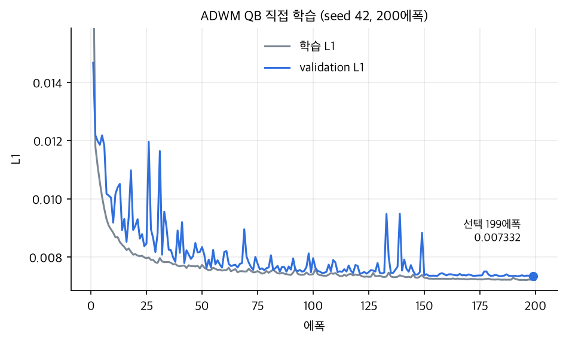
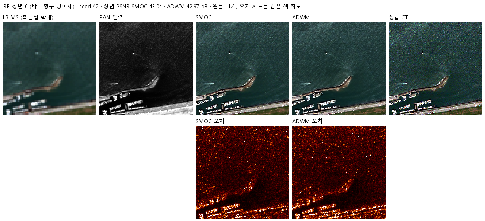
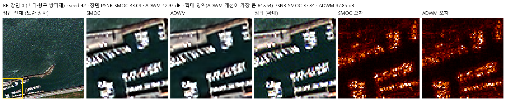

# ADWM (LAGConv 적용판)

| 평가자 | 설정 | 상태 |
|:---:|:---:|:---:|
| 김경찬 (설정·QB 학습·저자 가중치 채점), 이병현 (GF2 채점·어댑터·FR·이미지) | 저자 가중치 WV3, WV2 전이 / QB 200·GF2 500에폭 직접 학습 seed 42 | 평가 완료 |

**출처:** Huang 외, Adaptive Dual-level Weighting for Pansharpening(ADWM), CVPR 2025, [arXiv 2503.13214](https://arxiv.org/abs/2503.13214) · [공식 코드](https://github.com/Jie-1203/ADWM) 커밋 `aa185a6` · MIT(공식 저장소, 저자 WV3 가중치도 같은 저장소 `weights/`에 포함)

**결과:** 같은 시드 SMOC와의 RR PSNR 차이는 QB **+0.156 dB**, GF2 **+0.161 dB**입니다(직접 학습, seed 42 단일 시드). 저자 가중치는 시드가 없어 SMOC 3시드 평균과 비교했고 WV3 −1.278 dB, WV2 전이 −2.410 dB입니다. ADWM 파라미터는 약 39만 개로 SMOC(사용 파라미터 274만 개)의 약 1/7입니다.

[평가 표](../README.md#models) · [결과](#results) · [해석](#verdict) · [방법](#method) · [그림](#figures) · [재현 자료](#evidence)

<a id="results"></a>

## 결과

### RR 실제 MATLAB 채점

RR test 각 20장을 DLPan-Toolbox `a34f884`의 `score_suite.m`(MATLAB R2025b)으로 채점했습니다. PSNR은 모든 센서를 peak 2047 band mean으로 적습니다. GF2의 MATLAB 원본 출력은 peak 1023 기준 43.555 dB입니다. 같은 배열의 Python 공통 평가기와 PSNR·SAM·ERGAS·SCC는 차이가 1e-12 미만으로 일치했고, Q2n은 구현 차이로 최대 2e-4 달랐습니다([채점 요약](results/matlab.json)).

| 센서 | 설정 | PSNR (dB) | SAM (도) | ERGAS | SCC | Q2n | MATLAB 실행 |
|---|---|---:|---:|---:|---:|---:|---|
| QB | 직접 학습 seed 42 (199에폭) | 38.523 | 4.4714 | 3.6285 | 0.9830 | 0.9360 | [#45141153814](https://github.com/BIYONGHIYON/CtrS/actions/runs/45141153814) |
| GF2 | 직접 학습 seed 42 (467에폭) | 49.580 | 0.6912 | 0.6255 | 0.9911 | 0.9833 | [#45237462724](https://github.com/BIYONGHIYON/CtrS/actions/runs/45237462724) |
| WV3 | 저자 가중치 | 37.858 | 3.5287 | 2.5244 | 0.9778 | 0.8988 | [#45052950100](https://github.com/BIYONGHIYON/CtrS/actions/runs/45052950100) |
| WV2 | WV3 저자 가중치 전이 (참고) | 29.601 | 5.8006 | 4.5894 | 0.9127 | 0.8216 | [#45058335188](https://github.com/BIYONGHIYON/CtrS/actions/runs/45058335188) |

### SMOC와 비교

차이는 ADWM에서 SMOC를 뺀 값입니다(`results/summary_smoc.json`). QB·GF2는 같은 seed 42와 짝지었고, 저자 가중치는 시드가 없어 SMOC 3시드 평균과 비교했습니다. SMOC 수치는 [기준 비교 수치](../../docs/images/smoc/baseline_metrics.json)(Python 공통 평가기)입니다.

| 센서 | 비교 | SMOC PSNR | ADWM PSNR | PSNR 차이 | SAM 차이 | ERGAS 차이 |
|---|---|---:|---:|---:|---:|---:|
| QB | seed 42 | 38.368 | 38.523 | +0.156 | −0.047 | −0.063 |
| GF2 | seed 42 | 49.419 | 49.580 | +0.161 | −0.021 | −0.018 |
| WV3 | SMOC 3시드 평균 | 39.136 | 37.858 | −1.278 | +0.670 | +0.403 |
| WV2 전이 | SMOC 3시드 평균 | 32.011 | 29.601 | −2.410 | +0.850 | +1.133 |

### 논문 보고값과 비교

| 센서 | 논문 PSNR / SAM / ERGAS | 우리 환경 재현 PSNR / SAM / ERGAS |
|---|---|---|
| QB | 38.466 / 4.450 / 3.705 | 38.523 / 4.471 / 3.628 (직접 학습) |
| GF2 | 43.884 / 0.672 / 0.597 | 43.555(peak 1023) / 0.691 / 0.626 (직접 학습) |
| WV3 | 39.170 / 2.913 / 2.145 | 37.858 / 3.529 / 2.524 (저자 가중치) |

논문 값은 [성능 조사](../../docs/pansharpening_survey/QB_GF_WV2_WV3_팬샤프닝_성능조사_2026-10-27.md)에 정리한 ADWM 논문 표 값입니다. GF2 논문 값은 peak 1023 계열로 보여 우리 MATLAB 원본 출력(peak 1023)과 나란히 적었습니다.

### FR 참고 결과

FR 각 20장을 Python 공통 평가기로 쟀습니다. 정답이 없는 참고값이며 판단에 쓰지 않습니다.

| 센서 | QNR | Dλ | Ds |
|---|---:|---:|---:|
| QB | 0.9283 | 0.0245 | 0.0486 |
| GF2 | 0.9486 | 0.0279 | 0.0243 |
| WV3 | 0.9508 | 0.0142 | 0.0356 |
| WV2 전이 | 0.8713 | 0.0663 | 0.0730 |

<a id="verdict"></a>

## 해석과 정리

- **직접 학습한 QB·GF2는 같은 시드 SMOC보다 RR PSNR이 약 0.16 dB 높았습니다.** SAM·ERGAS도 모두 낮았습니다. 단일 시드 결과이고, SMOC는 3시드 중 seed 42와만 짝지었습니다. 판정은 붙이지 않으며 이 결과로 기준 모델을 바꾸지 않습니다.
- **QB 재현값은 논문 보고값(38.466 dB)보다 0.057 dB 높았습니다.** 논문과 같은 공식 학습 설정(200에폭, 배치 64, Adam 2e-3, StepLR)을 우리 분할에서 seed 42로 학습했습니다.
- **WV3 저자 가중치는 논문보다 1.31 dB 낮았습니다.** 공개된 WV3 가중치에는 CovBlock LayerNorm 파라미터가 없어서, LayerNorm을 identity로 바꿔야 그대로 불러올 수 있습니다. 이 차이가 원인인지, 저자 학습 데이터 분할이 다른 탓인지는 확인하지 못했습니다. 숫자는 보정하지 않습니다. WV2 전이도 이 가중치를 썼으므로 같은 제약이 있습니다.
- **SMOC에 가져올 만한 점:** ADWM은 39만 파라미터로 QB·GF2에서 SMOC 이상을 냈습니다. 층별 특징의 공분산으로 채널 가중(IFW)과 층 간 가중(CFW)을 정하는 방식이 핵심입니다. 이 아이디어를 쓰려면 성능 개선 연구의 새 실험으로 계획 상태부터 등록합니다.

<a id="method"></a>

<details>
<summary><b>방법</b> · 모델과 비교 조건 · 어댑터</summary>

### 모델과 비교 조건

ADWM은 LAGConv 기반 네트워크에 공분산 기반 가중을 붙인 구조입니다. LR MS를 bicubic으로 4배 키워 PAN과 합친 뒤 LAConv 6블록을 지나고, 각 블록 특징의 채널 공분산으로 채널 가중(IFW, CovBlock)과 블록 간 가중(CFW)을 계산해 합친 다음 출력층과 MS 잔차를 더합니다. 논문 부록 D에 따라 CACW 은닉 비율은 QB 0.6, GF2·WV3 0.8입니다.

| 항목 | SMOC | ADWM `retrain` |
|---|---|---|
| 학습 데이터·분할 | PanCollection 학습·validation | 같음 |
| 정규화 | QB·WV3 2047, GF2 1023 | 같음 |
| 손실 | L1 + 0.25 × 거친 쌍 L1 + 1.2 × 분광 손실 | L1 |
| 에폭·배치·학습률 | 150 · 32 · 1e-4로 120에폭 + 30에폭 cosine | QB 200·GF2 500 · 64 · 2e-3, StepLR(150에폭마다 0.5배) (공식 코드·논문) |
| 가중치 선택 | validation MSE 최소 | 전체 validation L1 최소 |
| 후처리 | 관측 일치 사영(K10), WV2 전이는 밴드별 보정 | 출력 0-1 clamp (공식 `main_test.py`) |
| 시드 | 42·43·44 | 42 |
| 파라미터 수 | 사용 2,735,418 | QB 389,692 · GF2 392,392 · WV3 396,024 |
| 학습 GPU | RTX 3060 Ti | 학교 서버 RTX A6000 |

### 어댑터

[`model.py`](model.py)가 공식 `model/bwnet_lagconv_sota.py`를 그대로 불러옵니다(공식 코드 수정 없음). 공식 입력 순서 `(ms, pan)`로 호출하고, `main_test.py`처럼 출력을 0-1로 자릅니다. QB는 `train.py`와 같게 CovBlock 은닉 비율을 0.6으로 만듭니다. 저자 WV3 가중치는 LayerNorm 파라미터가 없어 CovBlock LayerNorm을 identity로 바꿔 불러옵니다(config `author.<센서>.layernorm`). 공용 환경에 einops가 없으면 공식 코드가 쓰는 `rearrange` 한 패턴을 같은 연산(flatten·transpose)으로 대신합니다.

이 어댑터로 다시 추론한 결과는 Release에 있는 기존 예측(QB 직접 학습, WV3·WV2 저자)과 장면별 최대 차이 0.009·0.015·0.009 DN 이내로 같았습니다(GPU가 달라 생기는 부동소수점 차이). GF2 예측은 [`predict.py`](predict.py)로 만들었습니다.

### 학습 기록

QB는 2026-11-23 17:05, GF2는 2026-11-24 02:43(KST)에 학습을 마쳤습니다. 학습 실행 명령은 아래와 같습니다.

```bash
git submodule update --init SSA-MRN/benchmarks/adwm/upstream
python -u SSA-MRN/benchmarks/adwm/train.py --sensor qb --data "$PAN_DATA" --out "$RUNS/qb"
python -u SSA-MRN/benchmarks/adwm/train.py --sensor gf2 --data "$PAN_DATA" --out "$RUNS/gf2"
```

| 센서 | 학습 에폭 | 선택 에폭 | 선택 validation L1 | 마지막 에폭 validation L1 |
|---|---:|---:|---:|---:|
| QB | 200 | 199 | 0.007332 | 0.007394 |
| GF2 | 500 | 467 | 0.004017 | 0.004023 |

**GF2 중단과 재개:** 같은 서버 계정의 디스크 할당량(50GB)이 다른 작업으로 가득 차서, GF2 학습이 485에폭 체크포인트를 저장하다 멈췄습니다(2026-11-24 02:11). 484에폭 `latest.pt`의 모델·옵티마이저·StepLR·torch/CUDA 난수 상태·이력을 불러와 485-500에폭을 이어 학습했습니다. 이어 학습은 공식 학습 루프를 그대로 따르는 [`provenance/resume_GF2.py`](provenance/resume_GF2.py)로 했고 `train.py`는 바꾸지 않았습니다. 데이터 섞는 순서는 복원한 torch 난수에서 나오므로 중단 없는 학습과 같은 순서로 이어집니다. 선택한 467에폭 가중치는 중단 전에 저장된 것입니다. 기록은 [`provenance/resume_GF2.json`](provenance/resume_GF2.json)에 있습니다.

</details>

<a id="figures"></a>

<details>
<summary><b>그림</b> · 학습 곡선 · 결과 이미지</summary>

### 학습 곡선




WV3·WV2는 저자 가중치만 평가해 학습 곡선이 없습니다.

### 결과 이미지

고정 6장면(RR test 0-based 0·1·3·7·14·17)을 `common/benchmark_evaluate.py --figures`로 만들었습니다. 원본 크기 비교는 LR MS · PAN · SMOC · ADWM · 정답과 두 오차 지도입니다. 확대 비교는 ADWM이 SMOC보다 오차를 가장 많이 줄인 64×64 창이라 ADWM에 유리하게 고른 창입니다. 장면 PSNR은 각 폴더의 `result_images.json`에 있습니다.

| 센서 | 이미지 |
|---|---|
| QB 직접 학습 | [images_smoc/retrain_QB_s42](results/images_smoc/retrain_QB_s42) |
| GF2 직접 학습 | [images_smoc/retrain_GF2_s42](results/images_smoc/retrain_GF2_s42) |
| WV3 저자 | [images_smoc/author_WV3](results/images_smoc/author_WV3) |
| WV2 전이 | [images_smoc/author_WV2](results/images_smoc/author_WV2) |





</details>

<a id="evidence"></a>

<details>
<summary><b>재현 자료</b> · 코드, 가중치, 예측, 환경</summary>

- 직접 학습 가중치: `checkpoints/retrain_<센서>_seed42/best.pt` (Git), `latest.pt`·`initial.pt` ([Release `weights-benchmarks-adwm`](https://github.com/BIYONGHIYON/CtrS/releases/tag/weights-benchmarks-adwm)). 경로와 SHA-256은 `manifest.json`에 있습니다.
- 저자 WV3 가중치: 공식 하위 모듈 `upstream/weights/BWNET_LAGConv_WV3/model.pth` (SHA-256 `793e5ecc…928e2c`, MIT 저장소에 포함)
- RR 예측: [`predictions-benchmarks-adwm-retrain`](https://github.com/BIYONGHIYON/CtrS/releases/tag/predictions-benchmarks-adwm-retrain)(QB·GF2), [`predictions-benchmarks-adwm-author`](https://github.com/BIYONGHIYON/CtrS/releases/tag/predictions-benchmarks-adwm-author)(WV3·WV2). 자산 SHA-256은 `results/matlab.json`에 있습니다.
- 장면별 지표: `results/<설정>_<센서>/metrics.json`(RR·FR, Python), `results/matlab_scenes_<센서>.json`(MATLAB)
- 에폭별 학습 기록: `results/history_<센서>_seed42.json`
- 평가 환경: ctrs-server RTX 3060 Ti, torch 2.7.1+cu128 (FR·이미지·GF2 예측). WV2 이미지는 SMOC 밴드 보정의 장치 문제로 CPU에서 만들었습니다.

```bash
python SSA-MRN/common/benchmark_evaluate.py --model adwm --setting retrain --sensor GF2 --seed 42 --checkpoint SSA-MRN/benchmarks/adwm/checkpoints/retrain_GF2_seed42/best.pt --data <test 폴더> --device cuda
python SSA-MRN/common/benchmark_evaluate.py --model adwm --setting author --sensor WV3 --checkpoint SSA-MRN/benchmarks/adwm/upstream/weights/BWNET_LAGConv_WV3/model.pth --data <test 폴더> --device cuda
python SSA-MRN/benchmarks/adwm/predict.py --setting retrain --sensor GF2 --seed 42 --checkpoint SSA-MRN/benchmarks/adwm/checkpoints/retrain_GF2_seed42/best.pt --data <test 폴더> --out <출력 폴더> --device cuda
python SSA-MRN/common/verify.py --benchmark adwm --releases
```

</details>
