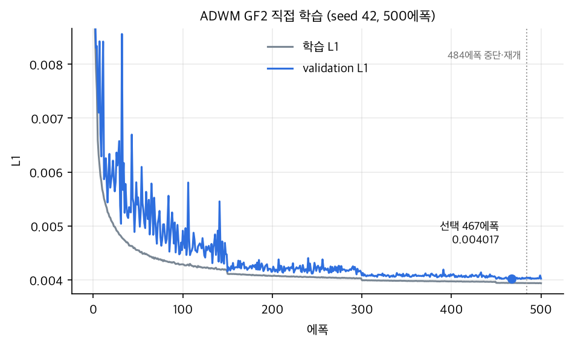

# ADWM LAGConv

공식 ADWM `aa185a6`의 LAGConv 모델을 PanCollection에서 평가한다. 평가자는 김경찬이다.

| 평가 | 상태 | 결과 |
|---|---|---|
| WV3 저자 가중치 RR·FR | 예측 생성 근거 확인 대기 | 새 추론 후 확정 |
| WV3 → WV2 전이 RR | MATLAB 완료 · 20장 | PSNR 29.60093 dB · SAM 5.80065° · ERGAS 4.58945 · SCC 0.91267 · Q2n 0.82165 |
| WV3 → WV2 전이 FR | Python 참고 · 20장 | QNR 0.871322 · Dλ 0.066332 · Ds 0.073021 |
| QB·GF2 직접 학습 | 학습 완료 · 평가 대기 | 시드 42 · 배치 64 · validation 선택 QB 199/200에폭, GF2 467/500에폭 |

WV2 전이는 WV3 저자 가중치와 `identity` 설정으로 예측했다. RR은 [MATLAB 실행 #19](https://github.com/BIYONGHIYON/CtrS/actions/runs/45058335188)에서 채점했고, 예측은 [ADWM author Release](https://github.com/BIYONGHIYON/CtrS/releases/tag/predictions-benchmarks-adwm-author)에 있다. FR은 CtrS Python 지표를 사용했다.

## 직접 학습

2026년 11월 23일 오전 5시경(KST)에 학교 서버 RTX A6000 한 장에서 QB와 GF2의 본 학습을 병렬로 시작했다. 두 센서 모두 첫 에폭의 학습·전체 검증·체크포인트 저장을 마쳤다.

논문 부록 D에 따라 QB의 CACW 은닉 비율은 0.6, GF2는 0.8이다. Adam과 L1, 초기 학습률 0.002를 사용하고 공식 StepLR 설정을 적용한다. 매 에폭 전체 validation에서 L1이 가장 작은 가중치를 선택한다.

학교 서버 RTX A6000 한 장에서 QB·GF2가 동시에 학습 3스텝과 검증 1배치를 통과했다. 배치 64에서 PyTorch 피크 예약량은 QB 20,916 MiB, GF2 20,918 MiB였다.

학교 서버에서 팀에 사용을 알리고 공식 소스 하위 모듈을 준비한 뒤, 센서별로 서로 다른 출력 폴더를 지정한다.

```bash
git submodule update --init SSA-MRN/benchmarks/adwm/upstream
python -u SSA-MRN/benchmarks/adwm/train.py --sensor qb --data "$PAN_DATA" --out "$RUNS/qb"
python -u SSA-MRN/benchmarks/adwm/train.py --sensor gf2 --data "$PAN_DATA" --out "$RUNS/gf2"
```

`PAN_DATA`는 PanCollection 데이터 루트이고 `RUNS`는 결과를 저장할 경로다. 병렬 실행은 센서별로 별도 터미널에서 시작한다.

## 직접 학습 결과

QB는 2026-11-23 17:05, GF2는 2026-11-24 02:43(KST)에 학습을 마쳤습니다. 매 에폭 전체 validation L1이 가장 작은 가중치를 골랐습니다. test 평가(RR·FR, MATLAB 채점)는 아직 하지 않았습니다.

| 센서 | 학습 에폭 | 선택 에폭 | 선택 validation L1 | 마지막 에폭 validation L1 |
|---|---:|---:|---:|---:|
| QB | 200 | 199 | 0.007332 | 0.007394 |
| GF2 | 500 | 467 | 0.004017 | 0.004023 |




**GF2 중단과 재개:** 같은 서버 계정의 디스크 할당량(50GB)이 다른 작업으로 가득 차서, GF2 학습이 485에폭 체크포인트를 저장하다 멈췄습니다(2026-11-24 02:11). 484에폭 `latest.pt`의 모델·옵티마이저·StepLR·torch/CUDA 난수 상태·이력을 불러와 485-500에폭을 이어 학습했습니다. 이어 학습은 공식 학습 루프를 그대로 따르는 [`provenance/resume_GF2.py`](provenance/resume_GF2.py)로 했고 `train.py`는 바꾸지 않았습니다. 데이터 섞는 순서는 복원한 torch 난수에서 나오므로 중단 없는 학습과 같은 순서로 이어집니다. 선택한 467에폭 가중치는 중단 전에 저장된 것입니다. 기록은 [`provenance/resume_GF2.json`](provenance/resume_GF2.json)에 있습니다.

<details>
<summary>재현 자료</summary>

- 선택 가중치: `checkpoints/retrain_<센서>_seed42/best.pt` (Git)
- 마지막·초기 가중치: `latest.pt`·`initial.pt` ([Release `weights-benchmarks-adwm`](https://github.com/BIYONGHIYON/CtrS/releases/tag/weights-benchmarks-adwm), 경로와 SHA-256은 `manifest.json`)
- 에폭별 기록: `results/history_<센서>_seed42.json`

</details>
