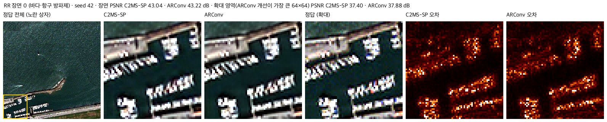
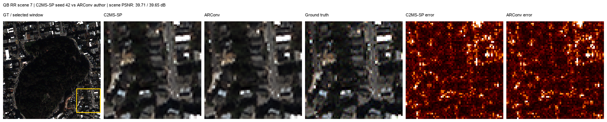
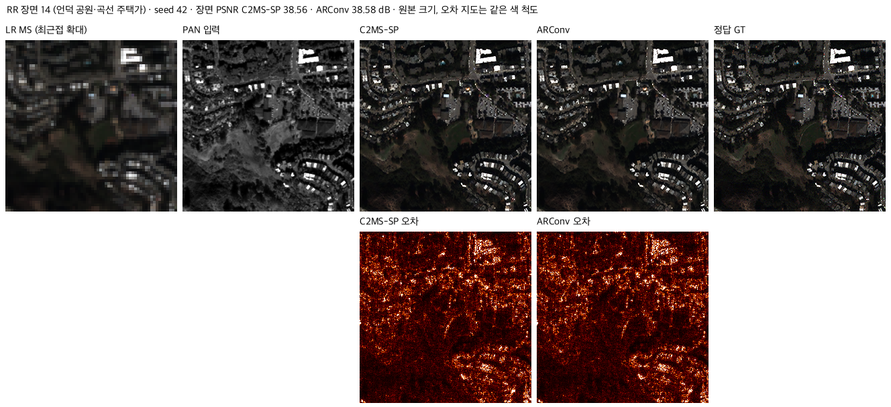
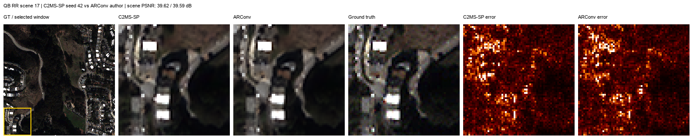

# ARConv ���� ����ġ �� (�ʾ�)

����: ������ �� ����: ���� ���� ����ġ �� ����: MATLAB RR ä�� �Ϸ�, ���� �ڷ�� �̹��� ���� ��

���� �ڵ�: [ARConv](https://github.com/Xueyangwang-will/ARConv), CVPR 2025. ���� ���� üũ����Ʈ�� ��������� ���� �н����� �ʾҽ��ϴ�. WV2���� WV3 ����ġ�� �����߽��ϴ�. ���� �н� ���Ұ� üũ����Ʈ ���� ������ �߰� Ȯ���� �ʿ��մϴ�.

## ���

�� ������ ������ RR test 20�忡 ���� MATLAB R2025b�� DLPan Toolbox�� ä���߽��ϴ�. PSNR�� �� ���� �񱳿� ���� ��庰 ���, peak 2047�Դϴ�. GF2�� peak 1023 ���� ��� ����� 43.360 dB�Դϴ�. FR�� ������ ������ Python ���� ��ǥ�� ������ ǥ���մϴ�.

| ���� | MATLAB PSNR | SAM | ERGAS | SCC | Q2n | Python FR QNR | D�� | Ds |
|---|---:|---:|---:|---:|---:|---:|---:|---:|
| QB | 38.425 | 4.4690 | 3.6613 | 0.9827 | 0.9366 | 0.9412 | 0.0243 | 0.0355 |
| GF2 | 49.385 | 0.7099 | 0.6451 | 0.9906 | 0.9824 | 0.9414 | 0.0268 | 0.0328 |
| WV3 | 39.167 | 2.8585 | 2.1178 | 0.9863 | 0.9165 | 0.9677 | 0.0127 | 0.0199 |
| WV2 | 29.853 | 5.4516 | 4.4176 | 0.9123 | 0.8357 | 0.9545 | 0.0232 | 0.0230 |

MATLAB�� Python�� PSNR��SAM��ERGAS��SCC�� ǥ�� ���е����� ��ġ�ϸ�, Q2n�� ���� ���̷� �ִ� �� 0.000039 �����Դϴ�. ���� ����ġ���� �õ� ������ ���� C2MS-SP�� �õ庰 ¦ �񱳴� �� �� �����ϴ�. QB C2MS-SP seed 42 Python PSNR�� 38.396 dB�̰� ARConv�� 38.425 dB�Դϴ�. �ٸ� ������ 3�õ� ��� �񱳴� ����� ���Դϴ�.

## ����� �Ѱ�

���� `ARNet`�� PAN�� ���� MS�� �ְ� `epoch=1000`���� ���� Ŀ���� ����մϴ�. ��� ���� �Է��� 2047�� ������ ����� 2047�� �����߽��ϴ�. CtrS GF2 ǥ�� ����ȭ�� 1023�̹Ƿ� ���� ����Ϳ����� �Է¿� 1023/2047, ��¿� 2047/1023 ��ȯ�� �ʿ��մϴ�. üũ����Ʈ �� ���� ���� ��Ʈ��ũ�� strict load�� ����߽��ϴ�.

WV3�� `hw_range=[1,18]`�� ������ ���� �߷� �ڵ忡 �����ϴ�. QB `[1,9]`, GF2 `[1,18]`�� ���� 3��9��18��27�� ��� 0 ����� ���� ���� ��°� ������ �����߽��ϴ�. ��ü 20�� ��� ���� ���̴� QB �� 0.0195 DN, GF2 �� 0.0167 DN, WV3 �� 0.0573 DN�Դϴ�. �̴� ���� �ٰ��̸� ������ ������ ���� Ȯ���� ���� �ƴմϴ�. ���� ����ġ�� ���� �н� �����Ϳ� test �ߺ� ���ɼ��� Ȯ������ ���߽��ϴ�.

## QB ��� �̹���

���� 6��� 0��1��3��7��14��17�Դϴ�. �� ��ü ������ LR MS��PAN��C2MS-SP seed 42��ARConv������ �� ���� ô���� �� ���� ���� �����Դϴ�. Ȯ�� ������ ARConv�� �����ϵ��� ���� �������� ARConv ������ �� ���� ���� ū 64��64 ������ ���������Ƿ� ��ü ��� PSNR�� �Բ� Ȯ���ؾ� �մϴ�. �ѱ� �۲��� ���� ���� ȯ�濡�� �����Ǿ� ����� �г� ��Ī�� �������� �ٽ� ǥ���߽��ϴ�.

### ��� 0

### ��� 1

### ��� 3

### ��� 7

### ��� 14

### ��� 17

## ���� �ڷ�

- [MATLAB �� ���](results/matlab.json), [FR ��麰 ��](results/summary.json), [�Է¡�����ġ �ؽ�](provenance/metadata.json).
- [RR ���� Release](https://github.com/BIYONGHIYON/CtrS/releases/tag/predictions-benchmarks-arconv-author), [MATLAB ���� ���](https://github.com/BIYONGHIYON/CtrS/actions/runs/44121444016).
- �̿Ϸ�: ���� �ڵ� ���� ��� �� ������ �����, ���� ���� �ڵ塤����ġ ����, manifest ����, ǥ��catalog ���. �� �ʾ��� ������ �غ� ���� �ʾҽ��ϴ�.
