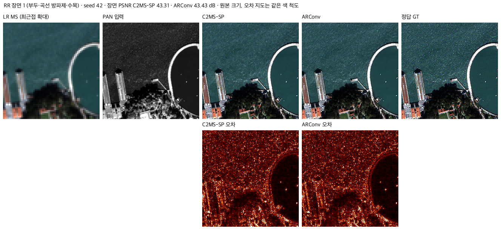
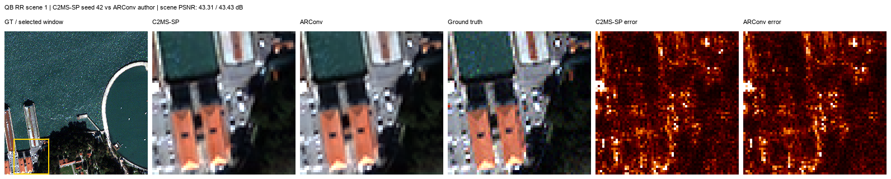
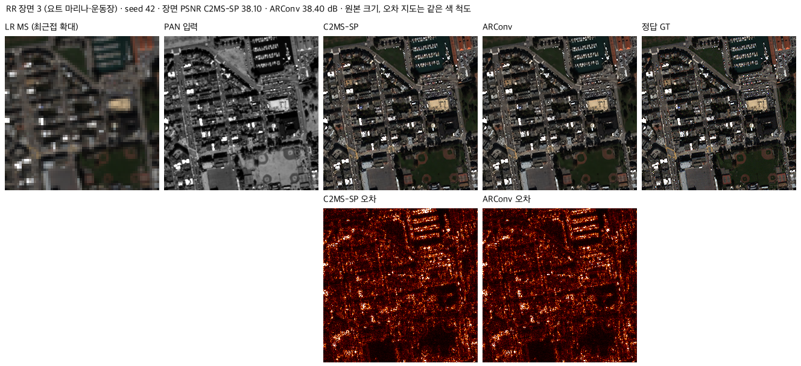
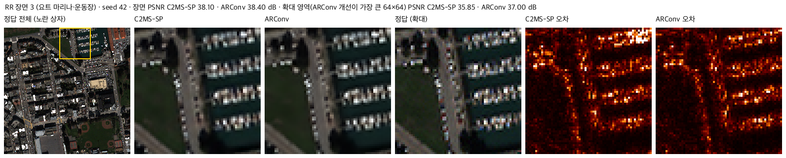
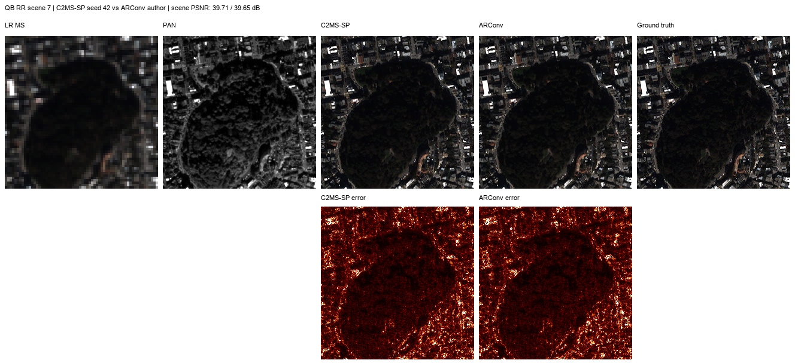
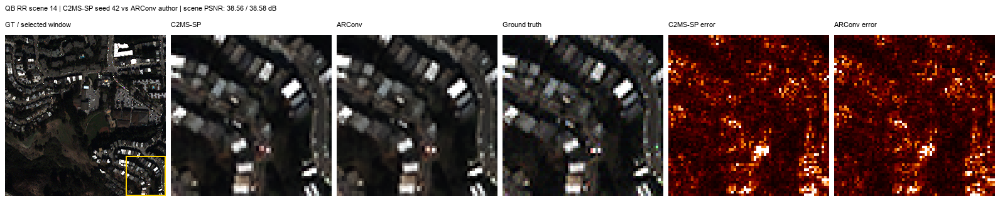

# ARConv 저자 가중치 평가 (초안)

평가자: 김윤지 · 설정: 저자 공개 가중치 · 상태: MATLAB RR 채점 완료, 재현 자료와 이미지 검토 중

공식 코드: [ARConv](https://github.com/Xueyangwang-will/ARConv), CVPR 2025. 저자 공개 체크포인트를 사용했으며 새로 학습하지 않았습니다. WV2에는 WV3 가중치를 적용했습니다. 저자 학습 분할과 체크포인트 선택 기준은 추가 확인이 필요합니다.

## 결과

각 센서의 동일한 RR test 20장에 대해 MATLAB R2025b와 DLPan Toolbox로 채점했습니다. PSNR은 팀 공통 비교와 같은 밴드별 평균, peak 2047입니다. GF2의 peak 1023 기준 밴드 평균은 43.360 dB입니다. FR은 정답이 없으며 Python 공통 지표를 참고로 표시합니다.

| 센서 | MATLAB PSNR | SAM | ERGAS | SCC | Q2n | Python FR QNR | Dλ | Ds |
|---|---:|---:|---:|---:|---:|---:|---:|---:|
| QB | 38.425 | 4.4690 | 3.6613 | 0.9827 | 0.9366 | 0.9412 | 0.0243 | 0.0355 |
| GF2 | 49.385 | 0.7099 | 0.6451 | 0.9906 | 0.9824 | 0.9414 | 0.0268 | 0.0328 |
| WV3 | 39.167 | 2.8585 | 2.1178 | 0.9863 | 0.9165 | 0.9677 | 0.0127 | 0.0199 |
| WV2 | 29.853 | 5.4516 | 4.4176 | 0.9123 | 0.8357 | 0.9545 | 0.0232 | 0.0230 |

MATLAB과 Python의 PSNR·SAM·ERGAS·SCC는 표시 정밀도에서 일치하며, Q2n은 구현 차이로 최대 약 0.000039 차이입니다. 저자 가중치에는 시드 정보가 없어 C2MS-SP와 시드별 짝 비교는 할 수 없습니다. QB C2MS-SP seed 42 Python PSNR은 38.396 dB이고 ARConv는 38.425 dB입니다. 다른 센서와 3시드 평균 비교는 재검토 중입니다.

## 방법과 한계

공식 `ARNet`에 PAN과 보간 MS를 넣고 `epoch=1000`으로 고정 커널을 사용합니다. 모든 센서 입력을 2047로 나누고 출력을 2047로 복원했습니다. CtrS GF2 표준 정규화는 1023이므로 공통 어댑터에서는 입력에 1023/2047, 출력에 2047/1023 변환이 필요합니다. 체크포인트 세 개는 공식 네트워크에 strict load를 통과했습니다.

[논문 보충자료 표 9](https://openaccess.thecvf.com/content/CVPR2025/supplemental/Wang_Adaptive_Rectangular_Convolution_CVPR_2025_supplemental.pdf)에 QB `[1,9]`, GF2 `[1,18]`, WV3 `[1,18]`이 명시되어 있습니다. 앞서 장면 0에 대해 상한 3·9·18·27을 저자 제공 출력과 대조한 결과와 일치합니다. 전체 20장 평균 절대 차이는 QB 약 0.0195 DN, GF2 약 0.0167 DN, WV3 약 0.0573 DN입니다. WV3의 체크포인트 내 고정 커널 크기 10개는 표 9와 일치했습니다. QB는 2번째, GF2는 3·4·7·8번째 커널이 표와 다릅니다. 제공된 출력과 근접하더라도 이 체크포인트가 표의 실행과 완전히 같은 것인지는 확인되지 않았습니다. 보충자료 7.1절은 PanCollection 학습·평가 분할을 명시하지만 배포 체크포인트 자체의 생성 이력은 별도로 확인되지 않았습니다.

## QB 결과 이미지

고정 6장면 0·1·3·7·14·17입니다. 각 전체 영상은 LR MS·PAN·C2MS-SP seed 42·ARConv·정답 및 공통 척도의 두 오차 지도 순서입니다. 확대 영역은 ARConv에 유리하도록 기준 오차에서 ARConv 오차를 뺀 값이 가장 큰 64×64 영역을 선택했으므로 전체 장면 PSNR도 함께 확인해야 합니다. 한글 글꼴이 없는 실행 환경에서 생성되어 제목과 패널 명칭만 영문으로 다시 표기했습니다.

### 장면 0

### 장면 1

### 장면 3

### 장면 7

### 장면 14

### 장면 17

## 재현 자료

- [MATLAB 상세 결과](results/matlab.json), [FR 장면별 값](results/summary.json), [입력·가중치 해시](provenance/metadata.json).
- [RR 예측 Release](https://github.com/BIYONGHIYON/CtrS/releases/tag/predictions-benchmarks-arconv-author), [MATLAB 실행 기록](https://github.com/BIYONGHIYON/CtrS/actions/runs/44121444016).
- GF2 실제 RR 장면 0·1·2를 CPU에서 저자 정규화와 어댑터 정규화로 비교했습니다. 평균 절대 출력 차이 0.000036–0.000048 DN, 최대 차이 0.002167 DN, 전체 화소 PSNR 최대 차이 0.000005 dB입니다. 전체 20장 재실행이나 원래 GPU 출력과 배열 대조를 대신하지는 않습니다.\n- 미완료: 전체 장면 어댑터 재평가, 가중치 재배포 조건 확인과 원본 학습·평가 실행 코드 보관. 이 초안은 병합할 준비가 되지 않았습니다.
