# FusionNet

| 평가자 | 설정 | 상태 |
|:---:|:---:|:---:|
| 김윤지 | 저자 가중치 QB·WV3, WV2 전이 / GF2 직접 학습 seed 42 | 학습 완료 일부 평가 |

**출처:** Deng 외, Detail Injection-based Deep Convolutional Neural Networks for Pansharpening · [DLPan-Toolbox 공식 코드](https://github.com/liangjiandeng/DLPan-Toolbox). 공식 코드의 라이선스와 저자 가중치의 별도 재배포 조건은 구분합니다.

**확인된 결과:** 네 센서 RR 각 20장의 실제 MATLAB 채점과 FR 각 20장의 Python 평가를 마쳤습니다. GF2는 400에폭 학습하고 validation MSE 최저인 382에폭을 선택했습니다. 저자 가중치의 학습 데이터 분할은 확인되지 않았으며 논문 조건을 완전히 재현했다고 판단할 수 없습니다. QB 고정 6장면의 C2MS 비교 이미지를 보관했습니다. 네 센서의 C2MS-SP 기존 기록과 비교했으며 평가 방법과 학습 조건의 차이를 아래에 적었습니다.

[평가 표](../README.md#models) · [결과](#results) · [해석](#verdict) · [방법](#method) · [그림](#figures) · [재현 자료](#evidence)

## 결과

### RR 실제 MATLAB 채점

| 센서 | 설정 | PSNR (dB) | SAM (도) | ERGAS | SCC | Q2n |
|---|---|---:|---:|---:|---:|---:|
| QB | 저자 | 31.485 | 7.3719 | 8.2911 | 0.8903 | 0.8047 |
| GF2 | 직접 학습 seed 42 | 45.547 | 0.9847 | 1.0072 | 0.9775 | 0.9623 |
| WV3 | 저자 | 32.519 | 4.9298 | 4.6888 | 0.9177 | 0.8058 |
| WV2 | WV3 가중치 전이 | 27.058 | 7.4858 | 6.0711 | 0.8494 | 0.7099 |

각 센서 RR test 20장입니다. PSNR은 band mean과 peak 2047을 사용했습니다. GF2의 원래 범위 peak 1023을 쓰면 PSNR은 39.522 dB입니다. 같은 배열의 Python과 MATLAB 결과에서 PSNR·SAM·ERGAS는 표시 정밀도에서 일치했습니다. Q2n은 구현에 따른 작은 차이가 있습니다. [저자 설정 장면별 채점](results/matlab_author.json) · [GF2 장면별 채점](results/matlab_retrain.json).

### 기준 모델과 비교

현재 지정된 기준 모델은 **C2MS-SP**입니다. RR test 각 20장의 기존 기록을 비교하면 다음과 같습니다. 차이는 FusionNet에서 C2MS-SP를 뺀 값입니다.

| 센서 | C2MS-SP seed 42 | FusionNet | 차이 (dB) |
|---|---:|---:|---:|
| QB | 38.396 | 31.485 | -6.910 |
| GF2 | 48.732 | 45.547 | -3.186 |
| WV3 | 38.663 | 32.519 | -6.144 |
| WV2 전이 | 31.335 | 27.058 | -4.277 |

C2MS-SP 수치는 [기존 Python 평가 기록](../../docs/images/c2ms_sp/baseline_metrics.json), FusionNet 수치는 위의 실제 MATLAB 채점입니다. 두 평가 코드는 같은 test 파일 이름과 20장, band mean PSNR 및 peak 2047을 사용하도록 작성됐지만, 기준 모델 예측을 이번에 MATLAB으로 다시 채점하거나 데이터 파일 해시의 일치 여부를 검증한 것은 아닙니다. 따라서 수치 차이는 참고로 해석합니다. 특히 GF2는 두 모델 모두 peak 2047 기준이며, peak 1023 수치와 혼합하지 않습니다.

GF2의 FusionNet은 seed 42로 직접 학습했고, QB·WV3 저자 가중치의 학습 시드와 분할은 확인되지 않아 같은 시드 쌍 비교가 아닙니다. WV2는 두 모델 모두 WV3 가중치로 전이했으나 C2MS-SP에만 밴드별 센서 보정과 관측 일치 사영이 적용됩니다. 학습 데이터 중복 여부와 조건 차이는 결과의 원인을 단정할 수 없게 합니다.

아래 QB 그림은 현재 기준 C2MS-SP가 아닌 이전 **C2MS** seed 42와 비교했습니다. 이전 C2MS의 실제 MATLAB RR PSNR은 [38.274 dB](../../experiments/performance/53_scale_mixed_training/results/matlab_reevaluation/40202998202/e53_QB_C2MS_s42/summary.json)입니다. 현재 기준과의 비교 그림은 확인되지 않았습니다.

### FR 참고 결과

FR에는 정답이 없으며 Python 공통 평가기로 각 20장을 평가했습니다. GF2 QNR은 0.8708입니다. QNR·Dλ·Ds는 참고 지표이며 개선 판정에 사용하지 않습니다. 다른 센서와 장면별 수치는 [실행 기록](provenance/progress_20261119.md)과 Kaggle 실행 결과에서 확인할 수 있습니다.

## 해석과 정리

QB 결과는 위의 이전 C2MS 결과보다 낮지만, 저자 가중치의 학습 데이터와 분할이 불명확해 차이의 원인을 단정하지 않습니다. SAM은 화소별 분광 벡터 사이의 각도를 도 단위로 나타낸 값이며 작을수록 방향이 비슷합니다. GF2의 0.9847도는 QB의 7.3719도보다 작지만 센서·데이터·가중치가 다르므로 수치 차이만으로 모델이나 데이터의 우열을 단정할 수 없습니다. 같은 예측 배열을 채점한 MATLAB과 Python의 SAM 평균은 네 센서 모두 약 5×10⁻¹⁵도 이내로 일치했습니다. 이는 두 구현의 계산 일치 확인이며 입력 밴드 순서, 가중치의 학습 분할, 데이터 중복 여부나 모델 재현의 정확성까지 입증하지는 않습니다. 밴드 순서·정규화·가중치와 입력의 대응 관계 및 장면별 값을 추가 점검해야 합니다.

GF2 PSNR의 45.547과 39.522 dB는 같은 예측에서 peak만 각각 2047과 1023으로 설정한 값입니다. 차이 약 6.025 dB는 peak 설정에 따른 것이므로 서로 다른 실험 결과로 해석하지 않습니다. 논문이나 다른 모델과 비교할 때는 peak와 밴드 평균 방식이 같은지 먼저 확인합니다. MATLAB과 Python의 Q2n 평균 차이(MATLAB−Python)는 QB -0.0000283, GF2 -0.0000032, WV3 -0.0001108, WV2 +0.0002219입니다. Q2n은 완전히 일치한다고 쓰지 않습니다.

WV2는 WV3 가중치로 평가한 전이 결과입니다. 서로 다른 정규화 범위와 평가 설정을 섞어 논문 보고값 재현이나 모델의 우열을 확정하지 않습니다.

## 방법

공식 FusionNet은 PAN을 밴드 수만큼 복제한 뒤 LMS와의 차이에서 세부 성분을 예측하고 LMS에 더합니다. QB·WV3·WV2 입력은 DN/2047, GF2 입력은 DN/1023입니다. 출력은 별도로 클리핑하지 않았습니다. GF2 학습은 Adam, 학습률 0.0003, 배치 32, MSE, 400에폭, seed 42를 사용했습니다. 400에폭은 DLPan 공식 학습 설정의 기본값으로, 논문의 모든 실험 설정과 일치한다고 확인된 것은 아닙니다.

저자 가중치는 QB·WV3에 적용했고 WV2에는 WV3 가중치를 사용했습니다. GF2는 우리 데이터의 학습 분할로 학습했으며 validation MSE를 이용해 best를 선택하고 test로 재선택하지 않았습니다. 학습 데이터 분할과 정규화 조건이 다른 기준 모델 간 직접 비교에는 한계가 있습니다.

## 그림

QB RR 고정 6장면(0·1·3·7·14·17)을 이전 C2MS seed 42와 비교했습니다. 현재 기준 C2MS-SP와 비교한 이미지는 아직 확인하지 않았습니다. 원본 비교는 LR MS · PAN · C2MS · FusionNet · 정답 순서이며 오차 지도는 같은 색 척도를 사용합니다. 확대 창은 FusionNet의 오차 감소가 가장 큰 64×64 영역이므로 FusionNet에 유리하게 선택된 창입니다. 전체 장면 PSNR과 창 위치는 [장면별 기록](results/images/author_QB_c2ms_s42/result_images.json)에 보관했습니다. FusionNet 저자 가중치의 학습 시드는 확인되지 않았습니다.

### 장면 0

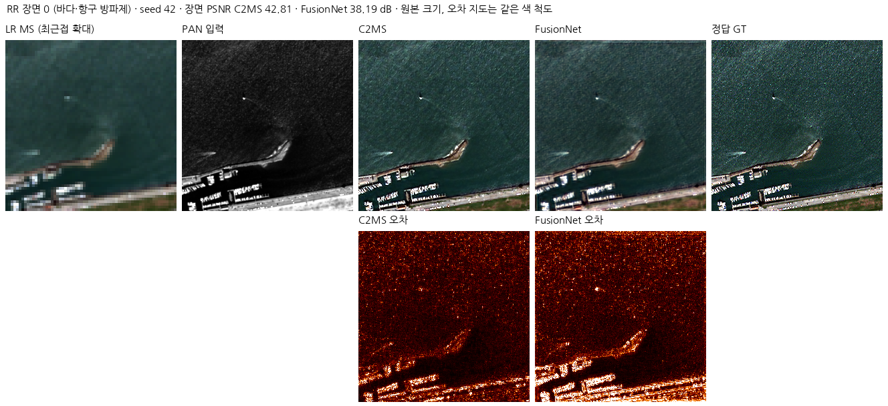

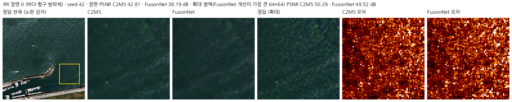

### 장면 1

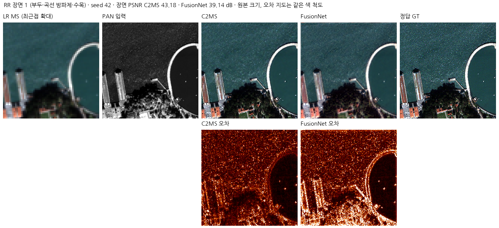

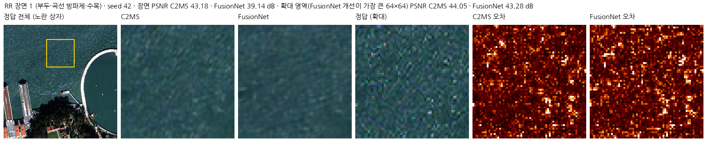

### 장면 3

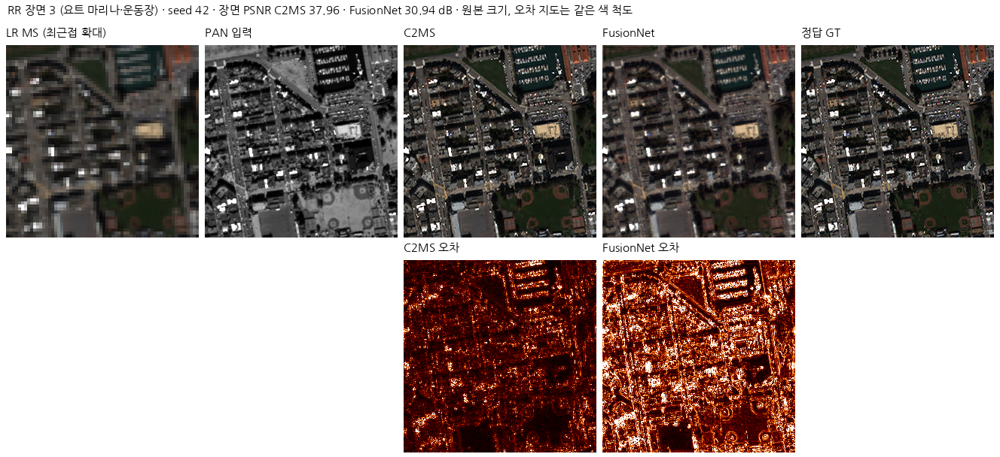

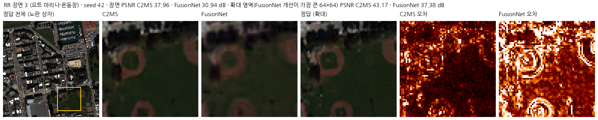

### 장면 7

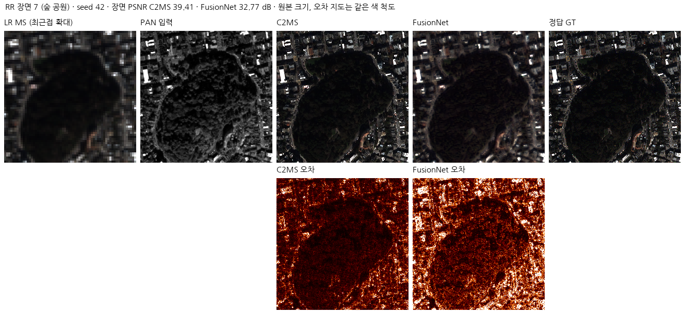

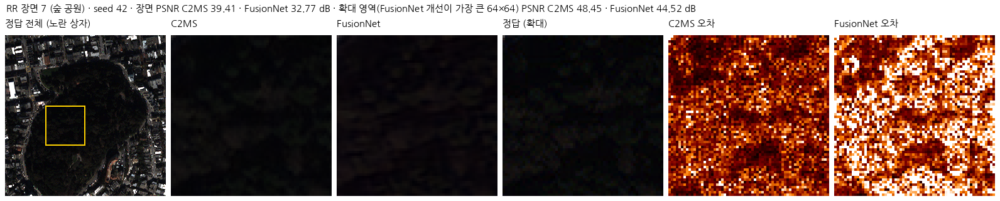

### 장면 14

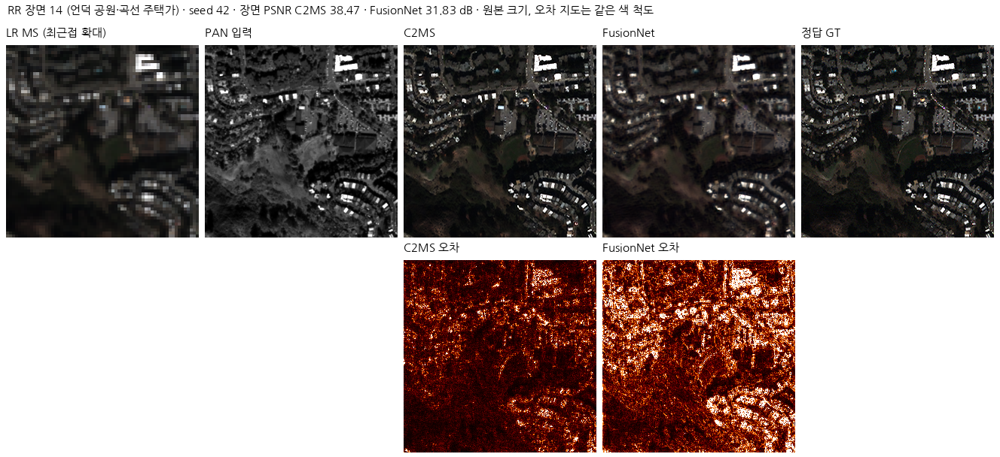

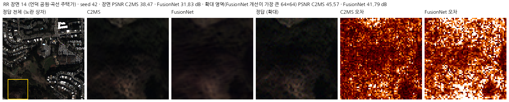

### 장면 17

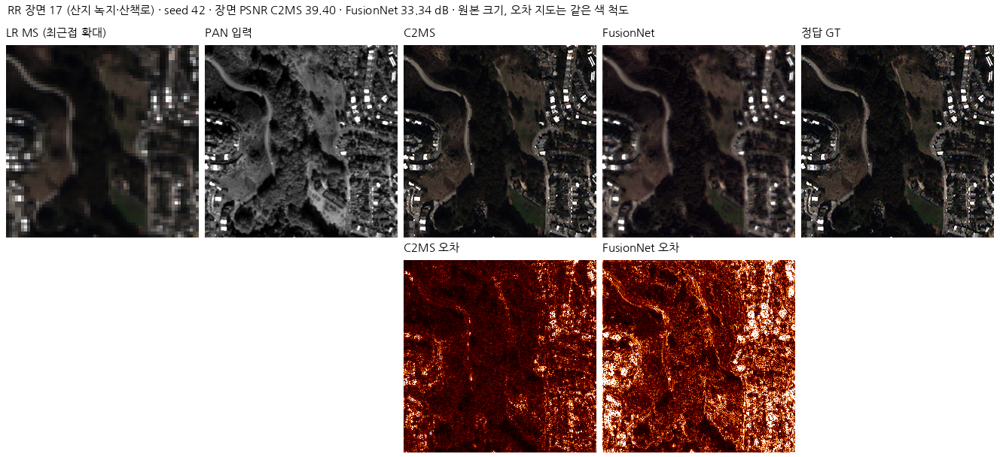

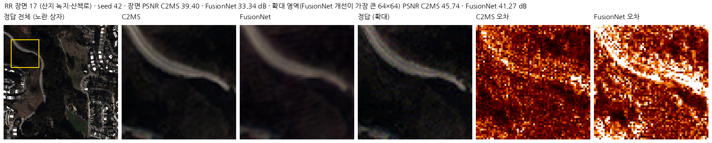

## 재현 자료

[설정](config.json) · [GF2 best 가중치](checkpoints/retrain_GF2_seed42/best.pt) · [manifest](manifest.json) · [진행 기록](provenance/progress_20261119.md) · [Kaggle 학습](https://www.kaggle.com/code/kimyunjiji/fusionnet-gf2-training-and-dlpan-evaluation) · [Kaggle 체크포인트 검증과 평가](https://www.kaggle.com/code/kimyunjiji/fusionnet-gf2-checkpoint-validation-and-evaluation?scriptVersionId=371079856).

[GF2 initial·latest Release](https://github.com/BIYONGHIYON/CtrS/releases/tag/weights-benchmarks-fusionnet-retrain) · [저자 예측 Release](https://github.com/BIYONGHIYON/CtrS/releases/tag/predictions-benchmarks-fusionnet-author) · [GF2 예측 Release](https://github.com/BIYONGHIYON/CtrS/releases/tag/predictions-benchmarks-fusionnet-retrain).

[저자 MATLAB 실행](https://github.com/BIYONGHIYON/CtrS/actions/runs/44337025831) · [GF2 MATLAB 실행](https://github.com/BIYONGHIYON/CtrS/actions/runs/44337153698). 저자 가중치의 재배포 허용 여부는 별도 확인되지 않았으며 출처 확인이 필요합니다.
