# U2Net: Spatial-Spectral-Integrated Double U-Net

| 평가자 | 설정 | 상태 |
|:---:|:---:|:---:|
| 송준현 | `author` · 저자 WV3 공개 가중치, 재학습 없음 | WV3·WV2 평가 완료<br>QB·GF2 미평가 |

**출처:** Siran Peng, Chenhao Guo, Xiao Wu, Liang-Jian Deng. *U2Net: A General Framework with Spatial-Spectral-Integrated Double U-Net for Image Fusion*. ACM MM 2023. [논문](https://doi.org/10.1145/3581783.3612084) · [공식 코드](https://github.com/PSRben/U2Net) · 코드와 공개 가중치는 공식 저장소의 GPL-3.0 배포본을 사용했습니다. 고정 버전과 해시는 [config.json](config.json)에 있습니다.

**결과:** PanCollection WV3·WV2의 RR·FR 각20장을 Python 공통 평가기로 채점했습니다. U2Net author의 RR PSNR은 WV3 38.844dB, WV2 전이 30.497dB이며, C2MS-SP **3시드 평균**과의 차이는 각각 +0.171dB, −1.039dB입니다. 고정6장면의 RR 비교 이미지는 **C2MS-SP seed42**와 비교했습니다. QB·GF2와 실제 MATLAB 채점은 수행하지 않았으며, 4개 데이터셋 평가 완료로 집계하지 않습니다.

[평가 목록](../README.md#models) · [수치](#results) · [해석](#verdict) · [방법](#method) · [그림](#figures) · [재현 자료](#evidence)

<a id="results"></a>

## 결과

### RR 전체20장: Python 공통 지표

저자 가중치의 학습 seed는 알려져 있지 않습니다. 저자 가중치 한 개와 C2MS-SP seed42·43·44의 산술평균을 비교하며, 동일 seed로 짝지은 실험이 아닙니다. Δ는 U2Net − C2MS-SP입니다. 수치는 [summary.json](results/summary.json)과 같습니다. Q2n·SCC를 실제 MATLAB으로 재검증하지 않았습니다.

| 센서 | 모델 | PSNR ↑ | SAM ↓ | ERGAS ↓ | SCC ↑ | Q2n ↑ |
|---|---|---:|---:|---:|---:|---:|
| WV3 | C2MS-SP, 3seed 평균 | 38.673246 | 2.984351 | 2.240736 | 0.984305 | 0.910665 |
| WV3 | U2Net, author | 38.844178 | 2.896916 | 2.199791 | 0.985843 | 0.915967 |
| WV3 | Δ | +0.170932 | −0.087434 | −0.040945 | +0.001538 | +0.005302 |
| WV2 전이 | C2MS-SP, 3seed 평균 | 31.535461 | 5.063285 | 3.663853 | 0.938174 | 0.877077 |
| WV2 전이 | U2Net, author | 30.496774 | 5.258539 | 4.076282 | 0.933318 | 0.846848 |
| WV2 전이 | Δ | −1.038687 | +0.195254 | +0.412429 | −0.004855 | −0.030229 |

WV2는 두 모델 모두 WV3 학습 가중치를 사용한 전이 평가입니다. C2MS-SP에는 현재 기준 모델 정의에 따른 밴드별 센서 보정과 관측 일치 사영이 포함되며, U2Net에는 우리 방법을 붙이지 않았습니다.

### 원 논문 보고값과의 차이

| 센서 | 원 논문 U2Net PSNR / SAM / ERGAS / Q8 | 이번 author 평가 | PSNR 차이 |
|---|---|---|---:|
| WV3 | 39.117 / 2.888 / 2.149 / 0.920 | 38.844 / 2.897 / 2.200 / 0.916 | −0.273dB |
| WV2 전이 | 30.740 / 5.250 / 4.070 / 0.849 | 30.497 / 5.259 / 4.076 / 0.847 | −0.243dB |

출처는 [원 논문 Table1·2](https://arxiv.org/html/2212.06466)입니다. 원 논문 수치와 이번 Python 수치가 완전히 일치했다고 쓰지 않습니다. PSNR 집계·경계 및 Toolbox 구현 차이, 공개 가중치의 실제 학습 이력 등이 확인할 원인 후보이며, 현재 원인을 확정하지 않았습니다. 수치를 맞추기 위해 checkpoint나 후처리를 다시 선택하지 않았습니다.

### FR 전체20장: 참고 지표

| 센서 | U2Net QNR ↑ | Dλ ↓ | Ds ↓ |
|---|---:|---:|---:|
| WV3 | 0.960572 | 0.017416 | 0.022463 |
| WV2 전이 | 0.932447 | 0.033710 | 0.035099 |

이는 Python 공통 평가기의 QNR 계열이며 실제 MATLAB 채점 결과가 아닙니다. 고해상도 GT가 없는 FR의 PSNR·SAM이나 정답 이미지는 만들지 않았습니다.

<a id="verdict"></a>

## 해석과 정리

WV3에서 U2Net의 RR PSNR·SAM·ERGAS 수치는 C2MS-SP 3시드 평균보다 높거나 낮은 방향으로 각각 +0.171dB·−0.087°·−0.041의 차이를 보였습니다. 반면 학습하지 않은 WV2에서는 −1.039dB·+0.195°·+0.412였습니다. 이 결과는 공개 가중치·원래 타일 추론을 사용한 한 번의 author 평가이며, 같은 학습 조건의 재학습 비교나 여러 seed 반복 결과가 아닙니다. 다른 모델 평가이므로 개선 판정이나 기준 모델 교체 결론은 붙이지 않습니다.

**수치표와 이미지의 기준 모델 범위가 다릅니다.** 위 전체20장 표는 C2MS-SP **3시드 평균**, 아래 이미지는 C2MS-SP **seed42 단일 모델**입니다. U2Net은 같은 저자 공개 가중치이며 학습 seed 미상입니다. 이미지 여섯 장면의 차이를 전체20장 평균으로 대체하지 않습니다. WV3·WV2의 각6장면에서 U2Net의 PSNR은 기존 전체 평가의 동일 장면 값과 정확히 일치했습니다.

WV3 장면3에서는 건물·수목 주변 차이를, WV2 장면7에서는 전체 영상 차이와 확대 창의 차이를 함께 볼 수 있습니다. WV2 장면7의 전체 PSNR은 C2MS-SP 30.671dB, U2Net 30.134dB이지만, **U2Net에 유리하게 고른 확대 창**의 PSNR은 29.03dB와 29.38dB입니다. 일부 확대 창만 보고 전체 결과를 설명하지 않도록 전체 장면과 장면 수치를 함께 제시합니다. 이 예시의 관찰을 모든 경계·세부 영역의 통계적 결론으로 확대하지 않습니다.

다음 작업은 QB·GF2에 대응하는 4밴드 모델·가중치 확보 또는 별도의 `retrain` 설정입니다. 현재 공식 클래스는 MS 8밴드를 고정하고 공개 가중치도 WV3용이므로, 이 가중치를 잘라 QB·GF2 결과로 사용하지 않습니다. 우리 재학습이 필요하면 seed42, validation 선택, 공식 학습 설정과 4밴드 대응 변경점을 별도로 기록해야 합니다. 현재 자료만으로 주간 목표인 한 모델의 4센서 완료를 충족하지 않습니다.

<a id="method"></a>

<details>
<summary><b>방법</b> · 모델과 평가 조건</summary>

U2Net은 PAN의 공간 경로와 MS의 분광 경로를 두 U-Net으로 처리하고, 각 단계의 S2Block에서 결합합니다. 공식 모델 파일과 가중치는 수정하지 않았습니다. [model.py](model.py) 어댑터에서 입력 순서를 `(PAN,LMS,MS)`에서 공식 `(MS,PAN)`으로 맞추며 제공 LMS는 사용하지 않습니다. 내부 학습된 4배 확대와 네트워크 연산은 공식 구현을 그대로 사용합니다.

| 항목 | C2MS-SP | U2Net author |
|---|---|---|
| 학습 출처 | 65번 WV3 seed42·43·44 보관 가중치 | 저자 공개 WV3 `200000_iter.pth` |
| 이번 학습 | 없음 | 없음 |
| 입력 | PAN·제공 LMS·MS | PAN·MS; 제공 LMS 미사용 |
| 추론 | 전체 장면, K10 관측 일치 사영 | 공식 test.py 방식 64px 타일·halo4, 72px 입력 |
| clipping | 기준 모델 구현 유지 | 공식 test.py의 [0,1] clipping 유지 |
| WV2 | WV3 가중치 + 장면별 밴드 보정 + WV2 관측 사영 | WV3 가중치 그대로, 보정·사영 미적용 |
| 정규화 | 두 센서 DN/2047 | 같음 |
| 전체 수치 비교 | 3seed 평균 | 저자 모델1개, seed 미상 |
| 이미지 비교 | seed42 | 같은 저자 가중치 |
| 실행 장치 | 이미지 비교 Kaggle Tesla T4 | 수치·이미지 Kaggle Tesla T4 |

저자 가중치는 validation으로 우리가 다시 선택한 checkpoint가 아닙니다. 파일명은 200000iter이며 실제 학습 로그와 epoch가 제공되지 않아 확정하지 않습니다. 원 논문의 360epoch·batch16·Adam·L1·초기 lr0.001·100epoch마다0.5 감소, 공식 train.py 기본500epoch와 구분합니다. 논문 학습 장치는 GPU-3090으로 기술돼 있으나 이번에 재학습하거나 필요한 최소 VRAM·학습시간을 측정하지 않았습니다.

U2Net 등록 파라미터는 **642,008개**입니다(미사용 등록층 포함). 전체 MAC/FLOPs와 순수 GPU 추론시간·peak VRAM은 아직 측정하지 않았습니다. 합성72² 타일의 Conv·Linear·ConvTranspose 부분합0.694GMAC는 attention 행렬곱과 타일 중복을 제외하므로 총 연산량으로 보고하지 않습니다. 두 모델의 입력 처리·학습·추론 조건이 다르다는 한계를 유지합니다.

</details>

<a id="figures"></a>

<details>
<summary><b>그림</b> · 전체 수치 비교와 고정 장면</summary>

재학습하지 않았으므로 이번 학습 곡선은 없습니다. 아래 첫 그래프는 전체20장 U2Net과 C2MS-SP 3seed 평균의 비교입니다. 축을 확대했으며, 두 번째는 고정6장면에서 C2MS-SP seed42와의 차이입니다.


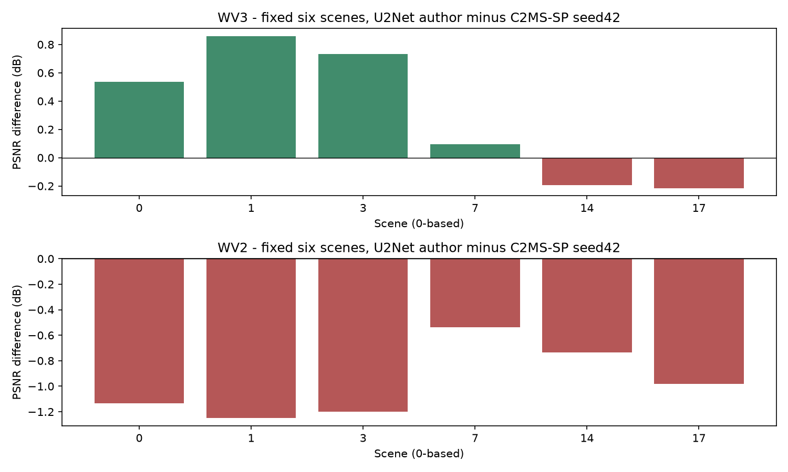

장면 번호는 두 센서 모두 0-based **0·1·3·7·14·17**로 고정했습니다. QB에서 풍경별로 정한 번호를 그대로 적용했으나, QB 풍경 이름을 WV3·WV2에 붙이지 않습니다. 원본 패널은 **LR MS · PAN · C2MS-SP · U2Net · GT**, 아래는 같은 색 척도의 두 오차 지도입니다. RGB[4,2,1], 장면 GT 1-99% 공통 대비이며 PAN은 별도 흑백 대비입니다.

확대 패널은 GT 전체의 노란 상자 · C2MS-SP · U2Net · GT · 두 오차 지도입니다. **U2Net의 오차 감소가 가장 큰 64×64 창을 사후 선택하고 4배 확대**했으므로 U2Net에 유리한 예시입니다. 모든 장면의 전체 PSNR을 함께 표시합니다.

### WV3 고정 장면0

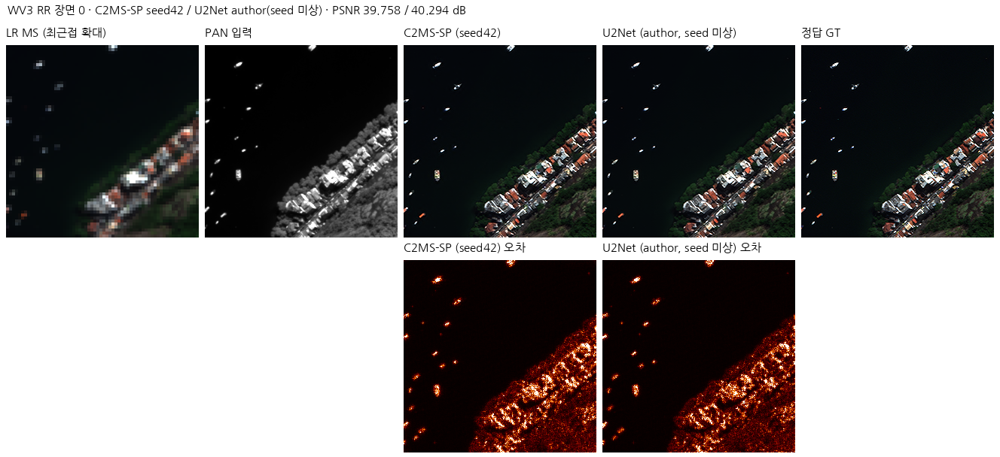


### WV2 전이 고정 장면0

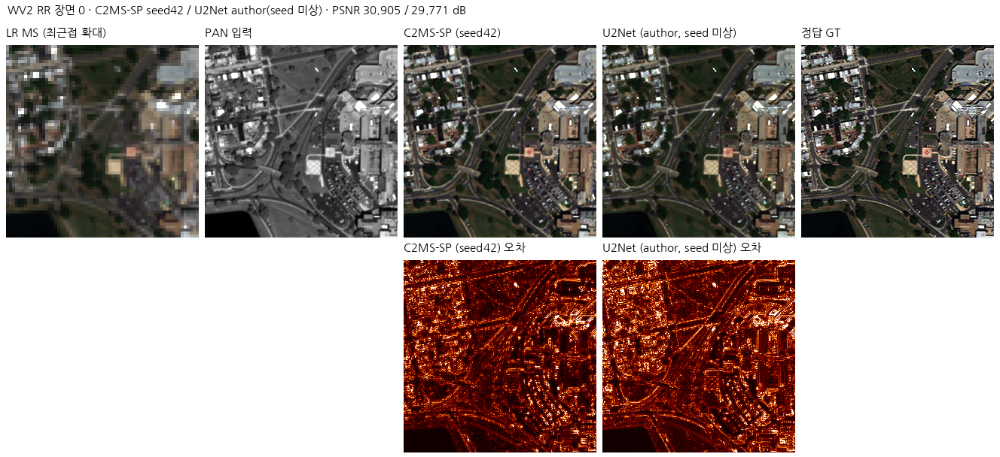


나머지 장면의 원본·확대 이미지는 아래에 모두 표시합니다.

#### WV3 장면1

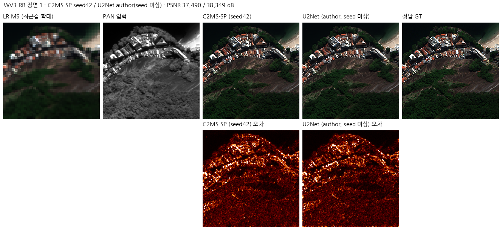
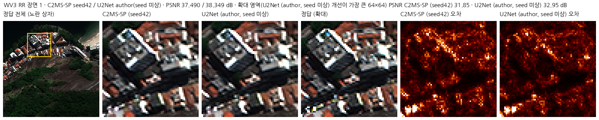

#### WV3 장면3


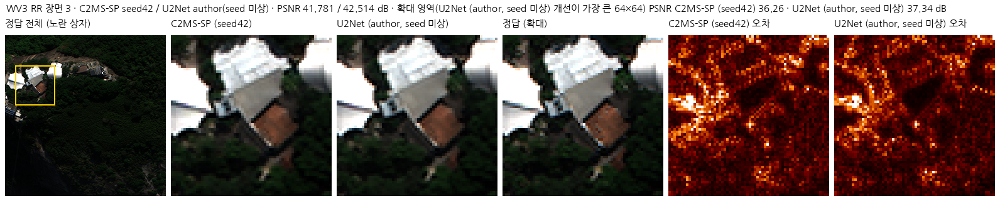

#### WV3 장면7


#### WV3 장면14

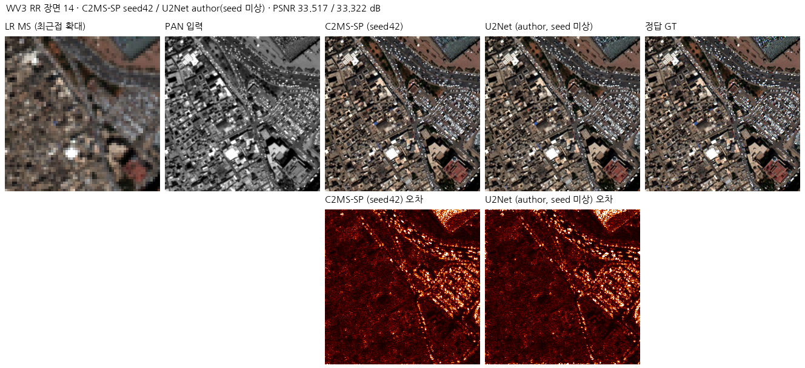
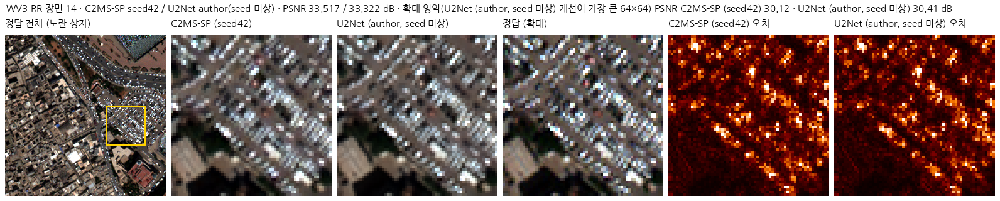

#### WV3 장면17

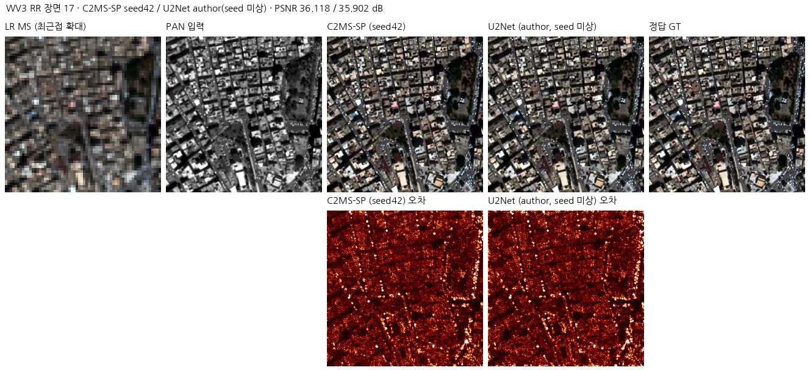


#### WV2 장면1


#### WV2 장면3


#### WV2 장면7

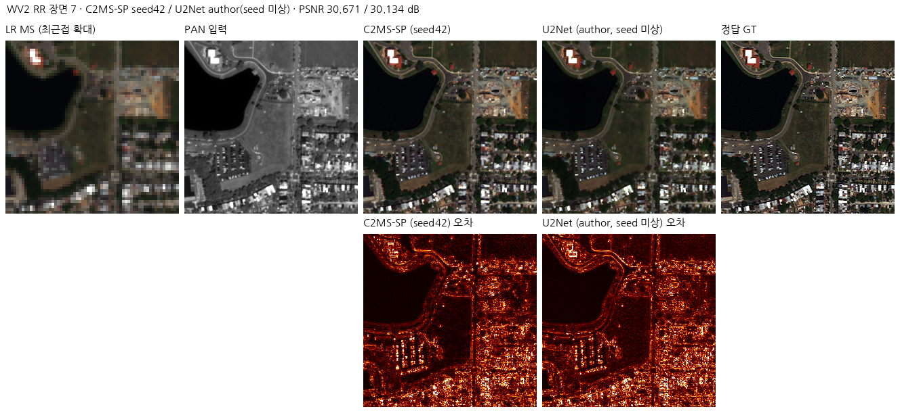
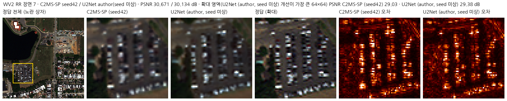

#### WV2 장면14


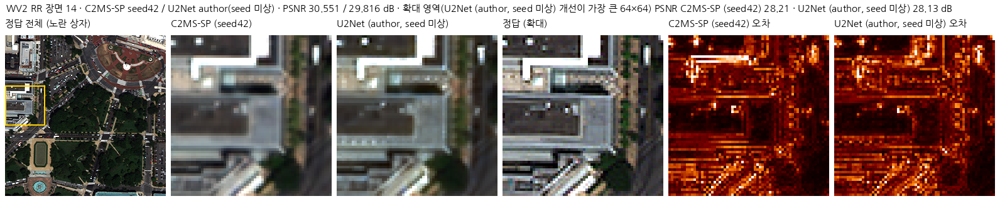

#### WV2 장면17

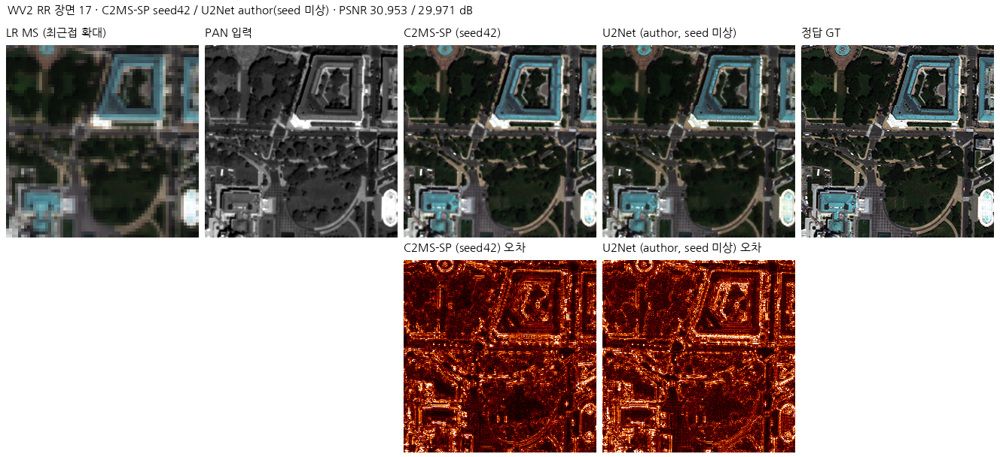


</details>

<a id="evidence"></a>

<details>
<summary><b>재현 자료</b> · 코드·가중치·수치·검증</summary>

- [공식 upstream](upstream) · [어댑터](model.py) · [설정](config.json)
- [저자 WV3 best 원본](checkpoints/author_WV3/best.pt): WV2도 이 가중치를 사용합니다. 우리가 학습한 latest·initial은 없으므로 Release 자산을 만들지 않았습니다.
- [WV3 전체20장 수치](results/author_WV3/metrics.json) · [WV2 전체20장 수치](results/author_WV2/metrics.json) · [집계](results/summary.json)
- [WV3 이미지·장면 수치](results/images/author_WV3/comparison_summary.json) · [WV2 이미지·장면 수치](results/images/author_WV2/comparison_summary.json)
- [평가 소스](provenance/evaluation_source) · [이미지 생성 당시 원본 소스](provenance/image_source) · [이미지 실행 환경](provenance/image_environment.json)
- [검증](results/verification.json) · [보관 manifest](manifest.json) · [원본 ZIP 출처와 해시](provenance/archive_sources.json)

원본 이미지 ZIP의 manifest75개와 이미지24개의 해시·PNG 형식, RR·FR 전체20장 평균을 확인했습니다. U2Net 동일 장면 PSNR 재현 오차는12장 모두0dB입니다. 보관 과정에서 실제 H5 재추론·재학습·MATLAB 평가를 수행하지 않았습니다.

실제 재평가에는 공식 하위 모듈과 H5 데이터가 필요합니다.

```bash
git submodule update --init SSA-MRN/benchmarks/u2net/upstream
python SSA-MRN/common/benchmark_evaluate.py --model u2net --setting author --sensor WV3 --device cuda
python SSA-MRN/common/benchmark_evaluate.py --model u2net --setting author --sensor WV2 --device cuda
python SSA-MRN/common/benchmark_evaluate.py --model u2net --summary
python SSA-MRN/common/verify.py --benchmark u2net
```

이미지의 기존 생성 조건은 보존된 `provenance/image_source/make_comparisons.py`와 package manifest에 있습니다. 이 원본 소스는 학습·평가 당시 경로를 포함하므로 현행 폴더명에 맞추려고 내용을 바꾸지 않았습니다. 기준 모델 가중치는 기존65번 경로를 참조하며 이 보고서 폴더에 중복 보관하지 않습니다.

</details>
