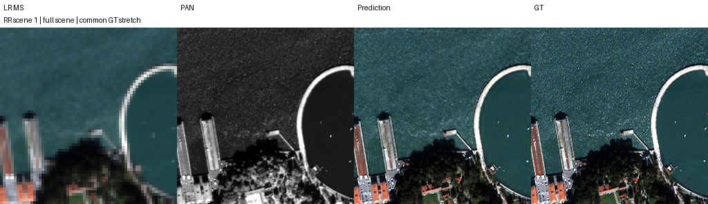
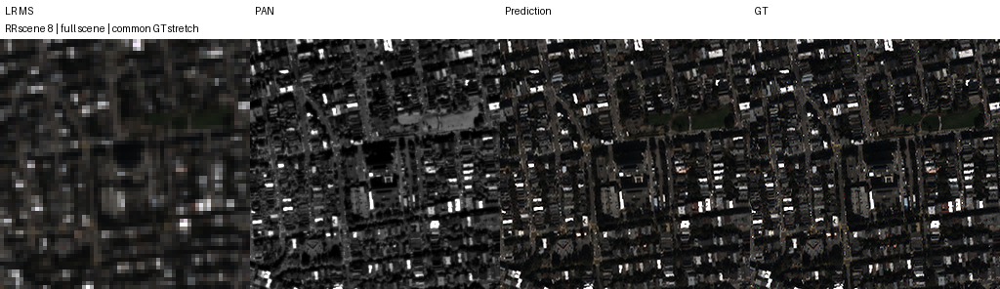
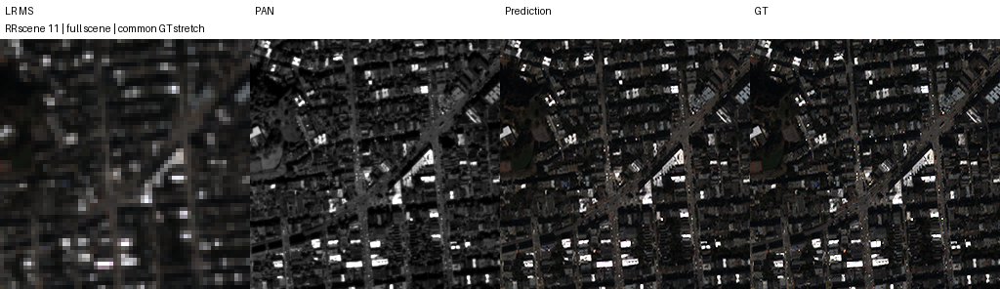
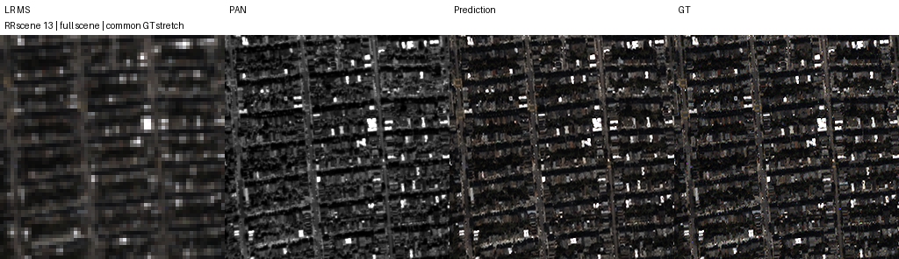
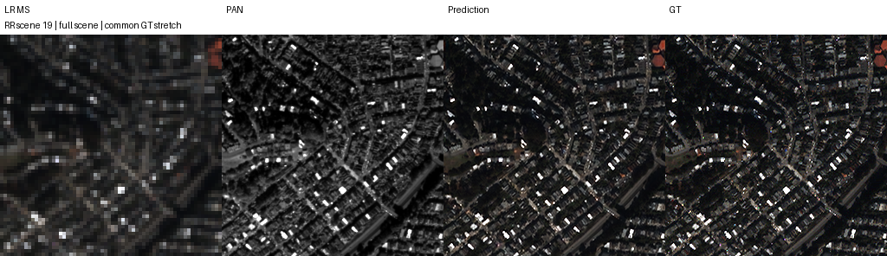

# QB B0/B1 K4 controlled experiment

| Reference | Change | Observed difference | Decision |
|---|---|---|---|
| Fresh B0 | B1 shared three-stage restoration | RR PSNR +0.300014 dB; provisional FR QNR -0.039261 | Review seed42 before deciding seed43 |

## 1. Purpose and status

Both models completed 100 epochs and full RR20/FR20 evaluation. Remote archival has not been verified.

## 2. Changes and conditions

QB; K4; seed42; batch=micro32; fused Adam; fixed lr1e-4; final output MSE; AMP FP16; channels-last; strict deterministic; TF32 disabled.
B0 is the original single-output adapter. B1 repeats the same core/error encoder/scalar alpha three times with zero error, trainable encoder bias and unconstrained alpha initialized to 0.1. No B2.
Identical initial core hashes and all 100 epoch order hashes were checked. See protocol.json and initialization_pair.json.
Best selected by FP32 validation MSE; test was not used for epoch/configuration selection.

## 3. Quantitative results

| Model | Best epoch | Validation MSE | RR PSNR | RR SAM | RR MSE peak1 | FR QNR provisional |
|---|---:|---:|---:|---:|---:|---:|
| B0 | 97 | 0.000172096363 | 37.371084 | 4.946089 | 0.000218160682 | 0.909722 |
| B1 | 94 | 0.000164554876 | 37.671097 | 4.838250 | 0.000202637929 | 0.870462 |

Scene rows and all metrics: [results](results.json), [paired differences](paired_comparison.json).

## 4. Previous research differences

Historical K6 B1 minus separately trained B0: PSNR +0.236541 dB, SAM -0.133224 deg, MSE -1.36760636e-5, provisional QNR -0.037049. Those runs differed in optimizer/session/order/resume and are not controlled K4 results.
Current B1-minus-B0 values are in paired_comparison.json. They are a single-seed observation.

## 5. Measured curves

## 6. Fixed RR panels

Selection was fixed before training: [selection.json](selection.json). MS panels share GT 1-99% contrast; LR uses nearest-neighbor enlargement. FR has no GT.

## 7. Weights and evidence

| Model | Weight | Epoch | SHA-256 |
|---|---|---:|---|
| B0 | [best](B0/best.pt) | 97 | 1b3aeacba79071f17809a83554f4673ee4cc3a726169f8d1bc033d74c153f86a |
| B0 | [latest](B0/latest.pt) | 100 | a5545785f2e301a806cd6aa15e8b856d02200e5ed69de3a38fdd072e1fdf1816 |
| B1 | [best](B1/best.pt) | 94 | 366328247b2a82203e298109906787b280b29dce8bb21094bcc8174969108cfa |
| B1 | [latest](B1/latest.pt) | 100 | 7fd93cce26c3bc45bcbf667dc1082574b55275ba0b20227c359d5da441bb643a |

Original best/latest include optimizer, scaler, RNG, batch cursor and measured history. artifact_manifest.json records artifact bytes/hashes; ZIP CRC and archive SHA-256 are verified locally. Preserve Saved Output and verify remote re-download/recovery before declaring archival complete.

## 8. Limitations and next decision

FR has no high-resolution GT. QNR/D_s use scikit-image bicubic rather than MATLAB-bit-exact resizing; Q2n/SCC parity also remains limited. Improvements are not guaranteed. Seed43 was not launched; decide after reviewing RR/FR differences and measured cost.
