# 기준 모델 C2MS 결과 이미지

원본 SSA-MRN과 현재 기준 모델 C2MS(seed 42)를 네 데이터셋의 RR test 고정 6장면(0-based 0·1·3·7·14·17)에서 비교한 이미지입니다. 장면 번호는 QB에서 정답 영상만 보고 풍경 종류로 고른 표준 번호이며, 다른 데이터셋에도 같은 번호를 썼습니다(결과를 보고 고르지 않았습니다). 장면별 정답 1-99% 공통 대비로 표시했고 수치는 원래 값으로 계산했습니다.

- **원본 크기 비교:** 위 줄은 LR MS(최근접 확대) · PAN 입력 · 원본 SSA-MRN · C2MS · 정답, 아래 줄은 원본과 C2MS의 |예측 − 정답| 지도입니다. 오차 지도는 원본 오차의 99퍼센타일을 공통 색 척도로 쓰며 밝을수록 오차가 큽니다.
- **확대 비교:** C2MS의 개선(원본 오차 − C2MS 오차)이 가장 큰 64×64 영역을 4배 확대했습니다. 왼쪽부터 정답 전체(노란 상자가 확대 영역) · 원본 · C2MS · 정답 · 원본 오차 · C2MS 오차입니다. C2MS에 유리하게 고른 영역이므로 전체 차이는 표의 장면 PSNR로 확인합니다.
- 두 형식 모두 원본 → C2MS → 정답 순서입니다.

[QB](#qb) · [GF2](#gf2) · [WV3](#wv3) · [WV2 전이](#wv2) · [루트 README](../../README.md)

## QB

RGB 밴드 [2,1,0]. QB로 학습·평가했습니다. 근거 실험: [성능 53번](../experiments/performance/53_scale_mixed_training/README.md).

| 장면 | 풍경 | 장면 PSNR 원본 → C2MS | 확대 영역 PSNR 원본 → C2MS |
|---:|---|---|---|
| 0 | 바다·항구 방파제 | 41.45 → 42.81 dB (+1.36) | 35.30 → 37.38 dB |
| 1 | 부두·곡선 방파제·수목 | 42.44 → 43.18 dB (+0.74) | 39.45 → 40.76 dB |
| 3 | 요트 마리나·운동장 | 36.22 → 37.96 dB (+1.74) | 33.03 → 35.36 dB |
| 7 | 숲 공원 | 38.83 → 39.41 dB (+0.57) | 36.54 → 38.12 dB |
| 14 | 언덕 공원·곡선 주택가 | 37.62 → 38.47 dB (+0.85) | 35.68 → 36.97 dB |
| 17 | 산지 녹지·산책로 | 38.73 → 39.40 dB (+0.67) | 35.11 → 36.09 dB |

**장면 0 · 바다·항구 방파제**

**장면 1 · 부두·곡선 방파제·수목**

**장면 3 · 요트 마리나·운동장**

**장면 7 · 숲 공원**

**장면 14 · 언덕 공원·곡선 주택가**

**장면 17 · 산지 녹지·산책로**

## GF2

RGB 밴드 [2,1,0]. GF2로 학습·평가했습니다(10bit, PSNR은 peak 2047 기준이라 약 6 dB 높게 표시). 근거 실험: [성능 54번](../experiments/performance/54_multi_sensor_scale_mixed_training/README.md).

| 장면 | 장면 PSNR 원본 → C2MS | 확대 영역 PSNR 원본 → C2MS |
|---:|---|---|
| 0 | 45.00 → 47.62 dB (+2.62) | 42.29 → 46.23 dB |
| 1 | 46.89 → 49.16 dB (+2.27) | 41.44 → 44.46 dB |
| 3 | 48.08 → 49.67 dB (+1.58) | 47.01 → 49.57 dB |
| 7 | 48.45 → 50.65 dB (+2.20) | 44.64 → 47.48 dB |
| 14 | 45.72 → 47.87 dB (+2.14) | 42.87 → 45.33 dB |
| 17 | 47.18 → 49.23 dB (+2.05) | 46.58 → 49.45 dB |

**장면 0**

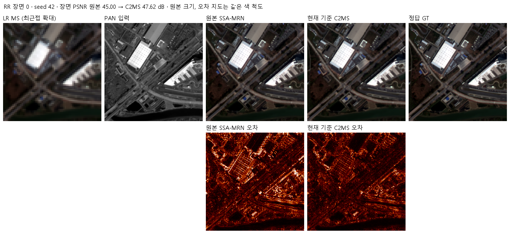

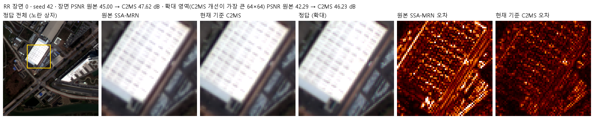

**장면 1**

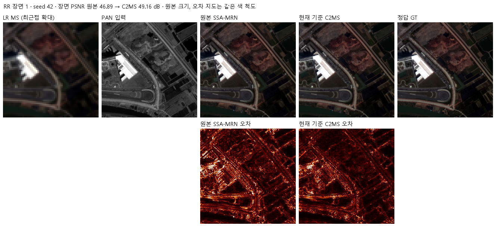

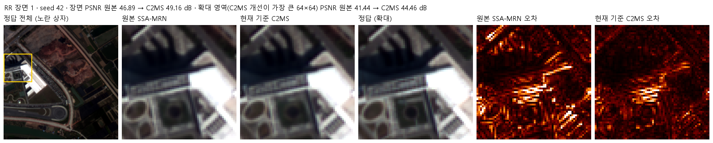

**장면 3**

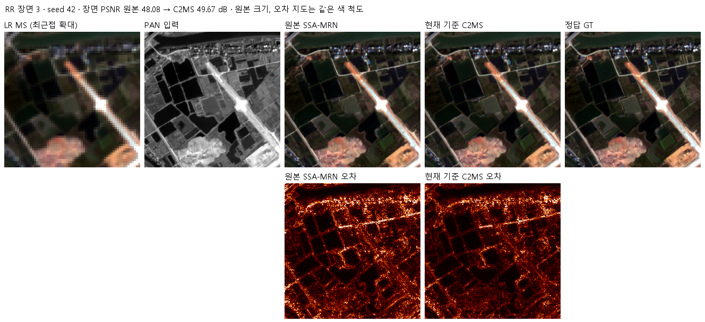

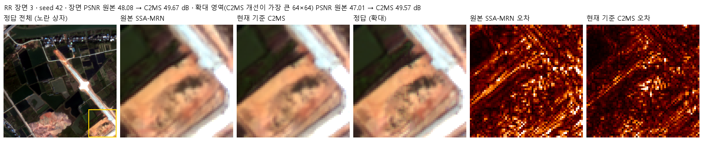

**장면 7**

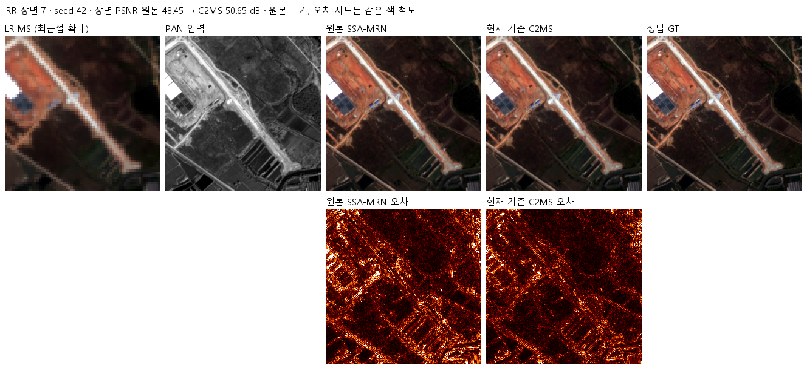

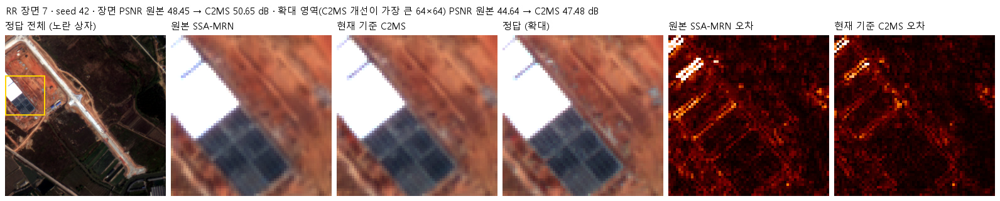

**장면 14**

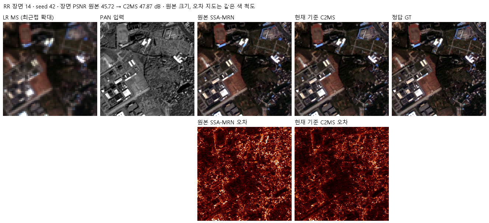

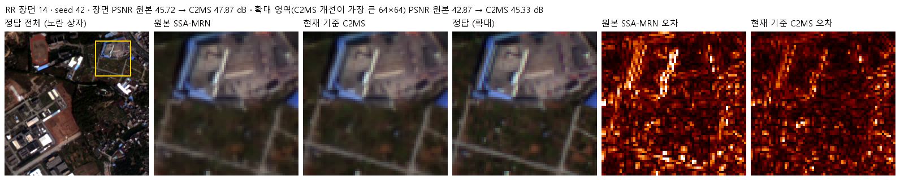

**장면 17**

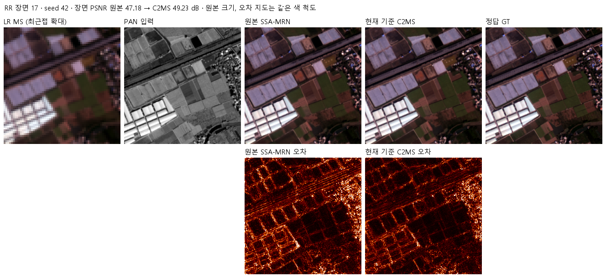

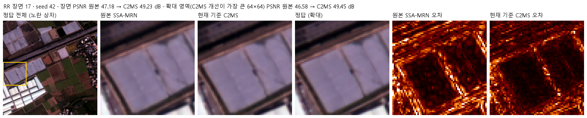

## WV3

RGB 밴드 [4,2,1]. WV3로 학습·평가했습니다. 근거 실험: [성능 54번](../experiments/performance/54_multi_sensor_scale_mixed_training/README.md).

| 장면 | 장면 PSNR 원본 → C2MS | 확대 영역 PSNR 원본 → C2MS |
|---:|---|---|
| 0 | 38.53 → 39.81 dB (+1.28) | 32.24 → 33.82 dB |
| 1 | 36.24 → 37.60 dB (+1.36) | 30.52 → 32.15 dB |
| 3 | 40.61 → 41.25 dB (+0.64) | 34.84 → 35.63 dB |
| 7 | 37.22 → 38.39 dB (+1.17) | 30.17 → 31.48 dB |
| 14 | 32.78 → 33.56 dB (+0.78) | 34.97 → 36.44 dB |
| 17 | 34.90 → 36.01 dB (+1.11) | 34.56 → 35.92 dB |

**장면 0**

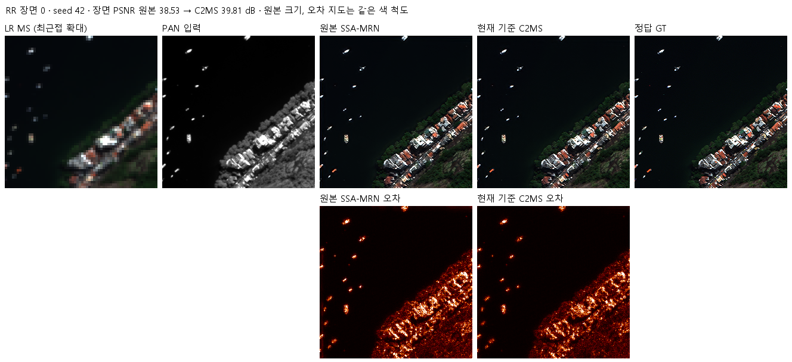

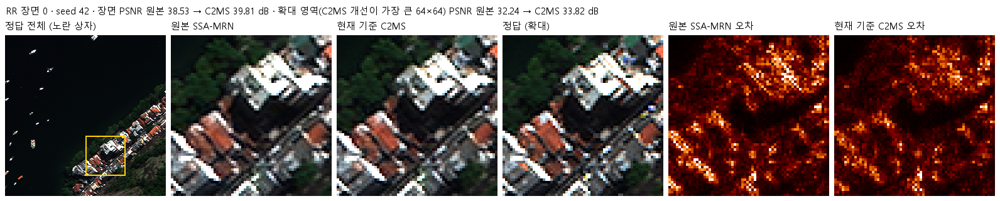

**장면 1**

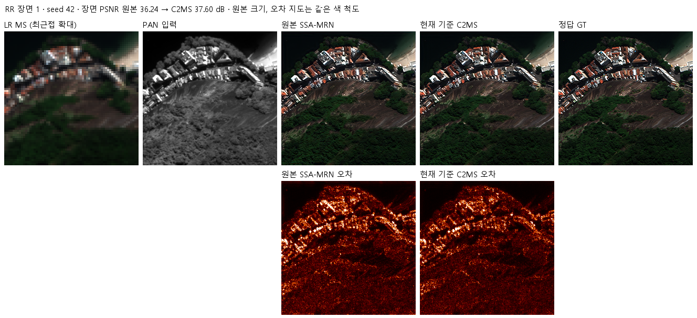

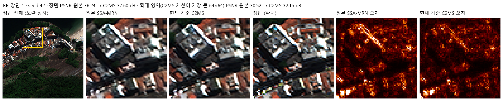

**장면 3**

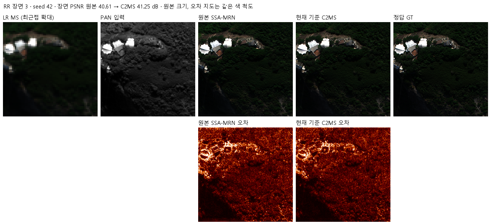

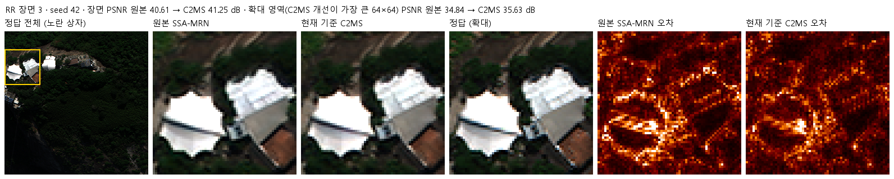

**장면 7**

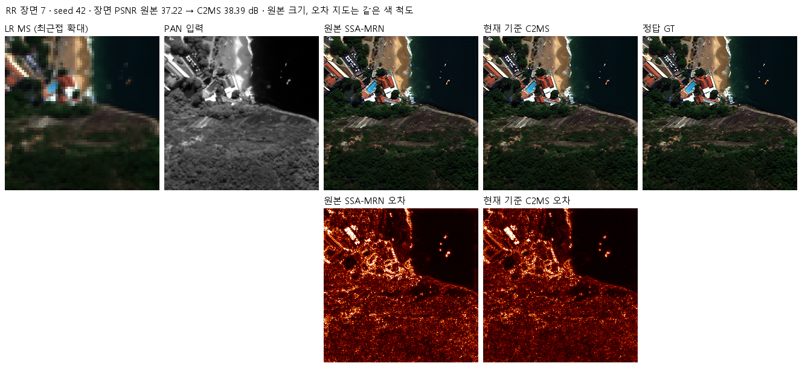

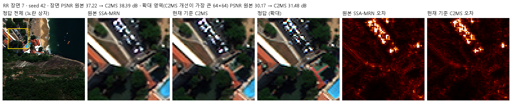

**장면 14**

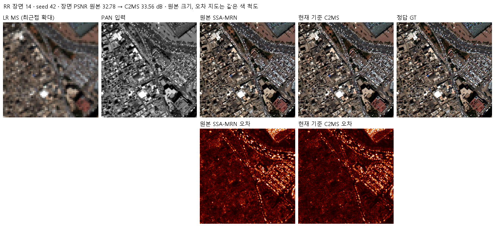

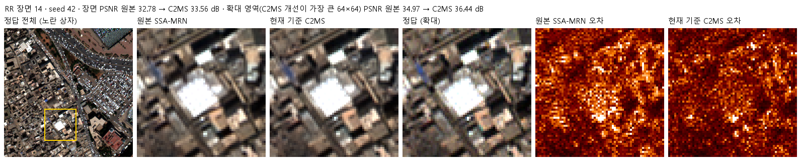

**장면 17**

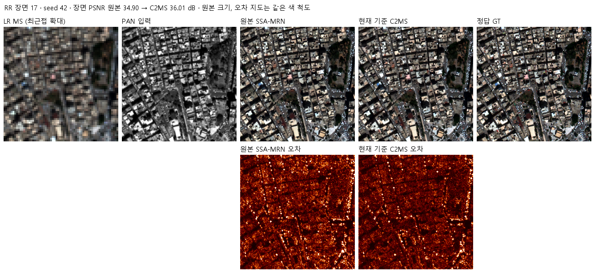

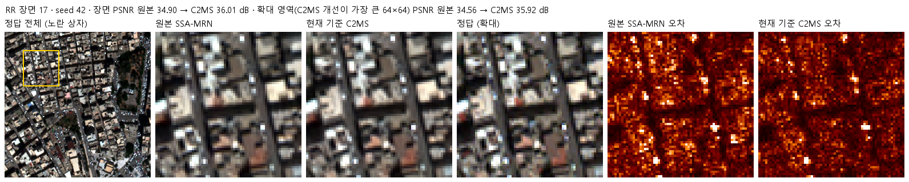

## WV2 전이

RGB 밴드 [4,2,1]. WV3로 학습한 모델을 학습하지 않은 WV2 test에 그대로 적용했습니다. 근거 실험: [성능 54번](../experiments/performance/54_multi_sensor_scale_mixed_training/README.md).

| 장면 | 장면 PSNR 원본 → C2MS | 확대 영역 PSNR 원본 → C2MS |
|---:|---|---|
| 0 | 27.80 → 28.69 dB (+0.89) | 26.15 → 27.76 dB |
| 1 | 26.02 → 26.82 dB (+0.79) | 24.14 → 25.29 dB |
| 3 | 33.71 → 34.94 dB (+1.23) | 27.19 → 28.56 dB |
| 7 | 28.38 → 29.18 dB (+0.80) | 24.03 → 25.14 dB |
| 14 | 27.91 → 28.93 dB (+1.02) | 26.07 → 27.92 dB |
| 17 | 28.43 → 29.39 dB (+0.96) | 26.41 → 27.86 dB |

**장면 0**

**장면 1**

**장면 3**

**장면 7**

**장면 14**

**장면 17**

