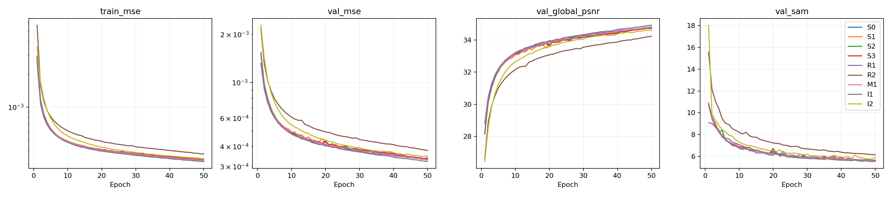
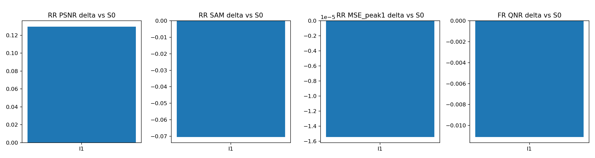
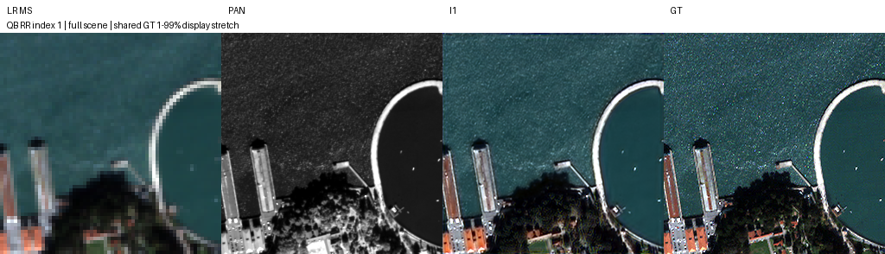
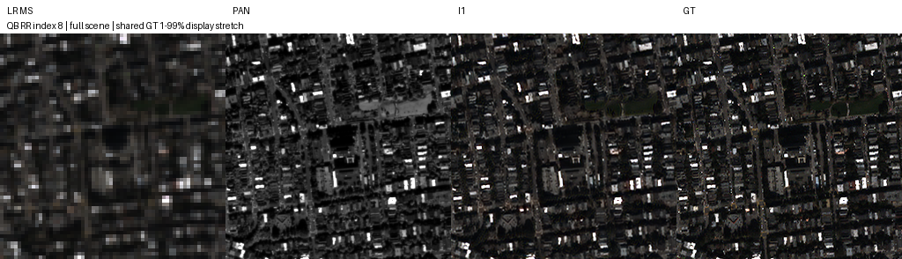
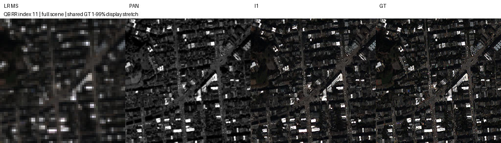
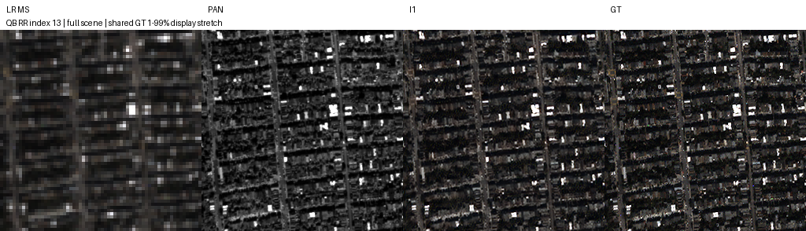
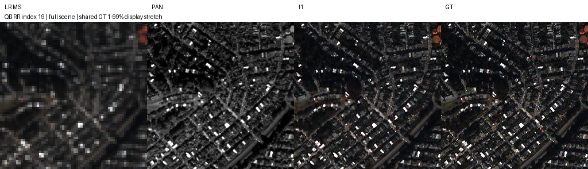

# SSAI 단계·잔차 복원·초기 입력 변경

**변경 내용:** SSAI 단계, 복원 잔차, LRPAN 입력을 분리해 비교했습니다.

| 확인된 결과 | 상태 | 개선 여부 |
|---|---|---|
| LRPAN 제거: PSNR +0.1297 dB, SAM −0.0704°, 잠정 QNR −0.0111 | 평가 완료 | **부분 개선** |

[실험 목록](../../README.md#experiments) · [수치](#results) · [그래프](#graphs) · [이미지](#images) · [가중치](#evidence)

| 비교 기준 | 이번에 바꾼 점 | 관측된 차이 | 판단 |
|---|---|---|---|
| 같은 서버·K4·seed42·batch256·50에폭 S0 | SSAI 단계·잔차 복원·초기 입력을9개 구조로 비교 | validation1위 I1: MSE −3.180%; RR PSNR +0.129676dB / SAM −0.070382°; 잠정 FR QNR −0.011093 | I1 후속 후보 유지, 종합 채택 보류 |

## 1. 목적과 상태

**전체 완료 확인: 2026-10-11 20:11:14 KST.** S0–S3/R1/R2/M1/I1/I2 각각50에폭, 합계450모델에폭을 수행했습니다. 실패 run은0개이고, 검증으로 선별한 I1과 기준선 S0의 전체 RR20장·FR20장(두 모델 합계80회 장면 평가)을 완료했습니다. 최상위 후보의 추가50에폭 연장은 하지 않았습니다.

당시 실행 소스 SHA는 [plan](../assets/windows_structure_qb_50/plan.json)에 고정했습니다. RR은 합성 축소 평가, FR은 HR 정답이 없는 원래 해상도 평가입니다. 17139/1905는 train/validation **패치 수**이며 독립 장면 수로 해석하지 않습니다.

## 2. 변경한 구조와 비교 조건

|항목|실제 조건|
|---|---|
|데이터|QB 기존 전체 train17139 / validation1905, 원본 H5·분할 유지|
|입력·범위|train PAN/LMS/GT64×64, MS16×16; DN/2047 FP32 공유 mmap|
|RR / FR|각20장; RR PAN/LMS/GT256×256·MS64×64; FR PAN/LMS512×512·MS128×128, GT 없음|
|모델·학습|**K4**, seed42, Adam lr1e-4, GT MSE, 50에폭, effective/micro batch**256**, 일정 LR|
|장치|Windows11·Ryzen5600X·RAM15GB·RTX3060Ti8GB 한 장, 두 프로세스 최대 병렬|
|정밀도|train AMP FP16/GradScaler, validation/test FP32, TF32 off, cuDNN benchmark on|
|초기화·샘플 순서|공통 계층 초기값 일치, epoch별 seed42+epoch permutation 공통, 새 계층은 별도 추가|
|체크포인트|최소 validation MSE → 동률 validation SAM → 고정 대기열 순; test로 선택 변경 없음|
|입력 보간|기존 bilinear·align_corners=True 유지; I1도 초기 LRPAN 경로만 제거, 이후 PAN 경로 유지|

[S0 원본 출력 정확 일치·9개 역전파·optimizer/AMP 재개 검증](../assets/windows_structure_qb_50/preflight.json)을 통과했습니다. Windows worker2·전송·validation·저장 경로도 별도 smoke로 검증했습니다. 실행은 SSH와 독립된 WMI 컨트롤러이며 [운영 명령](../operations/structural_ablation.md)에 기록했습니다.

실데이터32/64/128/256 측정 후 사용자 승인으로 batch256을 공통 선택했습니다. 합산965patch/s·전체 VRAM 최고4908MiB였고 실제 S0/S1 시작 시 GPU100%·약5.2GB를 확인했습니다. 단독 R2 측정1387patch/s보다 합산 속도가 낮았으며, 다른 후보·짧은 예비 측정이므로 정확한 병렬 가속비는 아닙니다. 유효 배치32에서256으로 바뀌면서 epoch당 optimizer update는536→67회로 감소했습니다. **50에폭은3350회 nominal update**이며 이전100에폭/batch32와 동일 학습량이 아닙니다.

S1/S2는 해당 SSAI의 최종 기여를0으로 하고, S3는 작은 SSAI만 제거해 decoder의 원본 MS를 유지합니다. R1은 마지막 출력을LMS+잔차로, R2는 작은/중간/전체 단계에서 잔차를 누적합니다. M1은 작은 SSAI를 현재 작은 특징+MS의1×1/3×3 밴드 혼합으로 교체합니다. I2는 PAN/LRPAN과 LMS를 별도 stem으로 추출합니다. I2 stem은3520→3744parameters(+6.4%), 전체 모델426654→426878(+0.05%)다. 구현은 [windows_structure.py](../../src/ssamrn/models/windows_structure.py)에서 확인할 수 있습니다.

## 3. 정량 결과

### 동일50에폭 validation 선별

|순위|구조|best epoch|best MSE ↓|S0 대비|best에서 SAM ° ↓|
|---:|---|---:|---:|---:|---:|
|1|I1 · 초기 LRPAN 제거|50|0.000321335936|-3.180%|5.540670|
|2|S2 · 중간 SSAI 기여 제거|50|0.000328822141|-0.925%|5.549940|
|3|M1 · 작은 SSAI → MS 밴드 혼합|50|0.000329346775|-0.767%|5.553734|
|4|R1 · 마지막 단계 LMS 잔차|50|0.000330485209|-0.424%|5.586159|
|5|S0 · 원본 K4 기준선|50|0.000331891632|+0.000%|5.595403|
|6|S1 · 전체 SSAI 기여 제거|50|0.000334356309|+0.743%|5.616693|
|7|S3 · 작은 SSAI 기여 제거, MS 유지|49|0.000335566938|+1.107%|5.621646|
|8|I2 · PAN/LRPAN·LMS 특징 분리|49|0.000345783498|+4.186%|5.745541|
|9|R2 · 세 단계 잔차 복원|50|0.000376525379|+13.448%|6.141185|

모든 run은50에폭을 끝냈입니다. S3/I2의 best49와 총 학습50은 다릅니다. **7/9개가 마지막50에폭에서 best**이므로, 충분히 수렴한 최종 순위로 판단하지 않습니다. S2/M1/R1의 작은 개선은 validation 신호이며 전체 test 결과가 아닙니다.

### validation1위 I1과 S0의 전체 test

|지표|S0|I1|I1−S0|
|---|---:|---:|---:|
|RR PSNR dB ↑|34.5420740809|34.6717500871|+0.12967600624|
|RR SAM ° ↓|6.19086204461|6.12047988658|-0.0703821580274|
|RR MSE peak1 ↓|0.000432411068996|0.000416988651862|-1.54224171345e-05|
|RR ERGAS ↓|5.81236140649|5.70914034119|-0.103221065298|
|RR Q4 ↑|0.884577014179|0.887934146572|+0.00335713239304|
|RR 고정 경계 MSE ↓|0.00106177764818|0.00103303683249|-2.87408156861e-05|
|FR QNR ↑ · 잠정|0.864486805183|0.853394142004|-0.0110926631792|
|FR Dλ ↓|0.0336031635606|0.0356357719749|+0.00203260841434|
|FR Ds ↓|0.105991220833|0.115683051413|+0.00969183057994|
|FR bilinear LR 일치 MSE ↓|0.00207752310248|0.00208474241305|+7.21931056997e-06|

I1의 RR PSNR·SAM은 각각 **20/20장 개선**됐지만 잠정 FR QNR은 **20/20장 악화**됐습니다. RR MSE는약3.567% 감소했고, FR bilinear LR 일치 MSE는약0.348% 증가했습니다. 초기 LRPAN 제거가 이 예산에서 RR 복원에 도움을 준 신호는 있으나 FR 포함 종합 개선은 확인되지 않았습니다.

[장면별 원본 수치·전체 평균](../assets/windows_structure_qb_50/evaluation/metrics.json) · [9개 validation 순위](../assets/windows_structure_qb_50/ranking.json).

MSE는 peak1 정규화, validation PSNR은global MSE에서 유도한 값, RR PSNR은peak2047에서 밴드별 PSNR의 산술평균입니다. 두 PSNR 정의를 혼용하지 않습니다. 경계 MSE는 GT 밝기 gradient 상위25% 고정 마스크로 계산합니다. FR bilinear LR 일치도는 실제 센서 MTF를 검증한 지표가 아니며 QNR·Q4/SCC의 MATLAB parity도 미확인입니다.

## 4. 기준선 대비 차이와 해석

직전 Windows K4 손실 연구의100에폭 MSE 기준선과 이번50에폭 S0의 관측 차입니다. **이번 조건은 batch256·AMP이고 이전은batch32·FP32다.** nominal optimizer update도53600→3350회로 달라져 구조 변화의 효과로 해석할 수 없습니다. I1의 구조 효과 판단은 위 동일 조건 S0 비교로 한정합니다.

|지표|이전 Windows 기준선|이번 S0|관측 차이|
|---|---:|---:|---:|
|RR PSNR|37.4577403869|34.5420740809|-2.91566630607|
|RR SAM|4.95544885127|6.19086204461|+1.23541319333|
|RR MSE_peak1|0.000213909186449|0.000432411068996|+0.000218501882547|
|FR QNR|0.90458869202|0.864486805183|-0.0401018868369|

이전 값의 출처: [Windows 손실 연구](auxiliary_losses.md). K6·다른 서버/구조·100/200에폭 실험과도 직접 개선량을 비교하지 않습니다.

## 5. 학습·평가 그래프

9개450에폭의 원본 epoch 기록을 사용했습니다. 마지막 epoch 누락이나 추정 보간은 없습니다.

## 6. 결과 이미지

사전 고정 **RR index1/8/11/13/19**, 오름차순·전체 장면이며 결과를 보고 선택하지 않았습니다. seed42를 선택 manifest에 기록했지만 실제 인덱스는 고정 지정입니다. 패널은 **LR MS · PAN · I1 예측 · GT** 순서입니다. 입력과 추론을 자르지 않았고 LR MS만 최근접 확대했습니다. RGB 밴드[2,1,0]는 표시 가정이며 MS·예측·GT에는 GT1–99percentile의 동일 대비를 적용했습니다. FR에는 GT를 만들지 않았습니다.

같은5장면의 S0 패널도 가중치와 함께 보관했습니다.

## 7. 재현 자료

현재 보존 파일은 `python SSA-MRN/scripts/verify_experiment.py --experiment structural_ablation`으로 해시를 확인합니다. 이 명령은 모델 추론이나 지표 재계산을 수행하지 않습니다. 과거 보관 manifest는 당시 전체 산출물 목록이며, 이번에 제거한 예측 배열·로그·캐시는 [정리 기록](../cleanup_manifest.json)에 남겼습니다.

**실제 학습된 원본 best/latest18개**를 `docs/assets/windows_structure_qb_50/runs/<ID>/`에 보관합니다. model·Adam·GradScaler·RNG·next batch·partial epoch 집계·실제 실행 config를 포함하며 inference 전용으로 축약하거나 재저장하지 않았습니다. 원본 server inventory68개 파일과 다운로드 해시가 일치합니다.

|근거|위치|
|---|---|
|가중치 epoch·원본 SHA|[server_inventory.json](../assets/windows_structure_qb_50/server_inventory.json)|
|전체 파일 해시|[report_manifest.json](../assets/windows_structure_qb_50/report_manifest.json)|
|정확한 조건·실행 코드 SHA|[plan.json](../assets/windows_structure_qb_50/plan.json)|
|train/validation 원본·캐시 SHA|[data_manifest.json](../assets/windows_structure_qb_50/data_manifest.json)|
|독립20장 데이터 shape|[test_data_shapes.json](../assets/windows_structure_qb_50/test_data_shapes.json)|
|전체 test·예시 선택|[metrics.json](../assets/windows_structure_qb_50/evaluation/metrics.json) · [selection.json](../assets/windows_structure_qb_50/evaluation/selection.json)|
|각 run50개 epoch 기록|`runs/<ID>/history.json`, `complete.json`, 원본train.log|
|검증 명령|`python SSA-MRN/scripts/verify_experiment.py` (`--check-torch`로 가중치 strict load)|

서버 원본: `C:\CtrS-structure-suite\runtime\qb_structure_50`. 훈련 캐시·원본 데이터는 Git에 넣지 않았고 서버 실행 폴더도 삭제하지 않았습니다../operations/windows_structure_recovery.json)을 통과했습니다. 18개 strict load·9개 best 모델 추론·S0/I1 실제RR 장면0의 CPU 재추론 MSE를 보관CUDA 결과와 대조했다(rtol1e-4).

## 8. 개선 여부와 다음 단계

**판정: 부분 개선.** 위 결과는 해당 보고서의 비교 조건에 한정합니다. 지표 일부의 개선을 최종 모델 채택으로 해석하지 않습니다.

1. **기본 SSA-MRN K4 유지, I1은 후속 후보.** RR 개선과 FR 악화가 함께 관측돼 즉시 기본 구조를 교체하지 않습니다.
2. 최적화가 아직 진행되는50에폭 단일seed42 선별입니다. R2/I2의 초기 순위만으로 구조의 가능성을 폐기하지 않습니다.
3. 다음 비교를 승인받으면 I1·S0를 동일한 더 충분한 optimizer update 예산으로 재검증하고, 이후 반복 시드·GF2/WV3로 확장합니다. 자동 추가 학습은 실행하지 않았습니다.
4. S2/M1/R1은 작은 validation 신호를 보였지만 test를 보지 않았습니다. 최종 후보를 test로 다시 고르는 다중 비교는 하지 않습니다.
5. RR 합성 축소 개선을 실제 해상도 정답 정확도로 주장하지 않습니다. 별도 Bit-Plane 실험은 이번450에폭에 포함되지 않았습니다.
