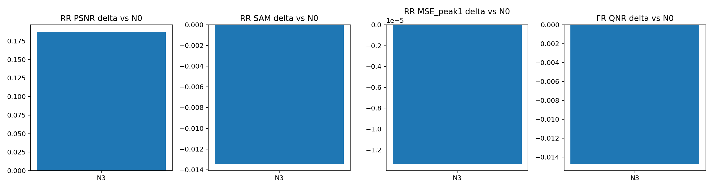
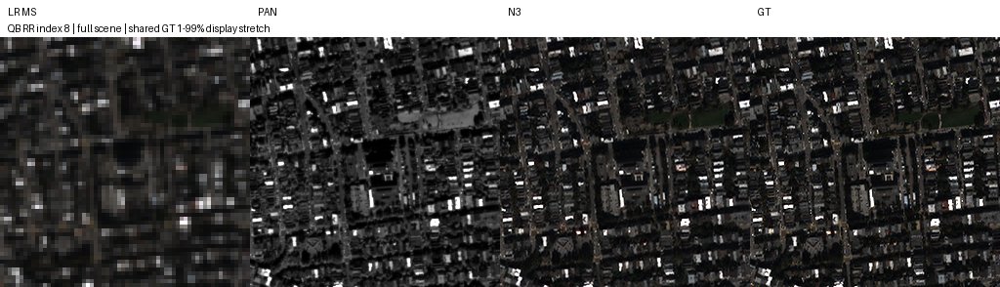
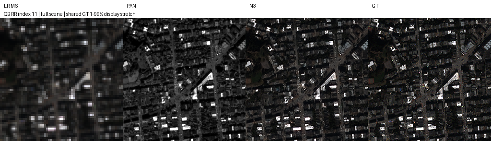
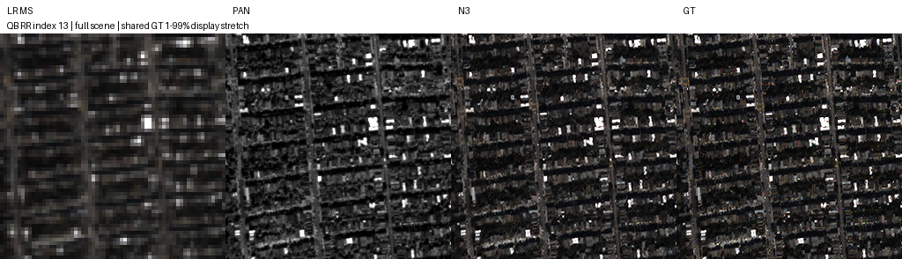
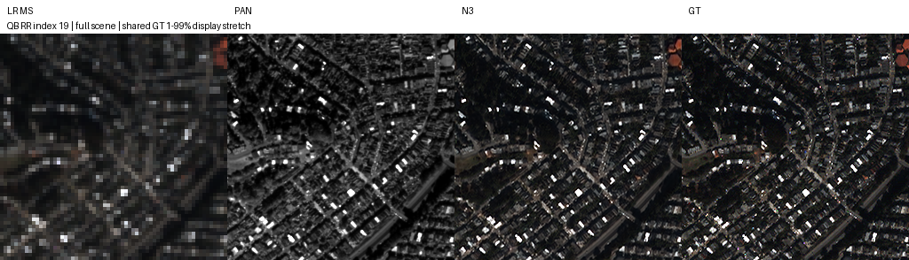

# Windows QB K4 · 작은 특징 보존과 PAN 기여량 조절

[수치](#results) · [그래프](#graphs) · [이미지](#images) · [가중치](#evidence)

| 비교 기준 | 바꾼 점 | 관측 차이 | 판단 |
|---|---|---|---|
| 새 N0, QB K4·batch64·각50에폭 | 작은 특징 전달을 SSAI와 병렬화; 초기 LRPAN 기여량 조절 | N3 validation MSE −1.990%; RR PSNR +0.187482dB / SAM −0.013421°; 잠정 FR QNR −0.014702 | N3 후속 후보, 기본 구조 채택 보류 |

## 1. 목적과 상태

직전 [9개 구조 선별](windows_structure_qb_50.md)에서 I1은 RR PSNR +0.129676dB·SAM −0.070382°지만 잠정 FR QNR −0.011093을 기록했다. M1은 validation MSE −0.767%, S3는 +1.107%였다. 작은 SSAI 제거가 특징 전달까지 없애는 혼동을 풀고, 초기 LRPAN의 제거 대신 학습 가능한 기여량 조절을 검증한다.

**2026-10-11 22:29:45 KST 전체 완료.** N0~N5 각각50에폭·합계300모델에폭, 실패0개다. N5는 사전 validation 조건 충족으로 실행됐다. N3를 validation으로 선택한 뒤 N0/N3 각RR20·FR20(합계80장면 평가)을 완료했다. [원본 순위](../assets/windows_coarse_anchor_qb_50/ranking.json) · [운영·실측](../operations/windows_coarse_anchor_queue.md).

## 2. 변경 사항과 평가 조건

QB 전체 train17139/validation1905패치, K4, seed42, Adam1e-4, MSE, 각50에폭, effective/micro batch64, train AMP FP16·validation/test FP32, TF32 off. 기존 bilinear 입력·분할·정규화 DN/2047을 유지한다. RTX3060Ti8GB에서 최대2개 프로세스가 자동 대기열을 실행한다.

| ID | 구조 | 직접 비교 |
|---|---|---|
| N0 | 기존 S0 | 공통 기준선 |
| N1 | 기존 I1: 초기 LRPAN 제거 | N0 |
| N2 | 기존 M1: 작은 특징+MS 밴드 혼합 | N0 |
| N3 | N2의 혼합 특징 + α×기존 작은 SSAI | N2 |
| N4 | 초기 LRPAN 특징 ×g | N0/N1 |
| N5 | N3+N4 | 두 개별 변경의 validation 개선이 모두 있을 때만 실행 |

α=0, g=1로 시작하는 학습 가능한 제한 없는 스칼라다. N3의 초기 출력은 N2, N4는 N0, N5는 N2와 같다. 게이트는 음수 또는1초과도 가능하고 epoch별로 기록한다. 특징 B에는 앞선 PAN 융합이 들어 있으므로 PAN을 전혀 안 쓰는 MS 경로로 해석하지 않는다. B는 이전 M1과 같은8→16→4 혼합으로, 모델 파라미터는 N0 426654, N2 427379, N3 427380, N4 426655, N5 427381이다. N3 대 N2의 추가 학습 파라미터는 스칼라1개지만 활성 SSAI 연산량도 증가한다.

N5 조건은 **N3 best validation MSE < N2, N4 < N0**이며 test를 보기 전에 결정한다. 미충족이면 skipped로 기록한다. 슬롯이 비면 대기 순서 N0→N1→N2→N3→N4에서 다음 run을 시작하고 N5는 선행 비교 종료 후 판단한다. 자동 추가50에폭 연장은 없다.

## 3. 정량 결과

| 순위 | 구조 | best epoch | validation MSE ↓ | N0 대비 | SAM ° ↓ |
|---:|---|---:|---:|---:|---:|
| 1 | N3 | 50 | 0.000215761763 | -1.990% | 4.947362 |
| 2 | N4 | 50 | 0.000216953308 | -1.449% | 4.971977 |
| 3 | N1 | 49 | 0.000218929692 | -0.551% | 4.961076 |
| 4 | N5 | 50 | 0.000219234724 | -0.412% | 4.969836 |
| 5 | N2 | 50 | 0.000219390734 | -0.341% | 5.018712 |
| 6 | N0 | 49 | 0.000220142513 | +0.000% | 4.958814 |

| 지표 | N0 | N3 | N3−N0 |
|---|---:|---:|---:|
| RR PSNR | 36.4043329958 | 36.5918146356 | +0.187481639831 |
| RR SAM | 5.40453398593 | 5.3911127021 | -0.013421283824 |
| RR ERGAS | 4.68019757466 | 4.57926879612 | -0.100928778539 |
| RR MSE_peak1 | 0.000278513827248 | 0.000265184869485 | -1.33289577628e-05 |
| RR edge_MSE_peak1 | 0.000649088029906 | 0.000605595137924 | -4.34928919819e-05 |
| RR Q2n | 0.910589968388 | 0.913544093385 | +0.00295412499639 |
| FR QNR | 0.885286225315 | 0.870584445447 | -0.0147017798682 |
| FR D_lambda | 0.0414095424727 | 0.0525172979823 | +0.0111077555096 |
| FR D_s | 0.0771564176303 | 0.0818058035709 | +0.00464938594063 |
| FR LR_MSE_bilinear_peak1 | 0.00224973269157 | 0.00227391774045 | +2.41850488858e-05 |

N3의 RR PSNR은20/20중19장, SAM은10장 개선됐다. FR QNR은20장 모두 악화됐다. RR MSE는약4.786% 감소했지만, FR 분광·공간 왜곡 모두 늘어 기본 구조 채택을 보류한다. [장면별 원본 수치](../assets/windows_coarse_anchor_qb_50/evaluation/metrics.json).

N3는N2 대비 validation MSE 약1.654% 낮았다. N5 결합은N3보다약1.61% 높아 이번 예산에서 결합 이득이 없다. N2/N4/N5의RR/FR는 평가하지 않았으므로 해당 구조의 test 우위를 주장하지 않는다. 50에폭에서α는N3 0.010512/N5 0.012232, g는N4 0.974508/N5 0.972977이다. 스칼라 값은 내부 특징 크기와 재매개변수화에 의존하므로 PAN의정보 기여율로 해석하지 않는다.

validation PSNR은global MSE 기반이고 RR PSNR은밴드별 산술평균으로 정의가 다르다. FR에는HR정답이 없고 QNR·Q4/SCC의MATLAB parity는미확인이다.

## 4. 직전 연구와 수치 차이

직전batch256은50에폭3350updates, 이번batch64는약13400updates다. 배치와 학습량이 다르므로 직전 순위와 직접 구조 개선량을 계산하지 않는다. 이번 cohort의 N0를 기준으로 해석한다.

## 5. 그래프

## 6. 결과 이미지

사전 고정 RR index1/8/11/13/19 전체 장면이다. LR MS·PAN·N3 예측·GT 순이며 LR MS만표시를 위해 확대했다. RGB밴드[2,1,0]는가정, GT1~99percentile의공통 대비를MS·예측·GT에적용했다. 입력·추론을자르지 않았고 FR GT를만들지 않았다. N0의같은5장면도보관했다.

## 7. 가중치·검증 근거

run별 best/latest/previous, model·Adam·GradScaler·RNG·epoch·next batch·partial epoch 합계·config fingerprint를 저장한다. latest는5분 간격과 매에폭 원자적으로 저장하고, latest가 없으면 previous를 복구한다. best는 validation 선별용이며 best에서 목표50에폭을 다시 시작하지 않는다.

서버 runtime의 plan/data manifest·source SHA·preflight·benchmark·cleanup 기록을 유지한다. **실제 학습된 원본 best/latest12개**를 `docs/assets/windows_coarse_anchor_qb_50/runs/`에 보관한다. 원본 79개 파일이 서버 inventory와 SHA가 일치하며 가중치를 재저장하지 않았다. 원시 실행 source_snapshot은 CRLF까지 보존한다. 전달 코드는 LF로 고정하고 원시 snapshot과 개행을 정규화한 내용이 일치한다. [서버 inventory](../assets/windows_coarse_anchor_qb_50/server_inventory.json) · [전체 보관 manifest](../assets/windows_coarse_anchor_qb_50/report_manifest.json).

검증: `python SSA-MRN/scripts/verify_coarse_anchor_results.py --check-torch --data C:/CtrS/SSA-MRN/data/dataset/QuickBird`. 원격 독립 clone 복구 결과는 전달 완료 시 운영 기록에 반영한다.

## 8. 한계와 다음 판단

단일 QB·seed42·50에폭 선별이다. cuDNN benchmark로 비트 단위 재현은 보장하지 않는다. 초기 출력 정확 일치·게이트 역전파·AMP/Adam 복구 오차·Windows persistent worker의 epoch/재개 샘플 순서를 검증했다. 복구 허용 오차 rtol1e-6/atol1e-8을 명시한다. FR QNR 및Q4/SCC의 MATLAB parity는 미확인이다. 추가 시드·GF2/WV3 확인 전 기본 구조를 자동 교체하지 않는다.

4/6개 best가 50에폭이므로 최종 수렴 순위로 단정하지 않는다. N3는 RR 개선·FR 악화의 후속 후보이며 현재 K4 원본 기준선을 유지한다. 이번 실험은 추가 시드·다른 센서 확장이나 추가 50에폭 재개를 수행하지 않았다.
