# QB · 분리 특징 경로와 반복 특징 융합 · Windows 50에포크

[실험 목록](../../README.md#experiments) · [수치](#results) · [그래프](#graphs) · [이미지](#images) · [가중치·근거](#evidence)

| 비교 기준 | 이번에 바꾼 점 | 관측된 차이 | 판단 |
|---|---|---|---|
| C0 원본 SSA-MRN K4 / C1 기존 B1 공유 3단계 | C2~C5: MS·PAN 경로 분리, 전체 크기 특징 유지, PAN 특징 차이, 공유 특징 보정 1/2회 | C1: RR PSNR +0.244200dB·SAM −0.188318°·잠정 FR QNR +0.024991. 신규 후보 C5: RR PSNR −0.921344dB | **C1 후속 검증 후보. C2~C5 이번 조건에서 채택 보류** |

## 1. 목적과 상태

**2026-10-12 02:43:36 KST에 6개 × 50에포크 = 총 300에포크와 자동 평가가 완료됐다.** 서버 완료 기록·전체 체크포인트·숫자를 확인했다. 큐의 실패·건너뛴 실험은 없고 AMP step 누락도 전 실험 0회다.

기존 B1·N3에서 관측한 RR 이득과 FR 악화의 원인을 탐색하기 위해 입력 융합과 작은 크기부터 복원하는 경로를 바꿨다. C0/C1은 기존 구조의 K4 대조군, C2~C5는 다중 크기 문맥을 유지하면서 SSAI 융합·복원 backbone을 교체한 새 구조다. 기반 main은 `383a7263a6c5703793949872d40224534ffbec30`, 브랜치는 `ssa-dual-stream-suite`다. 실행 소스는 당시 SHA-256과 원본 snapshot으로 고정했다.

## 2. 변경 사항과 평가 조건

| ID | 실제 구조 | 파라미터 |
|---|---|---:|
| C0 | 원본 복구 SSA-MRN K4 단일 출력 | 426,654 |
| C1 | 기존 B1: 동일 core, error encoder, 학습 가능한 α를 사용한 영상 3회 공유 갱신 | 426,803 |
| C2 | MS/LMS·PAN encoder 분리 → 전체/1/2/1/4 문맥 결합 → 특징 갱신 1회 | 587,812 |
| C3 | C2의 PAN guide를 `P−projection(S)`로 변경 | 587,812 |
| C4 | C2의 특징 갱신을 같은 가중치로 2회 반복 | 587,812 |
| C5 | C3의 특징 갱신을 같은 가중치로 2회 반복 | 587,812 |

C2~C5는 **LMS 4채널 + 확대한 MS 4채널을 함께 48개 특징 채널로 변환**한다. 밴드를 평균 내는 것은 아니지만, 기존 밴드별 SSAI 경로는 유지하지 않는다. PAN은 별도의 48채널 encoder를 거치고 최종 출력은 `LMS+head(S)`인 4밴드 영상이다. 신규 모델에 K 차원 연산은 없으므로 K4 모델로 부르지 않는다.

C2/C4의 guide는 `projection(P)`, C3/C5는 `P−projection(S)`다. 두 계열은 파라미터 수·shape·초기값이 같다. C3−C2는 projection 입력과 결합식의 변경 효과이며, PAN 공통 성분이 물리적으로 정확히 분리됐다는 의미는 아니다. 전체 특징을 유지하면서 전체/1/2/1/4 avg-pool 문맥을 합치고 `S←S+0.1×context`로 갱신한다. 고정 MTF 관측·wavelet·고주파 gate·추가 loss·LRPAN은 신규 경로에 추가하지 않았다.

| 공통 조건 | 실제 설정 |
|---|---|
| 데이터 | QB train 17,139 / validation 1,905 패치, RR 20장 / FR 20장 |
| 입력 | HR 64×64·LR 16×16, DN 2047 정규화 |
| 학습 | 새 학습 50에포크, seed 42, Adam lr 1e−4 고정, MSE |
| 배치 | micro = effective **96**, 마지막 불완전 배치 포함, 동일 epoch 순서(seed42+epoch) |
| 장치 | RTX 3060 Ti 8GB, Ryzen 5600X, RAM 15GB, 최대 2개 병렬 |
| 최적화 | AMP FP16 + GradScaler, worker 각 1개, TF32 비활성, cuDNN autotune |
| 평가·선택 | FP32; validation MSE 최소, 정확한 동률일 때 SAM·먼저 선택한 epoch |

가장 무거운 C4/C5 병렬 probe에서 6,396MiB를 사용했다. 배치 128은 7,974MiB여서 공통 배치 96을 채택했다. 실제 최적화 조건은 [plan](../assets/windows_dual_stream_qb_50/plan.json), [benchmark](../assets/windows_dual_stream_qb_50/benchmark.json)에 보존했다.

<a id="results"></a>
## 3. 정량 결과

### 6개 실험의 validation 비교

| ID | best epoch / 50 | Validation MSE ↓ | C0 대비 MSE | Validation SAM ↓ |
|---|---:|---:|---:|---:|
| C1 | 49 | 0.000227568 | -5.455% | 4.965278° |
| C0 | 50 | 0.000240698 | +0.000% | 5.094729° |
| C5 | 50 | 0.000304137 | +26.356% | 5.346969° |
| C3 | 50 | 0.000304757 | +26.614% | 5.343102° |
| C4 | 50 | 0.000317574 | +31.938% | 5.303864° |
| C2 | 50 | 0.000333633 | +38.610% | 5.328682° |

**전체 validation 1위는 C1, 신규 구조 C2~C5 중 1위는 C5다.** 규칙에 따라 C0·C1·C5만 전체 RR/FR를 평가했다. C2~C4의 test 수치는 없으며 아래 표에 임의로 채우지 않았다. C0 및 신규 4개 모두 마지막 50에포크가 best이므로 장기 수렴 여부는 미확정이다.

### 전체 독립 test 장면 평균

| 모델 | RR PSNR ↑ | RR SAM ↓ | RR ERGAS ↓ | 잠정 FR QNR ↑ | 잠정 FR D_s ↓ |
|---|---:|---:|---:|---:|---:|
| C0 | 35.998747 | 5.600549° | 4.924753 | 0.869386 | 0.089072 |
| C1 | 36.242947 | 5.412232° | 4.781581 | 0.894378 | 0.064691 |
| C5 | 35.077403 | 5.969577° | 5.504775 | 0.874230 | 0.100011 |

C0 대비:

- **C1:** PSNR **+0.244200dB**(17/20장), SAM **−0.188318°**(20/20장), ERGAS **−0.143172**(17/20장), MSE **−0.000017405**. 잠정 QNR **+0.024991**·D_s **−0.024381**(모두 20/20장).
- **C5:** PSNR **−0.921344dB**, SAM **+0.369028°**, ERGAS **+0.580022**(모두 20/20장 악화). 잠정 QNR **+0.004843**(10/20장 개선), D_s **+0.010939**(18/20장 악화). QNR 평균만으로 채택하지 않는다.

[전체 장면별 지표](../assets/windows_dual_stream_qb_50/evaluation/metrics.json) · [validation 순위](../assets/windows_dual_stream_qb_50/ranking.json) · [test 이전 후보 선택](../assets/windows_dual_stream_qb_50/evaluation/selected_models.json)

## 4. 직전 연구와 수치 차이

이번은 같은 실행 조건의 C0와 비교한 결과다. [이전 통제 B1](kaggle_b0_b1_k4_controlled.md)은 100에포크·배치32에서 RR PSNR +0.300014dB / SAM −0.107839° / 잠정 QNR −0.039261이었다. 이번 C1은 50에포크·배치96에서 +0.244200dB / −0.188318° / +0.024991이다. **FR 악화가 이번에는 재현되지 않았지만, 배치·에포크·학습 조건이 달라 그 원인을 구조만으로 설명할 수 없다.** 서로 다른 기준선의 절대 점수를 직접 비교하지 않는다.

[직전 N3](windows_coarse_anchor_qb_50.md)는 50에포크·배치64에서 +0.187482dB / −0.013421° / −0.014702였다. 이번 C5는 같은 C0보다 −0.921344dB / +0.369028° / +0.004843으로, RR 이득을 얻지 못했다.

신규 내부 비교에서 차이 guide는 validation MSE를 C3−C2 **−8.655%**, C5−C4 **−4.231%** 낮췄다. 반복은 C4−C2 **−4.813%**, C5−C3 **−0.204%**다. 개선은 새 계열 내부에 한정되며 C0 대비 가장 좋은 C5도 MSE가 **+26.356%** 높다.

<a id="graphs"></a>
## 5. 그래프

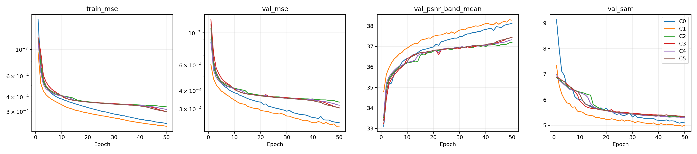

validation 밴드 평균 PSNR과 전체 MSE에서 유도한 global PSNR은 다른 계산이다. 보고서와 원본 history에서 구분했다.

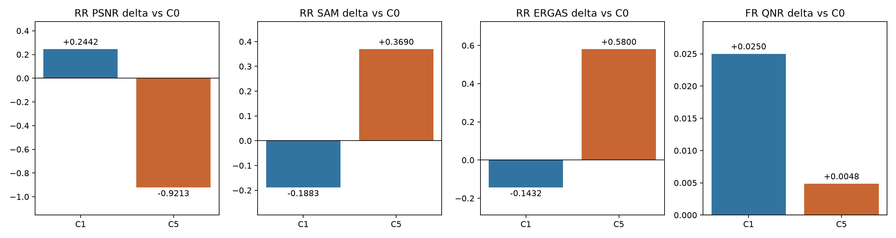

<a id="images"></a>
## 6. 결과 이미지 예시

사전 고정한 RR index **1·8·11·13·19**(0-based), 전체 장면을 사용했다. 순서는 **LR MS · PAN · 예측 · GT**, RGB [2,1,0] 가정, GT 1–99% 공통 표시 대비다. 입력을 자르지 않았고 LR MS만 최근접 확대했다. FR에는 GT를 만들지 않았다.

### C1 · 후속 검증 후보

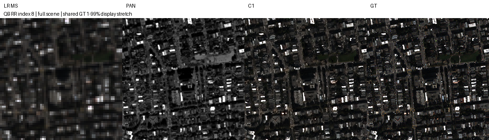

### C5 · 신규 경로 중 validation 1위

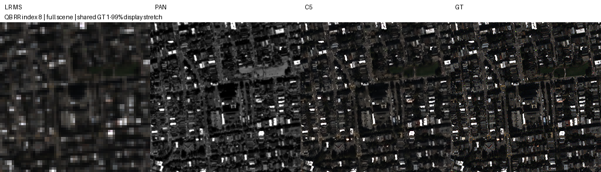

<details>
<summary>C0·C1·C5의 나머지 고정 장면 포함 15개 이미지</summary>


#### C0


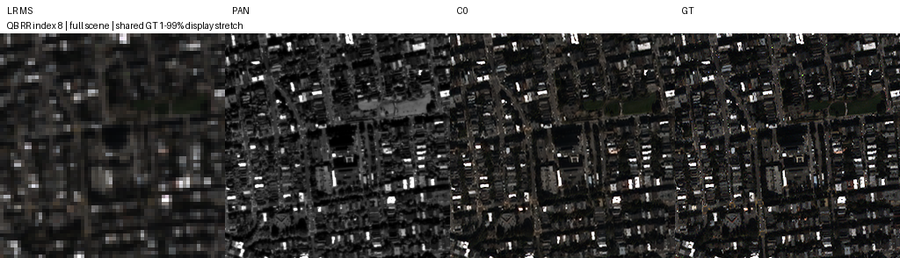

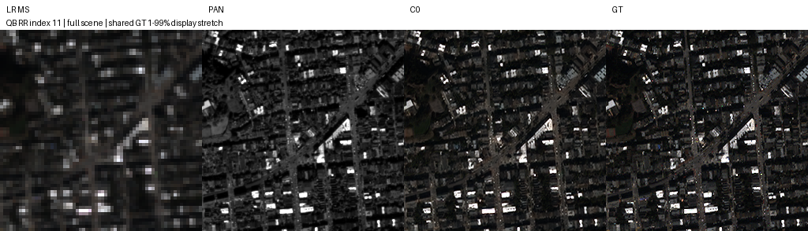


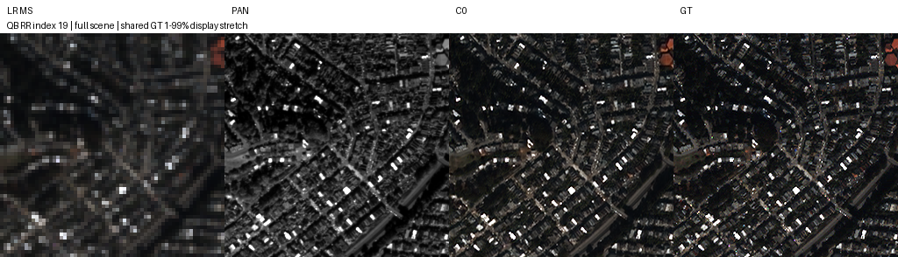


#### C1

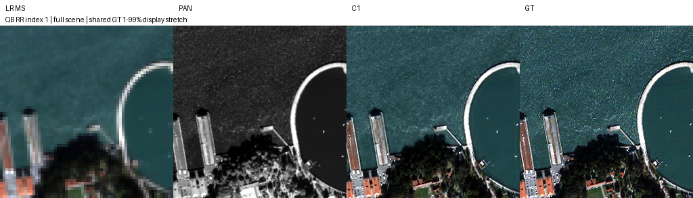


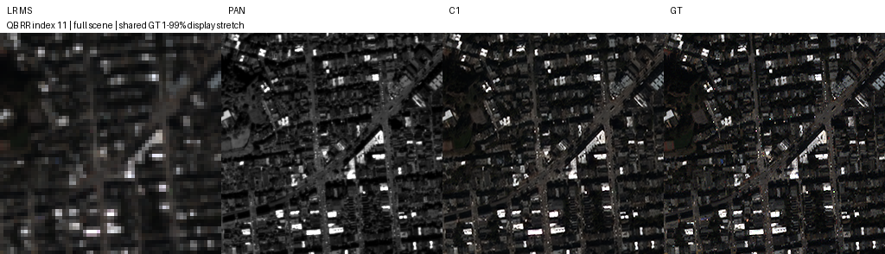

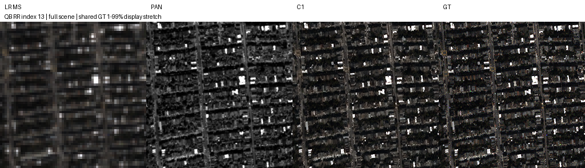

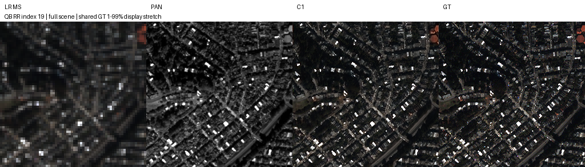


#### C5

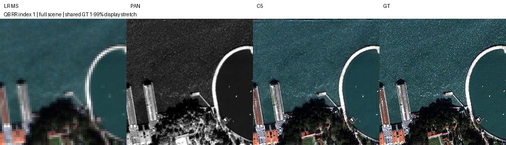


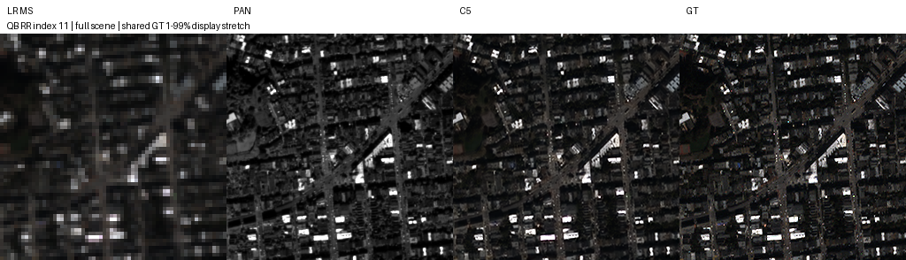

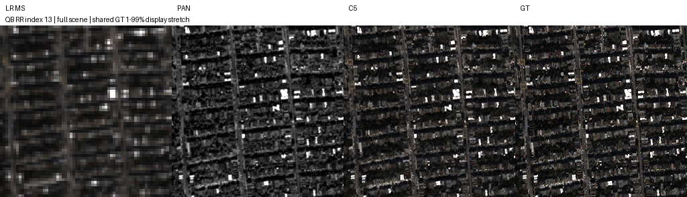

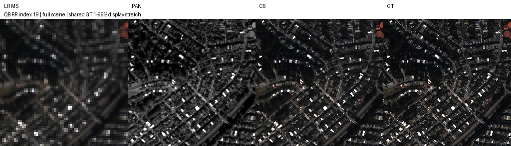

</details>

<a id="evidence"></a>
## 7. 가중치와 검증 근거

| 모델 | best epoch | best 가중치 | 마지막 epoch 50 가중치 |
|---|---:|---|---|
| C0 | 50 | [best.pt](../assets/windows_dual_stream_qb_50/C0/best.pt) | [latest.pt](../assets/windows_dual_stream_qb_50/C0/latest.pt) |
| C1 | 49 | [best.pt](../assets/windows_dual_stream_qb_50/C1/best.pt) | [latest.pt](../assets/windows_dual_stream_qb_50/C1/latest.pt) |
| C2 | 50 | [best.pt](../assets/windows_dual_stream_qb_50/C2/best.pt) | [latest.pt](../assets/windows_dual_stream_qb_50/C2/latest.pt) |
| C3 | 50 | [best.pt](../assets/windows_dual_stream_qb_50/C3/best.pt) | [latest.pt](../assets/windows_dual_stream_qb_50/C3/latest.pt) |
| C4 | 50 | [best.pt](../assets/windows_dual_stream_qb_50/C4/best.pt) | [latest.pt](../assets/windows_dual_stream_qb_50/C4/latest.pt) |
| C5 | 50 | [best.pt](../assets/windows_dual_stream_qb_50/C5/best.pt) | [latest.pt](../assets/windows_dual_stream_qb_50/C5/latest.pt) |

**원본 full checkpoint 12개**를 보존했다. model·Adam·scaler·RNG·epoch 내 cursor·compact history를 유지했으며, best와 마지막 epoch 50 가중치를 구분했다. 해시·크기와 실행 소스는 [원본 보관 manifest](../assets/windows_dual_stream_qb_50/preservation.json), [전달 manifest](../assets/windows_dual_stream_qb_50/report_manifest.json), [원본 source snapshot](../assets/windows_dual_stream_qb_50/source_snapshot/scripts/windows_dual_stream_suite.py)에 있다.

[모델](../../src/ssamrn/models/dual_stream.py) · [관리 코드](../../scripts/windows_dual_stream_suite.py) · [실행·재개 명령](../operations/windows_dual_stream_queue.md) · [모델 검증](../../scripts/verify_dual_stream.py) · [결과·복구 검증](../../scripts/verify_dual_stream_results.py)

실제 QB RR index 0을 원본 데이터에서 CPU FP32로 다시 추론하여 C0/C1/C5의 저장된 GPU MSE와 일치함을 확인했다([검증 기록](../assets/windows_dual_stream_qb_50/real_scene_verification.json)).

검증기는 300개 epoch 기록, validation 선택, 전체 장면 평균, 15개 고정 이미지, 12개 best/latest의 원본 해시·strict load·forward를 확인한다. 원본 데이터는 포함하지 않는다. 서버 runtime을 그대로 보존했으며 이번 전달에서 실행 폴더·원본 데이터·다른 연구 폴더를 삭제하지 않았다. 이전 cache 정리 기록은 [cleanup](../assets/windows_dual_stream_qb_50/cleanup.json)에 별도로 남아 있다.

복구 명령:

```bash
python SSA-MRN/scripts/verify_dual_stream_results.py --check-torch
```

## 8. 한계와 다음 판단

- **C1을 후속 후보로 유지한다.** RR·잠정 FR이 함께 좋아졌으나 QB seed42 한 번의 50에포크 결과다. 도전 목표 +0.3~0.5dB에는 미달했다. 다른 seed·센서와 FR 지표 parity를 확인하기 전 최종 모델로 확정하지 않는다.
- **C2~C5는 이번 조건에서 채택 보류한다.** 공동 분광 encoder와 전체 크기 경로로 바꾸는 것만으로 이득을 얻지 못했다. 밴드별 SSAI 제거가 악화 원인이라고 단정하지 않는다.
- C2~C5의 파라미터는 C0보다 약 37.8% 많고, 출력 잔차·encoder·융합·복원 경로도 함께 바뀌었다. C3−C2/C5−C4와 C4−C2/C5−C3만 각각 결합식·반복의 통제 비교다.
- FR QNR/D_s와 Q2n/SCC는 MATLAB parity 검증이 완료되지 않았다. 패치 수를 독립 장면 수로 해석하지 않는다. cuDNN autotune으로 CUDA 비트 단위 재현은 보장하지 않는다.
- 다음 학습은 별도 승인 후 설계한다. 이번 PR은 완료 결과 보관이며 추가 학습을 자동 시작하지 않는다.
