# 기준 모델 SMOC 결과 이미지

원본 SSA-MRN, 이전 기준 모델 C2MS-SP([성능 81번](../experiments/performance/81_l1_spectral_loss_projection/README.md)), 기준 모델 SMOC([성능 90번](../experiments/performance/90_dataset_matched_internal_resampling/README.md))를 네 데이터셋의 RR test 고정 6장면(0-based 0·1·3·7·14·17, seed 42)에서 비교한 이미지입니다. 장면 번호는 QB에서 정답 영상만 보고 풍경 종류로 고른 표준 번호이며 다른 데이터셋에도 같은 번호를 썼습니다(결과를 보고 고르지 않았습니다). 장면별 정답 1-99% 공통 대비로 표시했고 수치는 원래 값으로 계산했습니다.

- **모델:** 원본은 발표된 방식 그대로(QB 성능 43번, GF2·WV3 성능 54번 C0 가중치)입니다. C2MS-SP는 성능 65번 가중치에 관측 일치 사영(공액 기울기법 10회)을 붙였고, SMOC는 성능 90번 `CF` 가중치에 같은 사영을 붙였습니다. 코드는 `common/baseline_models.py`, 이미지는 `common/baseline_images.py`(`result_images.render_multi`)로 만들었습니다.
- **원본 크기 비교:** 위 줄은 LR MS(최근접 확대) · PAN 입력 · 원본 · C2MS-SP · SMOC · 정답, 아래 줄은 세 모델의 |예측 − 정답| 지도입니다. 오차 지도는 원본 오차의 99퍼센타일을 공통 색 척도로 쓰며 밝을수록 오차가 큽니다.
- **확대 비교:** SMOC의 개선(원본 오차 − SMOC 오차)이 가장 큰 64×64 영역을 4배 확대했습니다. 왼쪽부터 정답 전체(노란 상자) · 원본 · C2MS-SP · SMOC · 정답 · 세 모델의 오차입니다. SMOC에 유리하게 고른 영역이므로 전체 차이는 표의 장면 PSNR로 확인합니다.
- 3시드 평균 수치는 [루트 README](../../README.md#결과)와 [baseline_metrics.json](images/smoc/baseline_metrics.json)에 있습니다. 이전 기준 모델의 이미지는 [C2MS-SP 결과 이미지](c2ms_sp_result_images.md)와 [C2MS 결과 이미지](c2ms_result_images.md)에 기록으로 남겼습니다.

[QB](#qb) · [GF2](#gf2) · [WV3](#wv3) · [WV2 전이](#wv2) · [CtrS Viewer에서 장면 비교](https://biyonghiyon.github.io/CtrS/) · [루트 README](../../README.md)

## QB

RGB 밴드 [2,1,0]. QB로 학습·평가했습니다.

| 장면 | 풍경 | 장면 PSNR 원본 / C2MS-SP / SMOC | 확대 영역 PSNR 원본 / C2MS-SP / SMOC |
|---:|---|---|---|
| 0 | 바다·항구 방파제 | 41.45 / 43.04 / 43.04 dB (SMOC +1.59, C2MS-SP 대비 +0.01) | 35.13 / 37.51 / 37.69 dB |
| 1 | 부두·곡선 방파제·수목 | 42.44 / 43.31 / 43.34 dB (SMOC +0.90, C2MS-SP 대비 +0.02) | 42.24 / 44.12 / 44.45 dB |
| 3 | 요트 마리나·운동장 | 36.22 / 38.10 / 38.09 dB (SMOC +1.87, C2MS-SP 대비 −0.01) | 33.27 / 35.27 / 35.42 dB |
| 7 | 숲 공원 | 38.83 / 39.71 / 39.61 dB (SMOC +0.77, C2MS-SP 대비 −0.10) | 36.44 / 37.49 / 37.72 dB |
| 14 | 언덕 공원·곡선 주택가 | 37.62 / 38.56 / 38.41 dB (SMOC +0.79, C2MS-SP 대비 −0.15) | 35.12 / 36.53 / 36.24 dB |
| 17 | 산지 녹지·산책로 | 38.73 / 39.62 / 39.58 dB (SMOC +0.85, C2MS-SP 대비 −0.04) | 34.77 / 35.38 / 35.51 dB |

**장면 0 · 바다·항구 방파제**

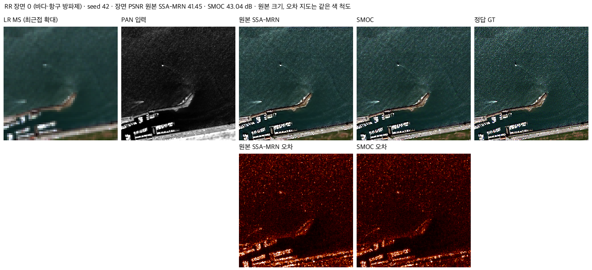

**장면 1 · 부두·곡선 방파제·수목**

**장면 3 · 요트 마리나·운동장**

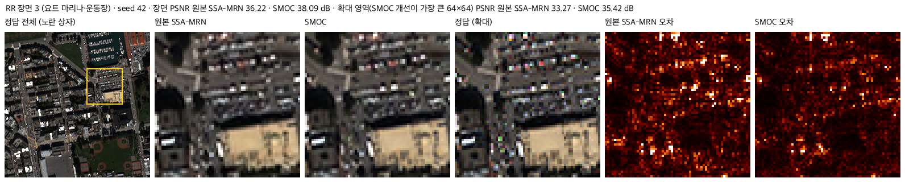

**장면 7 · 숲 공원**

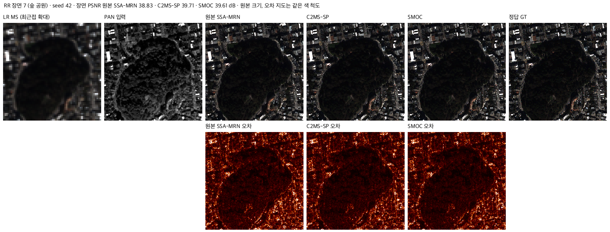

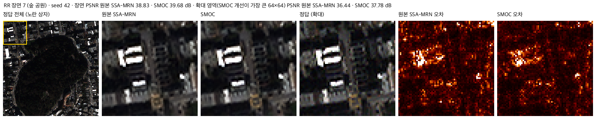

**장면 14 · 언덕 공원·곡선 주택가**

**장면 17 · 산지 녹지·산책로**

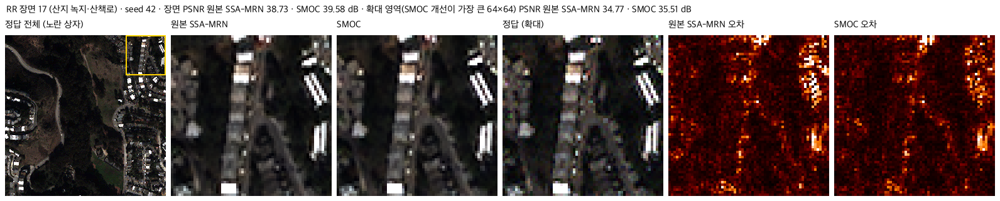

## GF2

RGB 밴드 [2,1,0]. GF2로 학습·평가했습니다(10bit 영상이라 PSNR이 약 6 dB 높게 나옵니다).

| 장면 | 장면 PSNR 원본 / C2MS-SP / SMOC | 확대 영역 PSNR 원본 / C2MS-SP / SMOC |
|---:|---|---|
| 0 | 45.00 / 47.79 / 48.52 dB (SMOC +3.52, C2MS-SP 대비 +0.73) | 42.29 / 46.41 / 47.30 dB |
| 1 | 46.89 / 49.43 / 49.99 dB (SMOC +3.10, C2MS-SP 대비 +0.56) | 41.44 / 44.93 / 45.57 dB |
| 3 | 48.08 / 49.85 / 50.67 dB (SMOC +2.58, C2MS-SP 대비 +0.81) | 47.01 / 50.13 / 50.51 dB |
| 7 | 48.45 / 50.78 / 51.41 dB (SMOC +2.96, C2MS-SP 대비 +0.63) | 44.64 / 47.62 / 48.83 dB |
| 14 | 45.72 / 48.04 / 48.73 dB (SMOC +3.00, C2MS-SP 대비 +0.68) | 44.33 / 46.60 / 47.71 dB |
| 17 | 47.18 / 49.63 / 50.34 dB (SMOC +3.16, C2MS-SP 대비 +0.71) | 45.81 / 48.08 / 49.98 dB |

**장면 0**

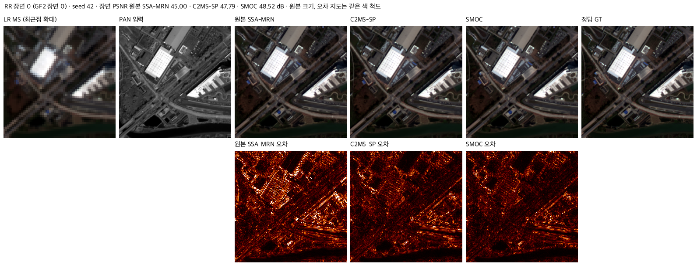

**장면 1**

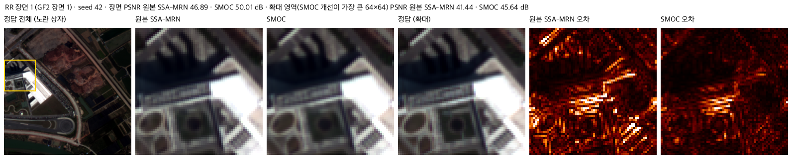

**장면 3**

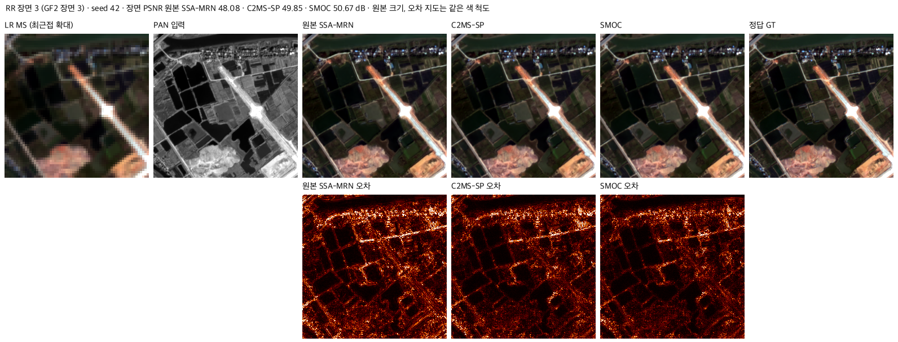

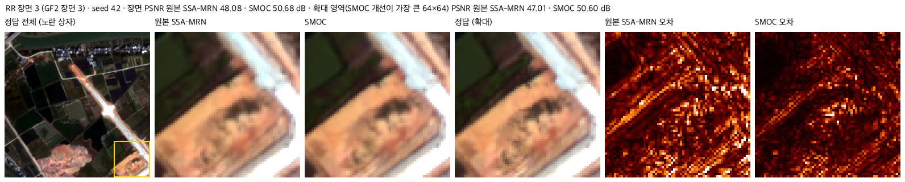

**장면 7**

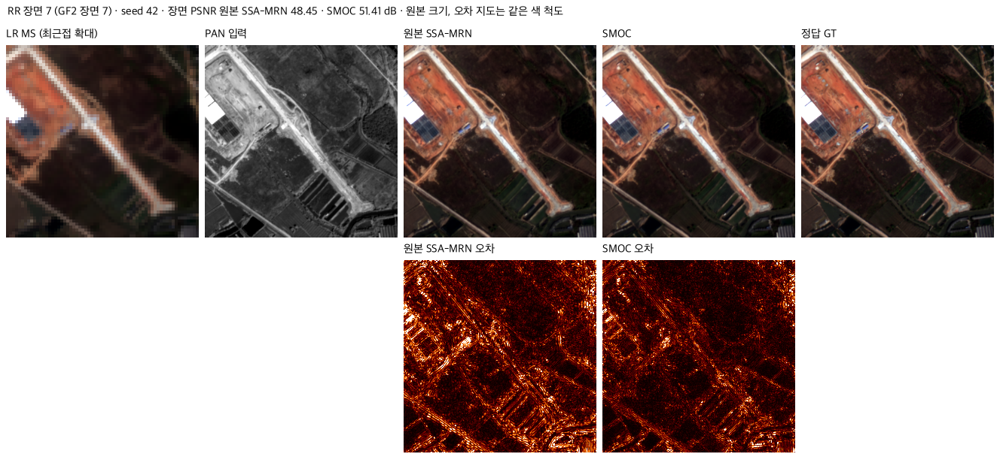

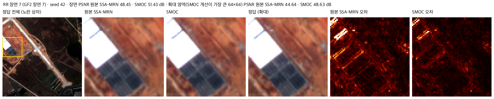

**장면 14**

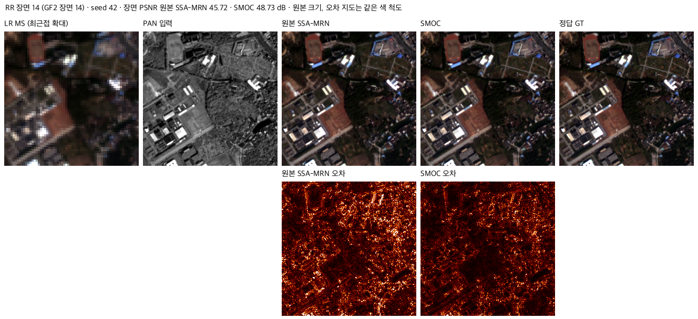

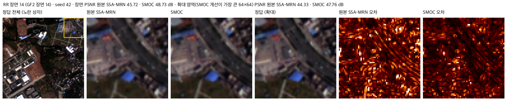

**장면 17**

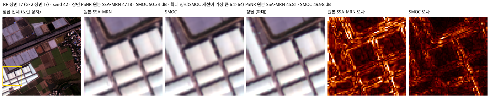

## WV3

RGB 밴드 [4,2,1]. WV3로 학습·평가했습니다.

| 장면 | 장면 PSNR 원본 / C2MS-SP / SMOC | 확대 영역 PSNR 원본 / C2MS-SP / SMOC |
|---:|---|---|
| 0 | 38.53 / 39.76 / 40.53 dB (SMOC +2.00, C2MS-SP 대비 +0.78) | 31.81 / 33.12 / 34.10 dB |
| 1 | 36.24 / 37.49 / 38.33 dB (SMOC +2.09, C2MS-SP 대비 +0.84) | 30.52 / 31.85 / 32.96 dB |
| 3 | 40.61 / 41.78 / 42.45 dB (SMOC +1.84, C2MS-SP 대비 +0.67) | 34.84 / 35.93 / 36.64 dB |
| 7 | 37.22 / 38.46 / 38.83 dB (SMOC +1.61, C2MS-SP 대비 +0.36) | 32.46 / 33.68 / 34.19 dB |
| 14 | 32.78 / 33.52 / 33.90 dB (SMOC +1.12, C2MS-SP 대비 +0.38) | 34.97 / 36.53 / 36.97 dB |
| 17 | 34.90 / 36.12 / 36.35 dB (SMOC +1.45, C2MS-SP 대비 +0.23) | 34.56 / 36.08 / 36.32 dB |

**장면 0**

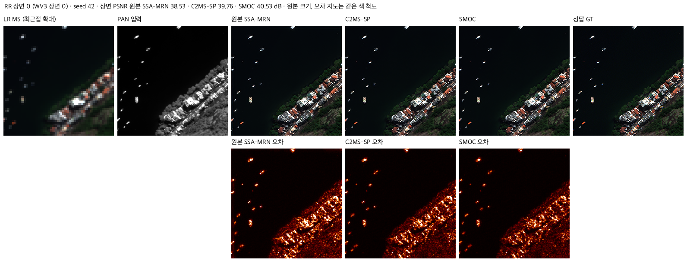

**장면 1**

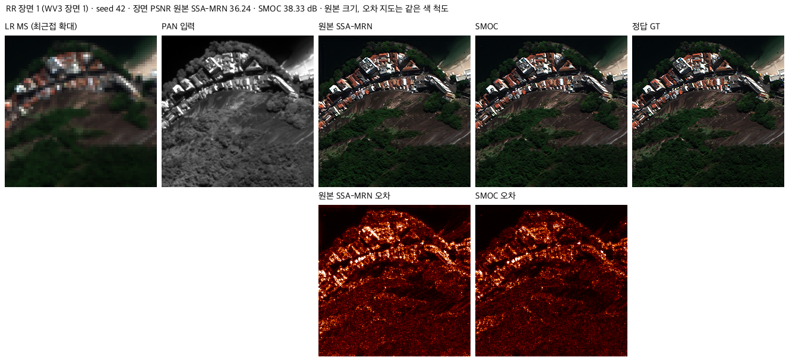

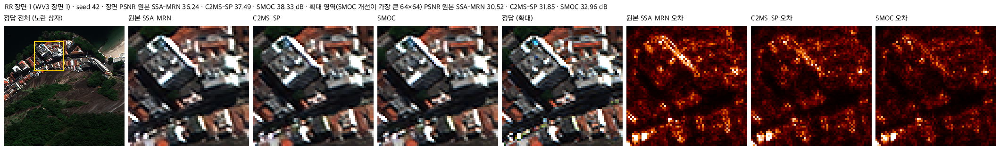

**장면 3**

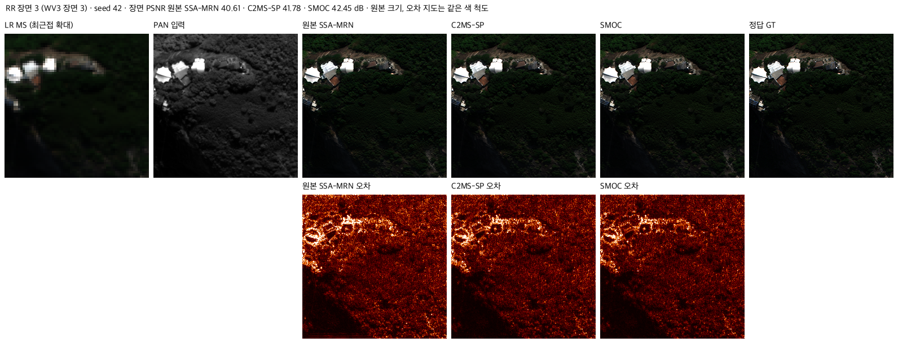

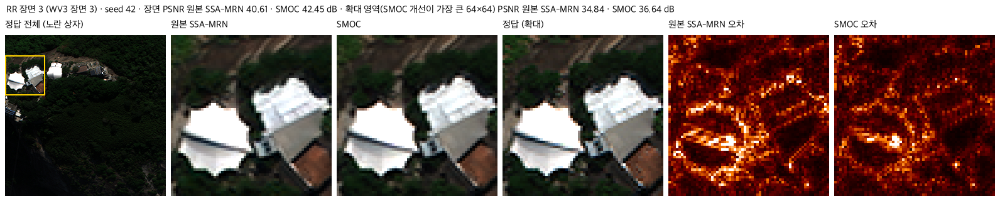

**장면 7**

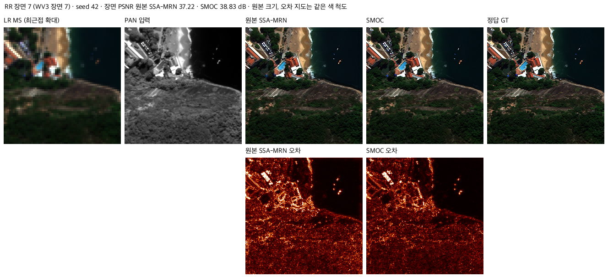

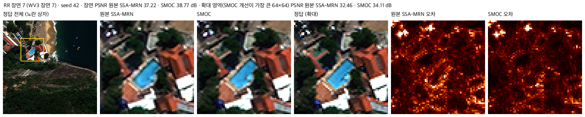

**장면 14**

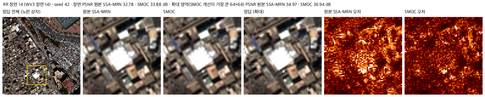

**장면 17**

## WV2 전이

RGB 밴드 [4,2,1]. WV3로 학습한 모델을 학습하지 않은 WV2에 적용한 전이 결과입니다(참고). C2MS-SP·SMOC에는 [성능 82번](../experiments/performance/82_cross_sensor_band_calibration/README.md)의 밴드별 센서 보정을 함께 적용했고, 원본은 발표된 방식 그대로입니다.

| 장면 | 장면 PSNR 원본 / C2MS-SP / SMOC | 확대 영역 PSNR 원본 / C2MS-SP / SMOC |
|---:|---|---|
| 0 | 27.80 / 30.90 / 31.76 dB (SMOC +3.96, C2MS-SP 대비 +0.86) | 24.19 / 27.56 / 28.61 dB |
| 1 | 26.02 / 29.44 / 30.01 dB (SMOC +3.99, C2MS-SP 대비 +0.58) | 23.00 / 27.77 / 28.15 dB |
| 3 | 33.71 / 36.91 / 37.17 dB (SMOC +3.46, C2MS-SP 대비 +0.26) | 27.19 / 30.70 / 31.13 dB |
| 7 | 28.38 / 30.67 / 31.93 dB (SMOC +3.55, C2MS-SP 대비 +1.26) | 24.03 / 26.51 / 28.05 dB |
| 14 | 27.91 / 30.55 / 31.53 dB (SMOC +3.62, C2MS-SP 대비 +0.98) | 25.65 / 29.38 / 30.72 dB |
| 17 | 28.43 / 30.95 / 31.78 dB (SMOC +3.35, C2MS-SP 대비 +0.83) | 25.77 / 28.35 / 29.78 dB |

**장면 0**

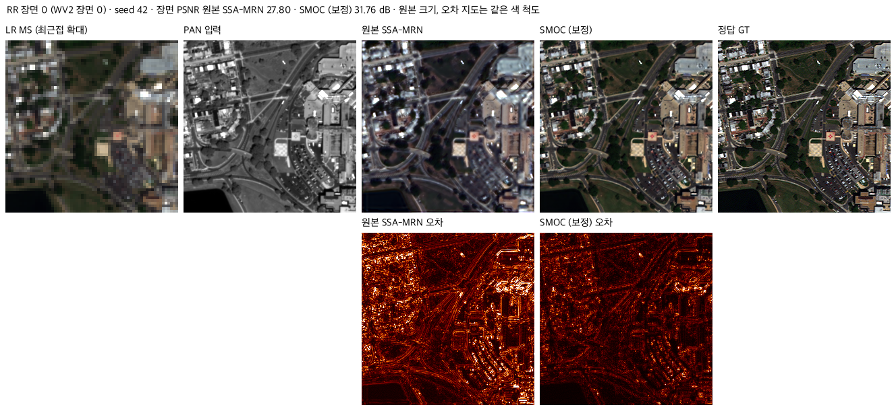

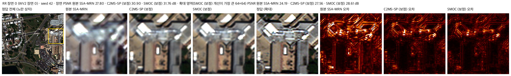

**장면 1**

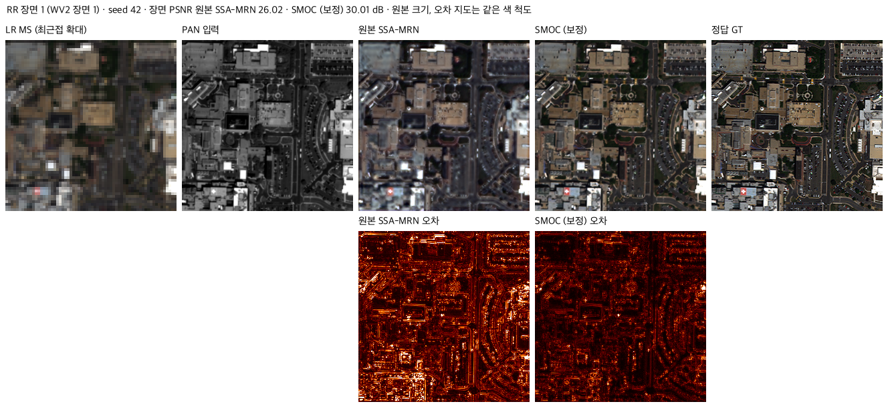

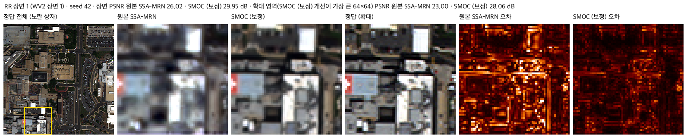

**장면 3**

**장면 7**

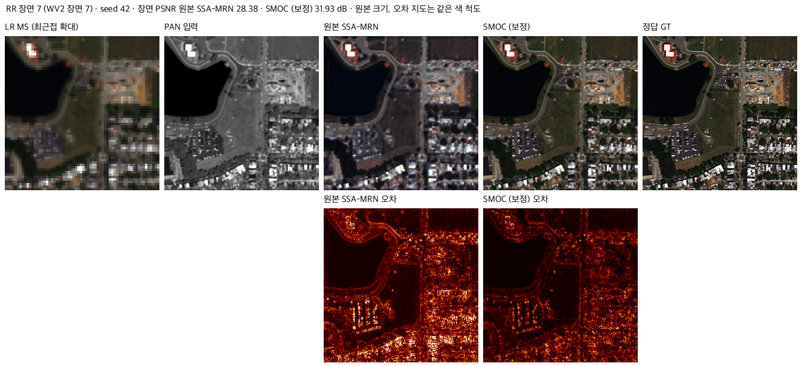

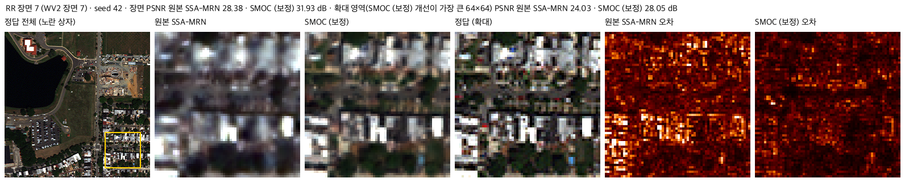

**장면 14**

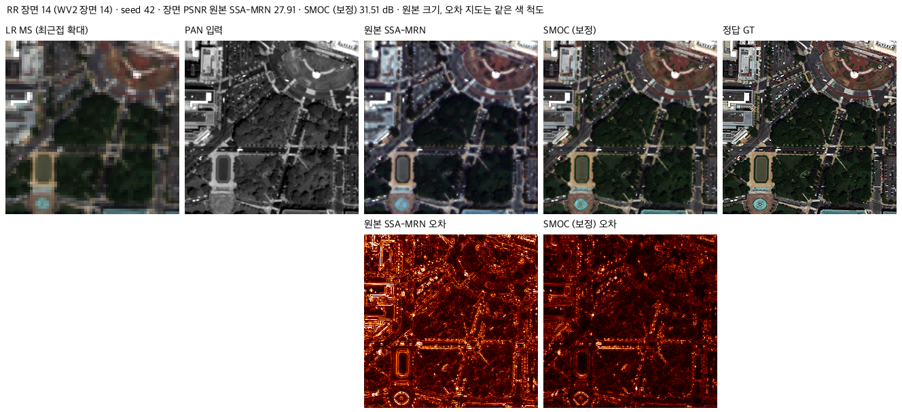

**장면 17**

