# 최종 개선 모델 SMOC 결과 이미지

원본 SSA-MRN과 최종 개선 모델 SMOC([성능 90번](../experiments/performance/90_dataset_matched_internal_resampling/README.md))를 네 데이터셋의 RR test 고정 6장면(0-based 0·1·3·7·14·17, seed 42)에서 비교한 이미지입니다. 장면 번호는 QB에서 정답 영상만 보고 풍경 종류로 고른 표준 번호이며 다른 데이터셋에도 같은 번호를 썼습니다(결과를 보고 고르지 않았습니다). 장면별 정답 1-99% 공통 대비로 표시했고 수치는 원래 값으로 계산했습니다.

- **모델:** 원본은 발표된 방식 그대로(QB 성능 43번, GF2·WV3 성능 54번 C0 가중치)입니다. SMOC는 성능 90번 `CK` 가중치(원래 크기 120에폭 → K2 분해 → 30에폭 감쇠)에 관측 일치 사영(공액 기울기법 10회)을 붙였습니다. 코드는 `common/baseline_models.py`, 이미지는 `common/baseline_images.py`(`result_images.render_multi`)로 만들었습니다.
- **원본 크기 비교:** 위 줄은 LR MS(최근접 확대) · PAN 입력 · 원본 · SMOC · 정답, 아래 줄은 두 모델의 |예측 − 정답| 지도입니다. 오차 지도는 원본 오차의 99퍼센타일을 공통 색 척도로 쓰며 밝을수록 오차가 큽니다.
- **확대 비교:** SMOC의 개선(원본 오차 − SMOC 오차)이 가장 큰 64×64 영역을 4배 확대했습니다. 왼쪽부터 정답 전체(노란 상자) · 원본 · SMOC · 정답 · 두 모델의 오차입니다. SMOC에 유리하게 고른 영역이므로 전체 차이는 표의 장면 PSNR로 확인합니다.
- 3시드 평균 수치는 [루트 README](../../README.md#결과)와 [baseline_metrics.json](images/smoc/baseline_metrics.json)에 있습니다. 분해 전 SMOC(`CF`)의 장면 이미지는 [90번 결과](../experiments/performance/90_dataset_matched_internal_resampling/results/)와 이 문서의 이전 버전에, 3시드 수치는 [smoc_full/baseline_metrics.json](images/smoc_full/baseline_metrics.json)에 남겼습니다. 이전 기준 모델의 이미지는 [C2MS-SP 결과 이미지](c2ms_sp_result_images.md)와 [C2MS 결과 이미지](c2ms_result_images.md)에 기록으로 남겼습니다.

[QB](#qb) · [GF2](#gf2) · [WV3](#wv3) · [WV2 전이](#wv2) · [CtrS Viewer에서 장면 비교](https://biyonghiyon.github.io/CtrS/) · [루트 README](../../README.md)

## QB

RGB 밴드 [2,1,0]. QB로 학습·평가했습니다.

| 장면 | 풍경 | 장면 PSNR 원본 / SMOC | 확대 영역 PSNR 원본 / SMOC |
|---:|---|---|---|
| 0 | 바다·항구 방파제 | 41.45 / 43.08 dB (SMOC +1.63) | 35.13 / 37.77 dB |
| 1 | 부두·곡선 방파제·수목 | 42.44 / 43.34 dB (SMOC +0.90) | 39.45 / 40.77 dB |
| 3 | 요트 마리나·운동장 | 36.22 / 38.09 dB (SMOC +1.87) | 33.27 / 35.42 dB |
| 7 | 숲 공원 | 38.83 / 39.68 dB (SMOC +0.84) | 36.44 / 37.78 dB |
| 14 | 언덕 공원·곡선 주택가 | 37.62 / 38.45 dB (SMOC +0.83) | 35.21 / 36.46 dB |
| 17 | 산지 녹지·산책로 | 38.73 / 39.61 dB (SMOC +0.89) | 35.65 / 36.65 dB |

**장면 0 · 바다·항구 방파제**

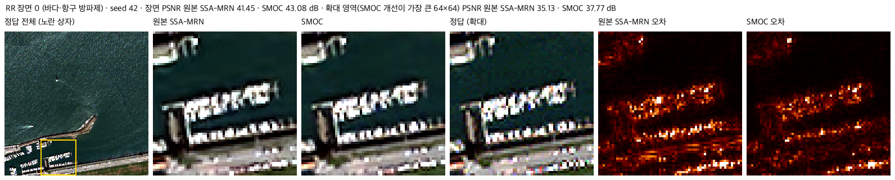

**장면 1 · 부두·곡선 방파제·수목**

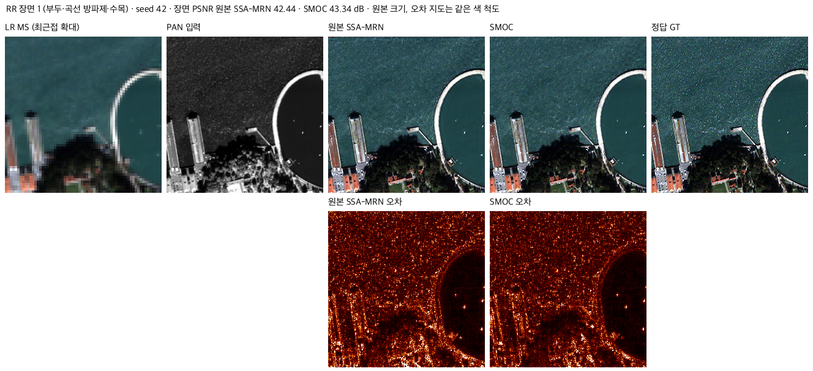

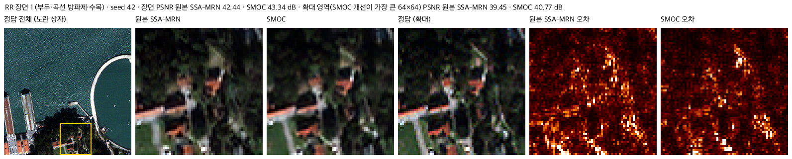

**장면 3 · 요트 마리나·운동장**

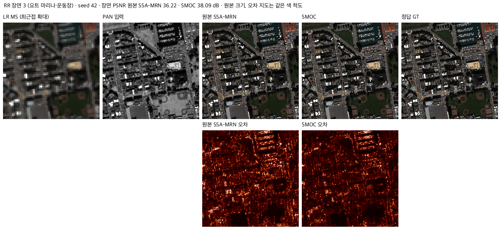

**장면 7 · 숲 공원**

**장면 14 · 언덕 공원·곡선 주택가**

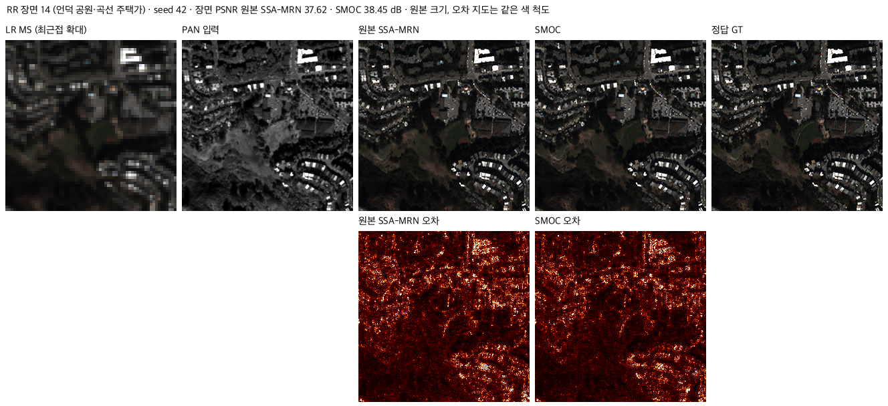

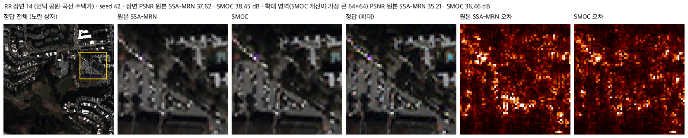

**장면 17 · 산지 녹지·산책로**

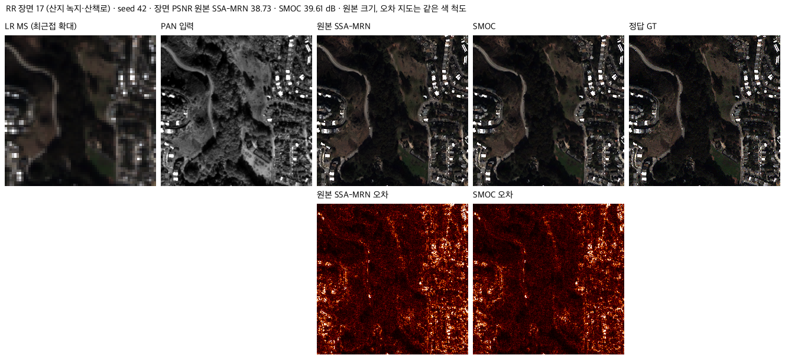

## GF2

RGB 밴드 [2,1,0]. GF2로 학습·평가했습니다(10bit 영상이라 PSNR이 약 6 dB 높게 나옵니다).

| 장면 | 장면 PSNR 원본 / SMOC | 확대 영역 PSNR 원본 / SMOC |
|---:|---|---|
| 0 | 45.00 / 48.46 dB (SMOC +3.46) | 42.29 / 47.19 dB |
| 1 | 46.89 / 50.01 dB (SMOC +3.12) | 41.44 / 45.64 dB |
| 3 | 48.08 / 50.68 dB (SMOC +2.60) | 47.01 / 50.60 dB |
| 7 | 48.45 / 51.43 dB (SMOC +2.98) | 44.64 / 48.63 dB |
| 14 | 45.72 / 48.73 dB (SMOC +3.01) | 44.33 / 47.76 dB |
| 17 | 47.18 / 50.38 dB (SMOC +3.20) | 45.81 / 50.09 dB |

**장면 0**

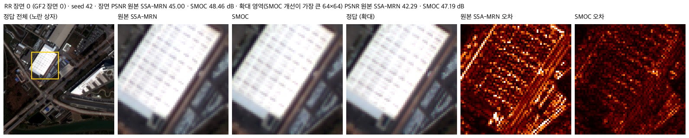

**장면 1**

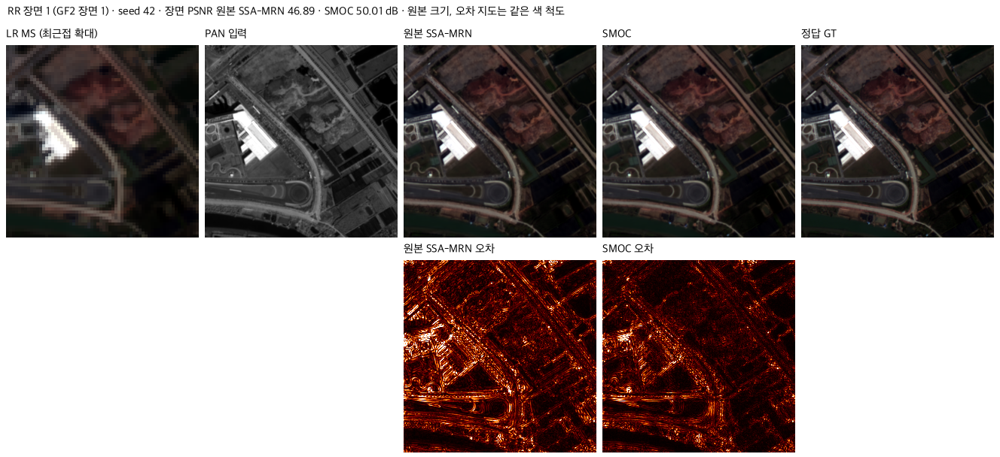

**장면 3**

**장면 7**

**장면 14**

**장면 17**

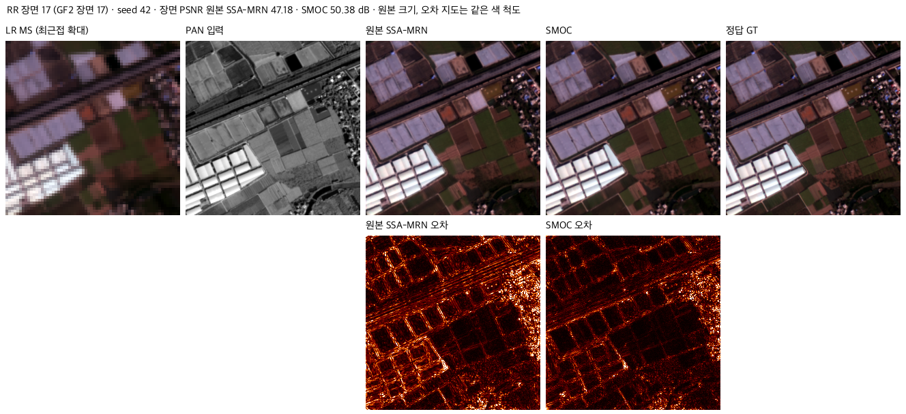

## WV3

RGB 밴드 [4,2,1]. WV3로 학습·평가했습니다.

| 장면 | 장면 PSNR 원본 / SMOC | 확대 영역 PSNR 원본 / SMOC |
|---:|---|---|
| 0 | 38.53 / 40.49 dB (SMOC +1.95) | 31.81 / 34.02 dB |
| 1 | 36.24 / 38.27 dB (SMOC +2.03) | 30.52 / 32.88 dB |
| 3 | 40.61 / 42.41 dB (SMOC +1.80) | 34.84 / 36.57 dB |
| 7 | 37.22 / 38.77 dB (SMOC +1.56) | 32.46 / 34.11 dB |
| 14 | 32.78 / 33.88 dB (SMOC +1.10) | 34.97 / 36.94 dB |
| 17 | 34.90 / 36.33 dB (SMOC +1.43) | 34.56 / 36.31 dB |

**장면 0**

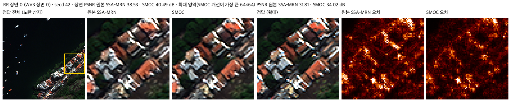

**장면 1**

**장면 3**

**장면 7**

**장면 14**

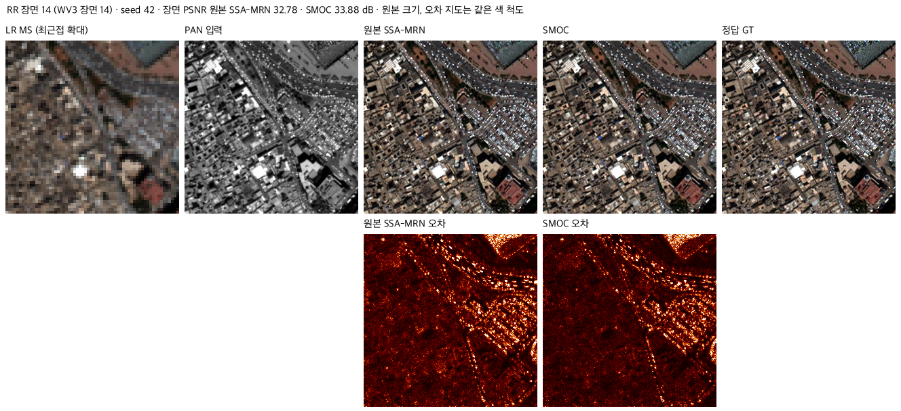

**장면 17**

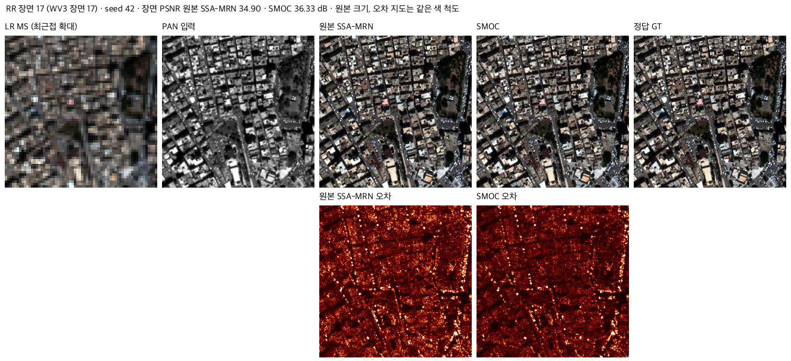

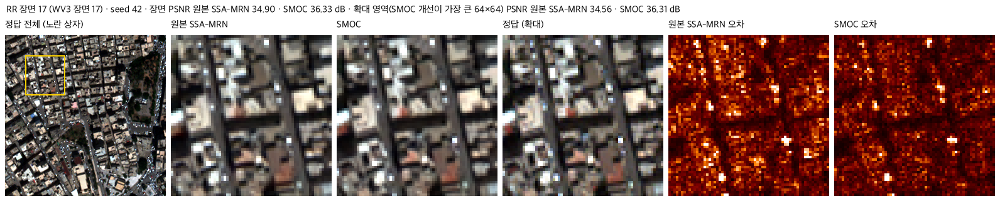

## WV2 전이

RGB 밴드 [4,2,1]. WV3로 학습한 모델을 학습하지 않은 WV2에 적용한 전이 결과입니다(참고). SMOC에는 [성능 82번](../experiments/performance/82_cross_sensor_band_calibration/README.md)의 밴드별 센서 보정을 함께 적용했고, 원본은 발표된 방식 그대로입니다.

| 장면 | 장면 PSNR 원본 / SMOC | 확대 영역 PSNR 원본 / SMOC |
|---:|---|---|
| 0 | 27.80 / 31.76 dB (SMOC +3.96) | 24.19 / 28.57 dB |
| 1 | 26.02 / 29.95 dB (SMOC +3.92) | 23.00 / 28.06 dB |
| 3 | 33.71 / 37.22 dB (SMOC +3.51) | 27.19 / 31.06 dB |
| 7 | 28.38 / 31.90 dB (SMOC +3.52) | 24.03 / 27.93 dB |
| 14 | 27.91 / 31.51 dB (SMOC +3.61) | 25.65 / 30.67 dB |
| 17 | 28.43 / 31.74 dB (SMOC +3.31) | 25.77 / 29.70 dB |

**장면 0**

**장면 1**

**장면 3**

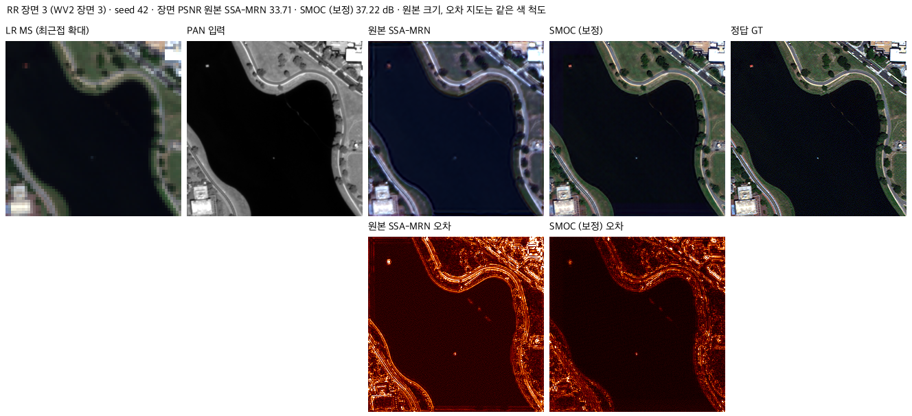

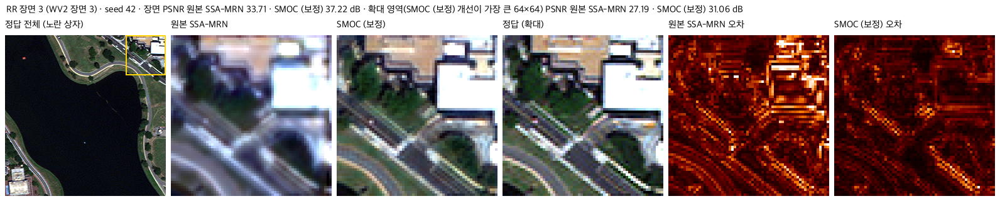

**장면 7**

**장면 14**

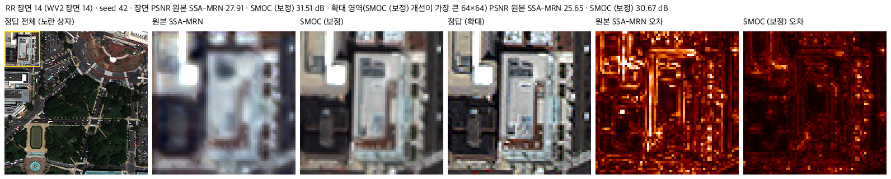

**장면 17**

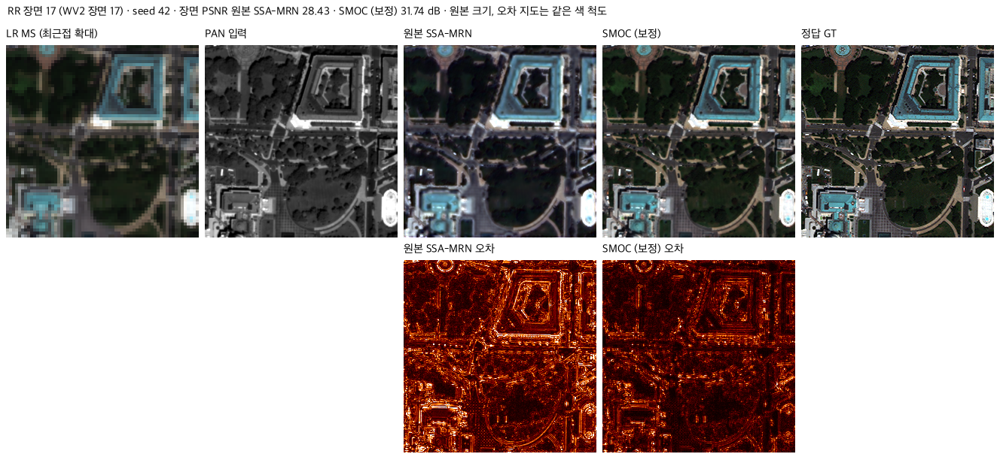

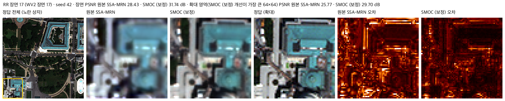
