# SSAI 내부 특징 차원 비교

**변경 내용:** 같은 환경에서 SSAI 내부 특징 차원 K4와 K6을 비교했습니다.

| 확인된 결과 | 상태 | 개선 여부 |
|---|---|---|
| 6개 모델의 RR·FR 각 20장 평가를 완료했습니다. | 평가 완료 | **비교 기준** |

## 1. 목적과 상태

같은 환경에서 SSAI 내부 특징 차원 K4와 K6을 비교했습니다. 보관된 validation 최적 가중치로 2026-10-12 전체 test 평가를 완료했습니다. 새 학습이나 가중치 변경 없이 같은 CPU FP32 코드로 비교했습니다.

## 2. 변경한 구조와 비교 조건

동일 SSA-MRN의 SSAI 내부 특징 차원만 K4 또는 K6으로 설정했습니다. QB·GF2는 MS 4밴드, WV3는 8밴드입니다. 차원별 파라미터 크기가 달라 같은 seed가 모든 초기값의 일치를 의미하지는 않습니다. 기존 validation MSE 다수결 2:1의 K4 선택은 test 평가로 변경하지 않았습니다.

QB·GF2·WV3, seed 42, 각 100에폭, Adam lr=1e-4, 기본 MSE, effective batch 32, micro batch 4의 gradient 누적, CUDA FP32·결정론 학습입니다. 센서별 고정 train/validation 분할과 정규화를 유지했습니다.

RR·FR은 각각 원본 H5의 20개 전체 장면을 사용했습니다. 입력 정규화는 QB·WV3 2047, GF2 1023입니다. 예측 배열을 자르거나 clipping하지 않았습니다. 모든 후보는 센서별 동일 H5를 사용했습니다.

PSNR은 공통 평가 코드의 밴드별 평균·peak 2047 정의입니다. GF2도 이 정의를 사용하므로 peak 1023 보고서와 절댓값을 직접 비교하지 않습니다. validation의 peak 1 PSNR과도 구분합니다. QNR·Q2n·SCC는 MATLAB 구현과의 정합이 확인되지 않았으며, FR 수치는 잠정 평가입니다.

## 3. 정량 결과

각 행은 20장 평균이며 가중치·H5 해시와 장면별 지표는 [평가 원본](results/test_evaluation/)에 있습니다.

| 모델 | 센서 | best 저장 epoch | RR PSNR ↑ | SAM ↓ | ERGAS ↓ | SCC ↑ | Q2n ↑ | FR Dλ ↓ | Ds ↓ | 잠정 QNR ↑ |
|---|---|---:|---:|---:|---:|---:|---:|---:|---:|---:|
| 01_GF2_k4_s42 | GF2 | 99 | 46.587822 | 0.955084 | 0.890096 | 0.982660 | 0.968984 | 0.036272 | 0.058463 | 0.907446 |
| 01_GF2_k6_s42 | GF2 | 99 | 46.492615 | 0.966894 | 0.899794 | 0.982344 | 0.968598 | 0.038127 | 0.057340 | 0.906784 |
| 01_QB_k4_s42 | QB | 98 | 37.457805 | 4.955422 | 4.112056 | 0.977000 | 0.922997 | 0.052675 | 0.045376 | 0.904589 |
| 01_QB_k6_s42 | QB | 98 | 37.424099 | 4.968923 | 4.125665 | 0.976664 | 0.922233 | 0.053281 | 0.046464 | 0.903233 |
| 01_WV3_k4_s42 | WV3 | 100 | 37.437113 | 3.474541 | 2.590595 | 0.977942 | 0.874478 | 0.019815 | 0.036099 | 0.944996 |
| 01_WV3_k6_s42 | WV3 | 99 | 37.407970 | 3.605403 | 2.629494 | 0.975804 | 0.880986 | 0.018715 | 0.031831 | 0.950254 |

## 4. 기준선 대비 차이와 해석

차이는 K6−K4입니다. 센서별 비교이며 센서 간 PSNR을 합쳐 선택하지 않았습니다.

| 비교 | ΔPSNR ↑ | ΔSAM ↓ | ΔERGAS ↓ | Δ잠정 QNR ↑ |
|---|---:|---:|---:|---:|
| GF2 | -0.095207 | +0.011809 | +0.009697 | -0.000661 |
| QB | -0.033705 | +0.013501 | +0.013609 | -0.001355 |
| WV3 | -0.029143 | +0.130862 | +0.038899 | +0.005257 |

GF2은 20장 중 PSNR 0장, SAM 0장, 잠정 QNR 7장에서 개선됐습니다.

QB은 20장 중 PSNR 7장, SAM 5장, 잠정 QNR 10장에서 개선됐습니다.

WV3은 20장 중 PSNR 10장, SAM 2장, 잠정 QNR 20장에서 개선됐습니다.

지표의 방향과 장면별 차이를 함께 판단합니다. 단일 시드의 작은 차이를 통계적으로 확정된 개선으로 해석하지 않습니다. 기존 test는 탐색에 사용됐으므로 독립 최종 holdout으로 주장하지 않습니다.

## 5. 학습·평가 그래프

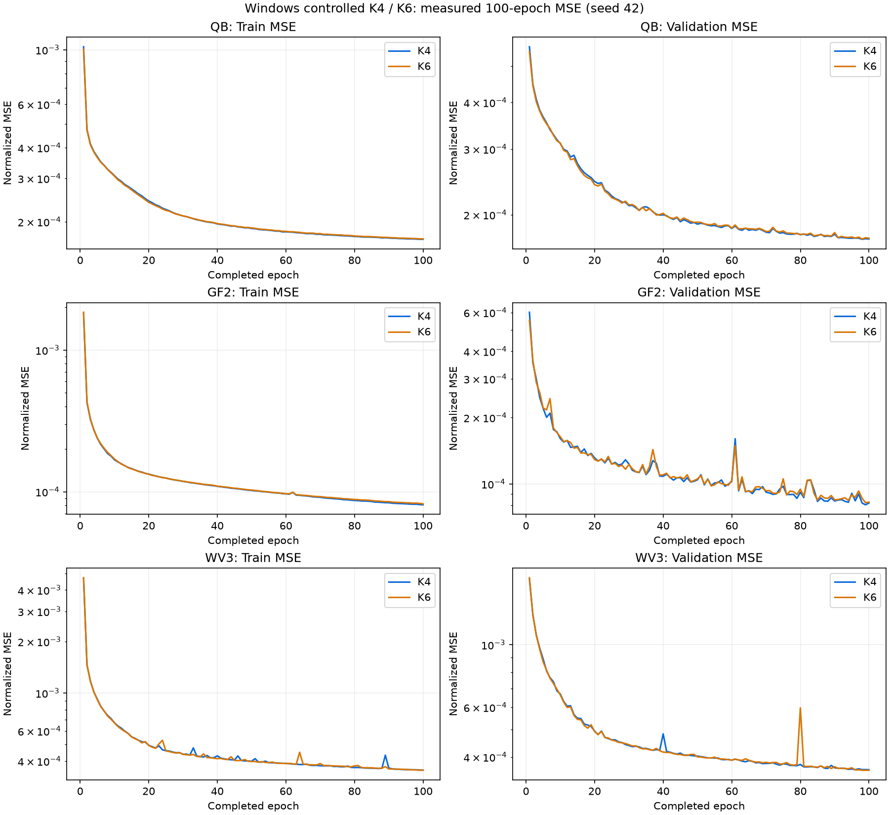

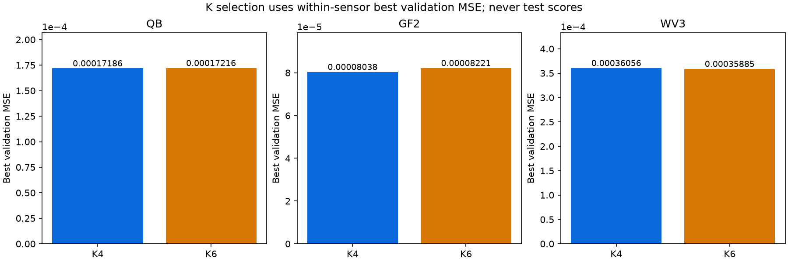

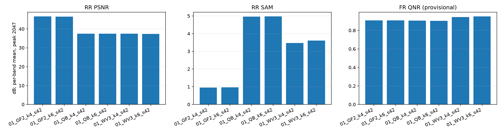

학습 그래프는 보존된 실제 이력입니다. test 그래프는 이번 평가의 20장 평균입니다.

## 6. 결과 이미지

고정 RR 장면 인덱스 1·8·11·13·19를 모든 모델에 동일하게 사용했습니다. 패널은 **LR MS·PAN·예측·GT** 순서이며 전체 장면을 추론했습니다. MS만 표시를 위해 nearest 확대했습니다. RGB 순서는 가정이며 QB·GF2는 [2,1,0], WV3는 [4,2,1]의 0부터 시작하는 밴드 인덱스입니다. 각 장면의 GT 1-99% 대비를 MS·예측·GT에 공유했고 PAN은 별도 대비를 적용했습니다. FR에는 GT를 만들지 않았습니다.

<details>
<summary>01_GF2_k4_s42: 고정 5장면</summary>


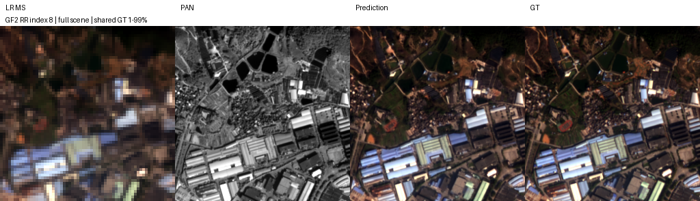

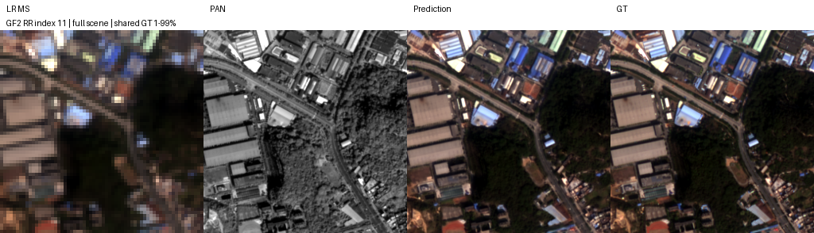

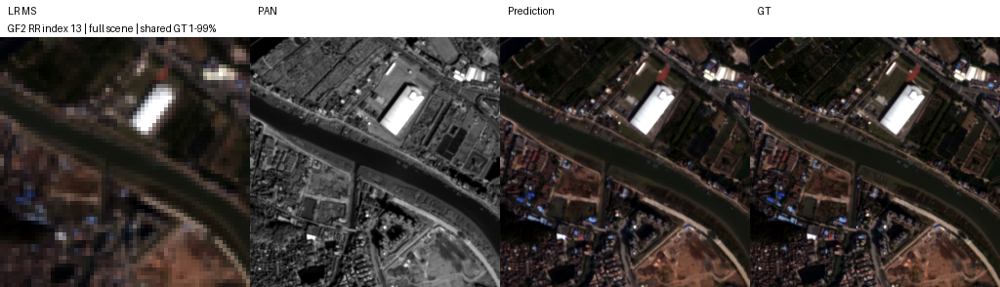


</details>

<details>
<summary>01_GF2_k6_s42: 고정 5장면</summary>

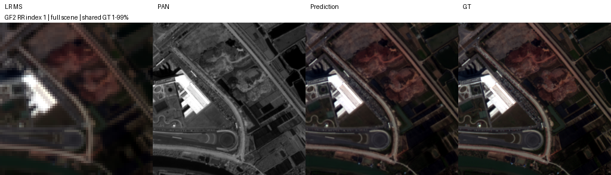

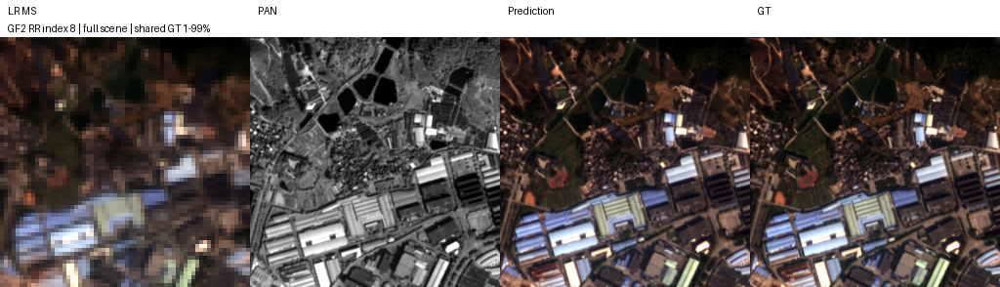

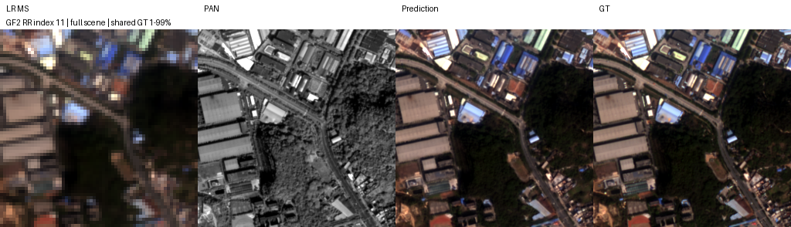


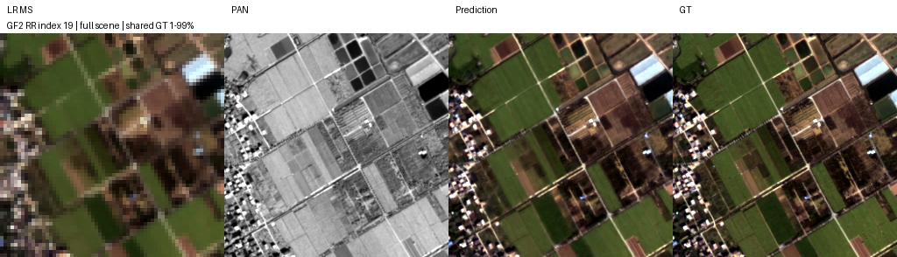

</details>

<details>
<summary>01_QB_k4_s42: 고정 5장면</summary>

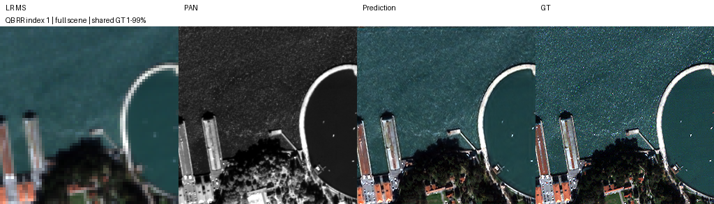

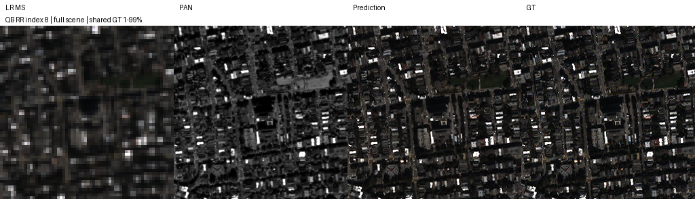

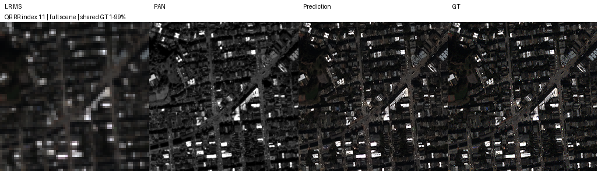

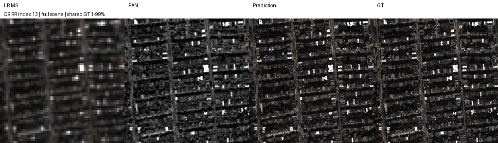

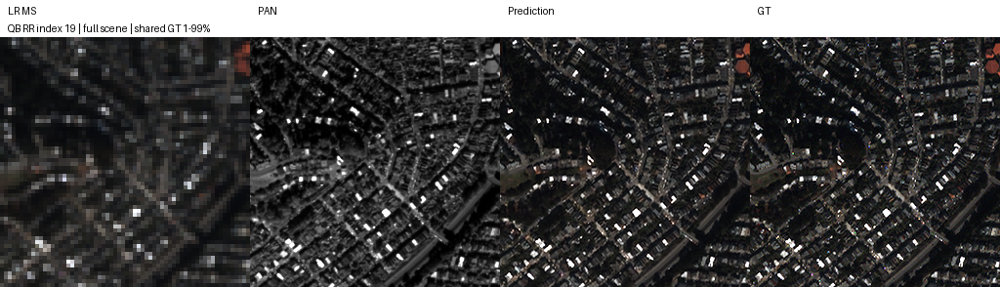

</details>

<details>
<summary>01_QB_k6_s42: 고정 5장면</summary>

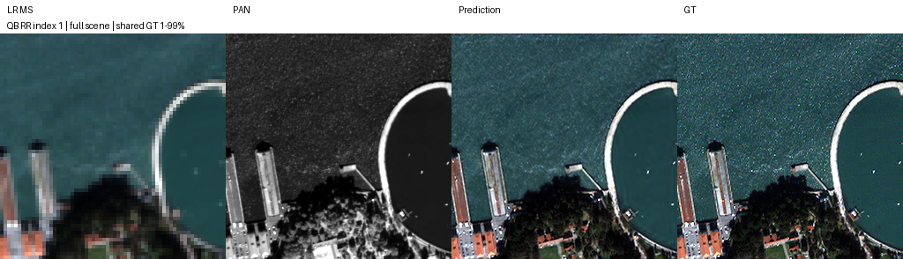

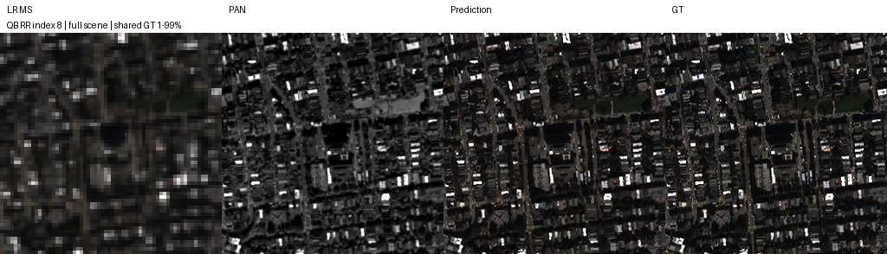

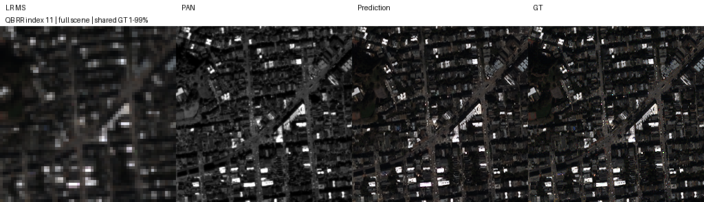

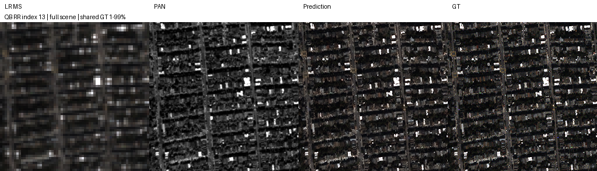

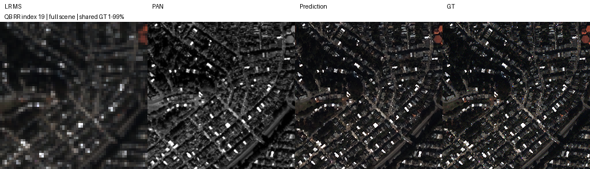

</details>

<details>
<summary>01_WV3_k4_s42: 고정 5장면</summary>

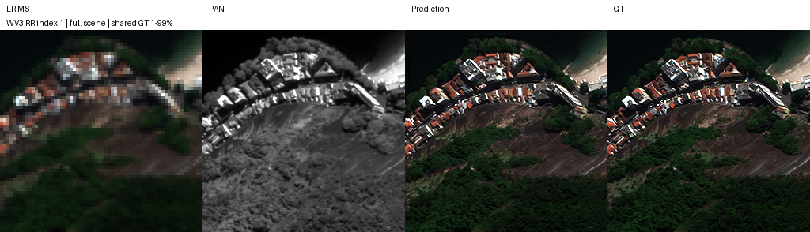


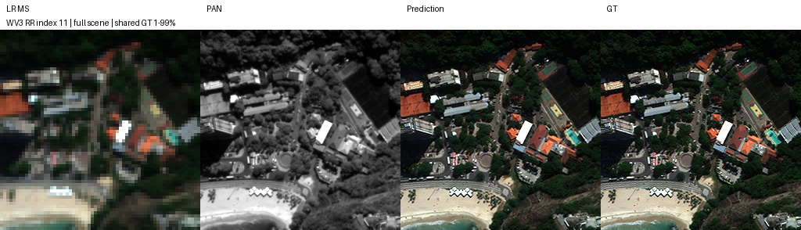

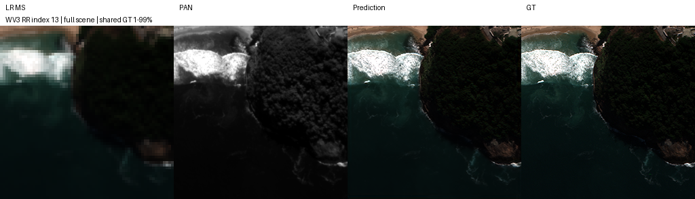

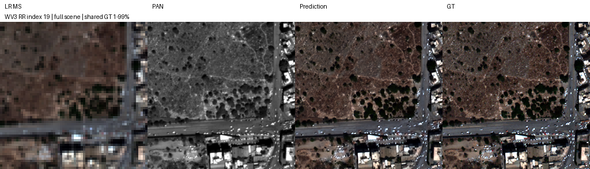

</details>

<details>
<summary>01_WV3_k6_s42: 고정 5장면</summary>


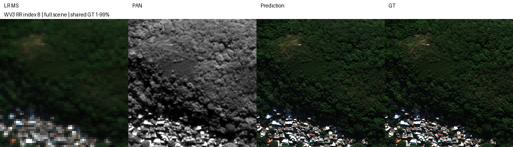


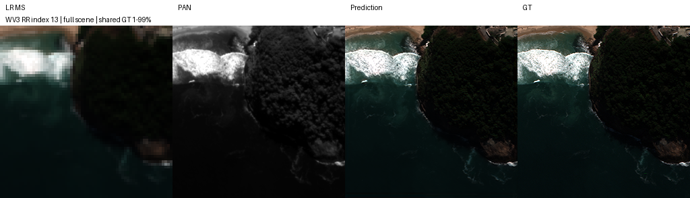


</details>

## 7. 재현 자료

[가중치](checkpoints/) · [학습 실행 코드](run.py) · [평가 원본](results/test_evaluation/) · [학습 당시 소스](provenance/) · [파일 해시](manifest.json)

공식 submodule을 초기화하고 아래 명령으로 원본 테스트 H5가 있는 폴더를 지정합니다. 완료 JSON은 덮어쓰지 않고 건너뜁니다. 다시 평가하려면 기존 결과를 보관하고 별도 checkout에서 실행합니다.

```bash
python SSA-MRN/common/evaluate_retained.py --experiment 12 --data /path/to/test_h5
```

공통 모델·지표·평가 코드 해시는 `results/test_evaluation/evaluation_source.json`에 보관했습니다. 체크포인트 내부 설정과 원본 best/latest는 변경하지 않았습니다.

## 8. 개선 여부와 다음 단계

**판정: 비교 기준.** validation에서 QB·GF2는 K4, WV3는 K6가 낮아 사전 다수결 규칙으로 K4를 선택했습니다. test 결과는 이 선택을 소급 변경하지 않으며, 센서·RR·FR별 강점으로 해석합니다.
