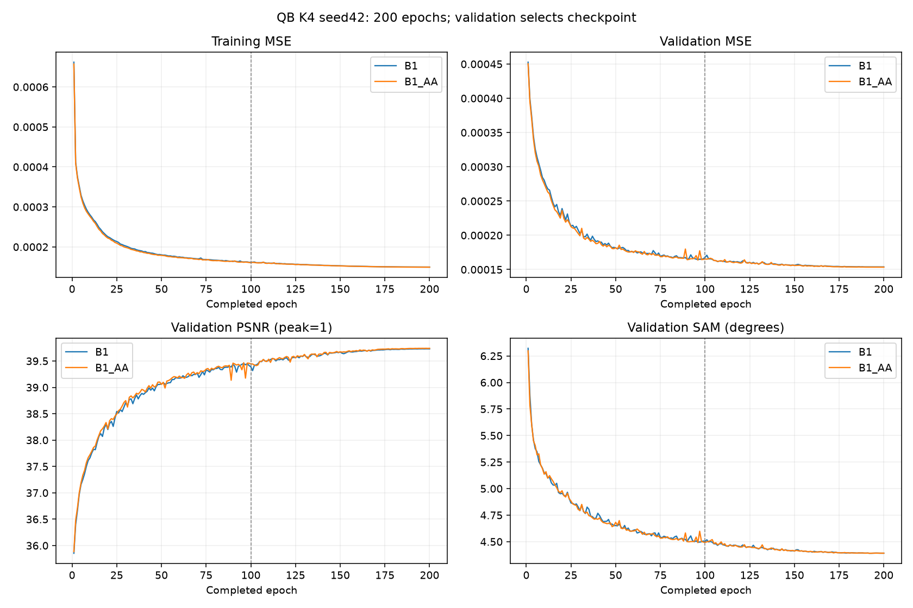
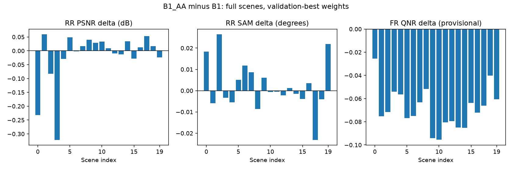
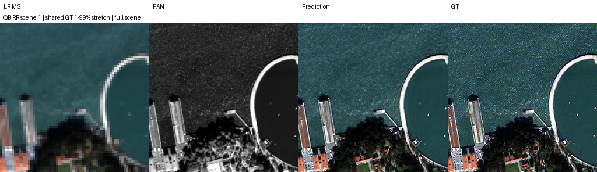
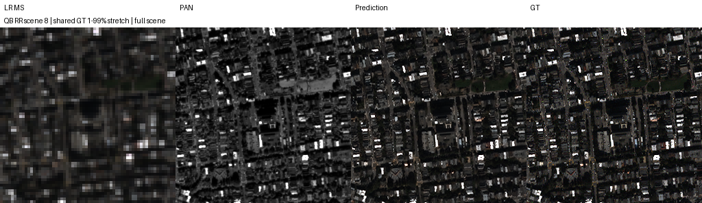
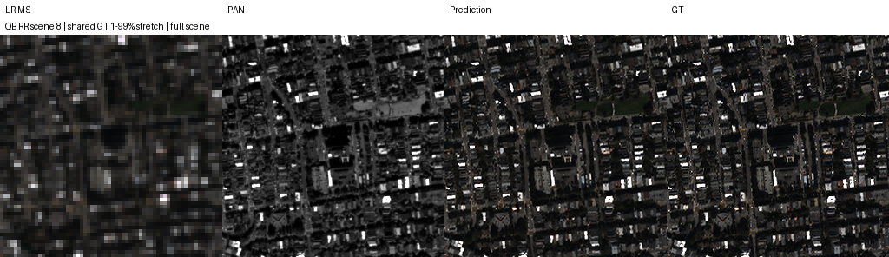
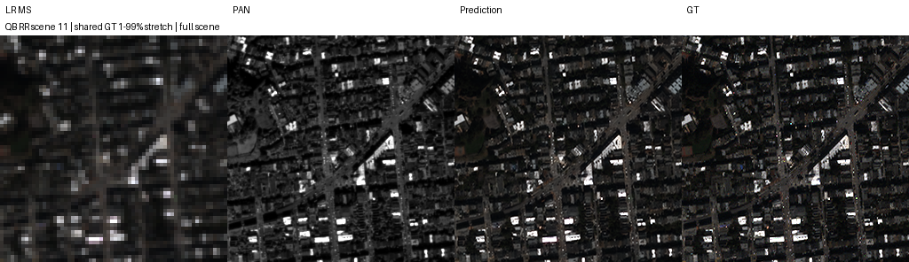
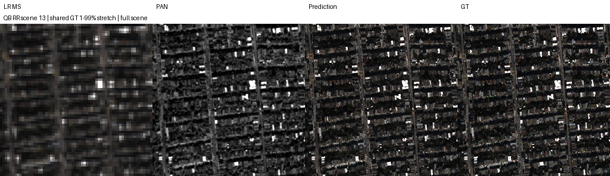
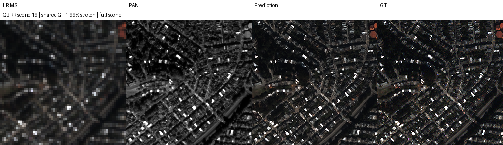
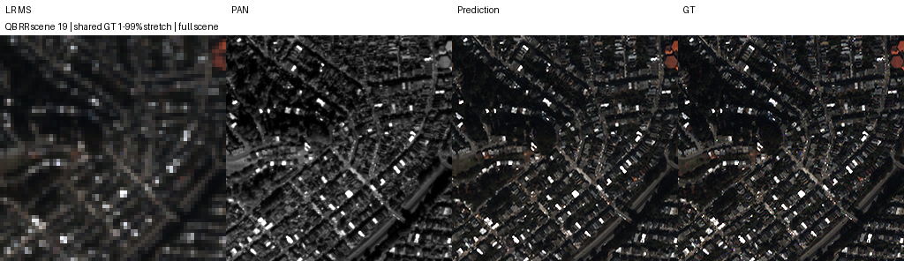

# 반복 복원의 축소 전 저역통과 필터

**변경 내용:** 축소 전에 고정 Gaussian 필터를 추가했습니다.

| 확인된 결과 | 상태 | 개선 여부 |
|---|---|---|
| PSNR −0.0196 dB, SAM +0.0022°, 잠정 QNR −0.0686 | 평가 완료 | **개선 없음** |


[실험 목록](../../README.md#experiments) · [수치](#results) · [그래프](#graphs) · [이미지](#images) · [가중치](#evidence) · [실행·재개](../../README.md#evaluate)

| 비교 기준 | 바꾼 점 | 관측된 차이 | 판단 |
|---|---|---|---|
| 같은 세션의 K4 B1 공유 3단계 복원 | core 네 축소 모듈에 고정 Gaussian 저역통과 추가 | validation MSE −0.186%, RR PSNR −0.019598dB, 잠정 FR QNR −0.068594 | 고정 필터 후보 채택 보류, B1 기준 유지 |

## 1. 목적과 상태

2026-10-11 KST 산출물 검증. **QB K4·seed42, 두 모델 각200에폭, 각 RR20장·FR20장 전체 평가 완료.** B1은199에폭, B1_AA는198에폭의 validation MSE 최저 checkpoint를 평가했습니다. 총400개 완료 에폭 기록이며 test로 모델이나 에폭을 선택하지 않았습니다.

Kaggle T4×2에서 GPU0=B1, GPU1=B1_AA로 실행했습니다. 세션을 나눠 latest로 재개했으며 데이터·코드·설정 해시를 보존했습니다. [최종 원본 Output Version 5](https://www.kaggle.com/code/biyonghiyon/ssa-mrn-test/output?scriptVersionId=357135446)를 저장했고 가중치6개·실행 코드·로그·지표·이미지를 직접 확보했습니다. 단순 Draft 저장을 보관 근거로 삼지 않습니다.

## 2. 변경한 구조와 비교 조건

B1은 `current=LMS`에서 같은 SSA-MRN core를 **3회 공유 실행**합니다. 각 단계는 `current += alpha*(proposal−current)`이며 alpha는 초기0.1의 학습형 scalar, 범위 제한 없음입니다. 오차 입력은 zeros_like(current)이지만 error_encoder의 bias는 남는입니다. 두 arm 모두 관측 오차 feedback을 쓰지 않습니다. 기존 SSA-MRN의 밴드별 복원 경로를 유지하며 B1이라는 이름을 물리 관측 unfolding 구현으로 해석하지 않습니다.

B1_AA는 `downsample1`, `downsample2`의 ×1/4 및 `downsample100`, `downsample200`의 ×1/2를 교체합니다. `downsample100`은 residual과 PAN 양쪽에서 사용됩니다. 4채널 residual에 QB gain `[.34,.32,.30,.22]`, PAN에 generic gain `.5`를 사용합니다. `sigma = r*sqrt(−2*ln(g))/pi`, 반경 `ceil(3*max(sigma))`, 양의 separable Gaussian·단위합·replicate 경계이며 FP32 필터 후 원래 dtype으로 반환합니다. PAN gain은 측정된 QB PAN MTF가 아닙니다.

필터 뒤의 bilinear 축소 좌표는 기존 `align_corners=True`, 즉 `j*(N−1)/(M−1)`를 유지합니다. 확대·손실·SSA 연산·반복 횟수·초기화는 동일합니다. residual을 원본 광학 밴드로 간주하는 Gaussian proxy 가설이며 정확한 센서 MTF나 adjoint를 구현했다고 주장하지 않습니다.

| 항목 | 두 모델의 공통 조건 |
|---|---|
| 데이터 | biyonghiyon/ctrs-pan-sharpening-dataset, QB 4밴드, peak=2047로 정규화 |
| train / validation | 17,139 / 1,905개의 H5 패치; PAN·LMS·GT64×64, MS16×16 |
| RR / FR | 각각20개 full scene; RR256×256/MS64×64, FR512×512/MS128×128 |
| 학습 | Adam fused, lr1e−4 고정100에폭 + cosine100에폭, 최저1e−6 |
| 배치·수치 | effective32 / micro32, AMP FP16 학습, FP32 validation·test, channels_last |
| 통제 | deterministic kernels, TF32 off, GPU 상주 데이터, seed42 |
| 선택 | validation MSE만 사용; SAM/PSNR은 진단값 |
| 기준 소스 | CtrS `be02b7cbf03fe00681194ae9fc9419661f24cd56`, upstream `a4ca40e407b12bf4c30f804384405ce321d11c51` |

[데이터 해시·shape](results/data_manifest.json) · [전체 설정](results/suite_config.json) · [원본 모델](provenance/code/B1_AA_models.py) · [원본 worker](provenance/code/kaggle_worker.py)

초기 state SHA-256는 두 arm 동일하고, **200에폭 전체의 sample_order_sha256가 일치**합니다. GPU별 고정 배정의 하드웨어 차이는 남아 있으며 GPU 교환 반복은 하지 않았습니다. 패치 수는 독립 장면 수가 아닙니다.

<a id="results"></a>

## 3. 정량 결과

| validation 최저 시점 | B1 | B1_AA | B1_AA−B1 |
|---|---:|---:|---:|
| best epoch | 199 | 198 | -1 |
| MSE ↓ | 0.000153754197527 | 0.000153468907229 | -2.85290298e-07 |
| PSNR dB ↑ | 39.730430603 | 39.7404441833 | +0.0100135803 |
| SAM ° ↓ | 4.39144229889 | 4.39119195938 | -0.000250339508 |

PSNR·SAM은 각각 MSE로 선택된 best 시점의 값입니다. 첫100에폭의 validation best는 두 모델 모두96에폭으로 B1 MSE0.000164428158314, B1_AA0.000163826640346이며 `best_first100.pt`를 별도로 보관했습니다. 100에폭 가중치의 RR/FR은 이번에 추가 평가하지 않았습니다.

| 전체 장면 평균 | B1 | B1_AA | B1_AA−B1 |
|---|---:|---:|---:|
| RR PSNR | 37.9147160033 | 37.8951175048 | -0.0195984985 |
| RR SAM | 4.71910445766 | 4.72130173217 | +0.00219727452 |
| RR ERGAS | 3.88411375828 | 3.89279017014 | +0.00867641186 |
| RR MSE_peak1 | 0.000191349063486 | 0.000192037939436 | +6.8887595e-07 |
| RR SCC | 0.980098466066 | 0.979923540277 | -0.000174925788 |
| RR Q2n | 0.929670947823 | 0.9295288052 | -0.000142142623 |
| FR D_lambda · 잠정 | 0.0590296514468 | 0.0698600326534 | +0.0108303812 |
| FR D_s · 잠정 | 0.142090291221 | 0.205565104631 | +0.0634748134 |
| FR QNR · 잠정 | 0.806361573994 | 0.737767292041 | -0.068594282 |
| FR MS_consistency_MSE_peak1_interior | 0.000154154119809 | 0.000290781489457 | +0.00013662737 |

RR PSNR/SAM/ERGAS는 기존 저장소 구현을 사용하고 GT와 정규화 전 DN 예측을 비교합니다. MSE_peak1은 peak2047로 정규화한 오차입니다. PSNR은 장면별 산출값의 평균이므로 평균 MSE를 PSNR로 변환한 수치와 다를 수 있습니다. **FR QNR·D_lambda·D_s는 구현의 공식 대조 검증이 남은 잠정값**입니다. Q2n·SCC에도 기존 구현 대조 한계를 유지합니다.

RR PSNR·SAM·ERGAS는 각각11/20장 개선했지만 전체 평균은 모두 악화했습니다. PSNR 장면 차이는 −0.321504–+0.059459dB로, scene3·0의 하락이 큽니다. 잠정 FR QNR은 **20/20장 악화**했습니다. FR 입력 MS 일치도 오차도0.000154154→0.000290781로 증가했습니다. RR 합성 축소 평가와 FR 무참조 평가를 분리하며 FR의 실제 HR 정답 정확도로 해석하지 않습니다.

[전체 요약 JSON](results/comparison_summary.json) · [CSV](results/comparison_summary.csv)

| 모델 | RR 장면별 | FR 장면별 | 전체 이력 |
|---|---|---|---|
| B1 | [20장](results/runs/B1_QB_B1_k4_s42/RR_per_scene.json) | [20장](results/runs/B1_QB_B1_k4_s42/FR_per_scene.json) | [200에폭](results/runs/B1_QB_B1_k4_s42/history.json) |
| B1_AA | [20장](results/runs/B1_AA_QB_B1_AA_k4_s42/RR_per_scene.json) | [20장](results/runs/B1_AA_QB_B1_AA_k4_s42/FR_per_scene.json) | [200에폭](results/runs/B1_AA_QB_B1_AA_k4_s42/history.json) |

## 4. 기준선 대비 차이와 해석

이번 인과 비교는 **동일 K4 B1 ↔ B1_AA**에 한정합니다. 이전 K6 B1/B2 100에폭은 K·스케줄·학습량·세션이 달라 수치 차이를 이번 필터 효과로 합치지 않습니다. Windows K4 단일 core 기준선도 장치·micro batch·구조·스케줄이 달라 통제 기준선이 아닙니다. 기존 RR 개선이 FR 개선으로 이어지지 않던 관찰은 동기이며 이번 실험은 고정 대역 제한 축소의 효과를 확인하지 못했습니다.

### 연산량과 실행 시간

두 모델의 학습형 파라미터는 각각 **426,803개**로 동일합니다. 필터는 학습형 파라미터를 추가하지 않지만 4밴드 축소에서는 ratio4에15탭, ratio2에9탭, PAN에서는 ratio4에11탭, ratio2에7탭의 분리 convolution 두 번을 수행합니다. 중간 H×W 특징 필터링 비용이 추가되며 커널·경계 인덱스를 forward마다 생성하는 구현입니다.

| 측정 범위 | B1 | B1_AA |
|---|---:|---:|
| 마지막50에폭 평균 train 초/에폭 | 77.682 | 86.588 |
| RR 평균 추론 ms/256×256 장면 | 67.612 | 68.149 |
| FR 평균 추론 ms/512×512 장면 | 206.623 | 209.931 |
| 학습 이력의 최대 allocated GiB | 3.306 | 3.324 |
| 이번 재개 세션 전체 소요 초 | 13,787.817 | 15,518.758 |

학습 구간 평균은 약11.47% 느렸입니다. GPU event 추론 시간에는 metrics·I/O·저장·시각화가 포함되지 않습니다. 이번 세션 시간은 cache·benchmark·재개 이후 학습·평가를 포함하며 **실험 처음부터의 총 wall time이 아닙니다**. 이력의 구간 합도 중단 전·후 계측 범위가 달라 GPU-hours의 엄밀한 측정으로 표시하지 않습니다.

<a id="graphs"></a>

## 5. 학습·평가 그래프

100에폭 점선은 고정 학습률에서 cosine으로 전환되는 경계입니다. 실제 완료 에폭 기록만 그렸습니다.





<a id="images"></a>

## 6. 결과 이미지

학습·test scoring 전에 seed42로 RR index **1·8·11·13·19**를 선택했습니다. 각 이미지의 순서는 **LR MS · PAN · 예측 · GT**입니다. MS의 모든 패널에 같은 장면 GT의1–99% 공통 대비를 적용하고 LR MS는 최근접 확대했습니다. 밴드는 zero-based `[2,1,0]`의 RGB 가정입니다. FR에는 GT가 없어 이 네 패널이 RR 자료임을 명시합니다. 예측만 보정하지 않았고 각 arm의 대비 범위가 같은지 검증했습니다.

### RR scene 1




### RR scene 8





### RR scene 11




### RR scene 13




### RR scene 19





<a id="evidence"></a>

## 7. 재현 자료

[공통 실행·평가 안내](../../README.md#evaluate) · [파일 해시](manifest.json) · [실행 코드](run.py) · [모델](model.py) · [가중치](checkpoints/) · [수치·그래프·예시](results/) · [원본 실행 근거](provenance/)

다음 명령으로 저장된 가중치를 확인합니다. 실제 test 평가는 `--h5`, `--protocol`, 새 `--output` 경로를 함께 지정합니다.

```bash
python SSA-MRN/common/checkpoint.py --experiment 16 --checkpoint checkpoints/runs/B1_AA_QB_B1_AA_k4_s42/best.pt
```

`run.py`는 Kaggle 한 셀 실행 코드입니다. 파일 전체를 셀에 넣고 상단 설정을 지정합니다. 학습 당시 고정된 소스 경로는 재현을 위해 유지했습니다.

## 8. 개선 여부와 다음 단계

**판정: 개선 없음.** 위 결과는 해당 보고서의 비교 조건에 한정합니다. 지표 일부의 개선을 최종 모델 채택으로 해석하지 않습니다.

단일 QB seed42 결과이며 종합 성능 향상은 확인되지 않았습니다. B1_AA를 기본값으로 교체하지 않습니다. validation의 작은 개선만으로 FR를 주장하지 않고, 이미 탐색에 사용한 test로 모델·에폭을 재선택하지 않습니다. 학습형 커널이나 sensor-specific 정렬을 연구하려면 고정 필터 실패와 분리한 새 가설·대조가 필요합니다. 새 학습은 시작하지 않았으며 이전 실행·원본 데이터·유일 결과를 삭제하지 않았습니다.
