# 공개 코드 재현

**변경 내용:** 공개 코드의 K=4 SSA-MRN을 재현했습니다. 이번에는 QB·GF2·WV3를 처음부터 150에폭 학습하고 validation best를 평가했습니다.

| 확인된 결과 | 상태 | 개선 여부 |
|---|:---:|:---:|
| 세 센서 150에폭 학습 및 RR·FR 각 20장 평가를 완료했습니다. | 평가&nbsp;완료 | 비교&nbsp;기준 |

## 1. 목적과 상태

2026-10-13 KST에 세 센서의 학습 완료와 평가 완료를 확인했습니다. 센서별 150개 연속 에폭 기록과 best/latest 해시를 확인했습니다. 이번 결과는 새 초기화로 학습한 결과이며 기존 100에폭 가중치를 재개한 결과가 아닙니다.

## 2. 변경한 구조와 비교 조건

원본의 밴드별 SSAI·다중 해상도 특징·단일 복원 구조를 유지했습니다. 반복 복원이나 특징 전달을 추가하지 않았습니다.

| 항목 | 조건 |
|---|---|
| 모델 | 공개 코드 재현 SSA-MRN, K=4 |
| 데이터 | QB·GF2·WV3 전체 train/validation, 센서별 RR 20장·FR 20장 |
| 학습 | seed42, 150에폭, 배치32, Adam, 최종 출력 GT MSE |
| 학습률 | 1-100에폭 1e-4, 101-150에폭 1e-5 |
| 수치 | FP32, TF32 비활성 |
| 선택 | validation MSE 최소 best; latest와 100에폭까지 best 별도 보관 |
| 평가 | FP32 전체 장면 추론, 지표별 20장 산술평균, crop·예측 clipping 없음 |
| 정규화 | QB·WV3 DN/2047, GF2 DN/1023 |

## 3. 정량 결과

### 새 150에폭 학습 · validation best

| 센서 | Best epoch | RR PSNR↑ | SAM↓ | ERGAS↓ | 잠정 FR QNR↑ |
|---|---:|---:|---:|---:|---:|
| QB | 149 | 37.496099 | 4.894125 | 4.092046 | 0.925670 |
| GF2 | 148 | 40.745827 | 0.930179 | 0.872341 | 0.902267 |
| WV3 | 150 | 37.779695 | 3.388259 | 2.497139 | 0.948928 |

QB의100에폭까지 best는 epoch100이며 PSNR 37.431365, SAM 4.935086°, ERGAS 4.125207, 잠정 QNR 0.919629입니다. GF2·WV3의 100에폭까지 best도 보관했지만 해당 가중치의 test 평가는 이번에 수행하지 않았습니다.

### 기존 논문 수치 비교 · 과거 100에폭 latest


2026-09-28 기준. PanCollection의 센서별 ReducedData(RR)·FullData(FR) H5를 각 20장씩, 총 160장 평가했습니다. QB·GF2·WV3는 각각 100-epoch `latest.pt`를, WV2는 논문처럼 WV3 가중치를 사용했습니다. 표의 `현재`는 **이미지별 지표를 계산한 뒤 20장 산술평균**한 값입니다. 논문 열은 Tables I–IV의 *Ours* 행입니다.

| 센서 | SAM↓ 논문/현재 | ERGAS↓ 논문/현재 | PSNR↑ 논문/현재 | SCC↑ 논문/현재 | Q4·Q8↑ 논문/현재 |
|---|---:|---:|---:|---:|---:|
| QB | 4.8478 / 4.9557 | 4.0726 / 4.1555 | 37.6645 / 37.3608 | .9702 / .9765 | .9243 / .9214 |
| GF2 | .9434 / .9668 | .8755 / .9125 | 46.9734 / 46.3520 | .9898 / .9816 | .9688 / .9661 |
| WV3 | 3.4873 / 3.5277 | 2.5866 / 2.5822 | 37.5691 / 37.3894 | .9735 / .9779 | .8930 / .8753 |
| WV2 | 5.8845 / 5.9265 | 4.7254 / 4.8002 | 29.4148 / 29.0611 | .9217 / .8959 | .8215 / .8190 |

| 센서 | Dλ↓ 논문/현재 | Ds↓ 논문/현재 | QNR↑ 논문/현재 |
|---|---:|---:|---:|
| QB | .0341 / .0479 | .0360 / .0396 | .9311 / .9147 |
| GF2 | .0395 / .0350 | .0487 / .0565 | .9137 / .9106 |
| WV3 | .0329 / .0221 | .0617 / .0382 | .9077 / .9408 |
| WV2 | .0657 / .0511 | .0549 / .0382 | .8831 / .9126 |

**평가 설정:** 논문이 PSNR의 기준 최댓값과 집계 방식을 공개하지 않아, 확인한 계산 방식 중 논문 수치에 가장 가까운 **전 센서 peak 2047·밴드별 PSNR 산술평균**을 적용했습니다. 이는 논문 저자의 실제 계산법이 확인됐다는 뜻이 아니며, GF2의 학습 입력 정규화 기준 1023도 변경하지 않았습니다. SCC 경계 처리와 Q4/Q8의 MATLAB 구현 일치성도 미검증입니다. FR의 PAN 축소는 MATLAB `imresize`가 아니라 scikit-image를 사용하므로 Dλ·Ds·QNR은 잠정치입니다. 평가식 선택만으로 모델 출력이나 화질이 개선된 것은 아닙니다.

또한 공개 `network.py`의 SSA 내부 차원 K=4·어텐션 연산은 논문 설명(K=6 등)과 다릅니다. 이 문서의 가중치와 수치는 **K=4 공개 코드를 복구하여 학습한 모델**의 결과입니다. 향후 MATLAB 평가 툴박스와 동일 입력을 대조하고, 논문의 누락 설정을 확인한 뒤 수치를 다시 비교해야 합니다.

서로 다른 센서의 PSNR을 평균내어 RGB–HSI와 비교하지 않습니다.


## 4. 기준선 대비 차이와 해석

구조 개선 실험이 아니라 후속 연구의 원본 대조군입니다. 기존 QB 100에폭 latest 대비 새 150에폭 best는 PSNR +0.1353 dB, SAM -0.0616°, ERGAS -0.0635, 잠정 QNR +0.0110입니다. 초기화·학습량·선택 기준이 함께 달라졌으므로 학습률 감소만의 효과로 해석하지 않습니다.

GF2의 새 PSNR은 peak1023을 반영했습니다. 과거 표의 peak2047 수치와 직접 비교하지 않습니다. QNR·Q2n·SCC의 MATLAB 구현 대응은 미검증입니다.

## 5. 학습·평가 그래프

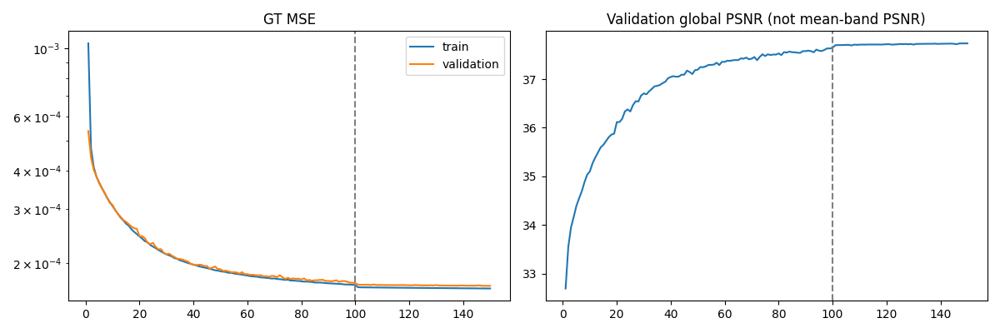

새 학습의 센서별 train·validation 숫자 기록은 각 결과 폴더의 history.json에 있습니다. QB validation global PSNR은 RR의 밴드별 PSNR 평균과 다릅니다.

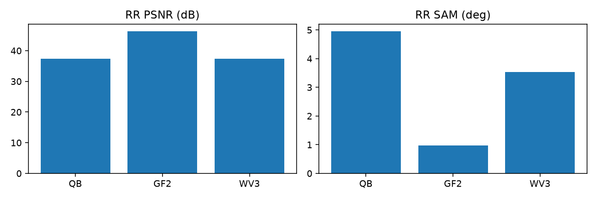

## 6. 결과 이미지

새 best의 장면 1·8·11·13·19를 고정했습니다. 패널은 LR MS·PAN·예측·정답 순서입니다. 입력을 자르지 않았으며 MS만 표시용으로 확대했습니다. RGB는 QB·GF2 [2,1,0], WV3 [4,2,1]을 가정했습니다. 정답의 1-99 백분위 대비를 MS·예측·정답에 공통 적용했습니다. FR에는 정답을 만들지 않았습니다.

### QB

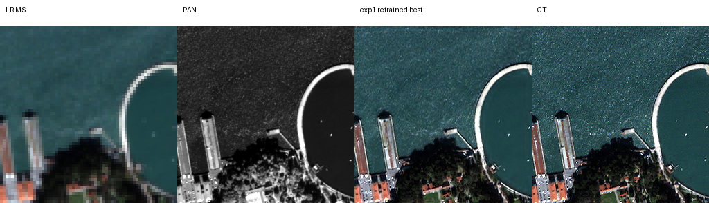

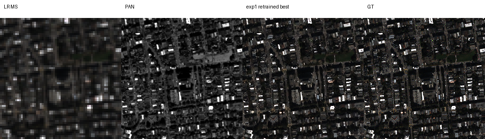

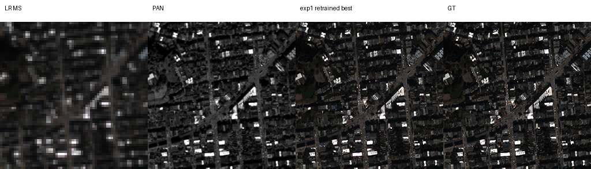

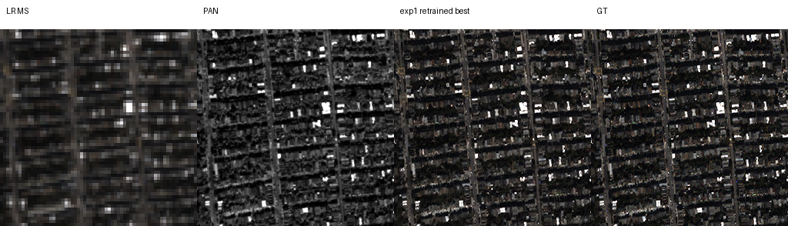

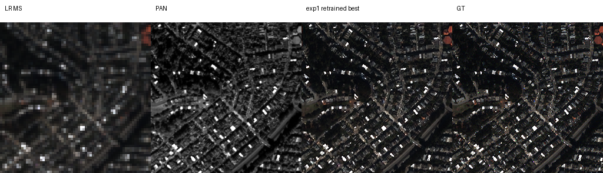


### GF2

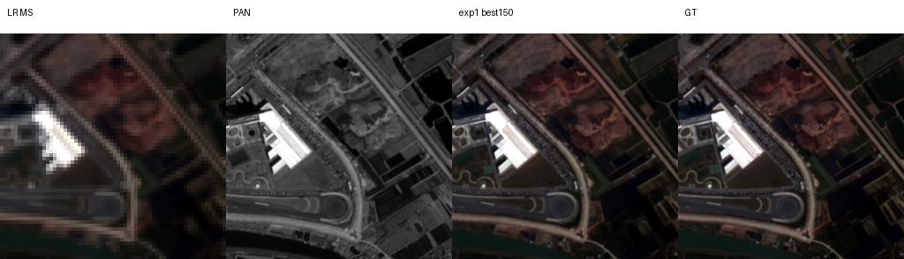

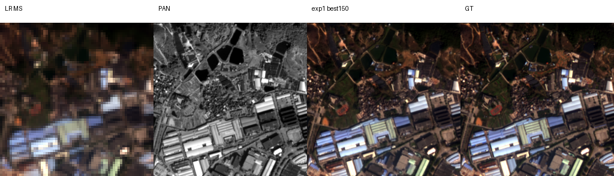

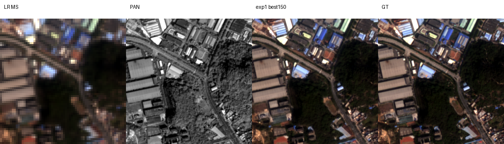

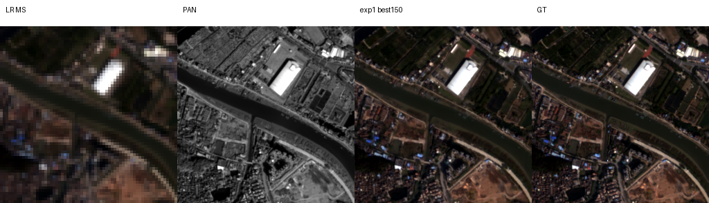

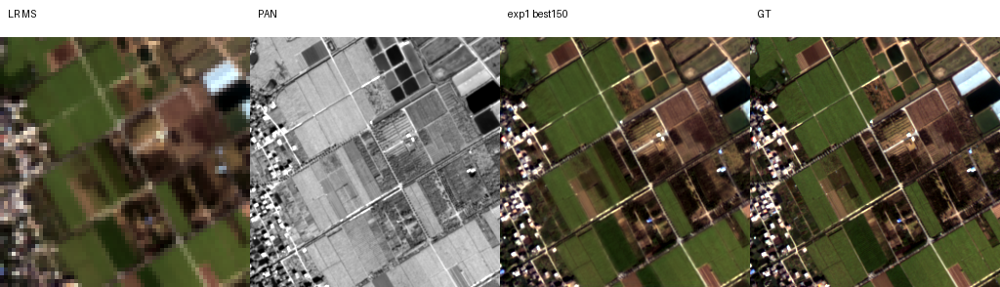


### WV3

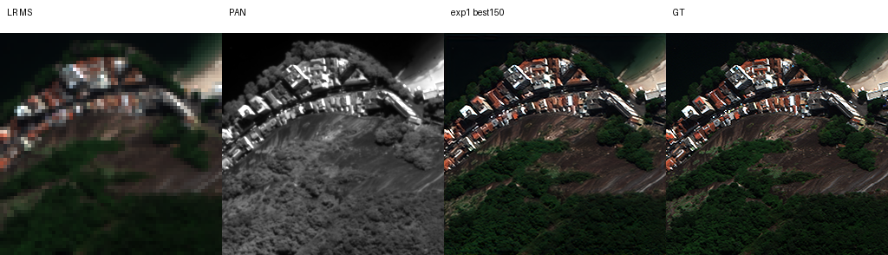

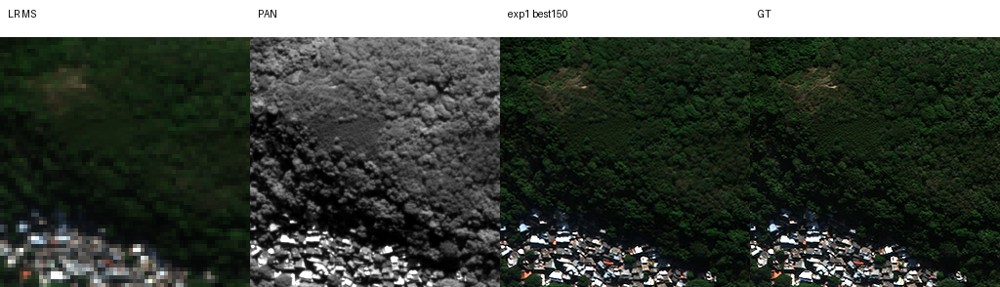

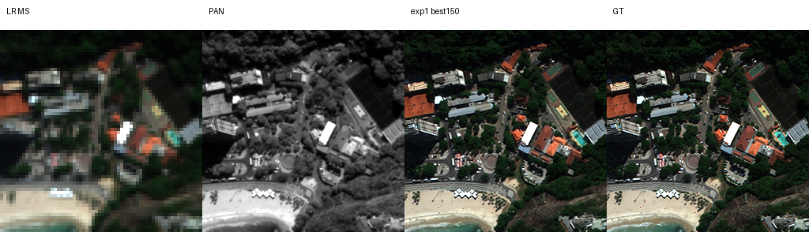

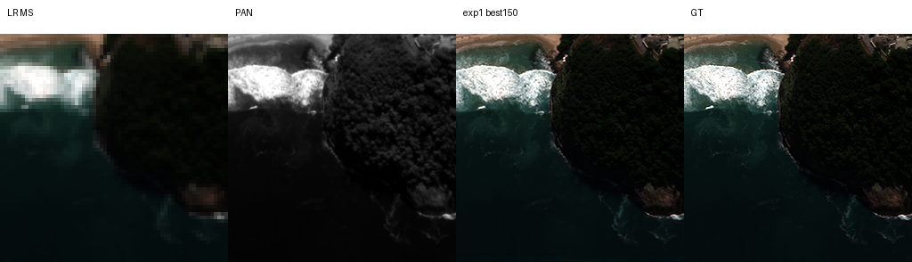

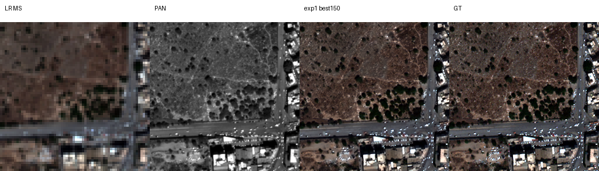

## 7. 재현 자료

[전체 평가](results/retraining_20261013/summary.json) · [보관 확인](results/retraining_20261013/verification.json) · [실제 학습 설정·소스](provenance/retraining_20261013/config.json) · [평가 코드](evaluate.py) · [파일 해시](manifest.json)

가중치는 checkpoints/qb_seed42_150, gf2_seed42_150, wv3_seed42_150에 best.pt·latest.pt·best_at_100.pt로 보관했습니다. 과거 가중치는 기존 경로에 그대로 유지했습니다. 장면별 숫자와 compact 학습 기록은 results/retraining_20261013/<센서>/에 있습니다.

```bash
python SSA-MRN/common/verify.py --experiment 1
```

## 8. 개선 여부와 다음 단계

**판정: 비교 기준입니다.** 논문 수식과 공개 코드 구현 차이가 있어 논문과 완전히 같은 모델·평가라고 주장하지 않습니다. 기존 재현과 새 학습 결과를 구분하며 다른 실험 문서의 비교 기준은 이번 작업에서 변경하지 않았습니다.
