# 반복 복원의 단계 간 특징 전달과 관측·PAN 차이

**변경 내용:** 기존 밴드별 SSAI를 유지하면서 반복 횟수, 단계 간 특징 전달, MS 관측 오차와 PAN 특징 차이를 비교했습니다.

| 확인된 결과 | 상태 | 개선 여부 |
|---|---|---|
| D3: 원본 D0 대비 PSNR +0.0956 dB, SAM −0.1127°, 잠정 QNR +0.0159. D1 대비 PSNR +0.1078 dB | 평가 완료 | **부분 개선** |

[실험 목록](../../README.md#experiments) · [수치](#results) · [그래프](#graphs) · [이미지](#images) · [가중치·근거](#evidence)

## 1. 목적과 상태

**2026-10-12 08:32:09 KST에 7개 × 50에포크 = 350에포크와 자동 평가가 완료됐습니다.** 전체 history·완료 기록·체크포인트를 확인했습니다. 실패·건너뛴 작업이 없고 AMP step 누락도 전 실험 0회였습니다.

직전 공유 복원 C1의 이득이 다른 seed에서도 유지되는지 확인하고, 밴드별 SSAI를 유지한 채 반복 단계에 전달하는 정보를 바꿨습니다. validation으로 D3를 선택한 뒤 D0·D1·D3의 전체 RR·FR test를 평가했습니다. 이후 D4·D5·D6도 같은 가중치 선택 기준과 RR 20장·FR 20장으로 추가 평가했습니다. D2는 test 미평가입니다.

## 2. 변경한 구조와 비교 조건

| ID | 실제 구조 | 파라미터 | 직접 비교 |
|---|---|---:|---|
| D0 | 원본 SSA-MRN K4 단일 복원 | 426,654 | 같은 조건의 기준선 |
| D1 | 기존 C1: error encoder와 학습 가능한 α를 사용하는 공유 3단계 복원 | 426,803 | D0 대비 반복 효과 |
| D2 | D1의 반복을 2단계로 변경 | 426,803 | D1 대비 반복 횟수 |
| D3 | D1 + 크기별 단계 간 특징 전달 | 426,875 | D1 대비 특징 전달 |
| D4 | D1 + MS 관측 오차 보정 | 426,807 | D1 대비 관측 오차 |
| D5 | D3 + MS 관측 오차 보정 | 426,879 | D3/D4 대비 결합 |
| D6 | D3 + 밴드별 PAN 특징 차이 | 428,663 | D3 대비 PAN 경로 추가 |

모든 모델은 전체·1/2·1/4 크기의 기존 4밴드별 SSAI, 복원 decoder와 **K=4**를 유지합니다. D1에서 D6까지 core·error encoder·α의 초기값이 같으며 α는 0.1, 새 gate는 0으로 시작했습니다. D3에서 D6까지 시작 시 D1과 같은 출력임을 사전 검증했습니다. 활성화 함수 교체 실험은 아닙니다.

- **특징 전달:** 앞 단계의 전체·1/2 크기 융합 특징과 1/4 크기 SSAI 특징을 다음 단계의 같은 위치에 더합니다. 1×1 Conv와 밴드별 tanh gate를 사용합니다. detach 없이 gradient를 전달하며 batch 간 특징을 보존하지 않습니다.
- **MS 관측 오차:** 현재 영상 X에서 `MS−D(X)`를 계산한 뒤 HR 크기로 확대하고 밴드별 gate를 거쳐 error encoder에 넣습니다. D는 bilinear 1/4 축소, align_corners=True입니다. 센서 MTF를 보정한 관측이 아닙니다.
- **PAN 특징 차이:** 각 밴드·크기의 SSAI에서 `PAN_feature−Conv(MS_feature)`를 계산하고 gate를 거쳐 기존 SSAI 출력에 추가합니다. 공식 transpose·softmax 경로를 유지합니다. D6−D3은 추가 경로 전체의 효과이며 subtraction 자체만의 효과를 분리하지 못합니다.

| 공통 조건 | 실제 설정 |
|---|---|
| 데이터 | QB train 17,139 / validation 1,905 패치, RR 20장 / FR 20장 |
| 입력 | HR 64×64 / LR 16×16, DN 2047 정규화 |
| 학습 | 새 학습 50에포크, seed **43**, Adam lr 1e−4 고정, 최종 출력 MSE |
| 배치 | micro = effective **96**, worker 각 1개, 마지막 불완전 배치 포함 |
| 장치 | Windows RTX 3060 Ti 8GB, Ryzen 5600X, RAM 15GB, 최대 2개 병렬 |
| 최적화 | AMP FP16 + GradScaler, 동일 epoch 순서(seed43+epoch), TF32 비활성, cuDNN autotune |
| 평가·선택 | FP32, validation MSE 최소 → 정확한 동률이면 SAM → 먼저 선택한 epoch |

같은 초기 core 해시를 전 모델에서 확인했습니다. test로 후보·epoch를 다시 선택하지 않았습니다. 실측 공통 배치와 실행 조건은 [plan](results/plan.json), [benchmark](results/benchmark.json)에 보존했습니다.

<a id="results"></a>

## 3. 정량 결과

### 7개 실험의 validation 비교

| 모델 | best epoch / 50 | Validation MSE ↓ | D0 대비 MSE | Validation SAM ↓ |
|---|---:|---:|---:|---:|
| D3 | 50 | 0.000222498 | -2.053% | 4.926187° |
| D6 | 50 | 0.000223126 | -1.777% | 4.920961° |
| D4 | 50 | 0.000223132 | -1.774% | 4.918860° |
| D5 | 50 | 0.000224296 | -1.262% | 4.921730° |
| D0 | 49 | 0.000227162 | +0.000% | 5.019070° |
| D1 | 50 | 0.000227806 | +0.283% | 4.943834° |
| D2 | 50 | 0.000227998 | +0.368% | 4.939151° |

**D3가 validation 1위입니다.** D6와 D4도 D1보다 낮았으며, 추가 test 평가를 완료했습니다. D0 외 모든 후보의 best가 마지막 50에포크여서 장기 수렴은 미확정입니다.

### 전체 RR·FR test 장면 평균

| 모델 | RR PSNR ↑ | RR SAM ↓ | RR ERGAS ↓ | 잠정 FR QNR ↑ | 잠정 FR D_s ↓ |
|---|---:|---:|---:|---:|---:|
| D0 | 36.285404 | 5.492340° | 4.755496 | 0.881538 | 0.073202 |
| D1 | 36.273192 | 5.392476° | 4.775516 | 0.881093 | 0.086080 |
| D3 | 36.380975 | 5.379622° | 4.711349 | 0.897448 | 0.065137 |
| D4 | 36.327241 | 5.378808° | 4.742393 | 0.882715 | 0.078665 |
| D5 | 36.377506 | 5.396208° | 4.715048 | 0.884710 | 0.077159 |
| D6 | 36.265775 | 5.382235° | 4.778136 | 0.898152 | 0.061634 |

- **D3−D0:** PSNR **+0.095571 dB**, SAM **−0.112717°**, ERGAS **−0.044147**, 잠정 QNR **+0.015910**, D_s **−0.008065**입니다. RR MSE는 −1.612%지만 경계 영역 MSE는 +0.586%로 악화했습니다.
- **D3−D1:** PSNR **+0.107783 dB**, SAM **−0.012854°**, ERGAS **−0.064166**, 잠정 QNR **+0.016355**, D_s **−0.020943**입니다. RR MSE는 −2.718%지만 FR bilinear LR MSE는 **+7.181%**로 악화했습니다.
- **D1−D0:** PSNR **−0.012212 dB**, SAM **−0.099864°**, ERGAS **+0.020020**, 잠정 QNR **−0.000445**, D_s **+0.012878**입니다. 반복만 추가한 D1의 이득은 지표별로 엇갈렸습니다.

[전체 장면별 지표](results/evaluation/metrics.json) · [validation 순위](results/ranking.json) · [평가 전 후보 선택](results/evaluation/selected_models.json)

20개 H5 항목 전체를 평가했습니다. 원래 촬영 장면 ID가 확인되지 않아 20개가 서로 독립적인 원본 촬영 장면이라고 단정하지 않습니다. PSNR은 장면별 밴드 PSNR 평균을 다시 평균한 값입니다. QNR·Q2n·SCC는 MATLAB parity 검증이 완료되지 않았습니다.

### D4·D5·D6 추가 평가

2026-10-12에 기존 validation best를 그대로 사용해 후보별 RR 20장·FR 20장을 FP32로 평가했습니다. test를 보고 epoch나 기존 validation 선택 D3를 바꾸지 않았습니다.

| 후보 | D0 대비 PSNR | D0 대비 SAM | D0 대비 잠정 QNR | FR bilinear LR MSE ↓ | 해석 |
|---|---:|---:|---:|---:|---|
| D3 | +0.095571 dB | -0.112717° | +0.015910 | 0.002278332 | RR PSNR·ERGAS가 가장 좋았습니다. |
| D4 | +0.041837 dB | -0.113531° | +0.001177 | 0.002104836 | SAM이 가장 낮았고 관측 오차가 줄었습니다. |
| D5 | +0.092101 dB | -0.096132° | +0.003172 | 0.002095245 | PSNR은 D3보다 0.003469 dB 낮고, 관측 오차는 약 8.03% 낮았습니다. |
| D6 | -0.019630 dB | -0.110104° | +0.016614 | 0.002235320 | 잠정 QNR·D_s는 가장 좋았지만 RR PSNR은 D0보다 낮았습니다. |

D4·D5·D6도 후속 비교 후보로 유지합니다. 모든 개선 후보의 RR 경계 MSE는 D0보다 높았습니다. LR MSE는 bilinear 축소 기준이며 보정된 센서 관측 정확도를 뜻하지 않습니다.

[추가 평가의 전체 장면별 지표](results/additional_evaluation/metrics.json) · [고정 장면 선택](results/additional_evaluation/selection.json)

## 4. 기준선 대비 차이와 해석

D3는 같은 조건의 D1에 특징 전달을 더해 validation MSE를 **2.330%** 낮췄습니다. 파라미터는 72개 증가했습니다. 주요 RR·잠정 FR 평균은 개선됐지만 이득이 작고 모든 오차 지표가 개선된 것은 아닙니다.

D2의 2단계는 D1보다 validation MSE가 **0.084%** 높았습니다. D4와 D6는 개선됐지만 D3를 넘지 못했고, D5 결합은 D3보다 **0.808%** 높았습니다. 추가 test에서 D4·D5의 관측 오차 감소와 D6의 잠정 FR 개선을 확인했지만, 모든 지표에서 동시에 개선되지는 않았습니다.

[직전 seed42 C1](../19_dual_stream_reconstruction/README.md)은 같은 조건의 C0 대비 PSNR +0.244200 dB·잠정 QNR +0.024991이었습니다. 이번 seed43 D1은 −0.012212 dB·−0.000445로 그 이득을 재현하지 못했습니다. 각 실행의 대조군 대비 차이를 비교하며 서로 다른 기준선의 절대 점수로 구조 효과를 단정하지 않습니다. Linux 구조 실험과 Windows 손실 결과를 결합한 성능도 아직 확정하지 않습니다.

<a id="graphs"></a>

## 5. 학습·평가 그래프

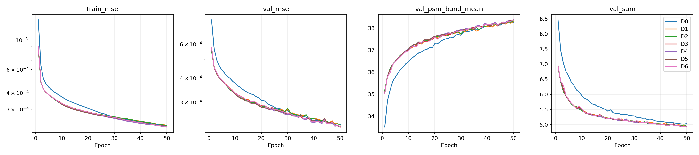

validation 밴드 평균 PSNR과 전체 MSE에서 유도한 global PSNR은 다르며 원본 history에서 구분했습니다.


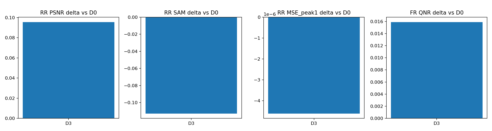

<a id="images"></a>

## 6. 결과 이미지

평가 전에 고정한 RR index **1·8·11·13·19**(0-based)의 전체 장면입니다. **LR MS · PAN · 예측 · GT** 순서이며 RGB [2,1,0] 가정, GT 1–99% 공통 대비를 적용했습니다. LR MS만 최근접 확대했고 FR 정답은 만들지 않았습니다.

### D3 · validation으로 선택한 특징 전달 후보


<details>
<summary>D0·D1·D3의 고정 5장면 전체 이미지 15개</summary>

### D0

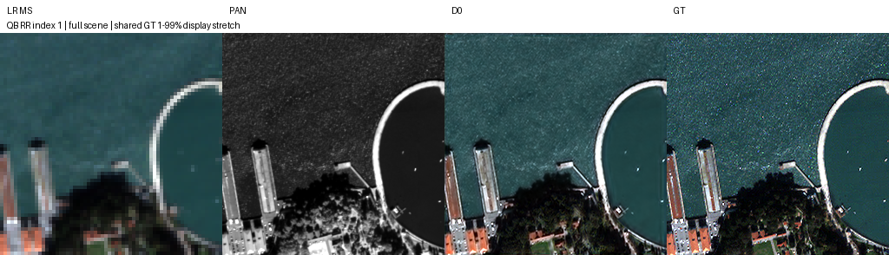

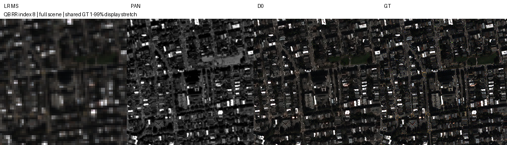

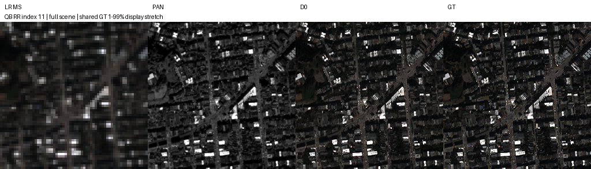


### D1


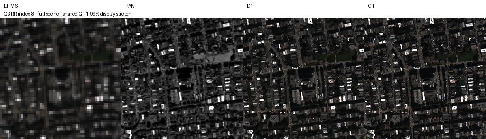


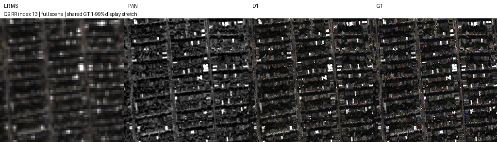


### D3


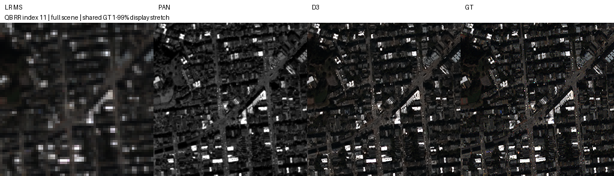


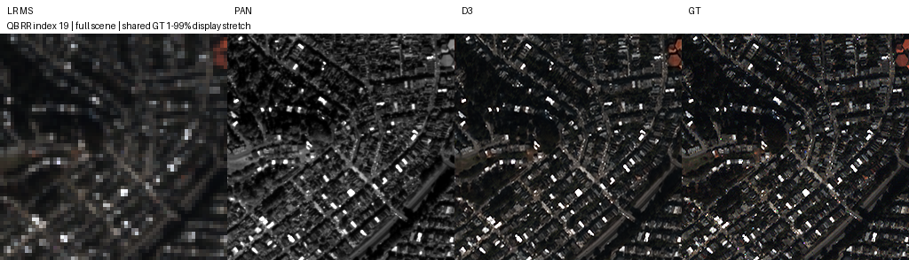

</details>

### 추가 평가 후보의 동일 장면 8

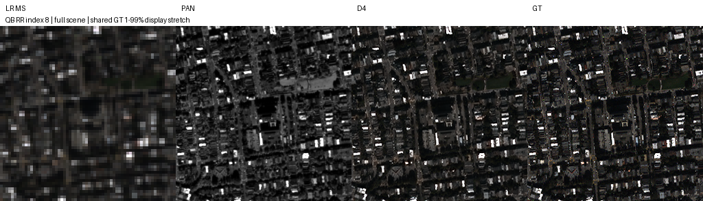

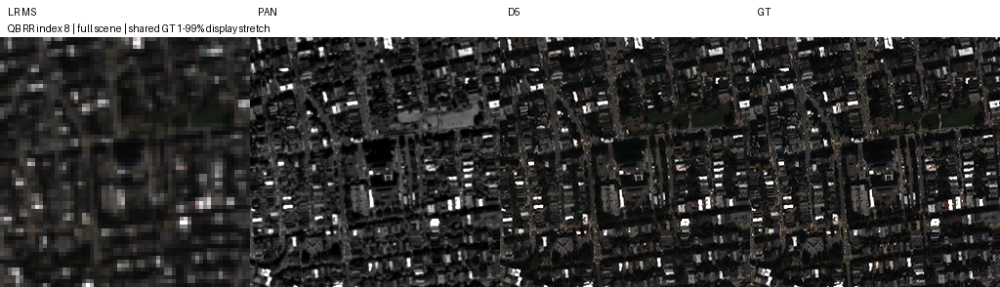

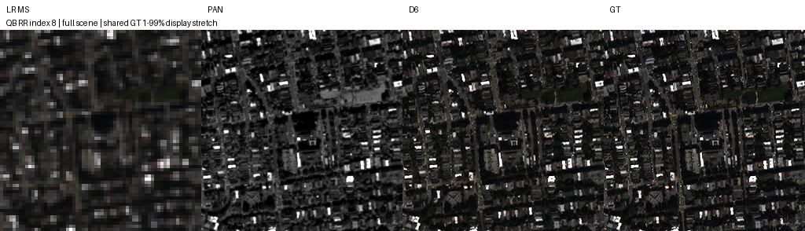

<a id="evidence"></a>

## 7. 재현 자료

- [모델](model.py) · [학습·평가 실행기](run.py) · [데이터·배치 준비](prepare.py)
- [가중치](checkpoints/) · [학습·validation·test 기록](results/) · [원본 실행 소스](provenance/source_snapshot/)
- [파일 해시](manifest.json) · [공통 가중치 평가 방법](../../README.md#evaluate)

D0-D6의 best/latest 14개에는 model·Adam·scaler·RNG·epoch cursor·history가 포함돼 있습니다. 가중치 내부 설정과 원본 소스는 변경하지 않았습니다. D2는 학습·validation만 완료됐으며 RR·FR test는 평가하지 않았습니다.

```bash
python SSA-MRN/common/checkpoint.py --experiment 20 --checkpoint checkpoints/D4/best.pt
python SSA-MRN/common/checkpoint.py --experiment 20 --checkpoint checkpoints/D4/best.pt --h5 /path/to/test_qb_multiExm1.h5 --protocol RR --output SSA-MRN/runtime/D4_rr.json
```

## 8. 개선 여부와 다음 단계

**판정: 부분 개선입니다.** D3는 RR, D6는 잠정 FR, D4·D5는 관측 오차에서 서로 다른 강점을 보였습니다. 모든 기준을 만족하는 최종 모델은 아직 선정하지 않았습니다.

단일 seed43·50에포크의 작은 차이이므로 새 시드 반복에서 유지되는지 확인합니다. D3만 남기지 않고 D4·D5·D6의 구조도 후속 비교에 포함했습니다. 장기 수렴·다른 센서·FR 지표 parity는 추가 확인이 필요합니다.
