# 특징 선택·복원 후 관측 보정·고주파 PAN 차이

**변경 내용:** 특징 전달 gate를 공간·밴드별로 확장하고, 관측 보정을 복원 후에 적용하며, PAN 특징 차이의 저주파를 제거했습니다.

| 확인된 결과 | 상태 | 개선 여부 |
|---|---|---|
| 8개 × 50에포크 및 전체 RR·FR 평가를 완료했습니다. E1은 E0 대비 PSNR +0.3345 dB, SAM -0.2219°, 잠정 QNR +0.0404입니다. | 평가 완료 | 부분 개선 |

[실험 목록](../../README.md#experiments) · [수치](#results) · [그래프](#graphs) · [이미지](#images) · [재현 자료](#evidence)

## 1. 목적과 상태

이전 D3는 RR, D5는 관측 일관성, D6는 잠정 FR 공간 지표에서 강점을 보였습니다. 각 구조를 seed44에서 재학습하고 세 가지 변경의 효과를 비교했습니다. 2026-10-12 17:16 KST에 8개 학습이 종료됐으며, 이미지 생성 함수의 가져오기 오류를 수정한 뒤 같은 날 17:56 KST에 평가를 완료했습니다. 학습을 다시 실행하지 않고 각 모델의 validation best를 평가했습니다.

## 2. 변경한 구조와 비교 조건

| ID | 변경 내용 | 직접 비교 |
|---|---|---|
| E0 | 원본 SSA-MRN 단일 복원 | 전체 기준선 |
| E1 | D3: 3단계 공유 복원과 특징 전달 | E0 |
| E2 | D4: MS 관측 오차 보정 | E0 |
| E3 | D5: 특징 전달과 관측 보정 | E1·E2 |
| E4 | D6: 특징 전달과 PAN 차이 | E1 |
| E5 | 현재·이전 특징으로 공간·밴드별 전달 gate를 계산했습니다. | E1 |
| E6 | E3의 관측 보정을 단계별 복원 출력 뒤로 이동했습니다. | E3 |
| E7 | E4의 PAN 차이에서 고정 5×5 box 필터 저주파를 제거했습니다. | E4 |

E5는 각 크기에서 현재·이전 4채널 특징을 결합하고 1×1 Conv로 4채널 gate를 계산합니다. 기존 밴드 gate에 logits를 더하고 tanh를 적용합니다. 추가 Conv는 0으로 초기화했습니다.

E6는 `복원 → α 잔차 갱신 → MS 관측 오차 계산 → α로 조절한 관측 보정` 순서입니다. 기존 error encoder를 재사용하며 `encoder(error)−encoder(0)`로 bias 중복을 제거했습니다. bilinear 관측·기존 α·밴드 gate는 유지했습니다. 따라서 효과는 보정 위치와 적용 방식 전체에 대한 비교입니다.

E7은 각 크기의 `PAN_feature−Conv(MS_feature)`에서 reflect padding의 5×5 평균을 뺀 뒤 기존 gate로 주입합니다. 상수 특징의 고주파가 0임을 확인했습니다. 이 필터는 센서 MTF를 대신하지 않습니다.

- QB 전체 train 17,139 / validation 1,905 패치, RR 20개 / FR 20개를 사용합니다.
- K4, seed44, 50에포크 새 학습, Adam lr 1e-4 고정, 최종 출력 MSE를 사용합니다.
- Windows RTX3060Ti 8GB·5600X·RAM15GB에서 최대 2개 병렬로 실행합니다.
- AMP FP16 학습·FP32 validation/test, TF32 비활성·cuDNN autotune을 적용합니다.
- 공통 micro=effective 배치는 **96**으로 정했습니다. 배치96의 동시 실행은 최대 약 6.25GB, 배치128은 약 7.87GB로 여유가 부족해 제외했습니다. 각 worker는 1개입니다.
- 순서는 E0→E1→E5→E3→E6→E4→E7→E2이며 빈 슬롯에 다음 작업이 들어갑니다.
- 전체 모델의 core 초기값과 새 경로가 0일 때 각 원형 출력의 일치를 확인합니다.

## 3. 정량 결과

validation MSE 최소, 정확한 동률이면 SAM으로 best를 결정했습니다. E3가 validation 기준 후보로 선택됐으며 test로 후보나 epoch를 다시 선택하지 않았습니다. 8개 각각 RR 20개·FR 20개, 총 320개 장면을 FP32로 평가했습니다.

| ID | 변경 내용 | best epoch | PSNR ↑ | SAM ↓ | ERGAS ↓ | 잠정 QNR ↑ | FR 관측 MSE ↓ |
|---|---|---:|---:|---:|---:|---:|---:|
| E0 | 단일 복원 기준선 | 50 | 36.1310 | 5.5914 | 4.8478 | 0.8666 | 0.0022589 |
| E1 | 3단계 공유 복원·특징 전달 | 50 | 36.4655 | 5.3696 | 4.6503 | 0.9071 | 0.0024696 |
| E2 | MS 관측 오차 보정 | 49 | 36.2974 | 5.4267 | 4.7527 | 0.8953 | 0.0021656 |
| E3 | 특징 전달·관측 보정 | 50 | 36.4509 | 5.3620 | 4.6561 | 0.9008 | 0.0024445 |
| E4 | 특징 전달·PAN 차이 | 49 | 36.3215 | 5.4198 | 4.7341 | 0.8963 | 0.0025928 |
| E5 | 공간·밴드별 전달 gate | 50 | 36.3996 | 5.3981 | 4.6882 | 0.9009 | 0.0024607 |
| E6 | 복원 후 관측 보정 | 50 | 36.3604 | 5.3984 | 4.7078 | 0.9046 | 0.0024029 |
| E7 | 고주파 PAN 차이 | 49 | 36.3836 | 5.4316 | 4.7103 | 0.9104 | 0.0026122 |

FR 관측 MSE는 센서 MTF 대신 bilinear로 출력 크기를 줄여 원본 MS와 비교했습니다. [전체 장면 수치](results/metrics.json)와 [validation 순위](results/ranking.json)에 원본 수치를 보존했습니다.

## 4. 기준선 대비 차이와 해석

E0 대비 E1은 PSNR +0.3345 dB, SAM -0.2219°, ERGAS -0.1975, 잠정 QNR +0.0404로 개선됐습니다. RR 경계 MSE도 약 8.70% 감소했습니다. 다만 FR 관측 MSE는 약 9.33% 증가해 모든 지표의 개선으로 판정하지 않았습니다.

새 변경은 각 원형과 직접 비교했습니다.

| 변경 | ΔPSNR ↑ | ΔSAM ↓ | ΔERGAS ↓ | Δ잠정 QNR ↑ | 해석 |
|---|---:|---:|---:|---:|---|
| E5 - E1 | -0.0659 | +0.0285 | +0.0379 | -0.0062 | RR·FR 주요 지표가 모두 악화됐습니다. |
| E6 - E3 | -0.0905 | +0.0364 | +0.0518 | +0.0037 | RR은 악화됐지만 QNR·관측 MSE는 개선됐습니다. |
| E7 - E4 | +0.0622 | +0.0118 | -0.0238 | +0.0141 | PSNR·ERGAS·QNR은 개선됐지만 SAM·관측 MSE는 악화됐습니다. |

E1이 RR PSNR·ERGAS·경계 MSE에서 가장 좋았고 E3가 SAM에서 가장 좋았습니다. E7의 잠정 QNR이 가장 높았습니다. E2는 FR 관측 MSE가 가장 낮았습니다. 이전 seed43 결과와는 배치 등 조건이 달라 절대 수치를 직접 비교하지 않았습니다.

## 5. 학습·평가 그래프

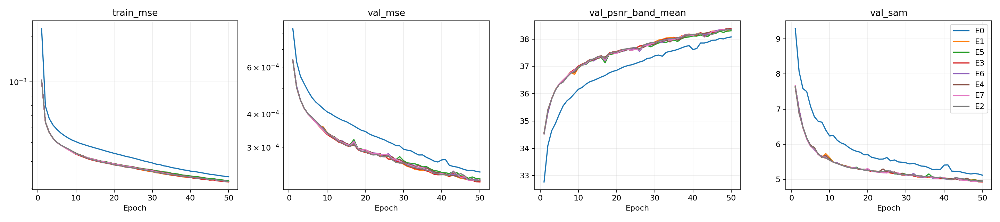

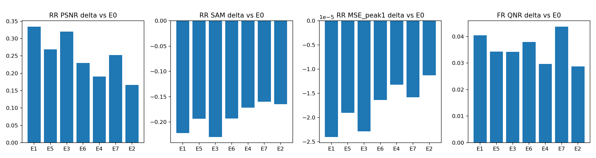

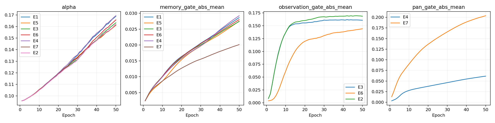

## 6. 결과 이미지

평가 전 RR index 1·8·11·13·19를 고정했습니다. LR MS · PAN · 예측 · GT 순서이며 LR MS만 최근접 확대하고 GT 1–99% 공통 대비·RGB [2,1,0] 가정을 적용합니다. FR에 GT를 만들지 않습니다.

기준선과 주요 후보의 같은 장면을 비교합니다. 전체 후보 40개 이미지는 results 폴더에 보존했습니다.

### E0 · 단일 복원 기준선

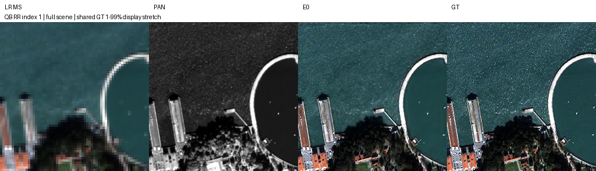

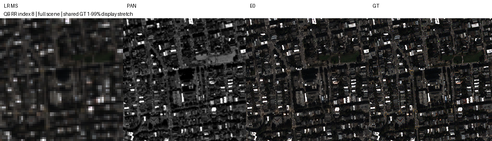

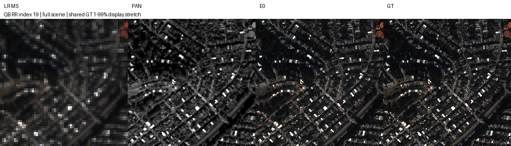

### E1 · 3단계 공유 복원·특징 전달

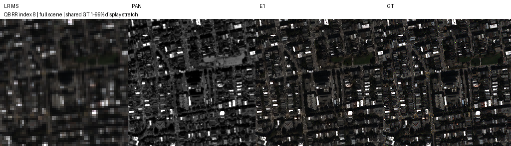

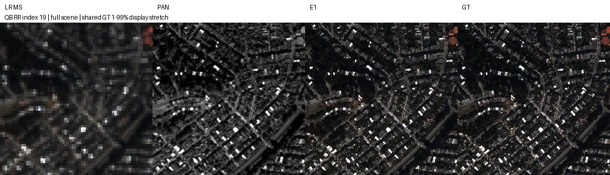

### E3 · 특징 전달·관측 보정

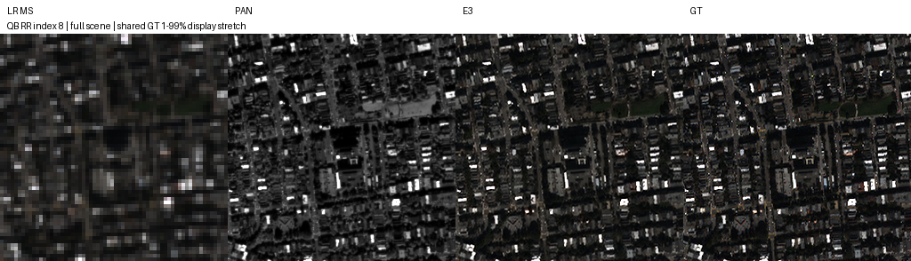

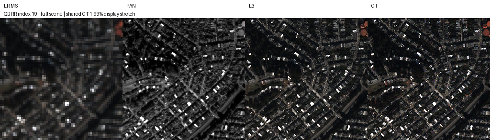

### E7 · 고주파 PAN 차이

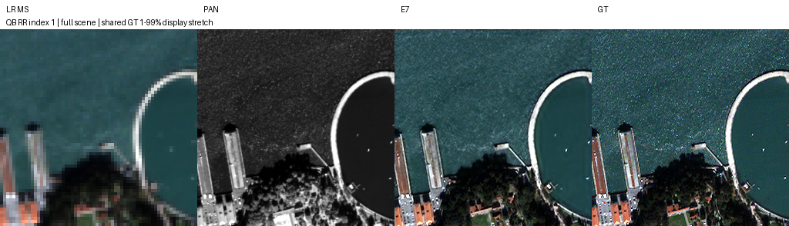

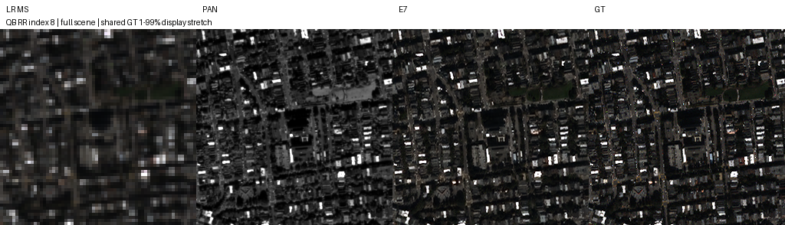

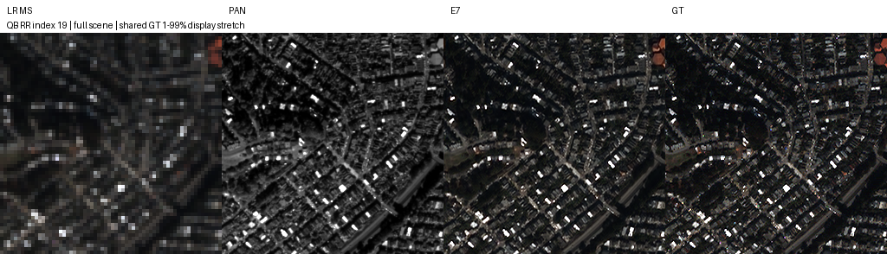

## 7. 재현 자료

[공통 실행·평가 안내](../../README.md#evaluate) · [파일 해시](manifest.json) · [실행 코드](run.py) · [모델](model.py) · [준비 코드](prepare.py) · [원본 실행 근거](provenance/) · [best/latest 가중치](checkpoints/) · [학습 기록](results/training/) · [학습 설정](results/plan.json)

새 실행 옵션은 `python SSA-MRN/experiments/21_guidance_refinement/run.py --help`에서 확인합니다. 기존 서버 runtime을 새 코드로 재개하지 않습니다.

## 8. 개선 여부와 다음 단계

전체 판정은 **부분 개선**입니다. E1의 반복 복원·특징 전달은 seed44의 E0 대비 주요 RR·FR 지표를 함께 개선했습니다. E5는 원형보다 개선되지 않았으며 E6·E7은 지표별 이득과 손실이 나뉩니다.

후속 확인은 E1·E3·E7을 같은 학습 조건과 추가 seed·센서에서 비교하는 방향입니다. 현재는 QB 단일 seed·50에포크 결과이며 FR QNR·Q2n·SCC의 MATLAB 일치성은 확인하지 않았습니다.
