# 단계별 갱신량·특징 변환·마지막 단계 PAN 주입

**변경 내용:** 공유 복원기의 단계별 갱신량과 특징 변환을 학습하고, 마지막 단계에만 고주파 PAN 차이를 주입합니다.

| 확인된 결과 | 상태 | 개선 여부 |
|---|---|---|
| F0 기준 전체 평가 완료. F4: PSNR -0.0009 dB, SAM +0.0064°, 잠정 QNR +0.0018. | 평가 완료 | 부분 개선 |

## 1. 목적과 상태

**2026-10-12 22:46:43 KST에 학습 6개와 전체 평가가 완료됐습니다.** 실패·생략 없이 300에포크, RR·FR 총 240장과 고정 장면 이미지 30개를 보관했습니다. validation 선택 후보는 F4이며 test로 후보나 epoch를 변경하지 않았습니다.

21번 실험에서 반복 복원·특징 전달 모델 E1이 RR 주요 지표에서 가장 좋았습니다. 복원기를 복제하지 않고 단계별 역할을 학습하도록 변경합니다. 공간·밴드 gate를 복잡하게 만드는 대신 단계별 갱신량과 작은 특징 변환을 비교합니다.

## 2. 변경한 구조와 비교 조건

| ID | 변경 내용 | 직접 비교 |
|---|---|---|
| F0 | E1과 같은 3단계 공유 복원·특징 전달입니다. | **이번 실험 기준선** |
| F1 | 공유 α 하나를 단계별 α 3개로 바꿨습니다. | F0 |
| F2 | 단계·크기·밴드별 affine 특징 변환을 추가했습니다. | F0 |
| F3 | F1의 α와 F2의 특징 변환을 결합했습니다. | F1·F2 |
| F4 | F3의 마지막 복원 단계에만 E7 방식 고주파 PAN 차이를 주입했습니다. | F3 |
| F5 | 원본 단일 복원입니다. | 원본 모델 참고 비교 |

F1의 α는 모두 0.1로 시작합니다. F2는 세 복원 단계 × 세 크기 × 네 밴드에 대해 `특징 × (1 + scale) + bias`를 적용하며 scale·bias를 0으로 초기화했습니다. 각 크기의 특징 전달 뒤, 다음 크기 처리와 decoder 결합 전에 적용합니다. 작은 변환으로 단계 정보를 전달하며 처음부터 단계별 역할을 강제하지 않습니다.

F4는 PAN·MS 특징 차이에서 reflect padding의 5×5 평균을 뺀 뒤, 마지막 복원 단계의 세 크기에 밴드별 gate로 주입합니다. gate는 0으로 초기화했습니다. 앞 두 복원 단계에는 이 경로를 적용하지 않습니다.

QB 전체 train 17,139·validation 1,905 패치, K4, seed45, 50에포크, Adam lr 1e-4, 최종 출력 MSE입니다. 공통 effective batch96, AMP FP16 학습·FP32 validation/test, TF32 비활성, 최대 두 개 병렬로 실행합니다. F0-F5의 core 초기값과 epoch별 데이터 순서를 맞췄습니다. 순서는 F0·F1 → 빈 슬롯에 F2·F3·F4·F5입니다. 가장 무거운 F3·F4의 동시 점검은 5,970MiB(약 5.83GiB), 본학습 F0·F1은 5,780MiB(약 5.64GiB)·GPU 사용률 98%를 확인했습니다. mmap 배치 로딩·pin memory·worker 1개·prefetch 1을 사용하고 이전 캐시를 NTFS hardlink로 공유했습니다.

## 3. 정량 결과

**이번 실험의 기준선은 F0입니다. F1-F4의 추가 개선은 F0와 비교하고, F5는 원본 모델 참고 비교로만 사용합니다.**

원본 validation MSE로 best를 선택하고 정확한 동률이면 SAM을 사용했습니다. 모든 후보의 RR·FR 각 20장 평균입니다. FR 관측 오차는 bilinear 축소와 원본 MS의 차이이며 센서 MTF 검증 결과가 아닙니다.

| 모델 | best epoch | PSNR ↑ | SAM ↓ | ERGAS ↓ | 잠정 QNR ↑ | FR 관측 MSE ↓ |
|---|---:|---:|---:|---:|---:|---:|
| F0 | 50 | 36.198956 | 5.448762 | 4.807619 | 0.882741 | 0.002121490 |
| F1 | 50 | 36.120549 | 5.492301 | 4.855574 | 0.892601 | 0.002107647 |
| F2 | 50 | 36.184378 | 5.485871 | 4.809946 | 0.879022 | 0.002153411 |
| F3 | 50 | 36.174817 | 5.485825 | 4.819761 | 0.876195 | 0.002164846 |
| F4 | 50 | 36.198024 | 5.455149 | 4.800663 | 0.884582 | 0.002206327 |
| F5 | 50 | 35.750439 | 5.685447 | 5.055505 | 0.864249 | 0.002135611 |

## 4. 기준선 대비 차이와 해석

| 직접 비교 | ΔPSNR ↑ | ΔSAM ↓ | ΔERGAS ↓ | Δ잠정 QNR ↑ |
|---|---:|---:|---:|---:|
| F0 - F5 | +0.448518 | -0.236685 | -0.247886 | +0.018491 |
| F1 - F0 | -0.078407 | +0.043538 | +0.047955 | +0.009860 |
| F2 - F0 | -0.014578 | +0.037109 | +0.002327 | -0.003718 |
| F3 - F0 | -0.024140 | +0.037062 | +0.012142 | -0.006546 |
| F4 - F3 | +0.023207 | -0.030676 | -0.019098 | +0.008387 |
| F4 - F0 | -0.000933 | +0.006386 | -0.006956 | +0.001841 |

**기존 특징 전달 F0가 RR PSNR·SAM에서 가장 좋았습니다.** F1은 잠정 QNR과 FR 관측 오차에서 가장 좋았습니다. 단계별 α·affine 변환을 추가한 F1-F3은 F0의 RR 주요 지표를 넘지 못했습니다. 마지막 단계 PAN 주입 F4는 F3의 PSNR·SAM·ERGAS·잠정 QNR을 개선했으나, F0 대비 PSNR -0.000933 dB·SAM +0.006386°로 추가 RR 개선은 뚜렷하지 않습니다. F4의 FR 관측 오차도 F0보다 높았습니다.


### 반복 단계별 RR MSE 진단

| 모델 | 1차 평균 | 2차 평균 | 3차 평균 |
|---|---:|---:|---:|
| F0 | 0.000792385 | 0.000384283 | 0.000293571 |
| F1 | 0.000825340 | 0.000415425 | 0.000299890 |
| F2 | 0.000789417 | 0.000392229 | 0.000293752 |
| F3 | 0.000844382 | 0.000432368 | 0.000294744 |
| F4 | 0.000858627 | 0.000465806 | 0.000292606 |
| F5 | 0.000325839 | — | — |

단계별 수치는 같은 모델의 중간 출력 진단이며 모델·epoch 선택에 사용하지 않았습니다. 이전 E 실험과는 seed가 달라 절대 점수를 직접 비교하지 않습니다.

## 5. 학습·평가 그래프

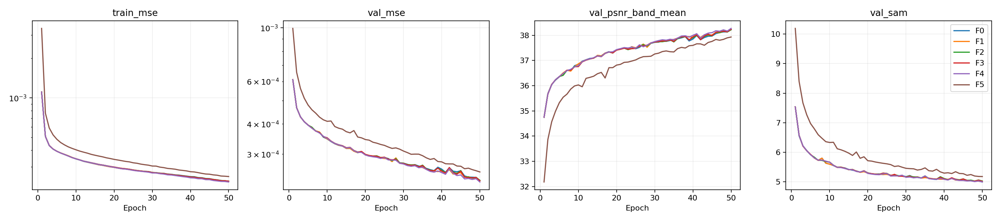

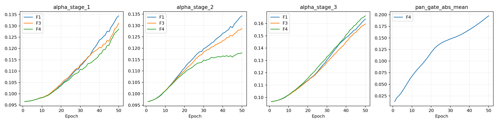

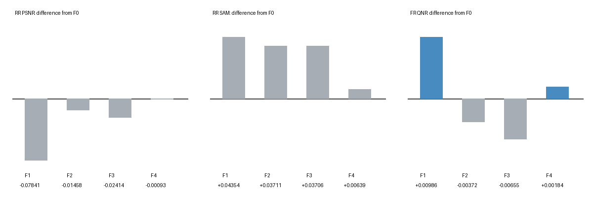

<details>
<summary>원본 모델 F5 참고 비교</summary>

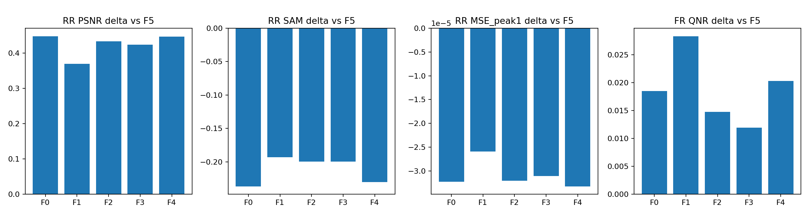

</details>

## 6. 결과 이미지

고정 RR index 1·8·11·13·19를 모든 후보에 사용했습니다. LR MS·PAN·예측·GT 순서이며 전체 장면을 추론했습니다. MS만 최근접 확대하고 RGB [2,1,0] 가정·GT 1-99% 공통 대비를 적용했습니다. FR에는 정답을 만들지 않았습니다.

<details>
<summary>F5: 고정 5장면</summary>

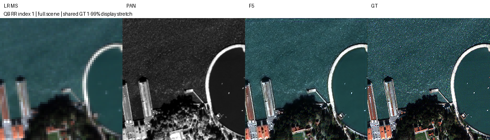

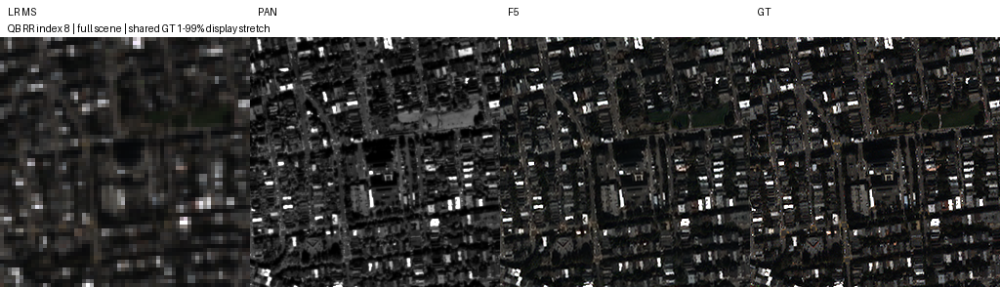

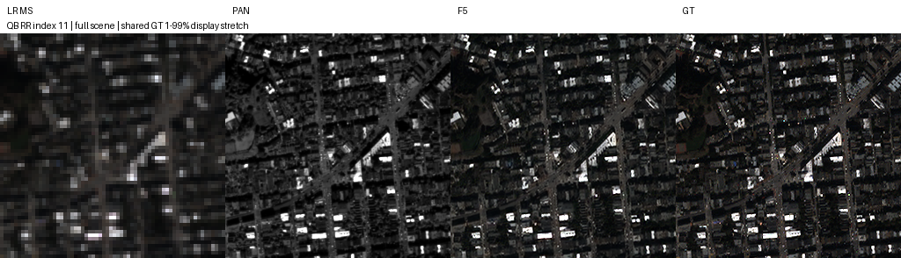

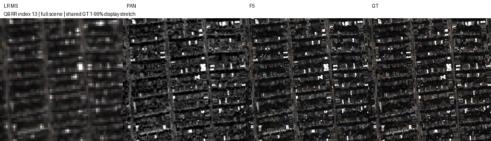

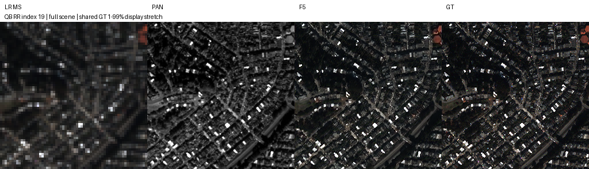

</details>

<details>
<summary>F0: 고정 5장면</summary>


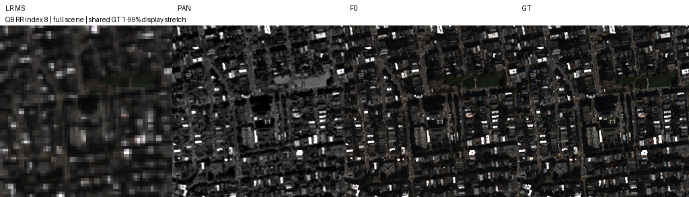

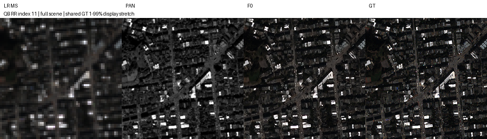


</details>

<details>
<summary>F4: 고정 5장면</summary>


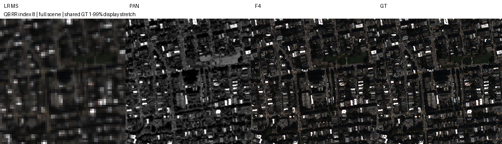

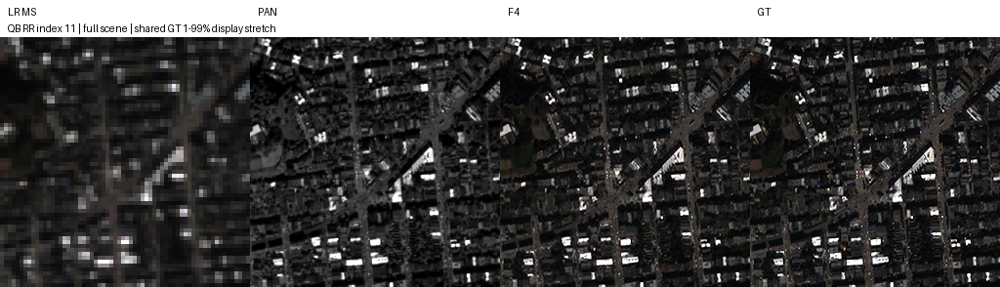


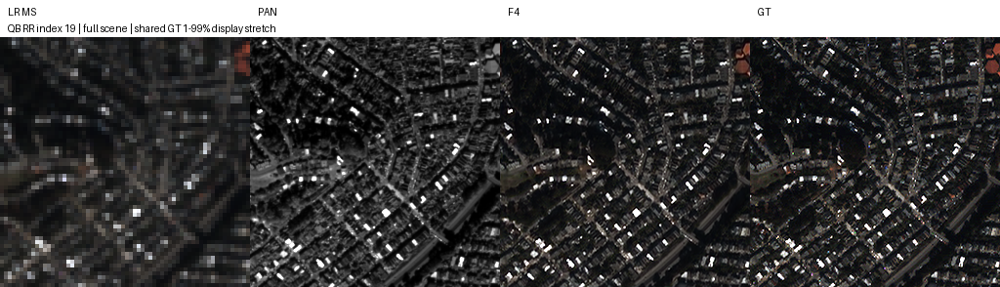

</details>

<details>
<summary>F1: 고정 5장면</summary>


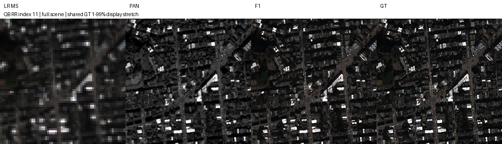

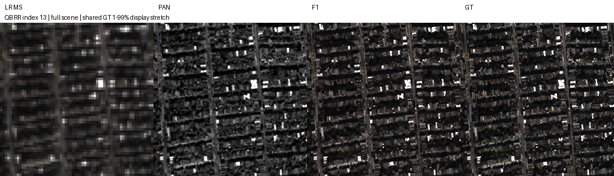

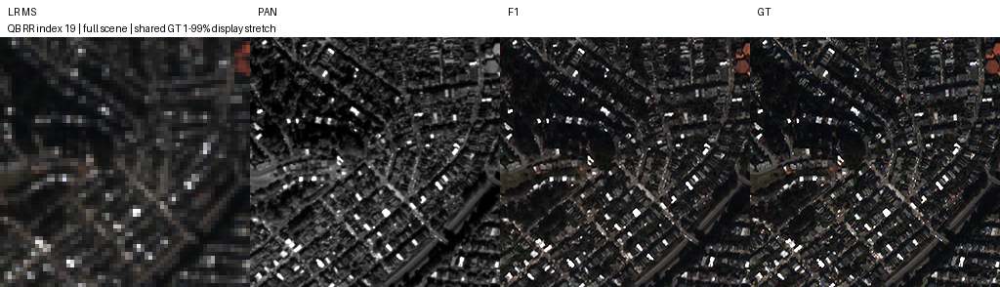

</details>

<details>
<summary>F2: 고정 5장면</summary>

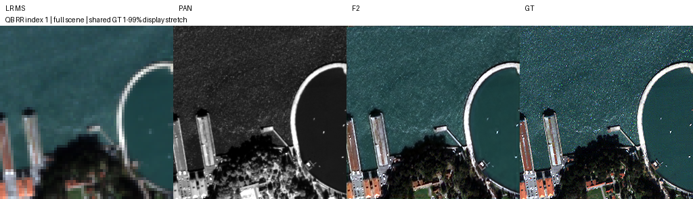


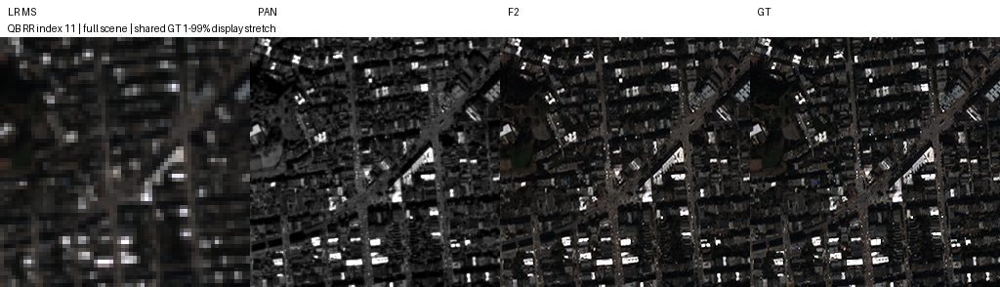


</details>

<details>
<summary>F3: 고정 5장면</summary>

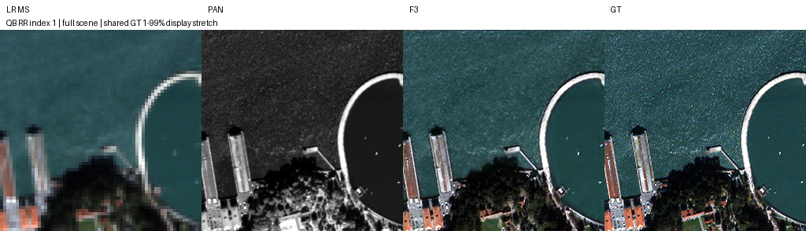


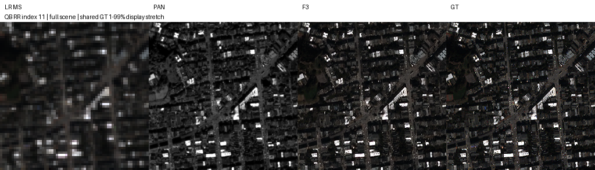


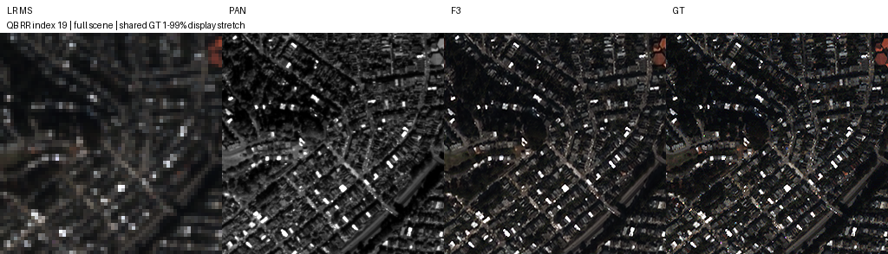

</details>

## 7. 재현 자료

[모델](model.py) · [실행·재개](run.py) · [준비](prepare.py) · [점검](verify.py) · [원본 best/latest](checkpoints/) · [평가 원본](results/evaluation/metrics.json) · [validation 순위](results/ranking.json) · [실제 학습 소스](provenance/source_snapshot/) · [파일 해시](manifest.json)

공통 평가 도구는 22번 원본 가중치 strict load를 지원합니다. 학습 당시 source snapshot과 체크포인트 내부 설정은 변경하지 않았습니다. 전체 전송 파일의 크기·SHA-256과 ZIP 해시를 대조했습니다. 큰 캐시·예측 배열·상세 로그는 포함하지 않았습니다.

```bash
python SSA-MRN/common/checkpoint.py --experiment 22 --checkpoint checkpoints/F0/best.pt
```

## 8. 개선 여부와 다음 단계

**판정: 부분 개선입니다.** 반복 복원·특징 전달은 이번 seed에서도 원본 대비 RR·잠정 QNR 개선을 보였습니다. 새 단계별 조절은 기존 F0를 일관되게 넘지 못했습니다. validation 선택 F4와 test 진단상 강점이 있는 F0·F1을 구분하며 test로 선택을 소급 변경하지 않습니다.

단계별 변환을 더 복잡하게 확장하기보다 기존 특징 전달의 반복 시드·장기 수렴·다른 센서 검증이 우선입니다. 마지막 단계 PAN 주입은 관측 오차·분광 지표 악화를 줄이는 별도 비교 가치가 있습니다. QB seed45·50에포크 탐색이며 QNR·Q2n·SCC의 MATLAB 일치성은 미확인입니다.
