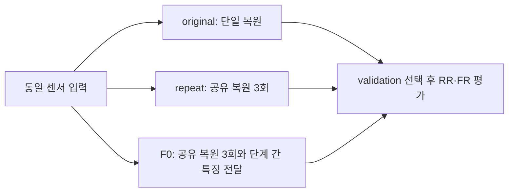

# 반복 복원·단계 간 특징 전달의 센서별 수렴 비교

**변경 내용:** 원본 단일 복원, 3단계 공유 복원, 단계 간 특징 전달을 세 센서에서 같은 조건으로 비교합니다.

| 확인된 결과 | 상태 | 개선 여부 |
|---|:---:|:---:|
| 2026-10-13 14:14 KST 기준 QB는 세 모델의 150에포크와 자동 평가가 완료됐으며, GF2와 WV3는 학습이 남아 있습니다. | 학습 중 | 판단 보류 |

## 1. 목적과 상태

반복 복원과 단계 간 특징 전달의 효과가 센서별 장기 학습에서도 유지되는지 확인합니다. 실험자는 이병현입니다. 전체 실험은 아직 완료되지 않았습니다.

## 2. 변경한 구조와 비교 조건

original은 원본 단일 복원입니다. repeat는 복원기를 세 번 공유하며 공통 α로 갱신량을 조절합니다. F0는 repeat에 세 크기의 특징 전달을 추가합니다. original과 repeat를 대조군으로 사용합니다.

QB·GF2는 4밴드, WV3는 8밴드이며 K4·seed46·effective/micro batch64·Adam·최종 출력 MSE를 공통 사용합니다. 모델별 150에포크를 학습합니다. 1-100에포크는 학습률 1e-4, 101-150은 1e-5입니다. 최대 두 작업을 병렬로 실행합니다.

## 3. 수치 결과

2026-10-13 14:14 KST에 실제 runtime의 queue·status·history를 확인했습니다.

| 센서 | original 완료 에포크 | repeat 완료 에포크 | F0 완료 에포크 |
|---|---:|---:|---:|
| QB | 150 | 150 | 150 |
| GF2 | 150 | 127 | 112 |
| WV3 | 100 | 100 | 100 |

50·100에포크의 전체 센서 자동 평가와 QB 150에포크 자동 평가의 완료 기록을 확인했습니다. 최종 RR·FR 수치의 검증과 보관은 남아 있습니다. validation MSE로 체크포인트를 선택하고 정확한 동률은 SAM으로 결정합니다. Test로 선택하지 않습니다.

## 4. 학습 곡선

학습이 진행 중이므로 최종 곡선을 아직 보관하지 않았습니다. GF2 repeat의 최근 에포크는 약 150초, F0는 약 137초였습니다. 병렬 작업 종료 후 속도가 달라질 수 있습니다.

## 5. 구조도

## 6. 결과 이미지

RR 장면 1·8·11·13·19를 고정하여 LR MS·PAN·예측·GT 순서로 표시합니다. 최종 검증된 이미지는 결과 정리 때 추가합니다. FR에는 GT를 만들지 않습니다.

## 7. 재현 자료

현재 실행은 `C:/CtrS-multi-sensor/SSA-MRN/experiments/23_multi_sensor_comparison/run.py`, runtime은 `C:/CtrS-multi-sensor/runtime/seed46`입니다. 실행 중 checkout을 변경하지 않습니다. 원본 코드·설정·가중치·결과의 최종 원격 보관은 아직 완료되지 않았습니다. 이 보고서는 진행 상황 기록입니다.

## 8. 해석과 다음 단계

전체 센서의 150에포크 학습과 평가를 완료한 뒤 원본 best/latest, 설정, 해시, 장면별 지표와 고정 예시를 보관하고 검증합니다. 단일 시드와 중간 결과만으로 최종 개선을 확정하지 않습니다. 센서별 조건 차이를 구조 하나의 효과로 단정하지 않습니다.
