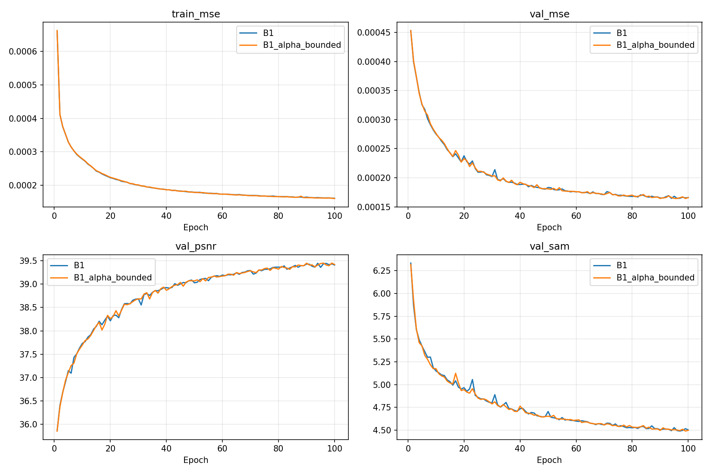
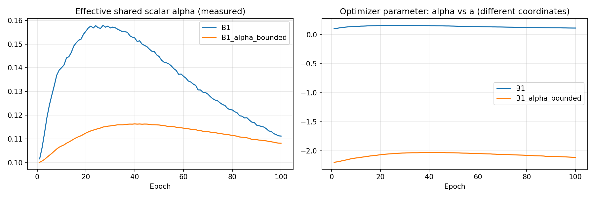
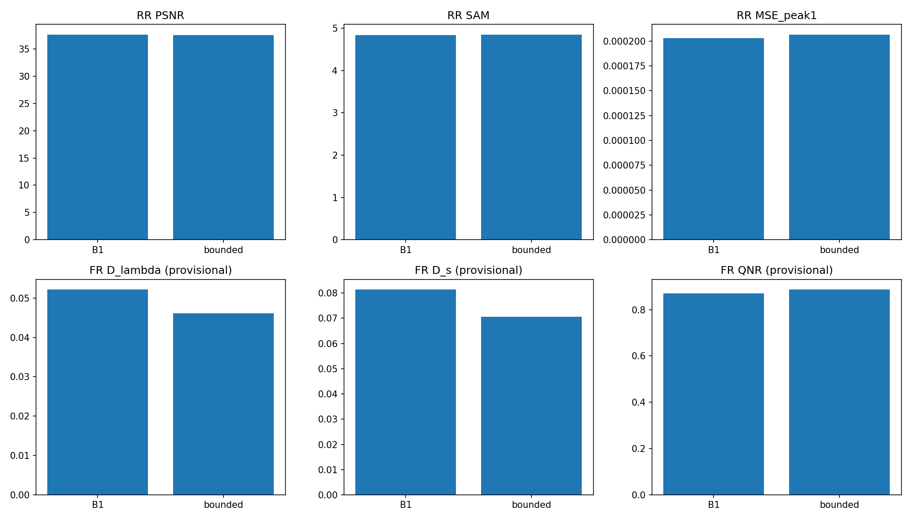
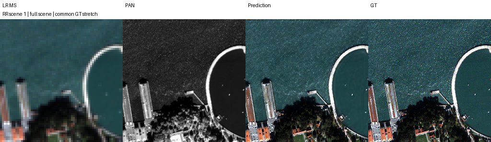
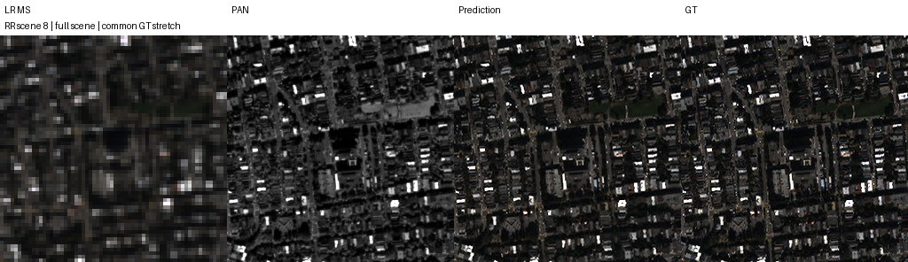
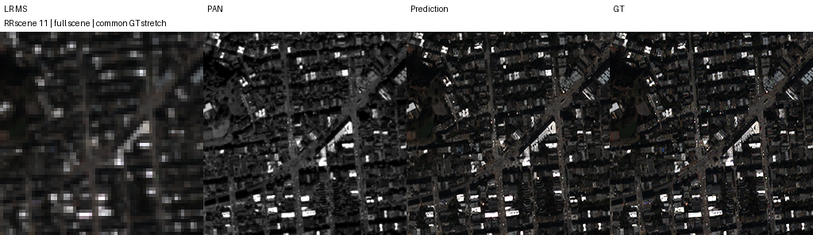
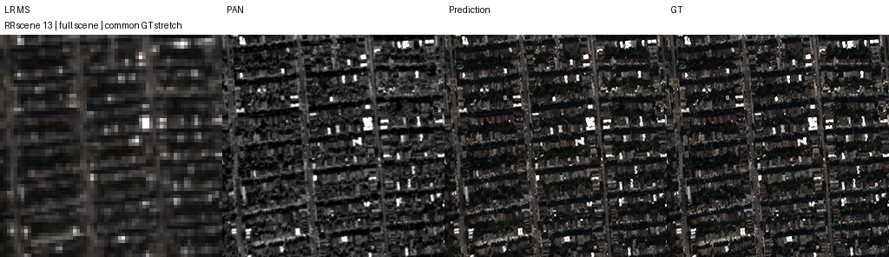
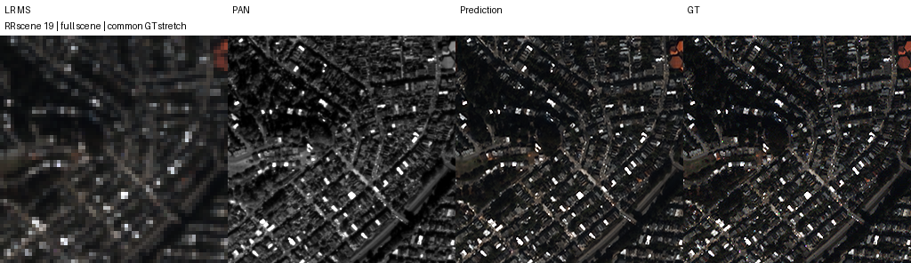

# 3단계 공유 복원의 보정 계수 범위 제한

**변경 내용:** 동일한 3단계 공유 복원에서 scalar α의 표현만 제한 없는 파라미터에서 `sigmoid(a)`로 바꿨습니다.

| 확인된 결과 | 상태 | 개선 여부 |
|---|:---:|:---:|
| 후보−B1: RR PSNR −0.084861 dB, SAM +0.010119°, MSE +3.84591242e−6; 잠정 FR QNR +0.015907입니다. FR 세 지표는20장 모두 개선했지만 RR 유지 목표를 충족하지 못했습니다. | 평가&nbsp;완료 | 부분&nbsp;개선 |

[실험 목록](../../README.md#experiments) · [수치](#results) · [그래프](#graphs) · [이미지](#images) · [재현 자료](#evidence)

## 1. 목적과 상태

3단계 공유 복원 B1의 RR 정확도를 유지하면서 FR 왜곡을 줄일 수 있는지 확인했습니다. 보정 계수 제한은 실험 전 가설이었으며 성능 향상을 보장하지 않았습니다. 실험자는 **김윤지**입니다. **두 모델을 처음부터 각각100에포크 학습했고 validation best로 RR20장·FR20장 전체 평가를 완료했습니다.** 사용자가 보관한 산출물을 확인한 날짜는2026-10-13 KST입니다. Notebook Version ID와 정확한 평가 종료 시각은 제공된 파일에 없습니다.

α 제한 후보는 validation MSE가 소폭 낮고 잠정 FR 왜곡도 줄었지만, RR PSNR·SAM·MSE는 모두 악화했습니다. 따라서 **“부분 개선”으로 기록하고 RR을 유지하며 FR을 개선하려던 목표는 미달로 판단했습니다. 기본 B1을 대체하지 않습니다.**

제공된65개 원본 파일의 크기·SHA-256,100개 에포크의 checkpoint history·CSV·곡선 원본, validation best 선택, 전체 장면별 평균·차이를 확인했습니다. 원본 best/latest4개는 strict load와 CPU 유한값 추론도 확인했습니다. 이는 제공된 결과의 정합성 검증이며, 원본 H5를 다시 읽어 전체 GT 지표를 재계산한 검증은 아닙니다. [검증 범위와 결과](results/verification.json)에 구분하여 기록했습니다.

## 2. 변경한 구조와 비교 조건

기준 B1은 LMS에서 시작해 같은 core·error encoder·scalar α를3회 공유합니다. 후보는 같은 위치에 사용하는 α의 표현만 바꿨습니다.

```python
conditioned = current + error_encoder(torch.zeros_like(current))
proposal = core(PAN, conditioned, MS)
current = current + alpha * (proposal - current)
```

| 모델 | 바꾼 위치·연산 | 초기값 | 대조군 |
|---|---|---|---|
| B1 | 동일 공유 복원식의 제한 없는 scalar α를 학습했습니다. | α=0.1 | 이번 실행에서 새로 학습한 기준 |
| B1_alpha_bounded | 같은 갱신식의 α를 `sigmoid(a)`로 표현했습니다. | a=`log(0.1/0.9)`; 유효 α=0.1 | B1 |

error encoder는 기존 `Conv2d(4,4,3,padding=1,bias=True)`를 유지했습니다. observation error가0이어도 bias는 학습했습니다. 단계별·밴드별 α, gate, 추가 손실, 모델23탭, B2 관측 피드백은 추가하지 않았습니다. core adapter·공식 upstream·지표 구현은 [선행 공유 복원 실험](../15_shared_reconstruction/README.md)과 같습니다.

| 항목 | 실제 조건 |
|---|---|
| 데이터 | QB PAN1·MS4밴드, DN2047 정규화; train17,139 / validation1,905 패치; RR20장·FR20장 |
| 크기 | train/val HR64×64·MS16×16; RR HR256×256·MS64×64; FR HR512×512·MS128×128 |
| 구조·학습 | K4,3단계 공유 복원, seed42, 각각100에포크, 최종 출력 MSE |
| 배치·학습률 | effective=micro32, 마지막 불완전 batch 포함, lr1e−4 고정 |
| optimizer | Adam `fused=True, foreach=False`, betas=(0.9,0.999), eps1e−8, weight_decay0, amsgrad=False |
| 장치·수치 | T4×2, GPU0=B1 / GPU1=후보; 학습 AMP FP16+GradScaler·channels-last |
| 결정론 | strict deterministic, cuDNN benchmark=False, TF32=False, CUBLAS `:4096:8` |
| 환경 | PyTorch2.11.0+cu128, CUDA12.8, Python3.13.15 |
| 데이터 공급·저장 | train/val GPU 상주, GPU randperm·index_select; 약60초·batch 경계·에포크 checkpoint |
| 선택·평가 | FP32 validation MSE 최소, 동률이면 먼저 선택한 best 유지; best FP32로 전체 RR/FR 평가 |
| 입력·출력 처리 | H5 PAN/LMS/MS를 그대로 사용했습니다. crop·재정합·예측 clipping을 추가하지 않았습니다. |

공통 초기 core·encoder state가 일치하고, 초기 유효 α는 양쪽 모두 약0.10000000149였습니다. validation 앞2패치의 초기 CPU 출력과 두 GPU의 FP32·AMP 초기 출력 차이는 모두0이었습니다. FP32 허용 오차는 atol1e−6/rtol1e−5, AMP는 atol1e−3/rtol1e−3이었습니다. [CPU 초기 검사](provenance/initialization_pair.json)와 [GPU 초기 검사](provenance/initialization_gpu_pair.json)를 원본 state·출력과 대조했습니다.

두 모델의100개 에포크 sample-order 해시도 전부 일치했습니다. launch와 두 config는 fresh 실행을 기록하고, 실행 소스도 이전 checkpoint를 가져오지 않는 초기화 경로였습니다. 선행 B1을 재사용하는 대신 이번 두 모델을 함께 처음부터 학습했습니다. [실제 protocol](provenance/protocol.json)과 [launch 기록](provenance/launch.json)을 보존했습니다.

α 제한 후보의 추가 sigmoid는 optimizer가 학습하는 좌표를 α에서 a로 바꿉니다. 초기 `dα/da=α(1−α)=0.09`입니다. 같은 lr·Adam에서 유효 α의 업데이트 크기도 달라지므로, 결과를 범위 밖 α를 막은 효과만으로 분리하여 해석하지 않습니다.

<a id="results"></a>

## 3. 정량 결과

각 split의 장면별 지표를 계산한 뒤 **20장 산술평균**을 사용했습니다. RR PSNR은 peak2047의 밴드별 PSNR 평균, MSE는 peak1 정규화 원소 MSE, SAM은 도 단위입니다. FR에는 HR GT가 없습니다. FR Dλ·Ds·QNR은 기존 구현의 MATLAB 대응이 검증되지 않은 잠정 지표입니다.

| 모델 | Best epoch | Best validation MSE ↓ | Best α | RR PSNR dB ↑ | RR SAM ° ↓ | RR MSE peak1 ↓ |
|---|---:|---:|---:|---:|---:|---:|
| B1 | 94 | 0.000164554876 | 0.114275217 | 37.671097 | 4.838250 | 0.000202637929 |
| B1_alpha_bounded | 96 | 0.000164345678 | 0.108804181 | 37.586236 | 4.848369 | 0.000206483841 |
| 후보−B1 | — | −2.09198333e−7 | −0.005471036 | **−0.084861** | **+0.010119** | **+3.84591242e−6** |

| 잠정 FR 지표 | B1 | 후보 | 후보−B1 |
|---|---:|---:|---:|
| Dλ ↓ | 0.052135662 | 0.046150209 | **−0.005985454** |
| Ds ↓ | 0.081344841 | 0.070524479 | **−0.010820362** |
| QNR ↑ | 0.870461649 | 0.886368440 | **+0.015906791** |

| 추가 RR 지표 | B1 | 후보 | 후보−B1 |
|---|---:|---:|---:|
| ERGAS ↓ | 3.999888 | 4.040037 | +0.040149 |
| SCC ↑ | 0.978558 | 0.977861 | −0.000697 |
| Q2n ↑ | 0.925454 | 0.924693 | −0.000761 |

validation MSE의 감소는 약0.127%였지만 RR MSE는 약1.898% 증가했습니다. 후보의 RR PSNR·MSE는20장 중1장만 개선하고19장에서 악화했습니다. SAM은7장 개선·13장 악화했습니다. FR에서는 Dλ·Ds·QNR 세 지표가 각각20장 모두 개선했습니다. validation의 작은 이득이나 FR의 일관된 이득으로 RR 저하를 덮지 않았습니다.

[전체 결과](results/results.json) · [평균·장면별 차이](results/paired_comparison.json) · [B1 RR](results/B1/RR_per_scene.json) / [후보 RR](results/B1_alpha_bounded/RR_per_scene.json) · [B1 FR](results/B1/FR_per_scene.json) / [후보 FR](results/B1_alpha_bounded/FR_per_scene.json)

## 4. 기준선 대비 차이와 해석

주된 비교는 같은 실행의 후보−B1입니다. **RR 유지와 FR 개선을 동시에 달성하지 못했습니다.** test로 α 설정·학습률·에포크를 고르지 않았으며, 두 모델 각각의 validation MSE 최소 checkpoint를 사용했습니다.

[선행 단일 복원/B1 통제 실험](../15_shared_reconstruction/README.md)의 B1과 이번 기준 B1은 best/latest의 모든 model tensor,100개 에포크의 train MSE·validation MSE/PSNR/SAM·sample order가 정확히 일치했습니다. checkpoint는 새 실행 metadata·α history를 포함하므로 파일 해시는 다릅니다. 이번 기준 B1의 RR PSNR/SAM/MSE와 잠정 FR Dλ/Ds/QNR 차이는 선행 B1 대비 모두0입니다. 선행 B1 파일이나 그때 없었던 α history를 수정하지 않았습니다.

| 같은 K4 B1 기준의 후보 변화 | 관측 | 해석 |
|---|---|---|
| RR PSNR/SAM/MSE | −0.084861 dB / +0.010119° / +3.84591242e−6 | 주요 RR 정확도가 낮아졌습니다. |
| 잠정 FR Dλ/Ds/QNR | −0.005985 / −0.010820 / +0.015907 | 두 왜곡 지표와 QNR은 좋아졌습니다. |
| α의 epoch별 궤적 | 기준 최고0.157914, 후보 최고0.116325 | 후보의 α 변화가 작았지만 원인을 범위 제한만으로 특정할 수 없습니다. |

초기 α는 두 모델 모두0.1이고 epoch 종료 시점의 관측은 다음과 같습니다.

| 모델 | 관측 최소 α · epoch | 관측 최대 α · epoch | Best α | Latest α · epoch100 |
|---|---:|---:|---:|---:|
| B1 | 0.101561397 · 1 | 0.157914072 · 27 | 0.114275217 | 0.111207850 |
| B1_alpha_bounded | 0.100139946 · 1 | 0.116324946 · 40 | 0.108804181 | 0.108175360 |

기준 B1은 기록된100개 epoch 시점에서 [0,1] 밖으로 나간 적이 없습니다. 배치 안의 극대값은 별도 기록되지 않았으므로 전체 학습 중 범위 이탈이 전혀 없었다고 단정하지 않습니다. α의 과도한 증가를 확인한 실험도 아닙니다. 관측된 FR 이득은 작은 유효 α 궤적·sigmoid의 최적화 좌표 변화와 함께 해석해야 합니다.

<a id="graphs"></a>

## 5. 학습·평가 그래프

제공된 실제100에포크의 train MSE·validation MSE/PSNR/SAM입니다. [B1 history](results/B1/history.json), [후보 history](results/B1_alpha_bounded/history.json), [compact epochs](results/compact_epochs.json)를 checkpoint 내부 history와 대조했고 없는 epoch를 채우지 않았습니다.



다음은 epoch별 유효 α와 optimizer가 직접 학습하는 α/a입니다. 오른쪽 두 곡선은 서로 다른 좌표이며 그 절댓값을 동일한 보정 강도로 비교하지 않습니다. 유효 α는 왼쪽에서 비교합니다.



RR PSNR/SAM/MSE와 잠정 FR Dλ/Ds/QNR을 함께 표시했습니다. 한 지표의 개선으로 다른 지표의 저하를 가리지 않습니다.



history에 누적된 학습/validation 시간은 B1 **122.78/13.35분**, 후보 **127.66/14.10분**입니다. 학습 시간에는 루프의 주기 저장 비용이 포함되지만 에포크 끝 저장·bootstrap·test·최종 포장 시간은 별도입니다. 두 GPU의 시간을 더해서 전체 wall time으로 쓰지 않았습니다. 최종 ZIP에 runtime 로그는 포함되지 않아 상세 메모리·이용률 기록과 정확한 총 wall time은 미보관입니다. 과거 실행 로그를 대신 넣지 않았습니다.

<a id="images"></a>

## 6. 결과 이미지

학습 전에 seed42로 고정한 zero-based H5 row **1,8,11,13,19**, full scene·오름차순입니다. [selection 원본](results/selection.json)에 seed·scene ID·tile·순서를 기록했습니다. 유일하게 RR PSNR이 개선된 장면을 선택에 추가하지 않았습니다.

아래는 α 제한 후보의 **LR MS · PAN 입력 · 예측 · 정답** 4패널입니다. RGB [2,1,0]을 표시 가정으로 사용하고 장면별 GT1-99% 대비를 LR MS·예측·GT에 공통 적용했습니다. LR은 최근접 확대, PAN은 별도 회색조 대비를 사용했습니다. 두 모델 각각의 고정 이미지5개를 원본으로 보관했으며, 본문에는 후보의5장면을 표시합니다. FR에는 GT를 생성하지 않았습니다.

### 고정 장면 1



<details>
<summary>나머지 고정 장면 8·11·13·19</summary>

### 고정 장면 8



### 고정 장면 11



### 고정 장면 13



### 고정 장면 19



</details>

<a id="evidence"></a>

## 7. 재현 자료

실제 학습한 원본 best/latest4개와 current/previous transaction이 참조하는 원본 state6개를 함께 보관했습니다. 편의 사본인 best/latest와 참조 state는 바이트 동일함을 확인했습니다. checkpoint 내부 config·optimizer·scaler·RNG·batch permutation·cursor·history를 수정하지 않았습니다.

| 모델 | Best 원본 | Epoch | Latest 원본 | Epoch |
|---|---|---:|---|---:|
| B1 | [best.pt](checkpoints/B1/best.pt) | 94 | [latest.pt](checkpoints/B1/latest.pt) | 100 |
| B1_alpha_bounded | [best.pt](checkpoints/B1_alpha_bounded/best.pt) | 96 | [latest.pt](checkpoints/B1_alpha_bounded/latest.pt) | 100 |

원본 SHA-256·크기는 [결과 JSON의 weights](results/results.json), [검증 기록](results/verification.json), [실제 보관 manifest](manifest.json)에 기록했습니다. [선택 기록](results/selection.json), [정합·관측 manifest](provenance/observation_manifest.json), [실행 protocol](provenance/protocol.json), [실행 당시 전체 셀](provenance/run_cell.py), [모델·worker 원문](provenance/code/), 초기 state·GPU 출력, 원본 제공 manifest를 함께 보존했습니다.

현재 재현 셀은 [run.py](run.py) 전체를 T4×2·Internet이 켜진 Kaggle 코드 셀 하나에 붙여 넣습니다. QB H5가 없으면 `kagglehub`로 요청한 데이터셋을 연결·다운로드한 뒤 shape·고정 해시를 확인합니다. 기존 실험 출력과 다른 폴더에서 실행하며 학습 화면은 현재 실행 두 모델의 상태만 갱신합니다.

배치 재개에는 원본 suite 전체와 동일한 실행 소스·환경이 필요합니다. `REQUIRE_RESUME=True`와 정확한 `RESUME_INPUT`을 지정하고 두 모델의 checkpoint record·초기 state·소스를 함께 보존해야 합니다. checkpoint가 없거나 source/data/environment가 다르면 두 모델 모두 오류로 멈추며 처음부터 시작하지 않습니다. Persistence·Saved Output·다운로드 복사본도 없이 VM 파일을 삭제하면 이 코드로 복구할 수 없습니다. 제공된 완료 산출물의 source record는 그대로 보존했으며 이 보고서 작성 과정에서 학습 재개를 실행하지 않았습니다.

결과 검증은 [prepare.py](prepare.py)의 `--audit-results <원본 폴더> --output <검증 JSON>`으로 수행합니다. 원본을 읽기만 하고 학습을 시작하지 않습니다. 실제 보관 파일의 해시는 다음 명령으로 확인합니다.

```bash
python SSA-MRN/common/verify.py --experiment 24
```

제공된 파일의 해시·초기 출력·history·best 선택·전체 장면별 평균·고정 이미지·가중치 strict load를 검증했습니다. 원본 H5에 대한 GT 지표 재계산과 T4에서의 학습·배치 재개 재실행은 하지 않았습니다. 원격 보관 검증은 결과 commit을 push한 뒤 GitHub blob과 원본 가중치를 대조하여 별도 기록합니다. 다운로드 원본과 다른 실험 폴더는 삭제하지 않았습니다.

## 8. 개선 여부와 다음 단계

**부분 개선이며 B1 대체는 보류합니다.** 이 seed42에서는 FR Dλ·Ds·QNR이 모든 장면에서 개선했지만 RR 주요 정확도가 낮아졌습니다. “RR을 유지하면서 FR을 개선한다”는 처음 목표를 만족하지 못했고 α 표현만 바꾸는 후보의 종합 성능 우위를 확인하지 못했습니다.

기준 α가 범위를 벗어났다는 관측도 없습니다. sigmoid는 범위와 유효 업데이트 크기를 함께 바꾸므로, FR 이득을 과도한 α를 막은 효과로 단정하지 않습니다. 적어도 epoch 기록에서는 두 모델 모두 [0,1] 안에 있었습니다. 추가 분석은 validation과 α의 최적화 경로를 중심으로 진행하며 test로 조건을 다시 고르지 않습니다.

QB 단일 seed·고정 GPU 배정·같은 test split의 반복 연구라는 한계가 있습니다. GPU 교환·다른 seed 반복을 수행하지 않았습니다. FR에는 HR GT가 없고 QNR/Ds 및 Q2n/SCC의 MATLAB 대응도 미검증입니다. 잠정 FR 지표가 좋아졌다는 사실이 실제 고해상도 디테일의 정확성을 보증하지 않습니다. 다음 실험에 gate·다른 손실·관측 피드백을 함께 섞어 이번 α 표현의 효과로 보고하지 않습니다.
