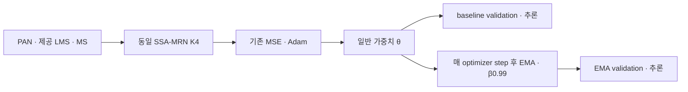
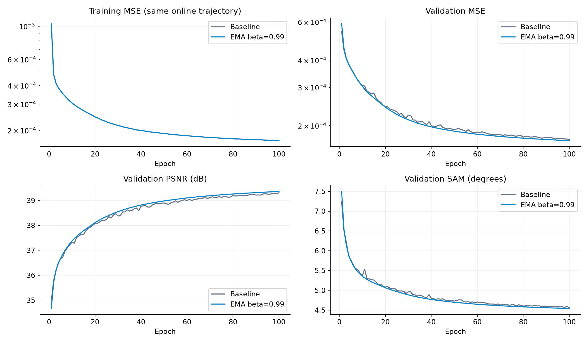
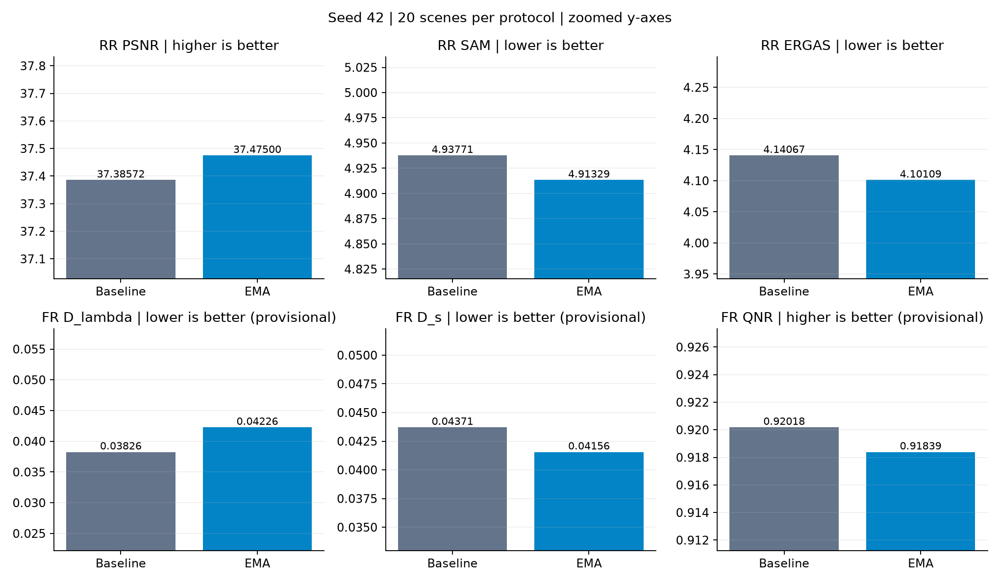
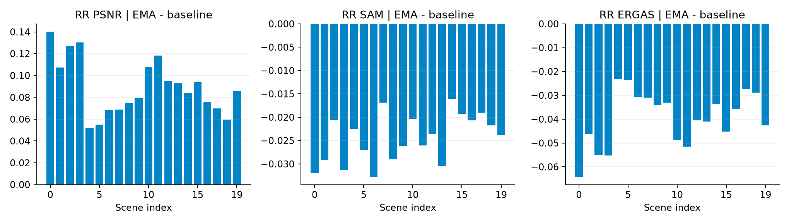
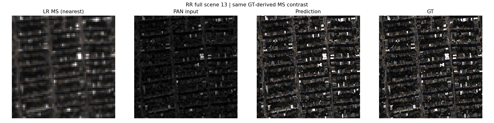
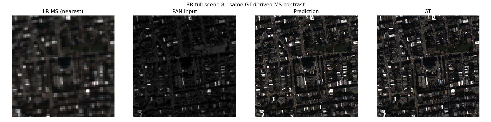
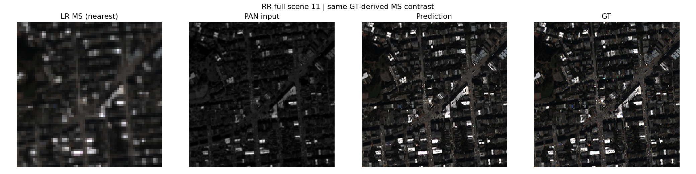
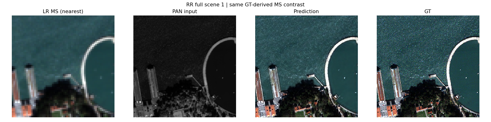
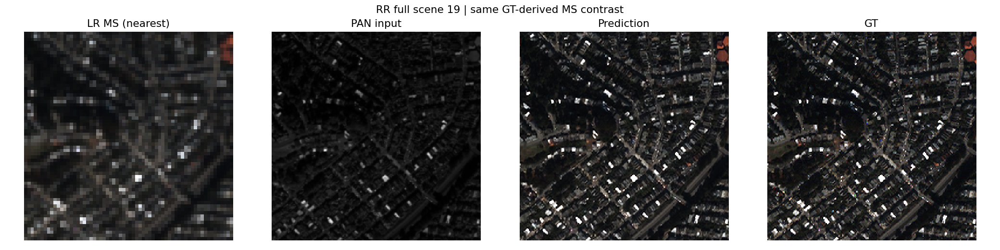

# 평가 가중치의 지수 이동 평균

**변경 내용:** 기존 MSE 학습과 네트워크를 유지하고, 평가 가중치에 지수 이동 평균(EMA)을 적용했습니다.

| 확인된 결과 | 상태 | 개선 여부 |
|---|:---:|:---:|
| seed42 RR PSNR +0.089288 dB, SAM −0.024417°, ERGAS −0.039583. 잠정 FR QNR −0.001786으로 지표가 엇갈렸습니다. | 평가&nbsp;완료<br>seed42 | 부분&nbsp;개선 |

[실험 목록](../../README.md#experiments) · [수치](#results) · [그래프](#graphs) · [이미지](#images) · [재현 자료](#evidence)

## 1. 목적과 상태

학습 가중치의 단기 변동을 평균하면 새로운 장면에서 공간·분광 복원이 안정되는지 검토했습니다. 두 군은 새 학습으로 각각 100epoch를 완료했고, validation으로 선택한 best를 사용해 RR·FR 각 20장 전체를 평가했습니다. 원본 평가 완료 상태의 마지막 갱신은 **2026-10-13 23:43:17 KST**입니다. 이는 실행 상태에 기록된 시각이며 보고서 작성 시각과 구분합니다.

이 보고서는 **QuickBird의 seed42 단일 비교**입니다. 첨부 결과에는 seed43·44 본 학습·평가가 없습니다. 세 seed 평균·표준편차나 통계적으로 확정된 개선을 주장하지 않습니다. 실험자 이름은 원본 기록에 없어 확인 필요로 남깁니다.

다운로드한 산출물의 무결성·설정·가중치·지표 집계를 검사했습니다. 원본 H5를 이용한 재학습·재추론은 수행하지 않았습니다.

## 2. 변경한 구조와 비교 조건

두 군 모두 PAN·제공 LMS·MS를 기존 SSA-MRN에 넣어 고해상도 4밴드 MS를 복원합니다. 일반 학습 가중치는 같은 MSE와 Adam으로 갱신합니다. baseline은 일반 가중치로, EMA군은 별도 평균 가중치로 validation과 최종 추론을 수행합니다.



`θ_EMA ← β × θ_EMA + (1−β) × θ_online`

EMA는 초기 일반 가중치와 같게 시작하고 첫 optimizer 갱신부터 적용합니다. β는 학습되지 않는 상수입니다. 성공한 optimizer step 직후 갱신하며 EMA를 일반 가중치에 되먹임하지 않습니다. 부동소수점 상태는 평균하고 정수 상태는 복사합니다. warmup·bias correction은 없습니다.

| 항목 | 실제 조건 |
|---|---|
| 변경 요소 | 평가 가중치의 EMA 적용만 변경했습니다. 학습 손실·구조·입력·전처리는 동일합니다. |
| 데이터 | **QB만 사용**했습니다. train 17,139 / validation 1,905패치, RR·FR 각각 20장입니다. |
| 크기·밴드 | train HR64×64 / MS16×16, RR HR256×256 / MS64×64, FR HR512×512 / MS128×128; MS4밴드·PAN1밴드 |
| 모델·학습량 | SSA-MRN K4, seed42, 각100epoch 새 학습 |
| optimizer·손실 | Adam 기본값, LR1e-4 고정, 기존 원소 평균 MSE |
| 배치·정밀도 | micro32 / effective32, FP32, AMP·TF32 비활성, 결정적 연산 |
| 장치·공급 | 동일 Tesla T4×2, 각14.562GiB; GPU0 baseline / GPU1 EMA; train·validation GPU FP32 상주 |
| 난수·통제 | 같은 초기 가중치; 초기화와 GPU 샘플링 난수 분리; 100epoch 순서 해시와 최종 일반 가중치가 실제로 일치했습니다. |
| EMA 최종 계수 | **β=0.99**, 본 학습에서 53,600번 갱신했습니다. |
| 정규화·LMS | 원본 DN/2047, 제공 LMS 유지, 값의 clipping 없음 |
| best 선택 | 각 군이 평가하는 가중치의 validation MSE 최소. 두 군 모두 best=100epoch이며 마지막 epoch와 같습니다. |
| 평가 | best FP32 전체 장면. 평가 crop·재정합·새 GT 합성 없음 |
| 환경 | Python3.13.15, PyTorch2.11.0+cu128, CUDA12.8, cuDNN91900, NumPy2.1.3, h5py3.16.0 |

### β 선택과 점검 실행

사전에 고정한 후보 0.99·0.999를 동일한 일반 학습 가중치의 두 EMA로 유지했습니다. 별도 전체 train/validation **10epoch 점검**에서 후보별 최소 EMA validation MSE로 선택했습니다.

| β 후보 | 최소 validation MSE | 선택 |
|---|---:|---|
| 0.99 | 0.000302752843 | 선정 |
| 0.999 | 0.000322026781 | 미선정 |

test 미사용 기록과 선택 근거 이력의 해시가 일치합니다. 10epoch 선택은 짧은 validation 대리 기준이며 100epoch 최적 β를 보장하지 않습니다. 이후 seed42 test로 β를 조정하지 않았습니다.

소량 2epoch smoke에서는 optimizer 경계 중단·재개와 연속 실행의 일반 가중치·EMA·갱신 횟수·배치 순서 일치를 확인했습니다. Smoke와 β 점검 수치는 아래 본 성능 비교에서 제외했습니다.

<a id="results"></a>

## 3. 정량 결과

### Validation과 best

| 군 | best epoch | validation MSE ↓ | PSNR dB ↑ | SAM ° ↓ |
|---|---:|---:|---:|---:|
| baseline | 100 | 0.000172088681 | 39.309058 | 4.557103 |
| EMA β0.99 | 100 | 0.000170325200 | 39.357889 | 4.539735 |

validation MSE는 baseline 대비 **1.025% 감소**했습니다. 두 군의 일반 가중치 validation은 동일하며, 차이는 EMA 평가 가중치에서 발생했습니다. Validation의 64×64 패치 점수와 아래 독립 RR의 256×256 장면 점수는 서로 다른 평가입니다.

### RR 전체 20장 평균

| 지표 | baseline | EMA | EMA−baseline | 개선 장면 |
|---|---:|---:|---:|---:|
| PSNR dB ↑ | 37.385715 | 37.475003 | +0.089288 | 20/20 |
| SAM ° ↓ | 4.937707 | 4.913290 | -0.024417 | 20/20 |
| ERGAS ↓ | 4.140672 | 4.101089 | -0.039583 | 20/20 |
| SCC ↑（잠정） | 0.976524 | 0.977044 | +0.000520 | 20/20 |
| Q2n ↑（잠정） | 0.921287 | 0.923599 | +0.002312 | 20/20 |
| MSE peak1 ↓ | 0.000217 | 0.000213 | -0.000004 | 20/20 |

PSNR은 peak2047의 밴드별 PSNR을 장면 안에서 평균하고 다시 20장 평균한 값입니다. SAM은 픽셀의 전체 밴드 벡터 각도를 도 단위로 평가합니다. MSE는 DN2047 정규화 원소 MSE입니다. RR Q2n·SCC의 공식 MATLAB 정합은 미검증입니다.

### FR 전체 20장 평균 — 잠정 지표

| 지표 | baseline | EMA | EMA−baseline | 개선 장면 |
|---|---:|---:|---:|---:|
| Dλ ↓（잠정） | 0.038257 | 0.042264 | +0.004007 | 1/20 |
| Ds ↓（잠정） | 0.043707 | 0.041560 | -0.002147 | 19/20 |
| QNR ↑（잠정） | 0.920177 | 0.918391 | -0.001786 | 6/20 |

FR에는 고해상도 GT가 없으므로 RR처럼 GT 기반 PSNR·SAM을 만들지 않았습니다. 원본 평가기의 QB 센서 축소와 Ds/QNR MATLAB 정합은 확인되지 않았으며, FR의 Dλ·Ds·QNR은 잠정 비교로 취급합니다. EMA의 공간 왜곡 Ds는 줄었지만 분광 왜곡 Dλ가 증가해 QNR은 낮아졌습니다.

### 시간과 메모리

| 항목 | baseline | EMA |
|---|---:|---:|
| 학습 누적（분） | 86.075 | 86.957 |
| 검증 누적（분） | 17.494 | 35.265 |
| 학습+검증（분） | 103.569 | 122.222 |
| 최대 학습 GPU 할당（GiB） | 3.164 | 3.167 |
| RR forward 평균（ms） | 70.125 | 69.599 |
| RR forward 중앙값（ms） | 23.315 | 23.347 |
| FR forward 평균（ms） | 76.553 | 76.633 |

학습 자체의 누적 시간 증가는 약 **1.02%**입니다. EMA군은 일반 가중치와 EMA를 모두 검증하므로 검증 시간이 약 두 배입니다. 실제 실행 한계는 EMA 평균 계산보다 중복 validation 비용이 더 컸습니다.

병렬 컨트롤러의 train wall 기록은 두 군 모두 약 **123.33분**입니다. 이 타이머는 모든 프로세스가 끝난 뒤 기록되어 먼저 완료한 군의 대기까지 포함할 수 있습니다. 이를 각 GPU의 순수 학습 시간으로 해석하거나 두 값을 더해 총 벽시계 시간으로 표시하지 않습니다. 데이터 검사·초기 준비·ZIP 저장은 별도입니다. 학습 누적 타이머에는 epoch 내부 checkpoint 비용이 포함됩니다.

추론 타이머는 forward만 포함하고 전송·지표 계산을 제외합니다. 별도 warmup 제외가 없어 첫 RR 추론의 준비 비용이 평균에 들어갑니다. 중앙값은 보조 진단이며 새 측정값이나 확정 속도 벤치마크가 아닙니다. EMA가 추론을 빨라지게 했다는 결론은 내리지 않습니다.

## 4. 기준선 대비 차이와 해석

RR에서는 PSNR·SAM·ERGAS·SCC·Q2n이 **20장 모두 개선**됐고 MSE가 **1.829% 감소**했습니다. 이 한 seed에서는 복원 오차·분광 각도·공간 지표가 같은 방향으로 움직였습니다. 다만 PSNR 평균 개선은 0.089288dB로 작아, 이미지에서 큰 화질 차이를 단정하지 않습니다.

FR에서는 Ds가 19장 개선됐지만 Dλ는 1장, QNR은 6장만 개선됐습니다. **RR의 분광 개선이 원해상도 FR 분광 보존의 개선으로 이어지지 않았습니다.** GT가 있는 축소 평가와 GT가 없는 원해상도 잠정 평가의 차이를 구분해야 합니다.

초기값·배치 순서와 최종 일반 가중치까지 일치하므로, 이번 비교는 학습 경로를 바꾸는 구조 개선보다 평가 가중치 평균의 효과를 검토합니다. 다른 실험의 micro4·AMP·K6·센서별 점수를 이번 baseline 대신 사용하지 않았습니다.

20장 변화량은 동일 장면의 paired 비교입니다. 같은 모델의 20장 결과를 20개의 독립 seed 실행처럼 취급하지 않습니다. 별도 holdout 독립성과 과거 팀의 test 탐색 이력은 원본 ZIP만으로 확인되지 않아, 평가 split을 신규 확증 holdout으로 주장하지 않습니다.

<a id="graphs"></a>

## 5. 학습·평가 그래프

100개 실제 epoch 기록으로 생성했습니다. 일반 학습 MSE 곡선은 두 군이 같아 겹칩니다. EMA군의 validation은 EMA 가중치, baseline은 일반 가중치 결과입니다.



전체 20장 평균 비교입니다. 작은 차이를 읽기 위해 세로축 범위를 확대했으며 0부터 시작하지 않습니다. FR은 잠정 지표입니다.



장면별 변화량은 EMA−baseline입니다. PSNR은 양수, SAM·ERGAS는 음수가 개선 방향입니다.



<a id="images"></a>

## 6. 결과 이미지

사전에 seed42로 고정한 서로 다른 RR 장면의 0부터 시작하는 H5 인덱스는 **13·8·11·1·19**입니다. 원본 selection의 순서를 유지했습니다. 점수를 보고 장면을 바꾸거나 가장 좋아진 장면만 고르지 않았습니다.

각 패널은 **LR MS · PAN 입력 · EMA 예측 · GT** 순서입니다. RR 전체 장면을 추론했으며 표시 RGB 밴드는 [2,1,0]입니다. LR MS·예측·GT에는 같은 장면 GT의 밴드별 1–99 백분위 대비를 공유합니다. LR MS는 nearest 표시이고 PAN은 별도 grayscale 대비입니다. 표시용 clipping은 지표 계산용 예측 clipping과 다릅니다. FR에 정답을 만들지 않았습니다.

원본에 보존된 EMA 4패널 이미지를 그대로 사용했습니다. baseline은 위 수치·그래프와 장면별 JSON으로 비교하고 baseline의 원본 5장 이미지는 결과 폴더에 별도로 보존했습니다.





<details>
<summary>같은 조건의 나머지 고정 3장면</summary>







</details>

<a id="evidence"></a>

## 7. 재현 자료

[원본 고정 조건](provenance/experiment.json) · [β 선택 기록](provenance/final_settings.json) · [데이터 기록](provenance/data_manifest_full.json) · [환경](provenance/environment_current.json) · [고정 장면](provenance/selection_scenes.json) · [원본 소스](provenance/code/) · [가중치](checkpoints/) · [파일 검증](manifest.json)

[baseline 전체 결과](results/baseline/results.json) · [EMA 전체 결과](results/ema/results.json) · [비교 CSV](results/comparison.csv) · [장면별 변화](results/paired_scene_deltas.json) · [시간 기록](results/timing_summary.json) · [검증 기록](results/audit.json)

원본 ZIP의 177개 manifest 항목을 크기·SHA-256으로 확인했고 ZIP CRC도 통과했습니다. 최종 평가 marker의 best/latest/results 해시, 100epoch 연속 이력, validation best epoch, 후보 선택 근거와 실제 checkpoint fingerprint를 대조했습니다. 전체 장면 JSON에서 평균을 다시 계산해 결과 JSON과 일치함을 확인했습니다.

두 best를 원본 모델에 strict load하고 작은 합성 입력의 CPU forward를 확인했습니다. 이는 원본 H5에서 다시 평가한 검증과 다릅니다. 원본 가중치·snapshot·checkpoint 내부 설정은 바꾸지 않았습니다. latest의 일반 가중치와 EMA shadow는 재개용으로 함께 보존했습니다. seed42의 best와 마지막 EMA shadow는 일치합니다.

현행 실행 진입점은 [run.py](run.py)입니다. 전체를 Kaggle 단일 셀에 붙이고 단계·seed·이전 Input을 지정합니다. 보관된 seed42 결과를 재학습하는 것이 아니라 새로운 실행 또는 같은 상태의 재개에 사용합니다. 실제 학습 당시 snapshot과 체크포인트 내부 경로는 원문을 보존합니다.

```bash
# 폴더의 보존 해시만 확인합니다.
python SSA-MRN/common/verify.py --experiment 26

# 원본 snapshot으로 strict load·합성 CPU 추론·지표 집계를 확인합니다.
python SSA-MRN/experiments/26_ema_weight_averaging/prepare.py
```

실제 소스 commit과 가중치 해시는 연결된 manifest·원본 설정에 보존했습니다. 후속 seed 학습의 실행 폴더나 원본 ZIP을 삭제하지 않았습니다.

## 8. 개선 여부와 다음 단계

**판정: 부분 개선.** seed42 RR의 모든 주요 지표와 모든 장면에서 소폭 개선이 확인됐지만, 잠정 FR Dλ·QNR은 악화했습니다. 현재 근거로 원해상도까지 종합 개선됐다고 판단하거나 팀의 최종 기준 모델로 교체하지 않습니다.

β0.99를 그대로 유지하여 seed43·44의 같은 조건 비교를 완료하고, seed별 변화량과 3seed 평균·표준편차를 추가합니다. 후속 seed test 결과로 β나 평가식을 바꾸지 않습니다. FR 센서 축소·지표 정합을 검토하되, 원본 지표와 새 구현의 값을 섞지 않습니다. EMA의 계산 비용과 중복 validation 비용도 별도로 판단합니다.
