# 원본 복원 후 관측 오차 기반 잔차 보정

**변경 내용:** 원본 SSA-MRN의 첫 복원 뒤에 다중 크기 잔차 보정기를 두 번 적용하고, 관측 오차 입력과 보정기 가중치 공유 여부를 비교했습니다.

| 확인된 결과 | 상태 | 개선 여부 |
|---|:---:|:---:|
| 기존 특징 전달 G2 대비 G5: PSNR +0.1317 dB, SAM -0.0391°, 잠정 QNR -0.0020. G4는 잠정 QNR +0.0079입니다. | 평가 완료 | 부분 개선 |

[실험 목록](../../README.md#experiments) · [수치](#results) · [그래프](#graphs) · [이미지](#images) · [재현 자료](#evidence)

## 1. 목적과 상태

실험자는 이병현입니다. 원본 복원기를 여러 번 호출하는 대신 첫 복원과 후속 오차 수정을 분리하면 기존 반복 복원·특징 전달보다 성능이 좋아지는지 확인했습니다. 2026-10-14 02:06:55 KST에 G3·G4·G5 각각 100에포크와 자동 평가가 완료됐습니다. 실패 없이 큐가 종료됐으며, 총 300개 완료 에포크 기록을 확인했습니다.

## 2. 변경한 구조와 비교 조건

| 후보 | 입력·연산·출력과 대조군 |
|---|---|
| G0 | 23번의 원본 단일 복원입니다. 100에포크 이내 validation best를 재사용했습니다. |
| G1 | 23번의 3단계 공유 반복 복원입니다. 같은 시점의 best를 재사용했습니다. |
| G2 | 23번의 단계 간 특징 전달 F0입니다. 같은 시점의 best를 재사용했습니다. |
| G3 | 원본 복원 후 같은 잔차 보정기를 두 번 적용합니다. 관측 오차 입력은 0으로 넣습니다. G0와 비교합니다. |
| G4 | G3에 MS 관측 오차와 PAN 고주파 차이를 입력합니다. G3와 비교합니다. |
| G5 | G4의 두 보정기를 각각 다른 가중치로 학습합니다. G4와 비교합니다. |

각 보정기는 현재 예측·LMS·PAN·MS 관측 오차·PAN 차이를 입력받습니다. 32채널 특징의 전체·절반·1/4 크기 문맥을 결합하여 4밴드 잔차를 출력하고 `X_next = X + correction`으로 합산합니다. 초기 SSA-MRN의 밴드별 SSAI는 유지합니다. 보정기의 마지막 합성곱은 0으로 초기화하여 초기 출력이 원본 복원과 같습니다. G3의 오차 입력은 0으로 채워 G4와 입력 크기·용량을 맞춥니다. G5의 두 보정기는 동일 초기값으로 시작합니다.

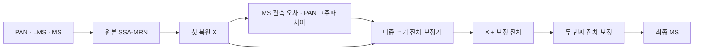

G3는 관측 오차를 0으로 넣으며, G3·G4는 두 보정 단계의 가중치를 공유하고 G5는 분리합니다. MS 관측은 학습 패치 128개에서 Gaussian 후보를 비교한 뒤 sigma 2.0을 고정한 근사 연산입니다. PAN은 비음수 밴드 조합과 절편으로 근사하고 5×5 평균을 빼 고주파 차이를 만듭니다. validation·test로 이 계수를 맞추지 않았으며, 공식 센서 MTF와 동일하다는 뜻은 아닙니다.

| 항목 | 실제 조건 |
|---|---|
| 데이터 | QB train 17,139·validation 1,905 패치, RR 20장·FR 20장 |
| 특징 차원·시드 | K4·seed46 |
| 학습 | 처음부터 100에포크, Adam lr 1e-4, 최종 출력 MSE |
| 배치·실행 | effective64·micro64, worker1, 최대 두 작업 병렬 |
| 정밀도 | 학습 AMP FP16, validation/test FP32, TF32 비활성 |
| 선택 | validation MSE 최소값, 정확한 동률은 SAM; test로 선택하지 않습니다. |
| 초기화 | 대조군과 초기 core 해시 및 에포크별 샘플 순서를 맞췄습니다. |

G0-G2는 동일 데이터·시드·배치·100에포크 구간의 보관된 결과를 재사용했습니다. 체크포인트와 평가 소스 해시를 대조했습니다. 새 후보의 모델 용량과 계산량은 달라집니다. AMP 업데이트 누락은 G3 4회, G4 3회, G5 3회였으므로 실제 optimizer 업데이트가 완전히 같다는 주장은 하지 않습니다.

<a id="results"></a>

## 3. 정량 결과

모든 값은 후보별 RR 20장·FR 20장 산술평균입니다. G0-G2는 23번의 동일 평가 기록이며, G3-G5의 새로운 120회 장면 평가를 추가했습니다. validation 선택은 세 후보 모두 99에포크였고, MSE는 G3 0.000181614, G4 0.000179972, G5 0.000176594로 G5가 가장 낮았습니다.

| 후보 | 선택 epoch | PSNR ↑ | SAM ↓ | ERGAS ↓ | Q2n ↑ | 잠정 QNR ↑ |
|---|---:|---:|---:|---:|---:|---:|
| G0 | 99 | 37.150187 | 5.098437 | 4.264986 | 0.919459 | 0.906172 |
| G1 | 97 | 37.203905 | 5.024074 | 4.234515 | 0.919744 | 0.917794 |
| G2 | 99 | 37.243620 | 5.007931 | 4.215276 | 0.921806 | 0.913712 |
| G3 | 99 | 37.286482 | 5.037647 | 4.199712 | 0.920845 | 0.915054 |
| G4 | 99 | 37.298709 | 5.007372 | 4.190174 | 0.921668 | 0.921611 |
| G5 | 99 | 37.375291 | 4.968820 | 4.149383 | 0.922232 | 0.911741 |

QNR·Q2n·SCC의 MATLAB 구현 대응은 미검증입니다. 잠정 지표를 최종 성능 근거로 확정하지 않습니다. RR의 PSNR·SAM과 FR의 QNR은 서로 다른 평가 범위입니다.

## 4. 기준선 대비 차이와 해석

| 직접 비교 | ΔPSNR ↑ | ΔSAM ↓ | ΔERGAS ↓ | Δ잠정 QNR ↑ |
|---|---:|---:|---:|---:|
| G3 - G0 | +0.136294 | -0.060789 | -0.065274 | +0.008882 |
| G4 - G3 | +0.012227 | -0.030275 | -0.009537 | +0.006557 |
| G5 - G4 | +0.076582 | -0.038552 | -0.040791 | -0.009871 |
| G3 - G2 | +0.042861 | +0.029717 | -0.015565 | +0.001342 |
| G4 - G2 | +0.055088 | -0.000559 | -0.025102 | +0.007899 |
| G5 - G2 | +0.131671 | -0.039110 | -0.065893 | -0.001971 |

| 후보 - G2 | PSNR 증가 장면 | SAM 감소 장면 | 잠정 QNR 증가 장면 |
|---|---:|---:|---:|
| G3 - G2 | 13/20 | 2/20 | 10/20 |
| G4 - G2 | 17/20 | 10/20 | 19/20 |
| G5 - G2 | 20/20 | 20/20 | 11/20 |

G3는 원본 G0보다 PSNR·SAM·ERGAS·잠정 QNR이 좋아졌습니다. 다만 기존 특징 전달 G2와 비교하면 PSNR은 좋아지고 SAM은 나빠집니다. G4의 관측 오차 입력은 G3 대비 RR 주요 지표와 잠정 QNR을 개선했습니다. G5의 보정기 분리는 G4 대비 RR을 더 개선했지만 잠정 QNR은 낮아졌습니다.

G5는 새로운 후보 중 RR PSNR·SAM·ERGAS와 validation MSE가 가장 좋습니다. G4는 잠정 QNR이 가장 좋습니다. 기존 G2 대비 G4의 SAM 차이는 약 -0.000559°로 매우 작으며 Q2n과 분광 왜곡 Dλ는 악화됩니다. G5도 G2보다 잠정 QNR이 낮습니다. 따라서 전체 판정은 **부분 개선**이며 특정 후보의 최종 채택을 확정하지 않습니다.

<a id="graphs"></a>

## 5. 학습·평가 그래프

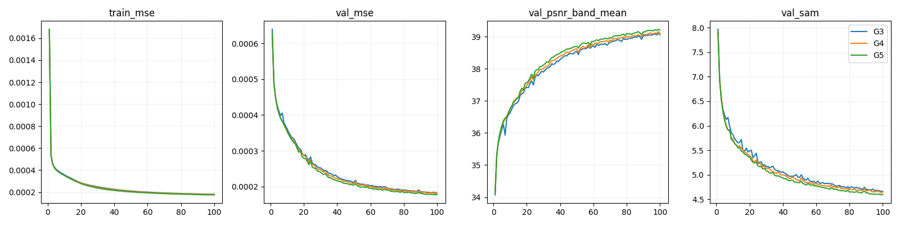

실제 100에포크의 학습 MSE와 validation 기록을 표시합니다.

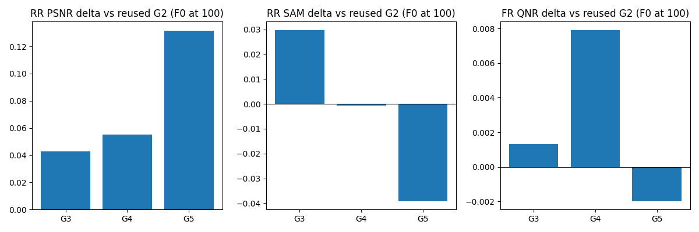

G2를 기준으로 PSNR·SAM·잠정 QNR 차이를 비교합니다. SAM은 낮을수록 좋으므로 막대 방향을 PSNR과 동일하게 해석하지 않습니다.

<a id="images"></a>

## 6. 결과 이미지

RR 장면 1·8·11·13·19를 사전 고정했습니다. 각 패널은 왼쪽부터 **LR MS · PAN · 예측 · GT**입니다. QB RGB는 밴드 [2,1,0]을 사용하며 GT 기반 1·99 백분위 대비를 공통 적용합니다. 이미지는 표시용이며 지표는 원래 수치로 계산했습니다. FR에는 정답을 만들지 않습니다.

### 장면 1

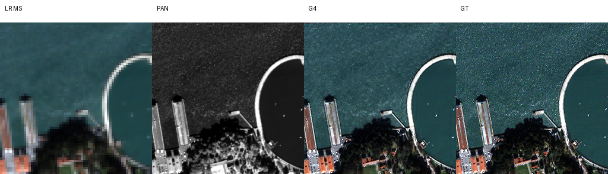

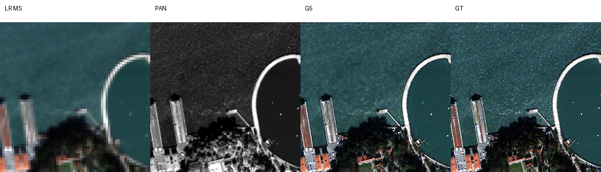

### 장면 8

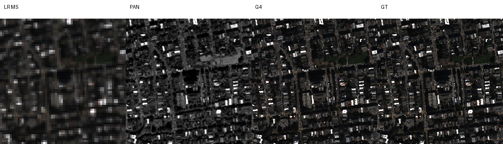

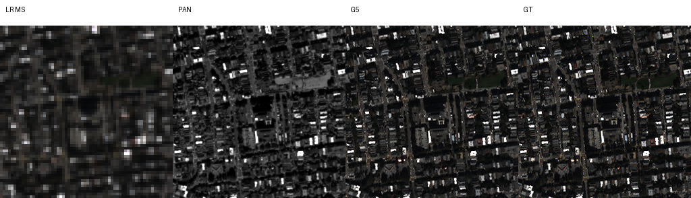

### 장면 11


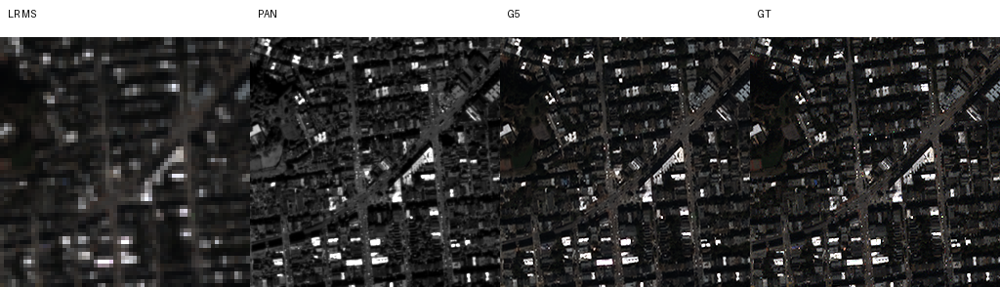

### 장면 13

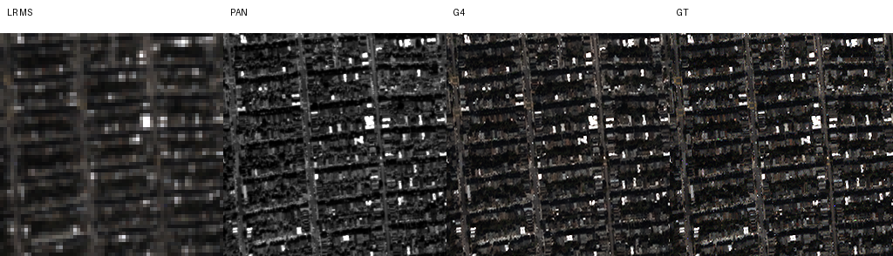

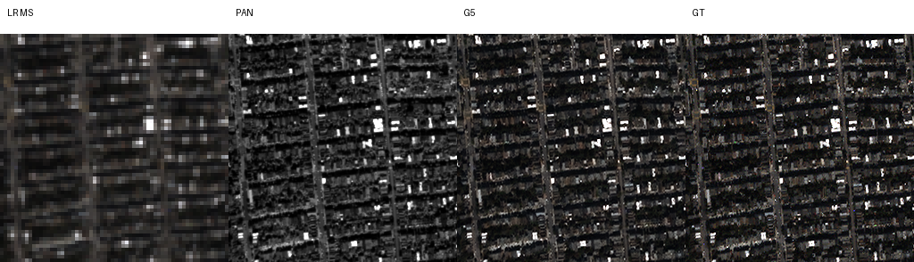

### 장면 19

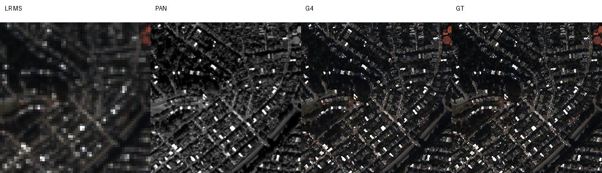


<details>
<summary>G3의 동일 고정 장면</summary>


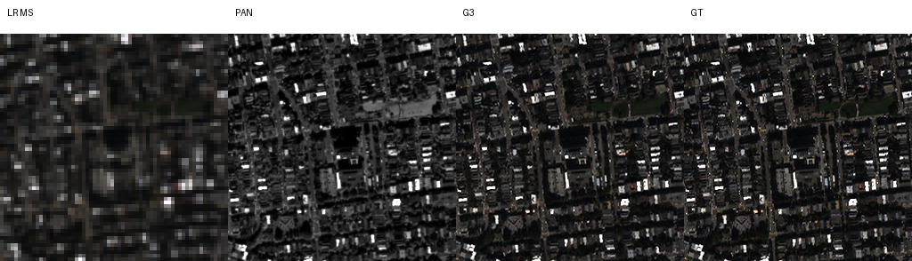

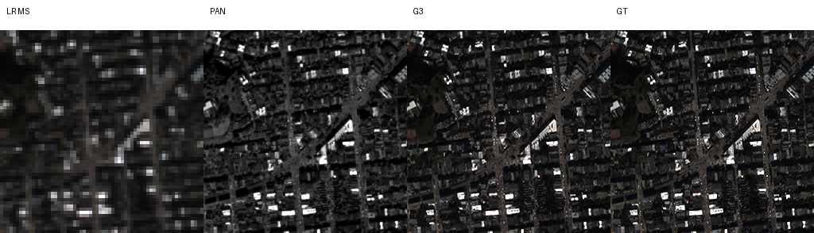

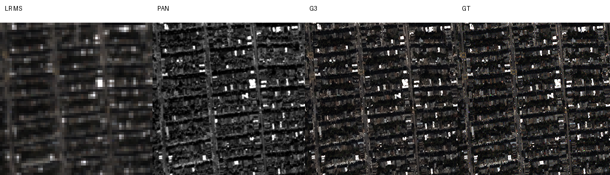

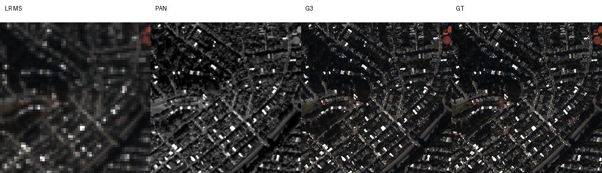

</details>

<a id="evidence"></a>

## 7. 재현 자료

[실행 코드](run.py) · [모델](model.py) · [설정](config.json) · [원본 실행 소스](provenance/source_snapshot/) · [관측 설정과 원본 계획](results/QB/plan.json) · [데이터 manifest](results/QB/data_manifest.json) · [장면별 지표](results/QB/evaluation/100/metrics.json) · [재사용 대조군](results/QB/controls.json) · [복구 검증](results/verification.json) · [원격 복구 확인](results/remote_recovery.json)

G3·G4·G5의 원본 best/latest를 후보별 `checkpoints/`에 보존했습니다. G0-G2는 [23번 가중치](../23_multi_sensor_comparison/checkpoints/)의 `best_at_100.pt`이며 controls의 해시와 일치합니다. 학습 당시 소스·내부 설정·경로는 원본 그대로 보존했습니다. 현행 실행 코드는 같은 실험 폴더의 모델을 가져오도록 경로를 맞췄으며 기존 runtime을 현행 코드로 재개하지 않습니다.

53개 내보낸 원본 파일의 크기·해시, 소스 해시, 세 후보의 100에포크 기록, 원본 체크포인트 6개의 strict load와 optimizer/RNG 상태, 현행 모델과 원본 모델의 CPU 추론 일치를 확인했습니다. 지표의 장면 수·평균과 PNG 17개도 확인했습니다. 독립적인 GitHub clone에서 원격 보관본을 복구하여 원본 파일의 바이트 일치와 동일 체크포인트 검증을 다시 확인했습니다. 이 검증은 새로운 전체 test 재평가와 구분합니다.

```bash
python SSA-MRN/common/verify.py --experiment 28
```

## 8. 개선 여부와 다음 단계

**부분 개선**입니다. G5는 RR 개선 후보, G4는 잠정 FR 개선 후보로 남깁니다. 같은 조건의 반복 시드로 작은 차이의 재현성을 확인하고, 공식 평가 도구와 QNR·Q2n·SCC를 대조한 뒤 종합 채택을 판단합니다. test 결과에 맞춰 학습 조건이나 체크포인트 선택 기준을 변경하지 않습니다.
