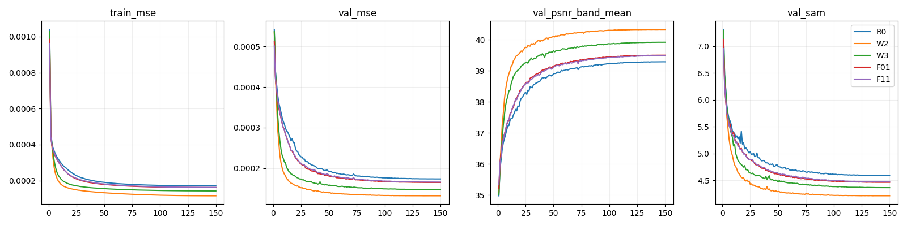
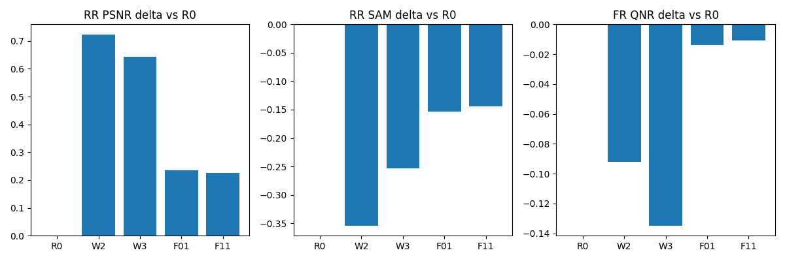
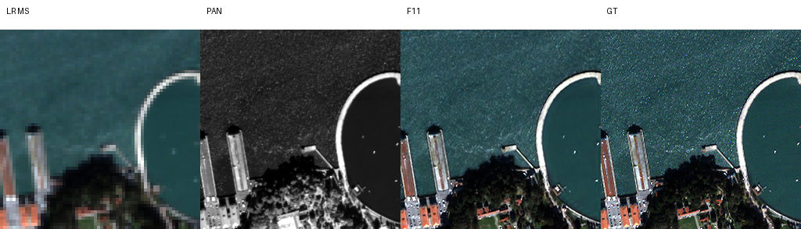

# 29. 병렬 특징 용량 확장과 독립 잔차 보정

연구 분야: 기존 성능 개선 · 실험자: 이병현

확인된 결과: W2의 RR PSNR +0.7234 dB, SAM -0.3542°; 잠정 FR QNR -0.0922입니다. | 상태: 평가 완료 | 개선 여부: 부분 개선

## 1. 목적

같은 150에폭 학습에서 backbone 용량 확장과 독립 잔차 보정의 효과를 비교합니다. 200에폭 설계에서 QB와 주요 후보만 선택했습니다. 장기 수렴이나 센서 일반화는 별도 확인이 필요합니다.

## 2. 변경한 구조

| 후보 | 변경 |
|---|---|
| R0 | 원본 SSA-MRN |
| W2 | 원본 backbone + PixelUnshuffle(2) → 256→128 채널 → ResBlock 8개 → 128→256 채널 → PixelShuffle(2) 가지 |
| W3 | 원본 backbone + 원래 해상도에서 64채널 ResBlock 8개 가지 |
| F01 | 원본 복원 한 번 + 성능 28번 G5의 독립 보정기 두 개 |
| F11 | F01의 core에서 초기 LRPAN 입력 제거 |

W2와 W3는 추가 가지의 마지막 1×1 Conv를 0으로 초기화했습니다. 같은 입력에서 초기 출력이 R0와 정확히 같은지 검증했습니다. F01의 초기 출력도 같습니다. F11은 원본 stem의 LMS·PAN 가중치와 bias를 복사하며 LRPAN 입력을 제외했습니다. 보정기는 성능 28번의 학습 데이터 기반 PAN·blur 보정값을 사용합니다.

## 3. 비교 조건

QB 학습 17,139개, 검증 1,905개 패치를 사용합니다. seed42, K4, 공간 4배, effective/micro batch32, Adam, 최종 출력 MSE, AMP FP16 학습과 FP32 검증·평가를 적용합니다. TF32는 끄고 cuDNN autotune은 켭니다. 비트 단위 재현은 보장하지 않습니다.

LR은 첫 에폭 1e-4에서 150번째 에폭 1e-6까지 에폭별 cosine으로 줄입니다. 모든 후보의 공통 원본 계층과 에폭별 샘플 순서는 같습니다. 이 일정의 100에폭 결과는 기존 100에폭 고정 LR과 동일 조건이 아닙니다.

## 4. 실행과 재개

최대 두 후보를 병렬 실행하고 빈 슬롯에 다음 후보를 시작합니다. source hash가 바뀌면 학습을 거부합니다. latest.pt에 optimizer·GradScaler·난수 상태·에폭·다음 batch를 저장합니다. 같은 코드와 설정으로 start를 재실행하면 latest에서 이어집니다. 체크포인트는 에폭 끝과 학습 중 약 5분마다 원자적으로 기록합니다.

서버 경로와 원본 데이터·캐시는 runtime plan.json에 기록했습니다. 기존 데이터·학습 폴더를 변경하지 않습니다.

## 5. 평가 방법

validation MSE 최소를 선택하며 정확히 같은 값이면 먼저 나온 에폭을 유지합니다. 50·100·150에폭까지의 best를 각각 보존하고 모든 학습 종료 후 RR·FR 각 20장 전체를 평가합니다. test로 체크포인트를 다시 고르지 않습니다. RR의 고정 장면 1·8·11·13·19는 LR MS·PAN·예측·GT 패널로 저장합니다. 장면 ID는 0부터 셉니다. FR 정답은 없습니다. QNR 등은 MATLAB 구현과의 일치가 미검증된 잠정 수치입니다.

## 6. 확인된 결과

5개 후보가 150에폭을 완료했고, 50·100·150에폭 시점별 validation best를 RR·FR 각 20장 전체로 평가했습니다. 학습은 2026-10-15 05:53에 시작해 13:04에 끝났으며, 평가까지 13:06에 완료했습니다. 총 약 7시간 12분이 걸렸습니다.

### 150에폭까지의 validation best 비교

| 후보 | 선택 에폭 | PSNR ↑ | SAM ↓ | ERGAS ↓ | SCC ↑ | Q2n ↑ | 잠정 Dλ ↓ | 잠정 Ds ↓ | 잠정 QNR ↑ |
|---|---:|---:|---:|---:|---:|---:|---:|---:|---:|
| R0 | 149 | 37.388271 | 4.959518 | 4.143847 | 0.976472 | 0.922701 | 0.038867 | 0.039168 | 0.923937 |
| W2 | 145 | 38.111658 | 4.605292 | 3.793608 | 0.981731 | 0.933521 | 0.025547 | 0.146136 | 0.831769 |
| W3 | 149 | 38.031117 | 4.706496 | 3.832499 | 0.980739 | 0.931236 | 0.049492 | 0.169090 | 0.789063 |
| F01 | 149 | 37.624045 | 4.805538 | 4.029437 | 0.977966 | 0.925648 | 0.041777 | 0.050226 | 0.910265 |
| F11 | 149 | 37.614538 | 4.815484 | 4.033352 | 0.977877 | 0.925840 | 0.036253 | 0.052664 | 0.913101 |

| 후보 | ΔPSNR ↑ | ΔSAM ↓ | ΔERGAS ↓ | Δ잠정 QNR ↑ | RR PSNR 개선 장면 | FR QNR 개선 장면 | 판정 |
|---|---:|---:|---:|---:|---:|---:|---|
| W2 | +0.7234 | -0.3542 | -0.3502 | -0.0922 | 20/20 | 1/20 | 부분 개선 |
| W3 | +0.6428 | -0.2530 | -0.3113 | -0.1349 | 20/20 | 1/20 | 부분 개선 |
| F01 | +0.2358 | -0.1540 | -0.1144 | -0.0137 | 20/20 | 3/20 | 부분 개선 |
| F11 | +0.2263 | -0.1440 | -0.1105 | -0.0108 | 20/20 | 4/20 | 부분 개선 |

### 학습 구간별 비교

각 칸은 PSNR / SAM / 잠정 QNR입니다. 각 시점까지의 validation best를 사용했습니다.

| 후보 | 50에폭까지 | 100에폭까지 | 150에폭까지 |
|---|---|---|---|
| R0 | 37.0902 / 5.1450 / 0.9084 | 37.3527 / 4.9826 / 0.9235 | 37.3883 / 4.9595 / 0.9239 |
| W2 | 38.2323 / 4.6423 / 0.8615 | 38.1494 / 4.6069 / 0.8451 | 38.1117 / 4.6053 / 0.8318 |
| W3 | 37.8355 / 4.8279 / 0.8477 | 37.9879 / 4.7293 / 0.8202 | 38.0311 / 4.7065 / 0.7891 |
| F01 | 37.3145 / 4.9759 / 0.9132 | 37.5640 / 4.8288 / 0.9169 | 37.6240 / 4.8055 / 0.9103 |
| F11 | 37.3340 / 4.9770 / 0.9167 | 37.5546 / 4.8427 / 0.9183 | 37.6145 / 4.8155 / 0.9131 |

### 학습 곡선과 비교 그래프

validation PSNR은 패치별 밴드 평균이고, 위 표는 RR 전체 장면 평가입니다. 서로 같은 집계 수치로 해석하지 않습니다.

### 고정 장면 결과 이미지

RR 장면 1·8·11·13·19를 미리 고정했습니다. 0부터 시작하는 장면 번호이며, 각 패널은 LR MS · PAN · 예측 · GT입니다. GT의 채널별 1·99 백분위 범위로 표시했고 QB RGB 밴드 순서는 [2,1,0]으로 가정했습니다. 각 후보의 5장 이미지는 평가 폴더에 모두 보존했습니다.

## 7. 해석과 다음 실험

- **용량 확장은 RR에서 뚜렷한 효과가 있었습니다.** W2와 W3 모두 R0보다 PSNR·SAM이 20장 전부 개선됐습니다. W2의 PSNR 이득은 +0.7234 dB입니다. 이는 이번 동일 조건 대조군의 개선이며 논문 대비 구조 개선의 확정은 아닙니다.
- **동일한 수준의 연산량에서는 W2가 W3보다 좋았습니다.** W2의 PSNR은 W3보다 +0.0805 dB, SAM은 -0.1012°, 잠정 QNR은 +0.0427입니다. 다만 두 후보의 파라미터 수가 달라 해상도 처리만의 독립 효과로 확정하지 않습니다.
- **FR 공간 왜곡 악화가 큽니다.** W2의 Dλ는 -0.0133으로 좋아졌지만 Ds가 +0.1070으로 악화해 QNR은 -0.0922가 됐습니다. W3도 QNR이 -0.1349로 악화했습니다. W2는 사전 제안했던 QNR 하락 0.005 이내 조건을 통과하지 못했으므로 후속 core로 자동 채택하지 않습니다.
- **validation 개선이 RR·FR 동반 개선을 보장하지 않았습니다.** W2는 50→150에폭의 validation best MSE가 약 5.3% 더 내려갔지만 RR PSNR은 38.2323→38.1117, 잠정 QNR은 0.8615→0.8318로 내려갔습니다. 학습 패치와 전체 장면·FR의 일반화 차이 가능성을 후속으로 확인해야 합니다. test가 좋았다는 이유로 50에폭 가중치를 최종 모델로 다시 선택하지 않습니다.
- **독립 보정기의 RR 이득은 유지됐습니다.** F01은 R0보다 PSNR +0.2358 dB, SAM -0.1540°이나 잠정 QNR은 -0.0137입니다. F11은 F01 대비 PSNR -0.0095 dB, SAM +0.0099°로 RR 추가 이득이 없고 QNR만 +0.0028입니다. LRPAN 제거 결합의 일관된 이득은 확인하지 못했습니다.
- 최종 AMP 생략 step은 R0 26회, W2 22회, W3 24회, F01 25회, F11 26회로, 후보당 총 80,400회 중 0.04% 미만입니다. 조건은 같지만 성공한 업데이트 수는 정확히 같지 않습니다. 단일 QB·seed42이며 추가 시드·GF2는 미실시입니다.
- 다음 검토는 W2의 RR 용량 이득을 유지하면서 FR의 PAN 공간 왜곡을 줄이는 방향입니다. 관측 연산의 데이터 정합을 먼저 확인하고, 고정 관측 지표와 전체 장면 validation을 함께 사용해야 합니다. 추가 학습은 이번 PR 범위에 포함하지 않았습니다.

## 8. 재현 자료

- `model.py`·`run.py`는 학습에 사용한 원본이며 `config.json`은 실제 실행 조건입니다. 의존하는 common과 선행 모델의 당시 소스는 `provenance/source/SSA-MRN/`에 보존했습니다.
- `checkpoints/<후보>_QB_s42/`에는 best·latest와 50·100·150 시점별 best를 보존했습니다. `best_at_150.pt`와 `best.pt`는 같은 validation 선택 결과입니다.
- `results/QB/`에는 compact 에폭 기록·상태·선택 기록, `results/QB/evaluation/{50,100,150}/`에는 장면별 지표·평균·고정 예시·곡선이 있습니다. `results/summary.json`에 R0 대비 차이와 장면별 개선 수를 기록했습니다.
- `provenance/plan.json`과 `data_manifest.json`에 원본 데이터·코드 해시를 보존했습니다. 로컬 실행 경로는 재현 설정에만 남겼습니다. 데이터셋과 재생성 가능한 예측 배열은 포함하지 않았습니다.
- 보존 파일 해시는 `python SSA-MRN/common/verify.py --experiment 29_capacity_refinement --research-track performance`로 확인합니다. 해시 검증과 성능 재평가는 별개입니다.
- `evaluate.py --data-root <dataset> --output <결과폴더> --target 150`으로 보존 가중치를 재평가할 수 있습니다. 원본 PAN–MS H5와 PyTorch·NumPy·h5py·SciPy·scikit-image·matplotlib·Pillow가 필요합니다.

보관 검증: 소스 해시 8개, 체크포인트 25개의 strict load·CPU 64×64 유한 출력, 세 시점의 validation 선택 에폭·평가 평균·가중치 해시를 확인했습니다.

추가 재평가: 새 실행기에서 모델 생성 전에 CPU 스레드를 1개로 제한하고 진행 출력을 추가한 뒤, 150에폭 best 5개 모델의 RR·FR 각 20장 전체 평가를 완료했습니다. 원본 학습·평가 코드는 변경하지 않았습니다. 기존 평가와 비교한 평균 PSNR 최대 차이는 0.000365 dB 미만, 평균 QNR 최대 차이는 0.000035 미만입니다. 모든 장면·모든 지표를 합친 최대 절대 차이는 0.000876 미만입니다. 비트 단위 일치는 아니며 cuDNN autotune 등 실행 조건에 따른 수치 차이 가능성이 있습니다. 후보별 RR 개선·FR QNR 악화와 부분 개선 판정은 유지됐습니다. 재평가 원본 지표·완료 기록·차이 분석은 `provenance/reevaluation_150/`에 보존했습니다.
