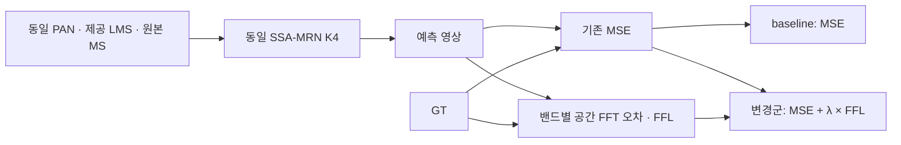
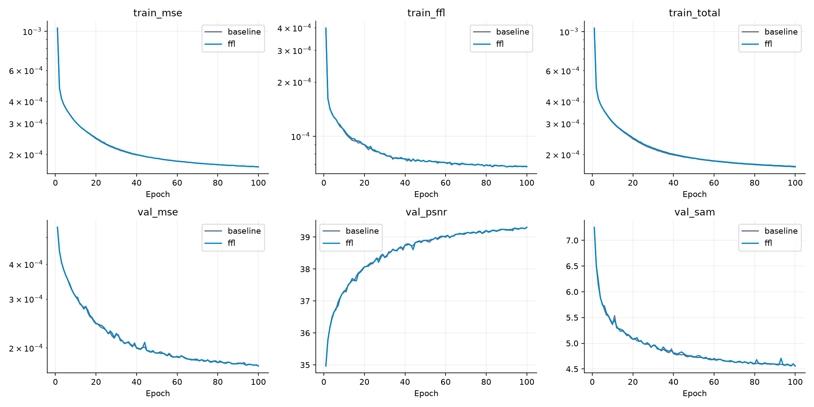
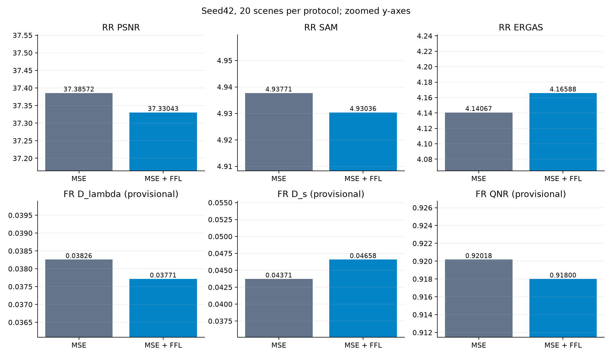
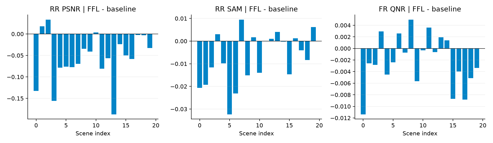
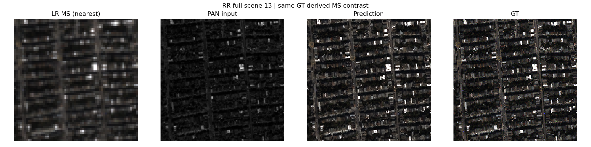
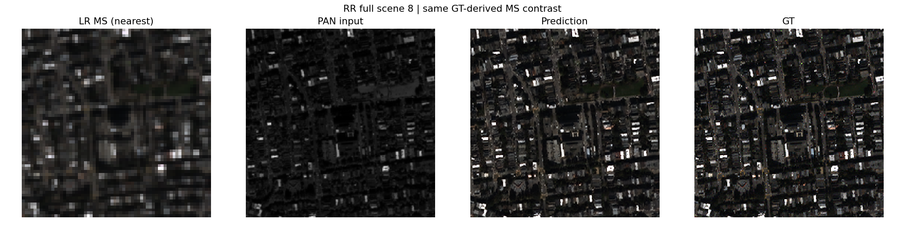
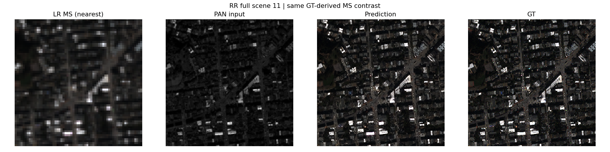
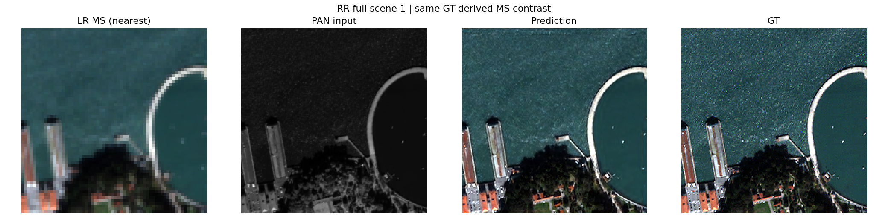
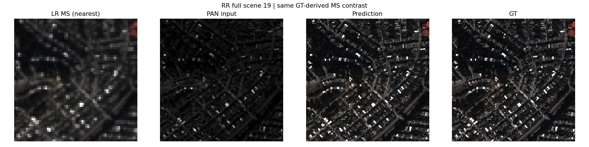

# 30. Focal Frequency Loss 추가

**연구 분야:** 기존 성능 개선

**실험자:** 송준현

**변경 내용:** 기존 SSA-MRN의 최종 출력 MSE에 오차가 큰 주파수 성분에 가중치를 주는 FFL을 추가했습니다. 네트워크와 입력·정규화는 유지했습니다.

| 확인된 결과 | 상태 | 개선 여부 |
|---|:---:|:---:|
| seed42: RR PSNR -0.0553 dB, SAM -0.0073°; 잠정 FR QNR -0.0022. validation에서도 기준선 우위입니다. | 평가&nbsp;완료<br>seed42 | 부분&nbsp;개선 |

[실험 목록](../../../research/performance/README.md#experiments) · [수치](#results) · [그래프](#graphs) · [이미지](#images) · [재현 자료](#evidence)

## 1. 목적과 상태

MSE에 주파수 오차 제약을 더해 복원 성능을 높일 수 있는지 확인했습니다. 먼저 학습 데이터에서 손실 크기를 측정해 세 λ를 고정하고, validation MSE로 후보를 선택했습니다. 이후 두 군을 새로 100에폭 학습하고 RR·FR 각 20장 전체를 평가했습니다.

최종 상태 확인 시각은 2026-10-15T08:45:40.836855+09:00입니다. seed42의 학습·평가가 완료됐으며 seed43·44와 3-seed 평균·표준편차는 아직 없습니다. smoke 결과는 최종 성능에 포함하지 않았습니다.

## 2. 변경한 구조와 비교 조건



FFL은 각 MS 밴드의 공간 축에 정규 직교 FFT를 적용한 복소수 오차 제곱을 사용합니다. 복소 오차의 크기를 각 표본·밴드 안의 공간 주파수 최댓값으로 나눈 가중치에 곱해 전체 표본·밴드·주파수에서 평균합니다. 가중치는 gradient에서 분리합니다. 최댓값이 0이면 가중치를 0으로 처리합니다. alpha=1, patch factor=1이며 spectrum 평균·log 가중치·batch 공동 정규화는 사용하지 않았습니다.

오차가 큰 주파수에 집중하는 손실이며 높은 주파수에 항상 큰 가중치를 주는 고정 high-pass 손실은 아닙니다. 밴드 벡터의 방향을 비교하는 분광 손실과도 구분합니다. 평가 SAM의 구현은 변경하지 않았습니다. 구현 근거는 [FFL 공식 저장소](https://github.com/EndlessSora/focal-frequency-loss)이며 실제 사용 소스는 아래 snapshot에 보존했습니다.

| 조건 | 실제 설정 |
|---|---|
| 데이터 | QB만 사용: train 17,139개·validation 1,905개·RR 20장·FR 20장 |
| 모델 | 원본 기준 SSA-MRN, 내부 특징 K4·공간 4배, 두 군 동일 구조 |
| 입력·정규화 | PAN·원본 MS·제공 LMS, raw DN / 2047, clipping 없음 |
| 학습량·시드 | 두 군 새 학습 100에폭, seed42 |
| batch | micro32·effective32, 동일 실제 패치 순서 |
| optimizer·LR | Adam 기본값, 고정 1e-4 |
| 정밀도 | FP32, AMP·TF32 끔, 결정적 설정 |
| 장치 | Tesla T4 두 개, 각 14.562 GiB, GPU0 baseline·GPU1 FFL |
| 선택 | 각 군의 validation MSE 최소 checkpoint, 정확한 동률이면 이른 에폭 |
| 최종 손실 | baseline=MSE, 변경군=MSE + 0.013491834 × FFL |

두 군은 같은 초기 가중치와 실제 100개 에폭별 샘플 순서에서 출발했습니다. 최종 일반 가중치는 서로 달라지는 것이 정상입니다. 이 실험에서는 양 군에 같은 micro32 실행기를 사용했습니다. 과거 Windows micro4 실행과 비트 단위로 같은 학습을 재현했다는 뜻은 아닙니다.

<a id="results"></a>

## 3. 정량 결과

### λ 선택과 validation

초기 가중치에서 학습 앞 64개 패치의 MSE=0.0125089283, FFL=0.0092714811를 측정했습니다. 그 비율에 사전 고정 배수 0.01·0.1·1을 곱해 아래 후보를 만들었습니다. test는 후보 생성·선택에 사용하지 않았습니다.

| 후보 | λ | 100에폭 중 최소 validation MSE ↓ |
|---|---:|---:|
| baseline | 0 | 0.000172088681 |
| lambda_1 | 0.013491834 | 0.000172371521 |
| lambda_2 | 0.13491834 | 0.000173192481 |
| lambda_3 | 1.3491834 | 0.000173726496 |

세 FFL 후보 중 λ=0.013491834를 선택했습니다. **선택된 후보도 baseline의 validation MSE보다 나빴습니다.** 선택 규칙은 FFL 후보끼리의 최저 MSE였으며, baseline보다 우수한 후보만 통과시키는 규칙은 아니었습니다. 따라서 이 선택을 채택 권고로 해석하지 않습니다.

새 최종 학습에서도 baseline validation MSE는 0.000172088681, FFL은 0.000172371521입니다. 두 군의 best는 모두 100에폭입니다. 같은 seed·설정의 결정적 새 학습이므로 sweep과 최종 학습의 같은 값은 독립 반복 시드 증거가 아닙니다.

### RR 전체 장면 평가

각 장면을 따로 평가한 뒤 20장 산술 평균을 냈습니다. PSNR은 peak2047 기준 밴드별 PSNR 평균입니다. validation 패치 PSNR과 집계 대상이 다릅니다.

| 지표 | MSE | MSE + FFL | 차이 | 개선 장면 |
|---|---:|---:|---:|---:|
| PSNR ↑ | 37.385715 | 37.330430 | -0.055285 | 3/20 |
| SAM ↓ | 4.937707 | 4.930361 | -0.007346 | 13/20 |
| ERGAS ↓ | 4.140672 | 4.165876 | +0.025204 | 3/20 |
| 잠정 SCC ↑ | 0.976524 | 0.976209 | -0.000315 | 5/20 |
| 잠정 Q2n ↑ | 0.921287 | 0.921164 | -0.000123 | 4/20 |
| MSE, peak1 ↓ | 0.000217 | 0.000220 | +0.000003 | 3/20 |

### FR 전체 장면 평가

FR 정답은 만들거나 사용하지 않았습니다. Dλ·Ds·QNR은 기존 구현의 잠정 수치이며 MATLAB·공식 센서 MTF 대응은 미검증입니다.

| 지표 | MSE | MSE + FFL | 차이 | 개선 장면 |
|---|---:|---:|---:|---:|
| 잠정 Dλ ↓ | 0.038257 | 0.037712 | -0.000544 | 15/20 |
| 잠정 Ds ↓ | 0.043707 | 0.046578 | +0.002871 | 6/20 |
| 잠정 QNR ↑ | 0.920177 | 0.917997 | -0.002180 | 6/20 |

## 4. 기준선 대비 차이와 해석

SAM과 잠정 Dλ는 소폭 좋아졌지만 PSNR·ERGAS·SCC·Q2n과 잠정 Ds·QNR은 나빠졌습니다. 이는 분광 관계 일부의 개선과 공간·전체 복원 성능의 손실이 함께 나타난 결과입니다. 원인까지 확정한 것은 아닙니다.

λ를 키울수록 이번 세 후보의 validation MSE는 악화했습니다. 측정한 초기 손실 비율에 맞춘 λ가 학습 후반에도 같은 상대 기여를 유지한다는 보장은 없습니다. 학습 MSE·FFL·합산 손실을 따로 기록해 이 변화를 확인할 수 있습니다. baseline에서도 기록한 FFL은 진단 값이며 λ=0이라 gradient에는 반영하지 않았습니다.

| 시간·메모리 | baseline | FFL |
|---|---:|---:|
| 실제 훈련 구간 합계, 초 | 5254.07 | 5437.41 |
| validation 시간 합계, 초 | 1046.75 | 1037.38 |
| 학습 peak GPU 할당, GiB | 3.164 | 3.164 |
| RR forward 중앙값, ms | 22.804 | 23.204 |
| FR forward 중앙값, ms | 74.639 | 76.112 |

훈련 구간 시간은 구간 내 체크포인트 비용을 포함하고 데이터 적재·validation은 제외합니다. controller wall time에는 다른 군 대기가 섞일 수 있어 모델 속도 비교에 사용하지 않았습니다. 추론 시간은 FP32 forward만 측정했으며 전송·지표·그림은 제외하고 별도 warmup 제거를 하지 않았습니다. 첫 장면 비용과 장치 상태가 포함되므로 작은 시간 차이를 FFL의 추론 속도 효과로 해석하지 않습니다. 두 군의 추론 구조는 같습니다.

<a id="graphs"></a>

## 5. 학습·평가 그래프





두 번째 그림의 y축은 차이를 보기 위해 확대했습니다. FR 지표는 잠정 값입니다.



<a id="images"></a>

## 6. 결과 이미지

평가 전에 고정한 0기준 장면 13·8·11·1·19입니다. 각 그림은 LR MS 최근접 표시 · PAN · 예측 · GT 순서입니다. MS 계열 영상은 해당 GT 밴드별 1/99 백분위로 공통 대비를 사용했고 RGB는 [2,1,0]입니다. 예측 값의 학습·평가 clipping은 하지 않았으며 화면 표시에서만 범위를 제한했습니다. 원본 결과 PNG를 그대로 보존했습니다.

### 장면 13



### 장면 8



### 장면 11



### 장면 1



### 장면 19



<a id="evidence"></a>

## 7. 재현 자료

- [실제 설정](config.json), [원본 고정 설정](provenance/experiment.json), [λ 생성 근거](provenance/lambda_catalogue.json), [validation 선택 근거](provenance/final_settings.json)를 보존했습니다.
- [최종 가중치와 sweep 선택 근거 가중치](checkpoints/), [원본 학습 소스](provenance/code/), [실제 군별 설정](provenance/configs/), [실행 환경](provenance/environment_current.json), [분할·데이터 해시](provenance/data_manifest_full.json)를 연결합니다.
- [baseline 전체 장면 지표](results/final/baseline/results.json), [FFL 전체 장면 지표](results/final/ffl/results.json), [장면별 변화](results/paired_scene_deltas.json), [검증 기록](results/audit.json), [파일 해시](manifest.json)를 보존했습니다.
- best/latest와 두 초기 가중치 등 총 14개 checkpoint의 strict load·64×64 합성 CPU 유한 출력을 확인했습니다. 두 군의 best/latest 모델 tensor가 같지만 latest를 별도로 H5 재평가한 것은 아닙니다. 게시 과정에서 원본 H5 추론을 다시 실행하지 않았습니다.
- 원본 ZIP의 CRC·모든 manifest 항목 해시, 실제 실행 소스 해시, λ 선택 증거, 100에폭 기록, 공통 초기값·실제 순서, 20장 평균 재계산을 확인했습니다. 보존 해시 확인과 실제 성능 재평가는 별개입니다.

```bash
python SSA-MRN/common/verify.py --experiment 30_focal_frequency_loss --research-track performance
python SSA-MRN/experiments/performance/30_focal_frequency_loss/prepare.py
```

`run.py`는 보존된 실행 소스를 넣은 Kaggle 단일 셀입니다. 상단 PHASE·seed·Input을 설정해 새 실행 또는 동일한 실행의 재개에 사용합니다. 원본 소스와 checkpoint 내부 설정은 바꾸지 않았습니다. 기존 가중치를 다른 설정의 학습으로 덮어쓰지 않습니다.

## 8. 개선 여부와 다음 단계

**부분 개선**으로 기록합니다. SAM·잠정 Dλ의 소폭 이득만 있고 validation·RR PSNR·ERGAS·공간 지표·잠정 QNR을 함께 개선하지 못했습니다. 현재 λ 후보를 새 기준 모델로 채택하지 않습니다. 단일 QB·seed42 결과라 통계적 유의성·센서 일반화를 주장하지 않습니다.

세 λ 모두 validation MSE가 baseline보다 나빴으므로 seed43·44를 같은 구성으로 확대하는 것보다 현재 결과를 우선 보관하고 다른 가설을 검토하는 편이 합리적입니다. 다른 λ·가중치 일정을 시험한다면 별도 실험으로 사전 고정하고 validation으로 선택해야 합니다. 이번 test 결과를 기준으로 λ를 다시 조정하지 않습니다.
