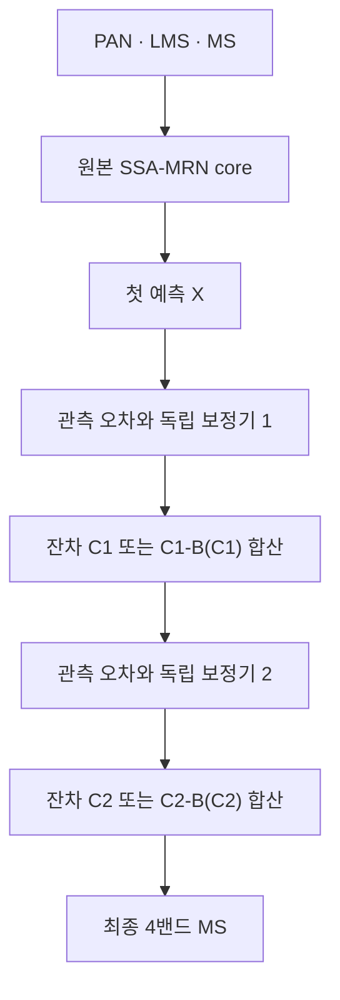
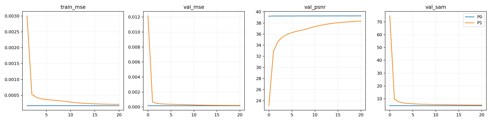
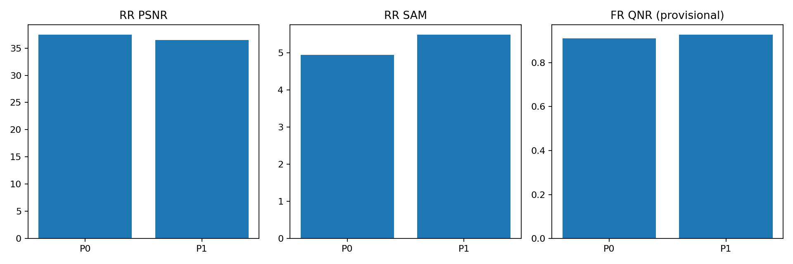
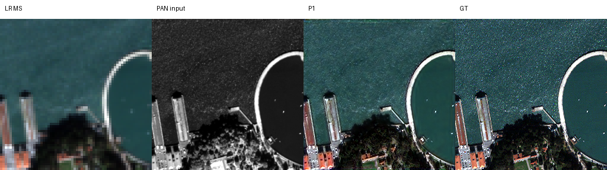
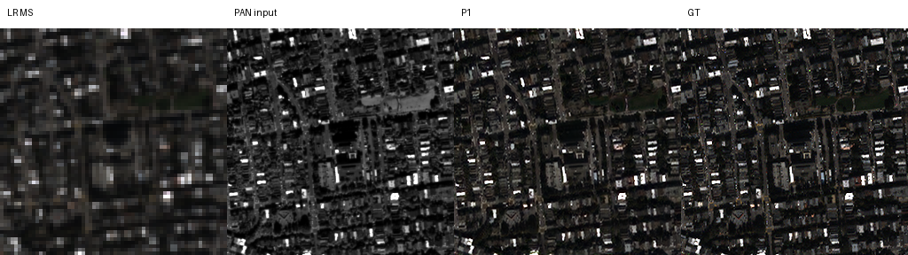
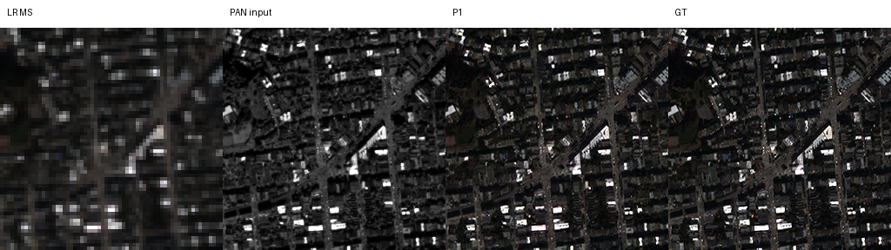
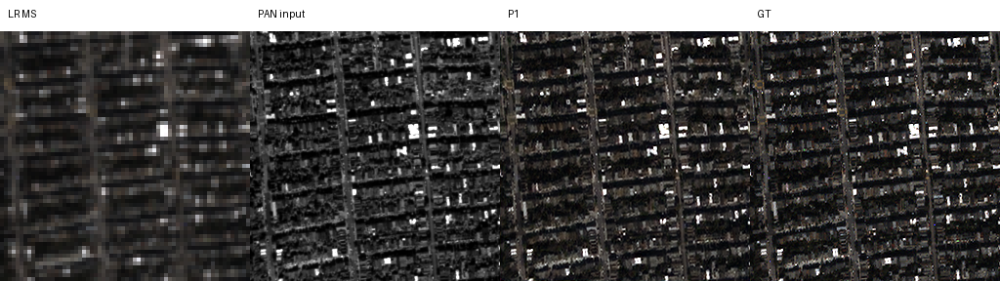
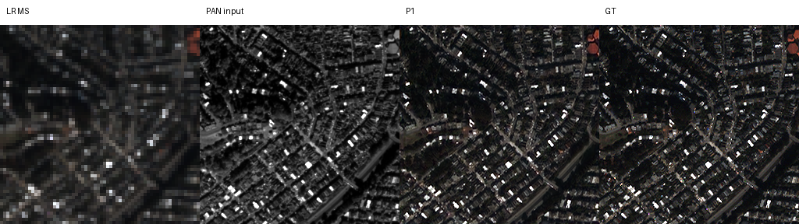

# 보정 잔차의 저주파 억제

**연구 분야:** 기존 성능 개선

**실험자:** 김경찬

**변경 내용:** 기존 G5의 두 독립 보정기 출력에서 고정 Gaussian 저주파 성분을 제거한 뒤 예측에 합산했습니다.

| 확인된 결과 | 상태 | 개선 여부 |
|---|:---:|:---:|
| P0 대비 P1: RR PSNR -0.9426 dB, SAM +0.5369°; 잠정 FR QNR +0.01671입니다. RR 유지 기준을 통과하지 못했습니다. | 평가&nbsp;완료 | 부분&nbsp;개선 |

[실험 목록](../../../README.md#performance-experiments) · [수치](#results) · [그래프](#graphs) · [이미지](#images) · [재현 자료](#evidence)

## 1. 목적과 상태

G5의 잔차 보정이 넓은 영역의 색상·밝기까지 바꾸는 자유도를 줄이면 RR 성능을 유지하면서 FR 왜곡을 낮출 수 있는지 검토했습니다. 두 군은 각각 20에포크 추가 학습과 RR·FR 각 20장 평가를 완료했습니다. 본 결과는 QuickBird·seed46 단일 비교이며 사전 학습된 G5를 조건으로 한 미세조정 실험입니다.

업로드한 실제 Kaggle Output의 코드·설정·가중치·장면별 지표·곡선을 확인했습니다. 보관 작업 중 새 학습이나 원본 H5 전체 재추론은 수행하지 않았습니다.

## 2. 변경한 구조와 비교 조건

| 군 | 변경 위치·입력·연산·출력 |
|---|---|
| P0 | 기존 G5입니다. 원본 SSA-MRN core 뒤의 두 독립 보정기가 현재 예측·LMS·PAN·MS 관측 오차·PAN 고주파 차이로 잔차 C를 만들고 X_next=X+C로 합산합니다. |
| P1 | 같은 보정기 출력의 C를 C-B(C)로 교체합니다. B는 밴드별 9×9 Gaussian, sigma=2, reflect 경계의 고정 depthwise convolution입니다. |



| 항목 | 실제 조건 |
|---|---|
| 데이터 | QB train 17,139·validation 1,905패치, RR·FR 각각 20장 |
| 특징 차원·배율 | K4·공간 4배 |
| 부모 가중치 | 28번 G5 seed46의 validation-best 99에포크 원본 |
| 새 학습 | 두 군 모두 같은 부모에서 추가 20에포크, core와 두 보정기 모두 갱신 |
| optimizer·손실 | Adam 새 생성, LR 1e-5 고정, 최종 출력 원소 평균 MSE |
| 배치·시드 | effective64·micro32, seed46 |
| 장치·정밀도 | T4×2, GPU0 P0·GPU1 P1 독립 process; 학습 FP16 AMP 초기scale1024, validation/test FP32, TF32 비활성 |
| 데이터 공급 | 두 worker 각각 train·validation을 GPU에 상주시켰습니다. |
| 정규화 | DN/2047 유지, 제공 LMS 사용, 입력·예측 clipping 없이 지표 계산 |
| best 선택 | epoch0 포함 validation MSE 최솟값, 정확한 동률은 최초 시점 |
| 공통 조건 | 초기 파라미터 해시와 실제 20에포크의 배치 순서 해시가 일치했습니다. |

필터는 학습 파라미터를 추가하지 않으며 두 군 모두 461,804파라미터입니다. 같은 파라미터에서도 P1의 forward가 바뀌므로 초기 출력은 같지 않습니다. 기존 G5 학습의 micro64와 이번 micro32가 다르고 optimizer도 새로 만들었으므로 과거 결과를 이번 직접 대조군으로 사용하지 않습니다.

MS 관측 근사는 기존 G5의 학습 데이터 기반 보정값을 그대로 사용합니다. Gaussian과 PAN 밴드 조합은 공식 센서 MTF 또는 실측 센서 모델이 아닙니다. C-B(C)는 정확한 MS 관측 영공간 투영이 아니며 분광 보존을 보장하지 않습니다. CUDA 보간의 결정성 미지원 연산에는 경고를 허용하므로 비트 단위 재현성을 보장하지 않습니다.

<a id="results"></a>

## 3. 정량 결과

### Validation

| 군 | 초기 MSE | best epoch | best MSE ↓ | best PSNR ↑ | best SAM ↓ |
|---|---:|---:|---:|---:|---:|
| P0 | 0.000176594 | 19 | 0.000174165 | 39.2837 | 4.5718° |
| P1 | 0.012155973 | 20 | 0.000213706 | 38.3466 | 5.0442° |

P1 best MSE는 P0보다 22.70% 높아 사전 validation 허용 기준인 +0.5%를 통과하지 못했습니다. validation은 64×64 패치이며 아래 RR 전체 장면 점수와 구분합니다.

### RR 전체 20장 평균

| 지표 | P0 | P1 | P1-P0 | 개선 장면 |
|---|---:|---:|---:|---:|
| PSNR ↑ | 37.446569 | 36.504005 | -0.942564 dB | 0/20 |
| SAM ↓ | 4.942224 | 5.479104 | +0.536880° | 0/20 |
| ERGAS ↓ | 4.117945 | 4.614063 | +0.496118 | 0/20 |
| SCC ↑（잠정） | 0.976582 | 0.970104 | -0.006478 | 0/20 |
| Q2n ↑（잠정） | 0.924306 | 0.911604 | -0.012702 | 0/20 |

### FR 전체 20장 평균 — 잠정 지표

| 지표 | P0 | P1 | P1-P0 | 개선 장면 |
|---|---:|---:|---:|---:|
| QNR ↑ | 0.909935 | 0.926646 | +0.016711 | 17/20 |
| Dλ ↓ | 0.045539 | 0.030169 | -0.015370 | 20/20 |
| Ds ↓ | 0.046854 | 0.045063 | -0.001791 | 11/20 |

RR PSNR은 peak2047의 밴드별 값을 장면 안에서 평균하고 다시 20장 평균했습니다. SAM은 도 단위이며 ERGAS는 공간비4입니다. QNR·Dλ·Ds와 Q2n·SCC의 공식 MATLAB 정합은 미검증입니다. FR에는 고해상도 GT가 없으므로 GT 기반 PSNR·SAM을 만들지 않았습니다.

### 추론 비용

| forward 중앙값 | P0 | P1 | 변화 |
|---|---:|---:|---:|
| RR 첫 장면 | 26.764 ms | 27.210 ms | +1.67% |
| FR 첫 장면 | 97.732 ms | 101.657 ms | +4.02% |

각 군의 별도 GPU에서 첫 장면을 warmup3회 후5회 측정한 값입니다. 전송·지표 계산을 제외하며 GPU 배정 교차 검증이 없으므로 확정적인 속도 비교로 해석하지 않습니다. 전체 학습시간 증가 목표10%의 달성 여부는 별도 집계하지 않아 판정하지 않습니다.

## 4. 기준선 대비 차이와 해석

RR은 주요 지표가20장 모두 악화했고 PSNR -0.03dB·SAM +0.02°의 사전 유지 기준도 통과하지 못했습니다. FR은 잠정 QNR +0.003 이상 및 Dλ·Ds 비악화 조건을 통과했습니다. 따라서 FR 개선을 근거로 전체 개선이나 기준 모델 승격을 주장하지 않습니다.

학습 전 validation 첫 micro batch에서 첫 보정기의 raw RMS0.06358 중 low RMS가0.06086이었고, 필터 후 used RMS는0.01303으로 줄었습니다. P1의 초기 validation PSNR은23.10dB, SAM은74.70°로 크게 악화했습니다. 기존 보정에 필요한 저주파 성분까지 제거했을 가능성을 시사하지만 저주파만이 유일한 원인이라고 확정하지 않습니다.

P1 validation MSE는20에포크 동안 계속 감소해 완전히 수렴한 구조의 한계로 판단할 수 없습니다. 이번 결과는 급격한 forward 변경 후 같은20에포크 미세조정을 비교한 결과입니다. test를 보고 학습량이나 필터를 변경하지 않았습니다.20장면은 독립 학습seed20개를 뜻하지 않습니다.

<a id="graphs"></a>

## 5. 학습·평가 그래프



초기 P1의 큰 오차 때문에 선형 MSE 축에서 후반 차이가 작아 보입니다. 실제 숫자는 각 군의 history에 보존했습니다.



PSNR·QNR은 높을수록, SAM은 낮을수록 좋습니다. FR은 잠정 비교입니다.

<a id="images"></a>

## 6. 결과 이미지

학습·test scoring 전에 고정한 RR H5의0기준 장면 인덱스는1·8·11·13·19입니다. 전체 장면을 추론했고 패널은 왼쪽부터 **LR MS · PAN 입력 · P1 예측 · GT**입니다. MS RGB밴드는[2,1,0], GT의1·99백분위 대비를 LR MS·예측·GT에 공통 적용했으며 LR MS는 최근접 확대했습니다. PAN은 별도 grayscale 대비입니다. FR에는 GT를 만들지 않았습니다.







P0는 수치·그래프 대조군으로 남겼으며 동일한5장면의 원본 이미지는[결과 폴더](results/P0/results)에 별도 보존했습니다.

<a id="evidence"></a>

## 7. 재현 자료

[실행 진입점](run.py) · [학습 없는 검사](prepare.py) · [현행 설정](config.json) · [학습 당시 원본 설정](provenance/config.json) · [실제 소스](provenance/source) · [가중치](checkpoints) · [선택 장면](provenance/selection.json) · [데이터 manifest](provenance/data_manifest.json) · [검증](results/verification.json) · [보존 해시](manifest.json)

[P0 전체 지표](results/P0/results/metrics.json) · [P1 전체 지표](results/P1/results/metrics.json) · [P0 이력](results/P0/history.json) · [P1 이력](results/P1/history.json) · [장면별 차이](results/paired_scene_deltas.json)

원본 ZIP CRC와51개 manifest 항목의 크기·SHA256을 확인했습니다. 두 군의best/latest 4개와 시작 G5 원본 1개를 보존하며 체크포인트 내부 설정은 바꾸지 않았습니다. latest에는 optimizer·scaler·RNG·실제 배치 순서·best_model이 포함된 실행 당시 원본을 보존했습니다. 파일 해시 검증과 실제 모델 추론 검증은 구분합니다.

실제 Kaggle preflight 기록은 두 군의 strict load·유한 forward/backward·GPU상주 검사를 통과했고 P0와 원본 G5 forward 동등성을 확인했습니다. 이는 당시 실행 기록의 확인이며 이번 보관 환경에서 새 strict load·모델추론·중단재개 수치일치를 재검증한 것은 아닙니다. 각 군20에포크·5360회 업데이트·누락0회, 공통 초기화 및 실제 배치순서 일치, best 선택과 전체 장면 평균을 확인했습니다. 원본 소스 6개의 해시도 설정과 일치했습니다.

```bash
python SSA-MRN/common/verify.py --research-track performance --experiment 31
python SSA-MRN/experiments/performance/31_low_frequency_preserving_residual/prepare.py
```

Kaggle에서는 run.py 전체를 한 셀에 붙여 사용합니다. 기존 runtime을 덮어쓰지 말고 새 RUN_ID로 시작하며, 재개는 실제 Saved Output과 원본 fingerprint가 일치할 때만 합니다. 시작 가중치를 Input으로 연결하고 PARENT_CHECKPOINT를 지정하면 네트워크 없이 실행할 수 있습니다. 실행 당시 launcher와 worker는 provenance에 그대로 남겼습니다.

## 8. 개선 여부와 다음 단계

**부분 개선·후보 채택 보류**입니다. 같은 조건의 P0를 유지하며 저장소의 원본 SSA-MRN 기준을 바꾸지 않습니다. P1은 잠정 FR이 개선됐지만RR·validation 유지 목표를 달성하지 못했습니다.

후속 실험을 진행한다면 초기 출력을 유지하고 저주파 억제량을 점진적으로 변경하는 별도 설계가 필요합니다. 이번 test 결과에 맞춰 필터나 best를 다시 선택하지 않으며, 새 계획은 validation으로 선택하고 독립 검증·반복 seed·지표 정합을 확인해야 합니다.
