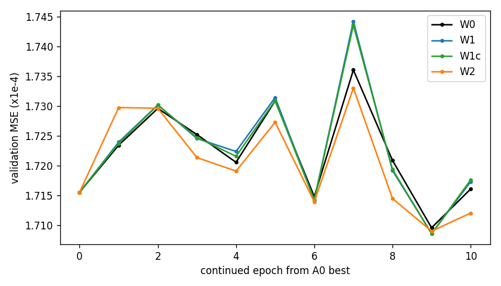

# 32. PAN 조건 특징 변조와 국소 회귀 사전 정보의 빠른 선별

**연구 분야:** 기존 성능 개선

**실험자:** 이병현

**변경 내용:** 원본 SSA-MRN(A0)에 두 가지 변경을 각각 추가하고, A0 best에서 10에폭 이어 학습해 개선 가능성을 선별했습니다. H2는 backbone 64채널 특징을 PAN 특징이 위치별로 조절합니다. H1은 MS 해상도에서 밴드별로 구한 국소 회귀(guided filter) 결과를 backbone 입력과 LMS 기준에 더합니다. SSA 블록·융합 convolution·decoder는 원본과 같습니다.

| 확인된 결과 | 상태 | 개선 여부 |
|---|:---:|:---:|
| A0 이어 학습(W0) 대비 best validation MSE: W1 −0.06%, W1c −0.06%, W2 −0.03%. 사전 기준 3%에 미달해 전체 학습과 test 평가를 하지 않았습니다. | 사전&nbsp;검증&nbsp;완료 | 판단&nbsp;보류 |

[실험 목록](../../../README.md#performance-experiments) · [수치](#results) · [그래프](#graphs) · [이미지](#images) · [재현 자료](#evidence)

## 1. 목적과 상태

SSAI 10번에서 SSAI 자리만 살리는 변경의 이득이 validation 기준 약 1%에 그쳤습니다. 이번에는 PAN 정보를 SSAI 밖에서 더 잘 결합하는 두 방향이 개선 가능성이 있는지, 전체 학습 전에 짧게 확인했습니다.

- H2(특징 단계 PAN 조절): 실제 복원이 일어나는 backbone 특징 단계에서 PAN이 특징을 조절하면 RR이 개선되는지 확인합니다.
- H1(국소 회귀 사전 정보): 저해상도에서 구한 밴드–PAN 관계를 원해상도에 적용하면 FR의 Ds와 RR이 개선되는지 확인합니다. FR 지표의 Ds가 |Q(융합 밴드, PAN) − Q(LMS 밴드, 저역 PAN)|로 정의되므로, 이 관계를 유지하는 사전 정보가 Ds를 줄일 수 있다고 보았습니다.

2026-10-16 01:51에 학습 없는 0단계 진단을 실행하고, 이어서 10에폭 이어 학습을 2개 병렬로 진행했습니다. 02:32에 모든 후보가 끝났습니다. 사전 기준을 통과한 후보가 없어 처음부터의 전체 학습과 RR·FR test 평가는 하지 않았습니다.

## 2. 변경한 구조와 비교 조건

| 후보 | 변경 위치·연산 | 추가 파라미터 |
|---|---|---:|
| W0 | 변경 없음. A0를 같은 조건으로 10에폭 이어 학습한 대조군입니다. | 0 |
| W1 | H2. PAN 인코더(3×3 1→32, ReLU, 3×3 32→64)의 출력과 backbone 특징을 1×1(128→128)로 결합해 scale·shift를 만들고, resblock 2·4 뒤에서 `F·(1+scale)+shift`로 조절합니다. | 51,840 |
| W1c | W1과 같은 구조이되 조절 신호를 PAN 대신 backbone 입력 특징(1×1 64→32, ReLU, 3×3 32→64)에서 만듭니다. PAN 정보의 기여를 분리하는 대조군입니다. | 53,600 |
| W2 | H1. MS 해상도에서 5×5 창 국소 회귀 `MS_b ≈ a·PAN_lr + c`(ε=1e-5)로 a·c를 구해 bicubic으로 올린 `GF_b = A·PAN + C`를 만듭니다. `[GF, GF−LMS]`를 3×3 convolution으로 backbone 첫 특징에 더하고, `res`에 `γ_b·(GF_b − LMS_b)`를 더합니다. | 4,612 |

새로 추가한 마지막 층과 γ는 0으로 초기화했습니다. 네 후보 모두 시작 출력이 A0와 정확히 같았고, 시작 validation MSE가 A0 기록과 일치했습니다.

| 조건 | 실제 설정 |
|---|---|
| 시작점 | 실험4 A0 best(98에폭)의 가중치·Adam 상태·데이터 순서 RNG를 이어받았습니다. 새 파라미터는 별도 Adam 그룹입니다. |
| 데이터 | QB 원본 train 17,139·validation 1,905, 2047 정규화 |
| 학습 | 10에폭, micro·유효 배치 32, FP32, 결정론 모드, Adam lr 1e-4, MSE |
| 선택 | 최소 validation MSE. test로 선택하지 않았습니다. |
| 캐시·실행 | GPU 부분 캐시 85%, 2개 병렬(W0·W1 → W1c·W2) |
| 장치 | Ryzen 5600X, RAM 16GB, RTX 3060 Ti 8GB, PyTorch 2.7.1+cu128 |

사전 기준은 다음과 같습니다.

- 0단계(학습 없음): W2는 국소 회귀 결과를 A0와 섞었을 때 validation 후반부 MSE가 2% 이상 줄거나, Ds 대리 지표가 0.005 이상 좋아질 때만 학습합니다.
- 1단계: W1은 W0보다 3% 이상, W1c보다 1.5% 이상 좋아야 하고 Ds 대리 지표가 0.002 넘게 나빠지지 않아야 합니다. W2는 W0보다 2% 이상 좋거나 Ds 대리 지표가 0.005 이상 좋아야 합니다.

## 3. 정량 결과

**0단계 진단 (validation, 학습 없음)**

| 진단 | 결과 |
|---|---|
| D3 오차 분해 | A0 오차 에너지의 96.6%가 MS 해상도로 표현할 수 없는 고주파 성분이고, 저주파는 1.9%입니다. |
| D4 국소 회귀 상보성 | validation 전반부에서 맞춘 밴드별 혼합(A0·GF)을 후반부에 적용했을 때 MSE 감소는 0.06%입니다. 혼합 계수는 GF 쪽이 0.005 안팎이었습니다. GF 단독 MSE는 A0의 약 4배입니다. |
| D5 Ds 대리 지표 (256패치) | A0 0.0432, GF 0.0802, 혼합 0.0429입니다. |

W2의 0단계 기준은 통과하지 못했습니다. 확인용으로만 W1c와 함께 학습했습니다.

**1단계 이어 학습 (validation 1,905개)**

| 후보 | best 에폭 | best validation MSE | W0 대비 | 마지막 3에폭 평균 W0 대비 | Ds 대리 지표 |
|---|---:|---:|---:|---:|---:|
| W0 | 9 | 0.00017095 | 기준 | 기준 | 0.0447 |
| W1 | 9 | 0.00017086 | −0.06% | −0.03% | 0.0449 |
| W1c | 9 | 0.00017085 | −0.06% | −0.02% | 0.0448 |
| W2 | 9 | 0.00017090 | −0.03% | −0.21% | 0.0453 |

W0 자체의 에폭 간 흔들림은 0.00017095에서 0.00017360으로 약 ±1%였습니다. Ds 대리 지표는 축소 해상도 validation 패치에서 계산한 값이며, 실제 FR test의 해상도 차이는 반영하지 않습니다.

## 4. 기준선 대비 차이와 해석

세 후보 모두 W0와의 차이가 W0의 에폭 간 흔들림보다 작았습니다. W1과 W1c는 에폭마다 거의 같은 값을 보여, PAN을 조절 신호로 쓰는 것의 추가 기여를 확인하지 못했습니다. W2는 0단계 진단대로 A0가 국소 회귀 정보를 이미 활용하고 있어 효과가 없었고, Ds 대리 지표도 개선되지 않았습니다.

이어 학습은 수렴한 A0에서 출발하므로 새 모듈의 효과를 과소평가할 수 있습니다. 다만 처음부터 학습한 SSAI 10번에서도 이득이 약 1%였던 결과와 방향이 같습니다. 남은 오차가 대부분 고주파임에도 PAN 결합 방식을 바꾸는 변경으로는 줄지 않았으므로, 원인은 PAN 정보 부족보다 학습 데이터와 장면 차이나 모델 용량 쪽일 가능성이 높다고 해석합니다.

## 5. 학습·평가 그래프

가로축은 A0 best 이후 이어 학습한 에폭이고, 0은 시작점(A0 best)입니다.

## 6. 결과 이미지

test를 평가하지 않았으므로 예측 이미지는 없습니다.

## 7. 재현 자료

- 가중치: `checkpoints/<W0|W1|W1c|W2>_QB_s42/`의 best(모델)·latest(모델·Adam·데이터 순서 RNG)
- 기록: [0단계 진단](results/diagnostics.json) · [요약](results/summary.json) · 후보별 `results/training/<후보>/history.json`·`complete.json`
- 학습 당시 원본 소스: [training_source.zip](provenance/training_source.zip)
- [파일 크기·SHA-256 manifest](manifest.json)

현재 코드는 저장소 경로에 맞춰 import 경로만 바꿨습니다. 네 후보의 best 가중치를 strict load하고 학습 당시 코드와 같은 입력에서 출력 최대 차이가 0임을 서버에서 확인했습니다. 실행 순서는 `prepare.py`(0단계 진단) → `run.py`(2개 병렬 이어 학습)입니다. 기록된 실행에서는 W2를 `--force-w2`와 같은 방식으로 W1c 시작 1분 뒤에 추가했습니다.

## 8. 개선 여부와 다음 단계

판단 보류입니다. 사전 기준을 통과한 후보가 없어 test를 평가하지 않았으므로 최종 개선 여부를 판정하지 않습니다. 단일 QB seed42, 10에폭 이어 학습, validation 기반 선별이라는 한계가 있습니다.

PAN 결합 방식을 바꾸는 방향(SSAI 1-10번, 이번 W1·W2)에서는 이득이 반복적으로 작게 나왔습니다. 다음 실험은 다른 축(예: 원해상도 입력의 비지도 일관성 손실)을 같은 빠른 선별 방식으로 확인하는 것을 제안합니다.
