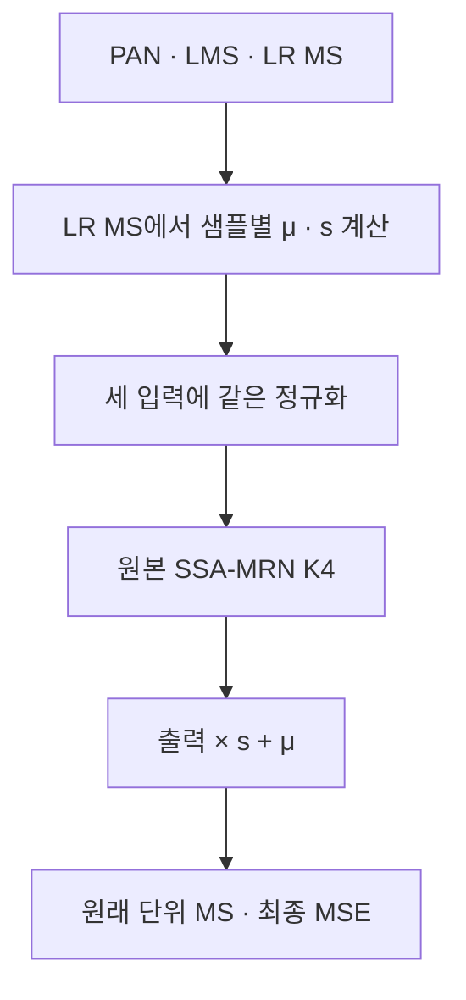
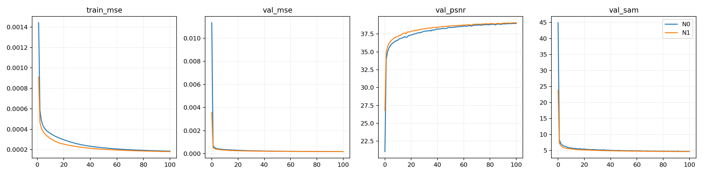
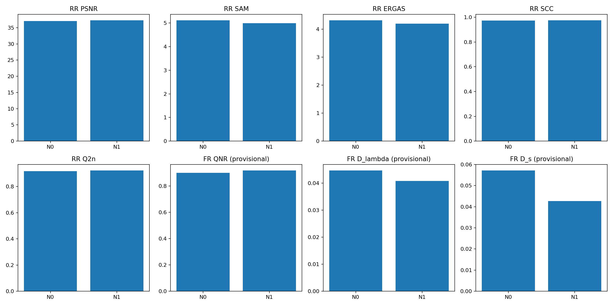
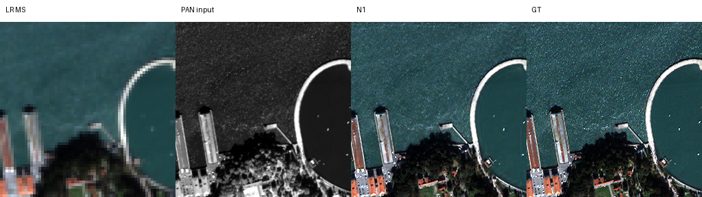
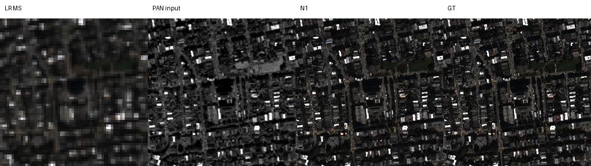
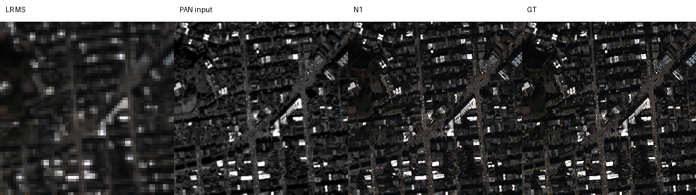
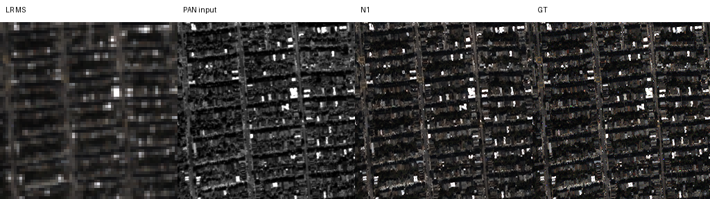
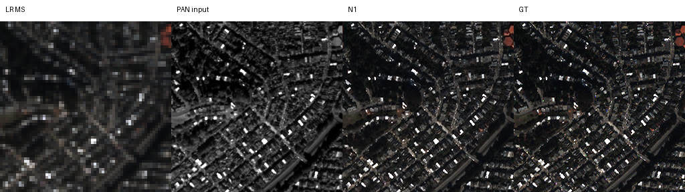

# MS 기준 가역 밝기·대비 정규화

**연구 분야:** 기존 성능 개선

**실험자:** 김경찬

**변경 내용:** 원본 SSA-MRN의 입력 PAN·LMS·MS에 LR MS 기준의 같은 샘플별 스칼라 정규화를 적용하고, 네트워크 출력에서 밝기·대비를 복원했습니다. 구조·MSE·학습 조건은 유지했습니다.

| 확인된 결과 | 상태 | 개선 여부 |
|---|:---:|:---:|
| seed42에서 N0 대비 RR PSNR +0.2111 dB·SAM −0.1242°, 잠정 FR QNR +0.01746입니다. 8개 지표 각각 20/20장 개선했습니다. 반복 검증과 기준 모델 채택은 별도 판단합니다. | 평가&nbsp;완료<br>seed42 | 개선 |

[실험 목록](../../../README.md#performance-experiments) · [수치](#results) · [그래프](#graphs) · [이미지](#images) · [재현 자료](#evidence)

## 1. 목적과 상태

팀의 기존 성능 개선 연구에서 RR 정확도와 FR 일관성을 함께 높일 수 있는 학습 방법을 검토했습니다. 선행 실험의 RR 개선·FR 악화 현상을 참고해, 입력의 밝기·대비 변화에 대한 의존을 줄이면 두 평가가 함께 개선될 수 있다는 가설을 세웠습니다. 분포 차이가 선행 실패의 유일한 원인이라고 확정하지 않습니다.

2026-10-16 01:48:59 KST에 두 군의 RR·FR 각20장 평가가 끝났고 결과 ZIP도 생성했습니다. 업로드된 ZIP의 원본 해시와 내부57개 항목의 크기·해시·CRC를 확인하고 이력·선택 가중치·장면별 평균을 대조했습니다. 본 결과는 QuickBird·seed42의 단일 학습 비교입니다. 전체 모델을 다시 학습하거나 원본 H5로 재평가한 결과는 아닙니다.

## 2. 변경한 구조와 비교 조건

| 군 | 입력·연산·출력 |
|---|---|
| N0 | 기존 RestoredPansharpeningNet K4의 forward(pan,lms,ms)입니다. 초기 LRPAN, backbone BatchNorm, 밴드별 SSAI, 다중 해상도 보간·복원을 유지합니다. |
| N1 | LR MS의 C·H·W 전체에서 샘플별 평균 μ와 모집단 표준편차 s를 계산합니다. s=max(std(MS),0.01)이며 PAN·LMS·MS 모두 (x−μ)/s로 변환합니다. 같은 원본 네트워크의 출력에 s를 곱하고 μ를 더합니다. |

밴드별·배치 전체 정규화를 하지 않습니다. GT는 입력 통계에 사용하지 않으며 같은 변환을 PAN과 모든 MS 밴드에 적용합니다. 입력의 DN/2047 정규화는 유지하고 GT는 원래 DN/2047 공간에서 최종 출력과 MSE로 비교합니다. 통계·입력 변환·출력 역변환·손실은 FP32로 처리합니다.



위 구조도는 N1이며 N0는 정규화·역변환 없이 원본을 호출합니다. 두 군은 각각426,654파라미터이며 정규화의 추가 학습 파라미터는 없습니다. 초기 파라미터는 같지만 초기 출력은 다릅니다.

| 항목 | 실제 비교 조건 |
|---|---|
| 데이터 | QB train17,139·validation1,905 패치, RR20장·FR20장 |
| 특징 차원·공간비 | K4·4배 |
| 초기화·학습 | seed42, 같은 초기 모델에서 각각100에포크 처음부터 학습, 과거best 사용 안 함 |
| optimizer·손실 | Adam lr1e-4 고정, 원래 단위 최종 출력의 원소 평균 MSE |
| 배치 | effective64·micro32, 마지막 불완전 배치도 동일 순서로 사용 |
| 장치 | Tesla T4×2, GPU0 N0·GPU1 N1 독립process, 각worker의 train·validation GPU상주 |
| 정밀도 | 학습 FP16 AMP 초기scale1024, 통계·역변환·손실·validation/test FP32, TF32 비활성 |
| 선택 | epoch0 포함 validation MSE 최소, 정확한 동률은 최초epoch |
| 평가 | 전체 장면, 원래 DN 단위, 입력·예측 clipping 없이 기존 지표 사용 |
| 공정성 | 초기 상태 해시와 실제100에포크 배치 순서 해시 일치, 각26,800회 업데이트·누락0회 |

BatchNorm이 있으므로 유효 배치뿐 아니라 micro batch도 두 군에서 같게 유지했습니다. 기존 G5의 미세조정 결과나 다른 배치·시드·모델 결과는 직접 대조군으로 사용하지 않습니다.

<a id="results"></a>

## 3. 정량 결과

### Validation best

| 군 | best epoch | MSE ↓ | PSNR ↑ | SAM ↓ |
|---|---:|---:|---:|---:|
| N0 | 100 | 0.0001871149 | 38.9823 | 4.7103° |
| N1 | 98 | 0.0001822321 | 39.0774 | 4.6516° |

N1 best MSE는 약2.61% 낮았습니다. 위 PSNR·SAM은 validation 패치 값이며 아래 전체 RR 장면 결과와 구분합니다.

### RR 전체20장 평균

| 지표 | N0 | N1 | N1−N0 | 개선 장면 |
|---|---:|---:|---:|---:|
| PSNR ↑ | 37.060356 | 37.271415 | +0.211059 dB | 20/20 |
| SAM ↓ | 5.116404 | 4.992239 | −0.124165° | 20/20 |
| ERGAS ↓ | 4.315631 | 4.198433 | −0.117199 | 20/20 |
| SCC ↑（잠정） | 0.974128 | 0.975677 | +0.001550 | 20/20 |
| Q2n ↑（잠정） | 0.917946 | 0.923169 | +0.005223 | 20/20 |

### FR 전체20장 평균·잠정 지표

| 지표 | N0 | N1 | N1−N0 | 개선 장면 |
|---|---:|---:|---:|---:|
| QNR ↑ | 0.901266 | 0.918728 | +0.017462 | 20/20 |
| Dλ ↓ | 0.044674 | 0.040777 | −0.003897 | 20/20 |
| Ds ↓ | 0.057166 | 0.042697 | −0.014469 | 20/20 |

RR PSNR은 peak2047의 밴드별 값을 장면 안에서 평균한 뒤20장 평균했습니다. SAM은 도 단위, ERGAS의 공간비는4입니다. FR QNR·Dλ·Ds 및 Q2n·SCC는 공식 MATLAB 정합이 미검증입니다. FR에는 고해상도 GT가 없어 GT 기반 PSNR·SAM을 만들지 않았습니다. 모든 요약 평균을 장면별 원본 숫자에서 다시 계산해 확인했습니다.

### 기록된 추론 비용

| 첫 장면 forward 중앙값 | N0 | N1 |
|---|---:|---:|
| RR | 15.314 ms | 15.408 ms |
| FR | 59.364 ms | 58.822 ms |

각 군의 별도GPU에서 warmup3회 후5회 측정했으며 전송·지표 계산을 제외했습니다. GPU 교차 배정·반복 측정이 없어 속도 개선을 주장하지 않습니다. 로그상 전체 작업은 약55분이며 환경에 따른 시간 차이가 있습니다.

## 4. 기준선 대비 차이와 해석

관측 사실은 N1이 같은 조건의 N0보다 RR5지표·잠정FR3지표에서 모두 개선했다는 점입니다. 사전 RR 유지 기준인 PSNR −0.03dB 이내·SAM +0.02° 이내와 FR 목표인 QNR +0.003 이상·Dλ·Ds 비악화를 통과했습니다. validation MSE 0.5% 이내 악화 허용 기준도 통과했습니다.

밝기·대비 변화에 대한 반응이 더 일관적이었을 가능성이 있습니다. 학습 전 같은 합성입력에 공통gain1.1·offset0.02를 적용한 진단에서 N0의 affine 대응 출력 최대오차는0.04547, N1은약2.38e-7이었습니다. 이는 학습 전 작동 원리 검사이며 실제 학습된 모델에서 성능 개선 원인을 입증한 분석은 아닙니다. 평균 제거·스케일 조절·역변환의 효과를 분리하지 않았습니다.

학습 패치와 전체 장면의 통계 범위가 다르고, s 하한이 활성화되면 엄밀한 affine 대응 성질이 깨집니다. 이 방법은 정합·센서별 비선형 응답·공간 열화 차이를 해결한다고 보장하지 않습니다. N0의best가100에포크이므로 완전 수렴 후에도 이득이 유지된다고 확정하지 않습니다.20장면은 독립 학습20회를 뜻하지 않습니다.

UniPAN의 분포 통일과 RevIN의 통계 제거·복원 개념을 참고했습니다. 이번 공유 affine 변환은 UniPAN의 비선형 변환을 완전히 재현한 구현이 아니며 세계 최초라고 주장하지 않습니다. RevIN의 시계열 성과를 팬샤프닝 성과로 간주하지 않습니다.

<a id="graphs"></a>

## 5. 학습·평가 그래프



N1은 더 낮은 학습·검증 오차로 진행했습니다. 초기값을 포함한 축이므로 후반의 작은 차이는 원본 이력으로 확인합니다.



그래프는 실제best의 전체 장면 평균입니다. 서로 단위가 다른 지표를 단일 점수로 합치지 않습니다.

<a id="images"></a>

## 6. 결과 이미지

학습·test scoring 전에 고정한 RR H5의0기준 장면 인덱스는1·8·11·13·19입니다. 모두 전체 장면이며 패널 순서는 **LR MS · PAN 입력 · N1 예측 · GT**입니다. RGB밴드는[2,1,0]이고 GT의1·99백분위 대비를 LR MS·예측·GT에 공통 적용했습니다. LR MS는 최근접 확대, PAN은 별도grayscale 대비입니다. 예측만 별도로 보정하지 않았으며 FR의 GT는 만들지 않았습니다.







N0는 수치·그래프 대조군으로 유지하며 같은5장면의 원본 패널은[결과 폴더](results/N0)에 보존했습니다.

<a id="evidence"></a>

## 7. 재현 자료

[단일 셀 실행기](run.py) · [학습 없는 검사](prepare.py) · [현행 설정](config.json) · [학습 당시 원본 설정](provenance/config.json) · [실제 실행 셀](provenance/run_cell.py) · [학습 당시 원본 소스](provenance/source) · [가중치](checkpoints) · [데이터 manifest](provenance/data_manifest.json) · [예시 선택](provenance/selection.json) · [보존 manifest](manifest.json)

[N0 장면별 전체 지표](results/N0/metrics.json) · [N1 장면별 전체 지표](results/N1/metrics.json) · [N0 이력](results/N0/history.json) · [N1 이력](results/N1/history.json) · [장면별 차이](results/paired_scene_deltas.json) · [검증 기록](results/verification.json)

실제 초기 가중치2개와 best/latest4개의 원본 바이트를 보존했습니다. latest에는 optimizer·scaler·RNG·배치 생성기·순서·다음 배치 위치·best_model과 실제history가 포함됩니다. 체크포인트 내부 설정과 학습 당시 소스는 수정하지 않았습니다. 원본 보관근거와 현재 파일의 해시는 provenance와manifest에 연결합니다. 현행 실행기는 새 실험의 등록 정보만 적용하며 모델·worker의 내장 소스는 원본과 같습니다. 기존runtime에 새 코드를 덮어써 재개하지 않습니다.

Kaggle 실행 당시 두 군의 유한forward/backward·GPU상주·짧은AMP 중단재개 검사가 통과했습니다. 이는4개 학습샘플의 두 업데이트 경로 검사이며 장시간 세션 강제종료 복구까지 검증한 것은 아닙니다. 보관 환경에서도 실제 초기·best·latest 6개를 strict load하고 유한 CPU 합성 추론을 확인했습니다. latest 안의 best_model과 실제 best.pt의 일치도 확인했습니다. 이번 검사는 원본 H5 전체 재추론이나 장시간 CUDA 재개 검증과 다르며 구체적 수행 범위를 검증 기록에 분리했습니다.

```bash
python SSA-MRN/common/verify.py --research-track performance --experiment 33
python SSA-MRN/experiments/performance/33_ms_anchored_reversible_normalization/prepare.py
```

추가 시드는 같은 33번 아래 후보·센서·시드별로 보관합니다. run.py의 SEED와 RUN_ID만 함께 바꾸고 RESUME_FROM은 비워 처음부터 학습합니다. 코드·학습 조건과 선택 기준을 유지합니다. 실행·재개·Saved Output 보관 절차는 [기존 안내](provenance/source/KAGGLE_GUIDE.md)를 따르되 새 실행의 기본 RUN_ID는 현행 실행기를 사용합니다. Draft 저장과 가중치 보관은 별개이며 실제 Saved Output의 best/latest·manifest와 다운로드를 확인합니다.

참고 문헌: [UniPAN](https://arxiv.org/abs/2510.22217), [RevIN 공식 구현](https://github.com/ts-kim/RevIN).

## 8. 개선 여부와 다음 단계

**개선·단일 시드 확인, 최종 채택 보류**입니다. 같은 조건에서 주요 RR·잠정 FR이 함께 개선해 저장소 분류는 개선으로 기록합니다. 현재 연구 기준 모델을 자동으로 교체하지 않습니다.

설정과 100에포크 학습량을 고정한 seed43·44 반복 비교가 다음 단계입니다. 각 시드에서 N0·N1을 새로 초기화하고 seed42 가중치를 이어 학습하지 않습니다. test를 본 뒤 best 선택·정규화·학습량을 바꾸지 않습니다. 반복 시드·추가 센서·독립 holdout·지표 정합을 확인한 뒤 주장 범위를 넓힙니다. 효과 원인 분리를 위한 후속 변경은 별도 실험으로 기록합니다. 단일 센서·시드와 이미 반복 관찰한 탐색 benchmark라는 한계를 유지합니다.
