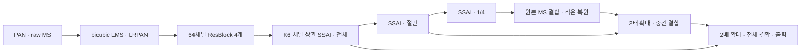
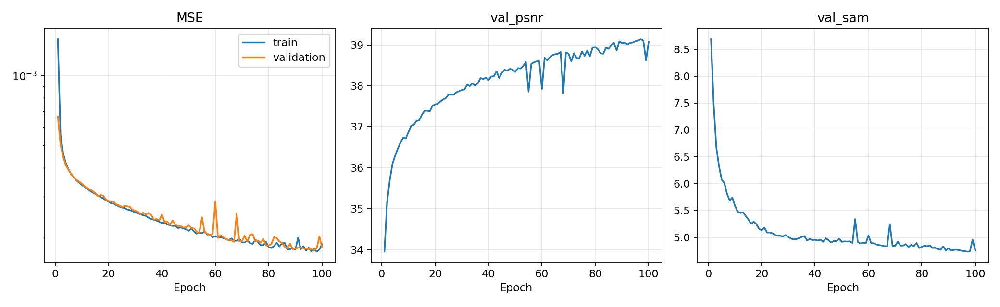
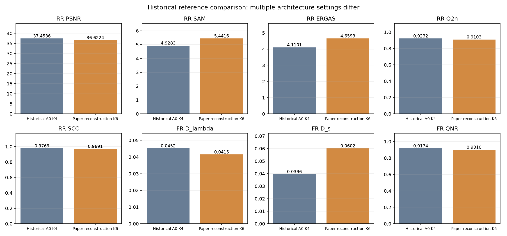
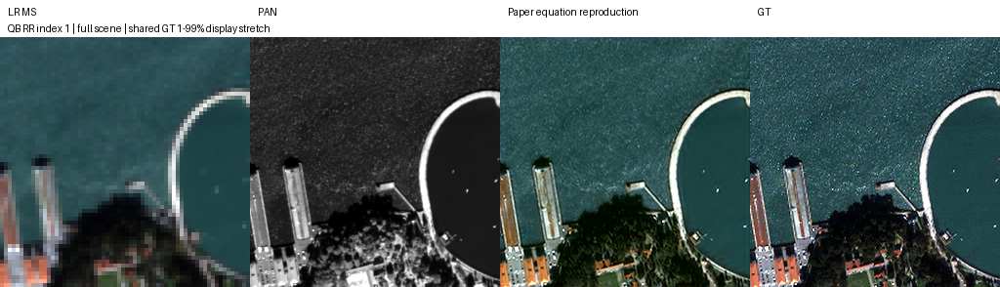
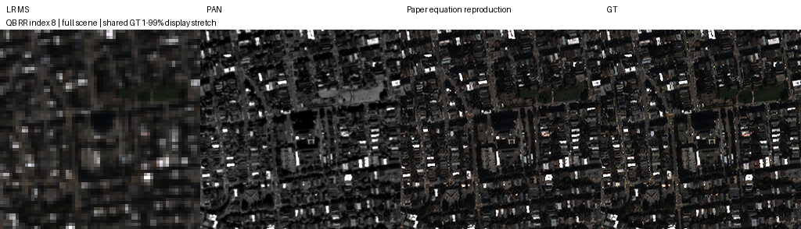
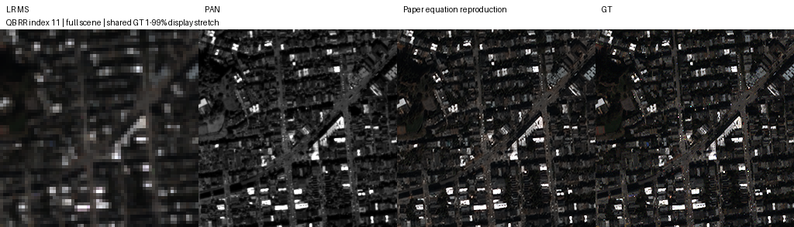
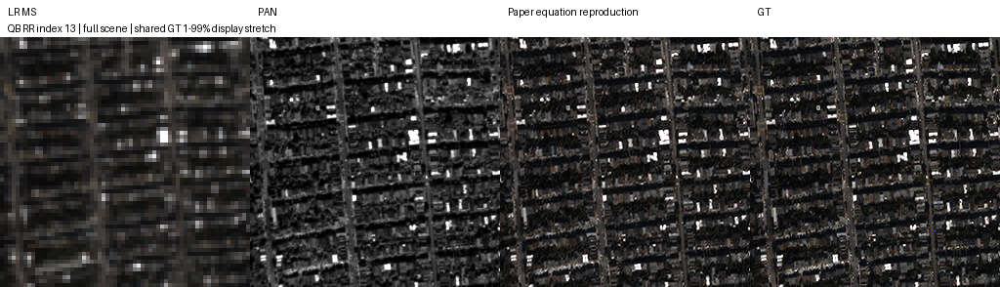
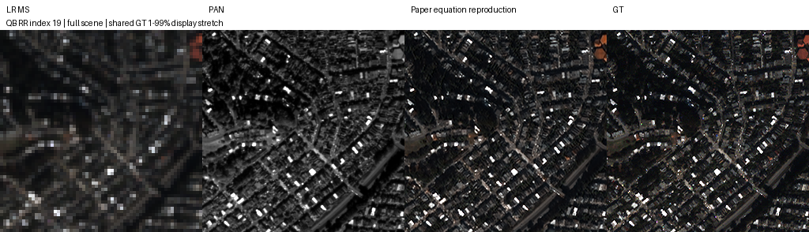

# 논문 채널 상관 어텐션과 다중 해상도 복원 재현

**연구 분야:** 기존 성능 개선

**실험자:** 이병현

**변경 내용:** 논문 본문 식 (1)-(14)과 Fig.2-3을 우선해 K6 채널 상관 어텐션, bicubic 해상도 변환, 세 단계 잔차와 순차 복원을 별도로 구현했습니다.

| 확인된 결과 | 상태 | 개선 여부 |
|---|:---:|:---:|
| QB 100에폭 완료, validation-best 97에폭을 RR20·FR20 전체 평가했습니다. 과거 A0 대비 PSNR −0.8311 dB·SAM +0.5134°·잠정 QNR −0.01639입니다. 여러 조건이 달라 단일 연산 효과를 확정하지 않습니다. | 평가&nbsp;완료 | 개선&nbsp;없음 |

[실험 목록](../../../research/performance/README.md) · [수치](#results) · [그래프](#graphs) · [이미지](#images) · [재현 자료](#evidence)

## 1. 목적과 상태

공개 코드 기반 기존 구현과 논문 본문 수식의 차이를 반영한 별도 재현입니다. QB seed42에서 처음부터 100에폭 학습하고 validation MSE로 선택한 97에폭 best의 RR·FR 각20장 평가를 완료했습니다. 저자의 실제 실행과 완전히 같은 모델·조건이라고 확정하지 않습니다. 원본 SSA-MRN 기준 모델을 유지합니다.

[원 논문](../../../references/paper/xu2025_ssa_mrn_jstars.pdf)의 식 (10)-(12)는 K×K 채널 상관행렬과 PAN 특징의 행렬 곱을 제시하지만, 공개 코드 기반 모델은 공간 원소 곱과 공간 softmax를 사용합니다. 이 차이를 해소하는 해석을 우선했습니다.

## 2. 변경한 구조와 비교 조건

| 부분 | 적용한 연산 |
|---|---|
| 입력 | 원본 MS를 bicubic으로 확대해 LMS를 다시 만듭니다. H5는 수정하지 않습니다. PAN을 4배 축소·확대해 LRPAN을 만듭니다. |
| 특징 추출 | LRPAN에 Conv·ReLU, LMS·PAN·LRPAN 결합, 64채널 ResBlock 4개, C채널 projection을 적용합니다. Fig.2에 없는 외부 LMS 잔차는 추가하지 않습니다. |
| 밴드별 어텐션 | spectral Conv와 PAN Conv–ReLU–Conv를 K×HW로 펼쳐 R=P Qᵀ, W=softmax(R), output=W P를 계산합니다. K6, softmax 마지막 축, 별도 logit scaling은 없습니다. |
| 다중 해상도 | 전체·절반·1/4 해상도 모두 밴드별 출력을 결합한 Conv·PReLU 뒤 입력 특징을 더합니다. 공개 코드의 작은 단계에서 빠진 잔차도 식 (14)에 맞춰 적용했습니다. |
| 복원 | 작은 특징과 MS를 결합한 Conv 뒤 2배 확대·중간 특징 결합·Conv·2배 확대·전체 특징 결합·Conv를 적용합니다. |



| 조건 | 실제 설정 |
|---|---|
| 데이터 | QB train17,139·validation1,905패치, RR20·FR20 전체 장면, DN/2047입니다. |
| 학습 | seed42·처음부터100에폭, Adam 기본 betas·epsilon·weight_decay=0, effective/micro batch32, LR1e-4 고정, 최종 출력 MSE입니다. |
| 정밀도 | 학습·검증·평가 FP32, TF32 off, cuDNN benchmark off입니다. CUDA bicubic backward의 결정성 경고를 허용하므로 비트 재현을 보장하지 않습니다. |
| 선택 | validation MSE 최소, 정확한 동률은 먼저 나온 에폭을 유지했습니다. test로 모델·에폭을 다시 선택하지 않았습니다. |
| 장치 | Ryzen5600X·RTX3060Ti8GB, Windows·PyTorch2.7.1+cu128입니다. |
| 보간 | PyTorch bicubic·align_corners=False·antialias=False입니다. |
| FR 관측 기준 | 후보 내부 LMS와 별개로 원본 H5 LMS를 지표 입력에 고정했습니다. |

논문 Fig.3 범례는 sigmoid, 본문 식 (11)은 softmax여서 식을 우선했습니다. 식 (12)는 원소 곱이라고 설명하지만 행렬 크기와 공식은 행렬 곱이므로 행렬 곱을 적용했습니다. softmax 축·보간 세부 옵션·seed·초기화·일부 채널 수는 논문에 충분히 명시되지 않았습니다. 64채널·convolution bias와 ResBlock 세부 구조는 공개 코드 및 기본 설정을 참고한 해석입니다. [대응과 미명시 사항](provenance/paper_mapping.json)을 보존했습니다.

<a id="results"></a>

## 3. 정량 결과

### 학습과 가중치 선택

100에폭의 epoch 기록을 확인했습니다. best는97에폭이며 validation MSE0.000177051657, validation PSNR39.1387dB, SAM4.7374°입니다. latest100에폭 MSE는0.000181256066입니다. epoch별 train·validation 처리 시간 합계는4,285.50초(약71.43분)이며 준비·전체 장면 평가 시간은 포함하지 않습니다.

### 과거 원본 A0와 전체 장면 비교

아래 A0는 SSAI4의 QB seed42·K4·FP32·batch32·100에폭 결과입니다. 같은 RR·FR H5 SHA-256을 확인했고 저장된 장면별 지표를 재사용했습니다. 이번에 A0를 재학습·재평가하지 않았습니다. K·보간·초기화·여러 연산이 달라 통제된 attention 단독 비교가 아닙니다.

| 지표 | 과거 A0 | 이번 본문 수식 재현 | 차이 | 개선 장면 |
|---|---:|---:|---:|---:|
| RR SAM ↓ | 4.928274 | 5.441646 | +0.513371 | 0/20 |
| RR ERGAS ↓ | 4.110100 | 4.659264 | +0.549164 | 1/20 |
| RR PSNR ↑ | 37.453589 | 36.622446 | -0.831143 | 0/20 |
| RR SCC ↑ | 0.976948 | 0.969107 | -0.007841 | 1/20 |
| RR Q2n ↑ | 0.923239 | 0.910324 | -0.012915 | 2/20 |
| FR D_lambda ↓ | 0.045167 | 0.041497 | -0.003669 | 14/20 |
| FR D_s ↓ | 0.039614 | 0.060164 | +0.020550 | 1/20 |
| FR QNR ↑ | 0.917411 | 0.901024 | -0.016387 | 1/20 |

RR의 PSNR은 peak2047 밴드별 PSNR을 장면 안에서 평균한 뒤20장 평균했습니다. validation PSNR과 집계가 다릅니다. FR에는 GT가 없으며 QNR·Dλ·Ds 및 Q2n·SCC MATLAB parity는 미검증인 잠정 지표입니다. 예측 clipping 없이 평가하며, Q2n 내부 uint16 모사 처리는 원래 지표 구현을 유지합니다.

논문 Table V의 Ours는 PSNR37.6645dB·SAM4.8478°·ERGAS4.0726·QNR0.9311입니다. 이번 수치를 논문 점수 재현으로 볼 수 없습니다. 보간·softmax 축·세부 채널·학습 분할·정밀도·가중치 선택·지표 구현의 저자 실행 정합을 모두 확인한 비교가 아닙니다.

## 4. 기준선 대비 차이와 해석

과거 A0 대비 RR 주요 지표와 잠정 FR QNR·Ds가 악화했고 Dλ만 좋아졌습니다. RR·FR 동반 개선을 확인하지 못했습니다. 이는 이번 설정의 결과이며, 논문이 의도한 SSAI의 효과 전체를 부정하거나 K6 채널 상관 연산만의 실패로 해석하지 않습니다.

초기 출력 일치를 강제한 대조군이나 같은 K6·bicubic의 convolution 대조군은 학습하지 않았습니다. 기존 A0 가중치를 변경된 구조에 이식하지 않고 처음부터 학습했습니다. 작은 validation 차이로 전체 장면 이득을 확정하지 않습니다.

<a id="graphs"></a>

## 5. 학습·평가 그래프





비교 그래프의 두 군은 여러 구조·설정이 다릅니다. PSNR·SCC·Q2n·QNR은 높을수록, SAM·ERGAS·Dλ·Ds는 낮을수록 좋습니다.

<a id="images"></a>

## 6. 결과 이미지

학습·평가 전에 고정한 RR 0기준 장면1·8·11·13·19입니다. 왼쪽부터 LR MS·PAN·예측·GT이며 MS RGB는[2,1,0]입니다. LR MS는 nearest 표시 확대, MS·예측·GT는 같은 GT1–99백분위 대비, PAN은 별도 대비를 사용합니다. 표시 대비는 평가에 사용하지 않으며 FR GT는 만들지 않았습니다.







<a id="evidence"></a>

## 7. 재현 자료

[현행 모델](model.py) · [실행](run.py) · [학습 없는 검사](prepare.py) · [학습](train.py) · [보존 best 재평가](evaluate.py) · [현행 설정](config.json)

[실제 학습 소스·설정](provenance/training_source) · [계획·환경·데이터 해시](provenance/plan.json) · [실제 지표·미리보기 코드](provenance/evaluation_source) · [논문 대응](provenance/paper_mapping.json) · [best/latest](checkpoints/PAPER_QB_s42) · [100에폭 기록](results/history.json) · [best 선택](results/selection.json) · [RR20](results/RR.json) · [FR20](results/FR.json) · [비교 수치](results/comparison.json) · [검증](results/checkpoint_verification.json) · [manifest](manifest.json)

원본 export ZIP의 CRC·크기·SHA-256, 학습 소스·설정6개 해시, best/latest strict load·CPU 유한 출력, best 선택과20장 평균을 확인했습니다. 과거 A0는 [참조 기록](provenance/reference_A0)에 결과만 보존했으며 원본 가중치를 중복하지 않았습니다.

학습 당시 내부 번호와 runtime 경로는33이었으며 원본 checkpoint config와 source snapshot은 변경하지 않았습니다. 저장소 등록은 기존33번을 보존해34번으로 했습니다. 현행 evaluate는 명령행 재평가와 보관 이력 경로를 지원하도록 보완했으며 학습 당시 원본은 별도 보존했습니다.

```bash
python SSA-MRN/common/verify.py --research-track performance --experiment 34
python SSA-MRN/experiments/performance/34_paper_equation_reproduction/evaluate.py --data <원본_데이터> --runtime SSA-MRN/experiments/performance/34_paper_equation_reproduction
```

재평가 시 원본 숫자를 보존하려면 보관 폴더 복제본을 runtime으로 사용합니다. 새 학습은 별도 runtime에서만 시작합니다.

## 8. 개선 여부와 다음 단계

개선 없음입니다. 이번 조건에서 RR·FR 주요 지표의 동반 개선을 확인하지 못했고 원본 기준을 유지합니다. 단일 QB seed42, 미명시 구현 선택, 여러 조건의 동시 변경, 잠정 지표라는 한계를 유지합니다. 반복 시드·다른 센서·동일 K6 대조군은 미실시입니다. 기존 탐색 test를 다시 사용했으므로 독립 최종 holdout 결과가 아닙니다.
