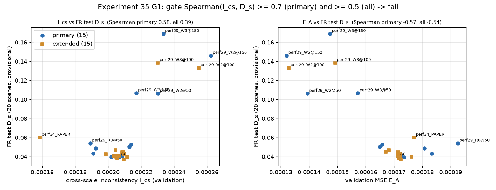

# 35. 교차 축척 일관성 학습

**연구 분야:** 기존 성능 개선

**실험자:** 이병현

**변경 내용:** 용량을 늘린 SSA-MRN을 축소 해상도(축척 A)와 한 번 더 열화한 축척 B에서 함께 학습하고, "열화 후 복원"과 "복원 후 열화"가 같도록 하는 교차 축척 일관성 손실을 더하는 계획이었습니다. 학습 전에 이 일관성이 FR test의 Ds를 예측하는지 기존 30개 모델로 확인했고(0단계), 사전 기준에 미달해 학습하지 않았습니다.

| 확인된 결과 | 상태 | 개선 여부 |
|---|:---:|:---:|
| 교차 축척 불일치 I_cs와 FR test Ds의 Spearman이 기본 15개 0.58, 전체 30개 0.39로 기준(0.7·0.5)에 미달해 학습하지 않았습니다. 8방향 self-ensemble은 A0 RR PSNR −0.93 dB로 유용하지 않았습니다. 지표 구현은 toolbox와 구조가 같았습니다. | 사전&nbsp;검증&nbsp;완료 | 성능&nbsp;비교&nbsp;아님 |

[실험 목록](../../../research/performance/README.md) · [수치](#results) · [그래프](#graphs) · [이미지](#images) · [재현 자료](#evidence)

## 1. 목적과 상태

용량을 늘린 모델은 RR을 크게 높였지만 FR Ds가 급격히 나빠졌습니다. [성능 29번](../29_capacity_refinement/README.md) W2는 R0 대비 RR PSNR +0.72 dB였지만 Ds가 0.039에서 0.146으로 커졌습니다. 같은 모델의 QNR은 50·100·150에폭에 0.862·0.845·0.832로 학습할수록 낮아졌습니다. 축소 해상도에서 계산한 validation FR 대리 지표는 이 악화를 보지 못했습니다([SSAI 11](../../ssai/11_ssai_contribution_headroom/README.md) D7, 순위 상관 −0.18).

가설은 다음과 같습니다. 고용량 모델이 학습 축척의 PAN 세부정보에 맞춘 고주파를 만들어서, 원 해상도에서는 PAN과 어긋난 공간 구조를 출력합니다. 모델이 축척 변화에 일관되게 동작하도록 학습하면 RR 이득을 유지하면서 Ds 악화를 줄일 수 있다고 봅니다.

2026-10-16 10:49-10:52에 서버에서 0단계를 실행했습니다. 옵티마이저 업데이트와 새 가중치 저장은 없습니다. 관문 G1이 실패해 1단계 학습은 진행하지 않았습니다. 이후 FR 지표 구현을 toolbox 원본과 대조했습니다(4절).

## 2. 변경한 구조와 비교 조건

### 축척 B와 교차 축척 불일치

| 항목 | 정의 |
|---|---|
| 축척 A | 원본 H5 패치: PAN 64×64, LMS 64×64, MS 16×16, GT 64×64 |
| 2배 열화 D | DLPan genMTF 공식(공용 관측 연산자와 같은 식)을 2배로 적용, 41탭, 복제 경계, 위상 1 추출 |
| MTF 계수(QB) | MS 0.34·0.32·0.30·0.22, PAN 0.15 |
| 축척 B | PAN_B = D_PAN(PAN) 32×32, MS_B = D_MS(MS) 8×8, LMS_B = 23탭 보간(MS_B) 32×32, GT_B = D_MS(GT) 32×32 |
| 불일치 I_cs | validation 패치마다 `MSE(D_MS(f(x_A)), f(x_B))`를 축척 B 내부(가장자리 4화소 제외)에서 평균 |

모델이 `f(D·x) = D·f(x)`를 만족할수록 I_cs가 작습니다. FR 입력에서도 같은 성질이 유지되면 FR 출력의 구조가 학습이 잘 된 축척의 예측에 묶일 것으로 예상합니다.

### 0단계 관문 검사

| 검사 | 내용 | 사전 기준 |
|---|---|---|
| G1 | 이미 FR test 결과가 있는 모델들의 validation I_cs와 FR test Ds의 순위 상관 | 기본 15개 모델 Spearman 0.7 이상, 전체 30개 0.5 이상이면 통과 |
| G2 | 8방향 기하 self-ensemble(90° 회전 4 × 좌우 반전 2) 추론의 RR20·FR20 변화 | A0 PSNR +0.05 dB 이상이고 잠정 QNR이 나빠지지 않으면 유용으로 기록 |

- 기본 집합은 SSAI 11 D7과 같은 15개 모델입니다: A0, SSAI 8 N1·N2, SSAI 9 A1·A2, 성능 29 R0·W2·W3·F01·F11의 50·150에폭.
- 확장 집합 15개: 성능 29의 100에폭 5개, SSAI 4 A1-A3, SSAI 5 M25·M50, SSAI 6·7, SSAI 12 B2·B3, 성능 34.
- 보조로 E_A, E_B, E_B/E_A, I_cs/E_A의 상관도 함께 기록합니다.
- G1 판정은 I_cs만으로 합니다. FR 값은 보관된 평가 기록을 그대로 쓰고, 학습과 옵티마이저 업데이트는 없습니다.
- **G1을 통과하지 못하면** 일관성 손실 학습을 하지 않습니다. 대신 출력을 "LMS + 저해상도 이득 지도 × PAN 고주파"로 제한하는 대안을 검토합니다.

### 1단계 계획(관문 통과 시, 별도 승인)

| 군 | 구조 | 손실 |
|---|---|---|
| A0 | 원본 | MSE, 기존 결과 재사용 |
| W | 성능 29 W2 용량 확장 | MSE |
| W+S | 성능 29 W2 용량 확장 | MSE + λ_B·축척 B MSE + λ_c·교차 축척 일관성 |
| (선택) A0+S | 원본 | W+S와 같음 |

조건은 QB seed42, FP32, 배치 32, Adam 1e-4 고정, 100에폭입니다. λ는 초기 기울기 비율로 미리 고정합니다.

| 판정 | 기준 |
|---|---|
| 메커니즘(W+S 대 W) | Ds −0.03 이하, PSNR 손실 0.15 dB 이하 |
| 개선(W+S 대 A0) | PSNR +0.3 dB 이상, SAM −0.1° 이하, QNR +0.005 이상, Ds 악화 +0.003 이내 |

<a id="results"></a>

## 3. 정량 결과

### G1: 교차 축척 불일치와 FR test Ds

| 상관 (Spearman) | 기본 15개 | 전체 30개 |
|---|---:|---:|
| I_cs ↔ Ds | **0.58** | **0.39** |
| I_cs ↔ QNR | −0.64 | −0.39 |
| E_B/E_A ↔ Ds | 0.59 | 0.43 |
| validation MSE E_A ↔ Ds | −0.57 | −0.54 |
| 참고: SSAI 11 D7 축소 해상도 FR 대리 지표 ↔ Ds | −0.18 | |

사전 기준(기본 0.7 이상, 전체 0.5 이상)에 미달해 **G1은 실패**입니다. I_cs의 Pearson 상관은 기본 0.82, 전체 0.72로 높았습니다. 이는 Ds가 큰 성능 29 W2·W3에 끌린 값이며, 나머지 모델 사이의 순위는 잘 맞지 않았습니다. 성능 34(I_cs 1.59e-4, Ds 0.060)와 성능 29 R0 50에폭(I_cs 1.89e-4, Ds 0.054)은 I_cs가 작은데도 Ds가 컸습니다.

| 모델 | I_cs | E_A | FR test Ds |
|---|---:|---:|---:|
| A0 | 2.068e-4 | 1.716e-4 | 0.0396 |
| 성능 29 R0 150에폭 | 2.050e-4 | 1.736e-4 | 0.0392 |
| 성능 29 W2 150에폭 | 2.624e-4 | 1.320e-4 | 0.1461 |
| 성능 29 W3 150에폭 | 2.335e-4 | 1.474e-4 | 0.1691 |
| 성능 34 | 1.586e-4 | 1.771e-4 | 0.0602 |

30개 모델의 전체 수치는 [G1.json](results/G1.json)에 있습니다. 원본 H5의 LMS와 MS를 23탭 보간한 결과의 최대 차이는 0.207(0-1 정규화 단위)이었습니다. 따라서 축척 B의 LMS 생성 방식은 원본 데이터와 다를 수 있습니다.

### G2: 8방향 기하 self-ensemble

| 모델 | 단일 추론 RR PSNR | 앙상블 차이 PSNR | SAM | FR Ds | FR QNR |
|---|---:|---:|---:|---:|---:|
| A0 | 37.4536 | −0.9254 | +0.1027 | +0.0112 | −0.0082 |
| 성능 29 R0 150에폭 | 37.3885 | −0.9135 | +0.1014 | +0.0177 | −0.0123 |
| 성능 29 W2 150에폭 | 38.1116 | −0.5551 | +0.0481 | −0.0781 | +0.0736 |

단일 추론 값은 세 모델 모두 보관된 기존 평가와 같았습니다. 앙상블은 RR을 크게 낮춰 사전 기준(A0 PSNR +0.05 dB 이상)에 미달했습니다. 데이터의 MS 축소 위상이 회전에 대칭이 아니어서, 회전한 입력에서 PAN과 MS의 위치가 어긋났을 가능성이 있습니다. 확인하지 않은 추정입니다. W2의 FR 개선도 같은 원인으로 출력이 흐려진 결과일 수 있어 개선으로 해석하지 않습니다.

### FR 지표 구현과 toolbox 원본 대조

DLPan-Toolbox(a34f884, GPL-3.0)의 지표 원본 20개를 실행하지 않고 읽어 `common/metrics.py`와 대조했습니다. 원본 파일은 저장소에 복사하지 않았습니다.

| 항목 | 결과 |
|---|---|
| QNR·Dλ·Ds | toolbox 기본값("Toolbox 1.0")과 구조가 같습니다. 고해상도 32블록 UQI, LMS 기준 Dλ, `interp23tap(imresize(PAN,1/4))` 기준 Ds입니다 |
| interp23tap·SAM·ERGAS·SCC | 같습니다 |
| Q2n 사원수 곱 | 4·8밴드에서 곱셈이 다르지만, RR test 20장에서 Q2n 차이는 최대 0.00005입니다 |
| Ds의 PAN 1/4 축소 | scikit-image 대 MATLAB `imresize`. FR test 20장·4밴드에서 기준값 Q_low 차이는 평균 절댓값 0.008, 최대 0.020입니다 |
| 출력 제한·보고 지표 | toolbox는 옵션에 따라 [0, 2048]로 자르고 HQNR도 제공합니다. 호출 스크립트와 논문의 선택은 확인하지 않았습니다 |

MATLAB `imresize`는 문서화된 알고리즘을 Python으로 옮겨 계산했습니다. MATLAB과 비트 단위로 같은지는 확인하지 않았습니다. 상세 수치는 [metric_parity.json](results/metric_parity.json)에 있습니다.

## 4. 기준선 대비 차이와 해석

- **I_cs는 FR Ds를 일부만 설명합니다.** D7(−0.18)보다 낫지만, 학습 중 FR 악화를 거르는 지표로 쓸 수준은 아닙니다. 이 결과만으로는 교차 축척 일관성 손실이 Ds를 줄인다는 근거가 부족해 학습하지 않았습니다.
- **validation 오차가 작은 모델일수록 Ds가 큰 경향(−0.57)이 30개 모델에서 반복됐습니다.** Ds의 기준값은 흐린 LMS와 흐린 PAN의 유사도이므로, 이 경향은 지표 정의의 성질일 수 있습니다. 확인하지 않은 가설입니다.
- **성능 29 W2의 Ds 악화는 지표 구현 차이로 설명되지 않습니다.** Q_low는 입력에만 의존해 모든 모델에 같은 양으로 작용합니다. 구현 차이로 인한 Ds 변화는 많아야 약 0.02인데, W2의 Ds 격차는 약 0.1입니다. 다만 0.01 이하의 작은 Ds 차이는 조심해서 해석해야 합니다.
- 이 판단은 QB 단일 센서, 보관된 단일 시드 모델, 탐색에 반복 사용한 test에 한정됩니다.

<a id="graphs"></a>

## 5. 학습·평가 그래프



파란 원은 기본 15개, 주황 사각형은 확장 15개 모델입니다. Ds가 0.1을 넘는 점은 모두 성능 29 W2·W3입니다.

<a id="images"></a>

## 6. 결과 이미지

0단계는 새 모델을 학습하지 않았고, G2 앙상블 예측은 저장하지 않았습니다. 따라서 결과 이미지가 없습니다.

<a id="evidence"></a>

## 7. 재현 자료

[관문 검사](prepare.py) · [설정과 사전 기준](config.json) · [실행 당시 설정](provenance/config.json) · [G1](results/G1.json) · [G2](results/G2.json) · [지표 대조](results/metric_parity.json) · [manifest](manifest.json)

```bash
python SSA-MRN/experiments/performance/35_cross_scale_consistency/prepare.py --data <QB_H5_폴더> --output <새_출력_폴더>
```

## 8. 개선 여부와 다음 단계

**성능 비교 아님**입니다. 학습 없는 관문 검사이며, 사전 기준에 따라 교차 축척 일관성 학습은 진행하지 않았습니다. 기준 모델은 원본 A0로 유지합니다.

후속 대안인 출력 구조 제한은 [성능 36번](../36_gain_map_detail_injection/README.md)에서 관문 검사했습니다. 지표 쪽에서는 `common/metrics.py`의 Q2n 곱셈과 PAN 축소를 toolbox에 맞추는 보정이 가능하지만, 측정된 영향이 작아 이번에는 바꾸지 않았습니다.
