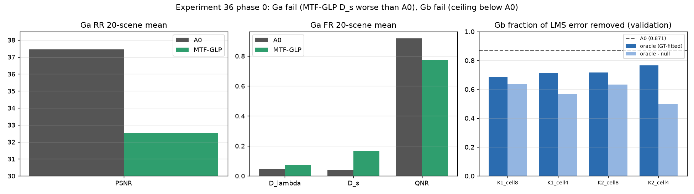

# 36. 저해상도 이득 지도 기반 세부정보 주입 제한

**연구 분야:** 기존 성능 개선

**실험자:** 이병현

**변경 내용:** 출력을 `LMS + 저해상도 이득 지도 × 고정 PAN 세부 대역`(필요하면 해상도를 제한한 잔차 추가)으로 제한해, 네트워크가 축소 축척에 맞춘 미세 고주파를 직접 만들지 못하게 하는 계획이었습니다. 학습 전에 전제와 이론 상한을 확인했고(0단계), 두 관문이 모두 실패해 학습하지 않았습니다.

| 확인된 결과 | 상태 | 개선 여부 |
|---|:---:|:---:|
| 고전 MTF-GLP는 A0 대비 FR Ds +0.1275, QNR −0.1438, RR PSNR −4.92 dB였습니다(Ga 실패). 제한 구조의 정답 기반 상한은 우연 대조군을 빼면 LMS 오차의 50-64%로 A0의 87.1%에 못 미쳤습니다(Gb 실패). | 사전&nbsp;검증&nbsp;완료 | 성능&nbsp;비교&nbsp;아님 |

[실험 목록](../../../research/performance/README.md) · [수치](#results) · [그래프](#graphs) · [이미지](#images) · [재현 자료](#evidence)

## 1. 목적과 상태

[성능 35번](../35_cross_scale_consistency/README.md)의 교차 축척 관문이 실패한 뒤 세운 대안입니다. [성능 29번](../29_capacity_refinement/README.md) W2처럼 용량을 늘린 모델은 RR을 높였지만 FR Ds가 크게 나빠졌습니다. 고전 MRA 기법처럼 출력의 미세 고주파를 "실제 PAN 세부 × 부드러운 이득"으로만 만들게 하면, FR에서도 같은 이득이 원 해상도 PAN 세부를 옮겨 Ds가 줄어들 것이라는 가설입니다.

학습 전에 두 가지를 확인했습니다. 하나는 이런 제한 구조의 대표인 고전 MTF-GLP가 실제로 A0보다 Ds가 좋은지(Ga), 다른 하나는 제한 구조가 이론적으로 A0 수준의 RR에 도달할 수 있는지(Gb)입니다. 2026-10-16 11:21-11:23에 서버에서 실행했고, 옵티마이저 업데이트와 가중치 저장은 없습니다.

## 2. 변경한 구조와 비교 조건

### 계획한 출력 구조

`ŷ_b = LMS_b + Σ_k ↑(G_{b,k}) ⊙ D_k(PAN) + R_b`

| 항목 | 정의 |
|---|---|
| D₁, D₂ | PAN − LP₂(PAN), LP₂(PAN) − LP₄(PAN). LP_r은 QB PAN MTF(0.15) 필터, MATLAB nearest 위상 추출, 23탭 보간 |
| G | 네트워크가 MS 격자(1/4 해상도)에서 예측하는 밴드·대역별 이득. bilinear로 확대 |
| R | 해상도를 제한한 자유 잔차(P3 후보만) |

### 0단계 관문

| 검사 | 내용 | 사전 기준 |
|---|---|---|
| Ga | 고전 MTF-GLP를 RR20·FR20에서 기존 A0(SSAI 4번 평가)와 같은 지표로 비교 | MTF-GLP의 FR Ds가 A0보다 0.005 이상 낮으면 통과 |
| Gb | validation 1,905개 패치에서 LMS 오차(GT − LMS)를 칸별 이득 × D 기저로 정답 기반 최소제곱했을 때 줄어드는 비율. 이웃 패치 PAN을 쓴 우연 대조군을 뺌 | K2·4×4 칸의 (상한 − 우연)이 A0의 87.1% 이상이면 통과 |

MTF-GLP는 DLPan-Toolbox(a34f884, GPL-3.0)의 `MTF_GLP.m`, `LPfilterGauss.m`, `genMTF.m`, `interp23tap.m`을 실행하지 않고 읽어 Python으로 구현했습니다. 원본은 저장소에 복사하지 않았습니다.

| MTF-GLP 단계 | 구현 |
|---|---|
| 히스토그램 정합 | PAN을 각 LMS 밴드의 평균·표준편차에 맞춤. 표준편차 비의 분모는 LPfilterGauss(GNyq 0.3, α에 N 사용)로 거른 PAN |
| 저역 PAN | 밴드별 QB MS MTF로 거른 뒤 4배 nearest 추출(위상 2), 23탭 보간 |
| 출력 | LMS + 정합 PAN − 저역 PAN, 출력 제한 없음 |

A0 기준값은 [SSAI 4번](../../ssai/4_aligned_sigmoid_gating/README.md)의 보관된 장면별 평가입니다(데이터 해시 일치 확인). A0의 validation 오차 비율 87.1%는 같은 1,905개 패치에서 [성능 35번](../35_cross_scale_consistency/README.md)이 측정한 A0 MSE(1.7155e-4)와 LMS MSE(1.328e-3)로 계산했습니다.

<a id="results"></a>

## 3. 정량 결과

### Ga: 고전 MTF-GLP 대 A0 (20장 평균)

| 지표 | A0 | MTF-GLP | 차이 | MTF-GLP가 나은 장면 |
|---|---:|---:|---:|---:|
| RR PSNR ↑ | 37.4536 | 32.5342 | −4.9194 | 0/20 |
| RR SAM ↓ | 4.9283 | 7.9137 | +2.9854 | 0/20 |
| RR ERGAS ↓ | 4.1101 | 7.4131 | +3.3030 | 0/20 |
| RR Q2n ↑ (잠정) | 0.9232 | 0.8372 | −0.0861 | 0/20 |
| FR Dλ ↓ | 0.0452 | 0.0716 | +0.0264 | 1/20 |
| FR Ds ↓ | 0.0396 | 0.1671 | **+0.1275** | 0/20 |
| FR QNR ↑ (잠정) | 0.9174 | 0.7736 | −0.1438 | 0/20 |

MTF-GLP의 Ds가 A0보다 크게 나빠 **Ga는 실패**입니다.

### Gb: 제한 구조의 정답 기반 상한 (validation)

| 기저·칸 | 상한 | 우연 대조군 | 상한 − 우연 |
|---|---:|---:|---:|
| K1(D₁+D₂)·8×8 | 0.684 | 0.046 | 0.638 |
| K1·4×4 | 0.715 | 0.146 | 0.569 |
| K2(D₁, D₂)·8×8 | 0.716 | 0.084 | 0.633 |
| K2·4×4 | 0.766 | 0.266 | **0.500** |
| 참고: A0 | | | 0.871 |

정답으로 이득을 맞추는 이상적인 경우에도 A0가 줄인 LMS 오차 비율에 미치지 못해 **Gb도 실패**입니다.

## 4. 기준선 대비 차이와 해석

- **전제가 성립하지 않았습니다.** 이번 지표(toolbox QNR 기본 정의)에서 고전 MRA 방식의 Ds는 A0보다 훨씬 나빴습니다. "출력을 MRA 형태로 제한하면 Ds가 좋아진다"는 가설은 근거를 잃었습니다.
- **RR 상한도 낮습니다.** PAN 세부 대역에 칸별 이득을 곱하는 형태로는 A0의 RR에 도달할 수 없습니다. 4×4 칸에서는 우연히 맞는 부분이 크게 늘어(0.266) 실제 설명량이 오히려 줄었습니다.
- 두 결과를 합치면, 제한을 약하게 둘수록 A0와 같아지고 강하게 둘수록 RR·FR 모두 나빠지는 구조입니다. 그래서 1단계 학습(P1·P1-W·P3-W)은 진행하지 않았습니다.
- 이 판단은 이번에 고른 기저(PAN MTF 저역 두 대역)와 칸 크기, 고전 MTF-GLP 한 가지에 한정됩니다. 다른 MRA·CS 기법이나 학습형 기저는 확인하지 않았습니다.

<a id="graphs"></a>

## 5. 학습·평가 그래프



왼쪽 두 그래프는 A0와 MTF-GLP의 RR PSNR, FR Dλ·Ds·QNR이고, 오른쪽은 Gb의 상한(진한 막대)과 우연 대조군을 뺀 값(연한 막대), A0 기준선(점선)입니다. 학습하지 않았으므로 학습 곡선은 없습니다.

<a id="images"></a>

## 6. 결과 이미지

새 모델을 학습하지 않았고 MTF-GLP 예측 이미지는 저장하지 않았습니다. 장면별 지표는 [Ga.json](results/Ga.json)에 있습니다.

<a id="evidence"></a>

## 7. 재현 자료

[관문 검사](prepare.py) · [설정과 사전 기준](config.json) · [실행 당시 설정](provenance/config.json) · [Ga](results/Ga.json) · [Gb](results/Gb.json) · [실행 로그](results/phase0.log) · [manifest](manifest.json)

```bash
python SSA-MRN/experiments/performance/36_gain_map_detail_injection/prepare.py --data <QB_H5_폴더> --output <새_출력_폴더>
```

## 8. 개선 여부와 다음 단계

**성능 비교 아님**입니다. 학습 없는 관문 검사이며, 두 관문 모두 실패해 출력 구조 제한 학습은 진행하지 않았습니다. 기준 모델은 원본 A0로 유지합니다.

FR Ds를 겨냥한 두 설계(35·36)가 모두 학습 전에 기각됐습니다. 이번 지표 정의에서는 학습 모델(A0)이 고전 기법보다 Ds가 이미 훨씬 좋습니다. 다음 실험은 구조 제한보다 학습 조건(LR 감쇠·학습량 등)처럼 선행 실험에서 RR·FR이 함께 움직인 방향을 검토할 예정입니다.
