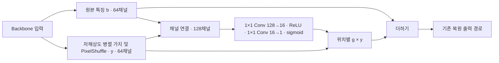
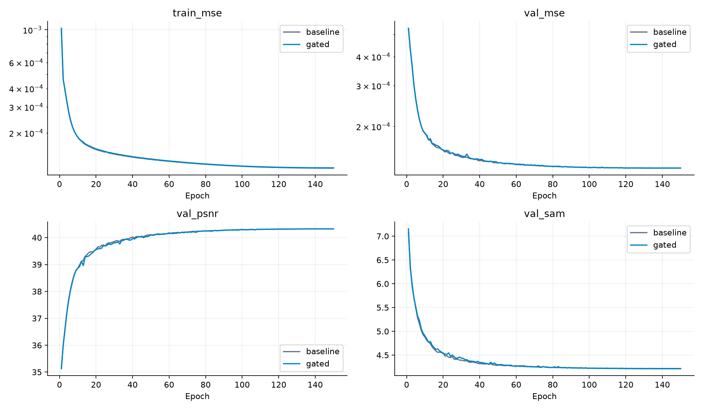
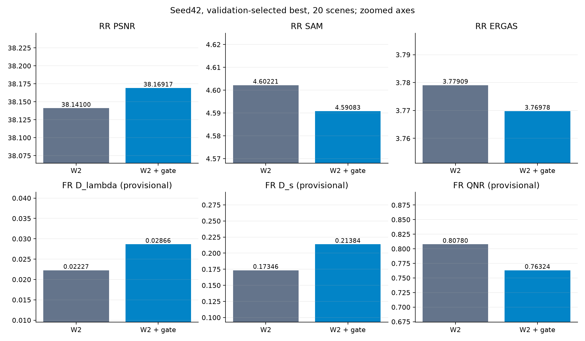
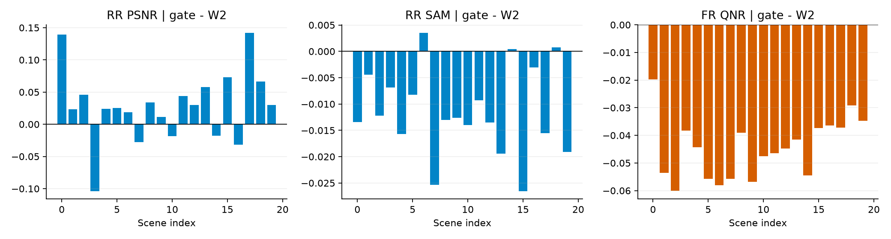
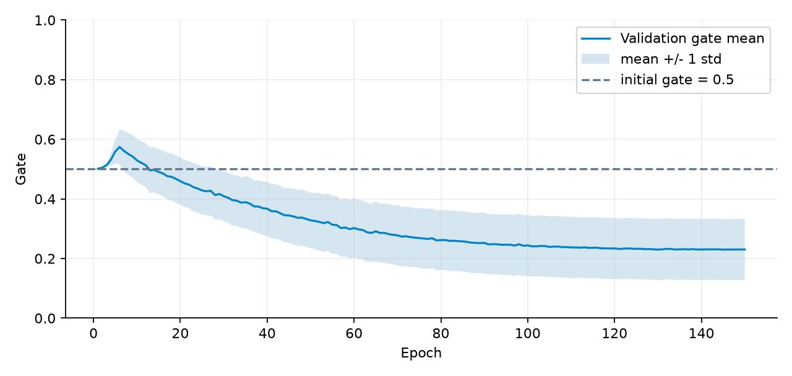
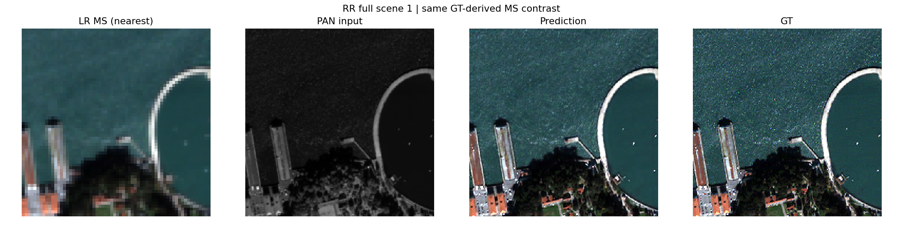
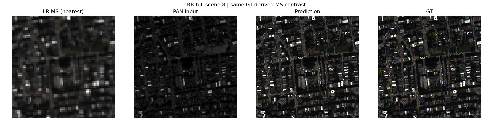
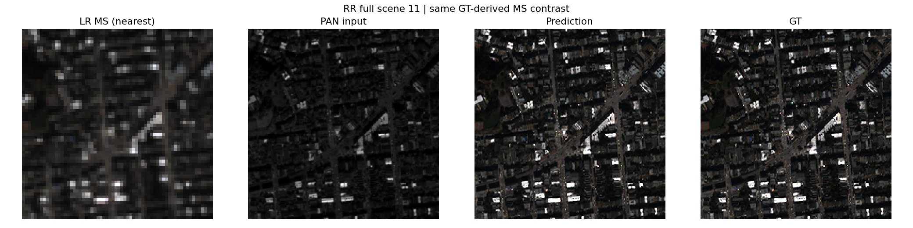
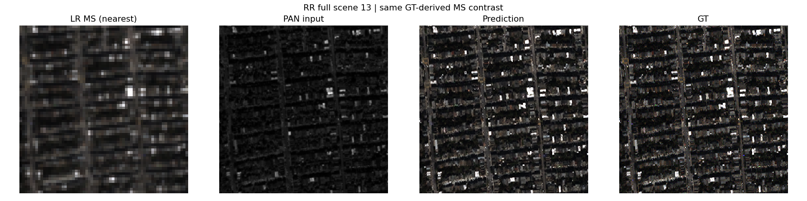
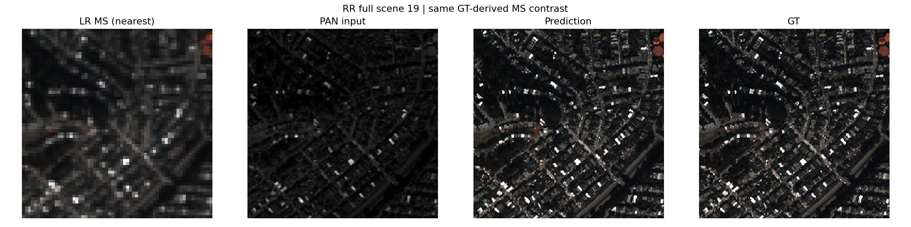

# 병렬 추가 가지의 위치별 게이트

**연구 분야:** 기존 성능 개선

**실험자:** 송준현

**변경 내용:** 29번 W2의 병렬 추가 특징을 원본 특징에 더하는 위치에 1채널 sigmoid 게이트를 추가했습니다. MSE와 나머지 학습 조건은 유지했습니다.

| 확인된 결과 | 상태 | 개선 여부 |
|---|:---:|:---:|
| seed42: RR PSNR +0.02817 dB·SAM −0.01138°, 잠정 FR QNR −0.04456입니다. QNR과 Ds는 20장 모두 악화했습니다. 기준 모델 채택을 보류합니다. | 평가&nbsp;완료<br>seed42 | 부분&nbsp;개선 |

[실험 목록](../../../README.md#performance-experiments) · [수치](#results) · [그래프](#graphs) · [이미지](#images) · [재현 자료](#evidence)

## 1. 목적과 상태

[29번 병렬 복원 용량 확장](../29_capacity_refinement/README.md)의 W2 추가 가지를 위치마다 조절하면 RR 정확도를 유지하면서 FR 왜곡을 줄일 수 있는지 확인했습니다. 추가 가지를 제한하면 왜곡이 줄어들 것이라는 가설이며 실제 원인을 확정하지 않습니다.

마지막 평가 기록은 2026-10-15 23:17 KST입니다. 같은 seed42의 두 군 모두 150 epoch를 완료하고 validation으로 선택한 best 및 마지막 latest에 대해 RR·FR 전체 장면을 평가했습니다. seed43·44는 수행하지 않았으며 사용자가 반복 진행을 중단하기로 했습니다. 단일 시드 관측 결과입니다.

## 2. 변경한 구조와 비교 조건

기존 W2는 원본 backbone 특징 b와 저해상도 병렬 가지의 PixelShuffle 이후 특징 y를 `b+y`로 합칩니다. 변경군은 두 특징을 채널 방향으로 연결하여 위치별 게이트를 만들고 `b+g×y`로 합칩니다. 그 뒤의 원본 복원 연산은 유지했습니다.



g는 모든 특징 채널에 공통인 1채널 지도입니다. 게이트 마지막 convolution의 가중치·bias를 0으로 초기화하여 g=0.5로 시작합니다. W2의 추가 가지 마지막 convolution도 원래 0 초기화이므로 시작 시 두 군의 출력은 같습니다. 추가 게이트 초기화는 공통 모델 초기화의 난수 흐름과 분리했습니다.

| 조건 | 실제 실행 |
|---|---|
| 데이터 | QuickBird만 사용, train 17,139·validation 1,905 patch, RR 20·FR 20 전체 장면 |
| 내부 특징 차원 / 공간 배율 | K=4 / 4배 |
| 입력·전처리 | 제공 PAN·LMS·MS, 원시 DN/2047, 제공 LMS 재사용, 평가 출력 clipping 없음 |
| 초기화·순서 | seed42 공통 초기 파라미터, 별도 CPU randperm(seed+0기준 epoch), 실제 epoch 순서 해시 일치 |
| 장치 | GPU0 W2 / GPU1 gated W2, 동일 Tesla T4×2 |
| 학습 | 150 epoch, micro batch=유효 batch=32, 최종 출력 MSE, Adam 기본 옵션 |
| 학습률 | 1e-4에서 1e-6까지 150 epoch cosine 일정 |
| 정밀도 | AMP FP16 학습, FP32 validation/test, TF32 끔 |
| best 기준 | 전체 validation MSE 최솟값, 정확히 동률이면 먼저 나온 epoch |
| 파라미터 | W2 2,853,918 / 게이트 모델 2,855,999, 2,081개 증가 |

두 군의 공통 초기 파라미터·실제 배치 순서는 일치합니다. AMP에서 생략된 업데이트는 각각 22·23회로 성공한 업데이트 수까지 정확히 같지는 않습니다. 이번 실행기는 GPU 상주 데이터와 Kaggle 환경을 사용하므로 과거 29번 Windows 결과의 비트 단위 재현이나 다른 실험과의 직접 순위 비교를 주장하지 않습니다. 데이터·전처리·평가 구현은 이번 두 군 사이에서 동일합니다.

<a id="results"></a>

## 3. 정량 결과

### Validation 선택

| 항목 | W2 | W2 + 위치별 게이트 |
|---|---:|---:|
| best epoch | 137 | 134 |
| 전체 validation MSE | 0.000132237149 | 0.000132212289 |

MSE 감소는 약 0.0188%입니다. 선택은 전체 validation MSE로 했고 test 점수로 바꾸지 않았습니다. 기록의 validation ERGAS·SCC·Q2n은 앞32개 고정 패치의 보조 지표이며 전체 분할 지표가 아닙니다.

### Best RR · 전체 20장

| 지표 | W2 | W2 + 위치별 게이트 | 변화량 | 개선 장면 |
|---|---:|---:|---:|---:|
| PSNR ↑ | 38.14099605 | 38.16916649 | +0.02817044 | 15/20 |
| SAM ↓ | 4.60220900 | 4.59082776 | -0.01138124 | 17/20 |
| ERGAS ↓ | 3.77909020 | 3.76977861 | -0.00931159 | 15/20 |
| 잠정 SCC ↑ | 0.98189141 | 0.98198405 | +0.00009264 | 10/20 |
| 잠정 Q2n ↑ | 0.93387691 | 0.93422069 | +0.00034378 | 14/20 |
| MSE peak1 ↓ | 0.00018129 | 0.00018045 | -0.00000084 | 15/20 |

### Best FR · 전체 20장

| 지표 | W2 | W2 + 위치별 게이트 | 변화량 | 개선 장면 |
|---|---:|---:|---:|---:|
| 잠정 Dλ ↓ | 0.02227379 | 0.02865895 | +0.00638516 | 2/20 |
| 잠정 Ds ↓ | 0.17345896 | 0.21383752 | +0.04037856 | 0/20 |
| 잠정 QNR ↑ | 0.80779629 | 0.76324041 | -0.04455588 | 0/20 |

FR에는 GT가 없습니다. ratio=4의 보관된 평가 구현을 그대로 사용했습니다. FR PAN 축소·보간의 공식 센서 MTF/위상 및 MATLAB 대응과 RR SCC·Q2n 기준 대응은 미검증이므로 해당 지표를 잠정 값으로 표시합니다. 게시 과정에서 원본 H5 추론을 다시 수행하지 않았습니다.

### Latest · 마지막 epoch150의 보조 결과

| 지표 | W2 | W2 + 위치별 게이트 | 변화량 | 개선 장면 |
|---|---:|---:|---:|---:|
| PSNR ↑ | 38.12896013 | 38.14625307 | +0.01729294 | 15/20 |
| SAM ↓ | 4.60368895 | 4.59176321 | -0.01192574 | 19/20 |
| ERGAS ↓ | 3.78441544 | 3.77961313 | -0.00480231 | 13/20 |

| 지표 | W2 | W2 + 위치별 게이트 | 변화량 | 개선 장면 |
|---|---:|---:|---:|---:|
| 잠정 Dλ ↓ | 0.02227945 | 0.02847875 | +0.00619930 | 2/20 |
| 잠정 Ds ↓ | 0.17459100 | 0.21505647 | +0.04046547 | 0/20 |
| 잠정 QNR ↑ | 0.80668086 | 0.76218952 | -0.04449135 | 0/20 |

주 결과는 validation-selected best입니다. latest를 test 결과가 유리하다는 이유로 새 best로 바꾸지 않습니다. 모든 지표의 원본 값과 장면별 숫자는 [전체 결과](results/)에 있습니다. seed42만 있으므로 시드 간 표준편차나 통계적 유의성을 주장하지 않습니다.

## 4. 기준선 대비 차이와 해석

RR 평균은 모두 개선 방향이지만 PSNR +0.0282 dB와 SAM −0.0114°는 작은 변화입니다. 반면 잠정 FR QNR과 Ds는 20장 모두 악화했습니다. QNR은 절대값 약 0.04456, W2 대비 약 5.52% 감소했습니다. latest에서도 같은 FR 악화가 나타나 특정 best epoch만의 현상으로 보기 어렵습니다. RR 유지와 FR 왜곡 완화라는 원래 목표는 달성하지 못했습니다.

게이트는 선택 epoch134에서 validation 평균 0.2301, 표준편차 0.1023, 최솟값 0.0511, 최댓값 0.9992였습니다. 초기 상수 0.5에서 변화했지만 이를 PAN 사용 비율이나 추가 특징 크기의 감소율로 해석할 수는 없습니다. 게이트 이전 가지의 크기와 이후 복원 연산도 학습되기 때문입니다. FR 전체 장면의 gate heatmap·특징 RMS는 미보관이어서 위치별 실패 원인을 단정하지 않습니다.

| 비용 | W2 | 위치별 게이트 |
|---|---:|---:|
| 학습 구간, 분 | 112.94 | 117.32 |
| validation 합계, 분 | 8.67 | 8.84 |
| 학습 peak 할당, GiB | 3.566 | 3.566 |
| best RR forward 중앙값, ms | 42.816 | 43.384 |
| best FR forward 중앙값, ms | 98.693 | 104.705 |

학습 구간 시간에는 구간 내 checkpoint 비용이 포함되고 데이터 적재·validation은 제외됩니다. 약 3.88% 증가했습니다. 추론 시간은 각 장면 FP32 forward 실측이며 별도 warmup 반복이 없는 기록이라 순수 이론 연산량 비교로 해석하지 않습니다. 평가 포함 전체 peak 메모리는 원본 results에 따로 있습니다.

<a id="graphs"></a>

## 5. 학습·평가 그래프





두 번째 그래프의 y축은 작은 차이를 보기 위해 확대했습니다. FR 수치는 잠정 값입니다.





<a id="images"></a>

## 6. 결과 이미지

평가 전에 고정한 0기준 장면 1·8·11·13·19 순서입니다. tile은 전체 장면입니다. 각 패널은 **LR MS 최근접 표시 · PAN 입력 · 변경 모델 예측 · GT** 순서이며 baseline 이미지는 본문 패널에 넣지 않고 수치 비교에 남겼습니다. RGB 밴드는 [2,1,0], MS 계열은 동일 GT 밴드별 1/99 percentile 대비입니다. 화면 표시에서만 범위를 제한하며 학습·평가 예측을 clip하지 않았습니다. FR에 GT 예시를 만들지 않았습니다.

### 장면 1



### 장면 8



### 장면 11



### 장면 13



### 장면 19



<a id="evidence"></a>

## 7. 재현 자료

- [실제 조건](config.json), [원본 고정 프로토콜](provenance/experiment.json), [실행 환경](provenance/environment_contract.json), [데이터 분할과 해시](provenance/data_contract.json), [실제 군별 설정](provenance/configs/)을 보존했습니다.
- [공통 초기·실제 best/latest 가중치](checkpoints/), [학습 당시 원본 소스](provenance/code/), [파일별 보존 해시](manifest.json), [원본 ZIP 해시](provenance/archive.json)를 연결합니다. 원본 checkpoint 내부 설정은 변경하지 않았습니다.
- [전체 결과·이력·장면별 숫자](results/), [비교 검증](results/pair_checks.json), [분석 근거](results/analysis.json), [원본 파일 대응](results/source_artifact_map.json)을 보존했습니다. 완료된 상세 로그와 smoke 가중치는 게시하지 않습니다.
- 원본 ZIP CRC·모든 182개 manifest 항목·실제 실행 소스 해시·공통 초기 파라미터·epoch 순서·best/latest 평가 증거·20장 평균 재계산을 확인했습니다. 초기 1개와 best/latest 4개를 strict load하고 합성 CPU 입력의 유한 출력을 확인했습니다. 원본 비공개 H5의 성능 재평가는 하지 않았습니다. 해시 검증과 성능 재평가는 별개입니다.

```bash
python SSA-MRN/common/verify.py --experiment 37 --research-track performance
python SSA-MRN/experiments/performance/37_spatial_gate_on_parallel_branch/prepare.py
```

`model.py`는 보관된 구현을 로드하는 진입점입니다. `run.py`는 당시 제공한 소스와 controller가 포함된 Kaggle 단일 셀이며 기본은 smoke입니다. 원본 QB를 Input으로 연결하고 smoke 통과 후 PHASE를 final_train/final_test, SEED를 42로 설정합니다. 새 실험은 새 RUN_TAG로 시작하고, 재개는 동일 설정의 원본 누적 결과만 사용합니다. 과거 29번 가중치로 이번 학습을 재개하지 않습니다. 코드 준비·합성 CPU 검증이 실제 원본 H5 성능 재평가 완료를 뜻하지 않습니다.

## 8. 개선 여부와 다음 단계

**부분 개선·채택 보류**로 기록합니다. 같은 조건에서 RR은 소폭 좋아졌지만 잠정 FR 분광·공간 왜곡은 악화하여 전체 성능 향상으로 채택할 근거가 부족합니다. 단일 QB·seed42 결과이며 반복 시드·다른 센서·독립 holdout·공식 지표 대응은 확인하지 못했습니다.

사용자 결정에 따라 이번 구조의 seed43·44 반복은 진행하지 않습니다. 현재 test를 보고 게이트를 조정한 결과를 같은 실험의 반복으로 합치지 않습니다. 새로운 구조를 검토한다면 별도 실험에서 가설과 조건을 사전 고정하고 validation으로 선택해야 합니다.
