# MS 기준 가역 정규화의 반복 시드 검증

**연구 분야:** 기존 성능 개선

**실험자:** 김경찬

**변경 내용:** 33번의 LR MS 기준 공유 정규화·역변환을 유지하고 시드43·44로 독립 반복했습니다.

| 확인된 결과 | 상태 | 개선 여부 |
|---|:---:|:---:|
| 세 시드의 RR 평균 5지표가 모두 개선됐으나 seed44의 잠정 FR QNR·Ds가 악화했습니다. | 평가 완료 | 부분 개선 |

[실험 목록](../../../research/performance/README.md#experiments) · [선행 실험](../33_ms_anchored_reversible_normalization/README.md)

## 1. 목적과 상태

33번의 단일 시드 이득이 다른 초기값에서도 반복되는지 확인했습니다. 시드43·44의 N0·N1 학습을 각각100에폭 완료했고 validation best로 RR·FR 각각20장 전체를 평가했습니다. 시드42는33번에 보관된 결과를 참조하며 다시 학습하지 않았습니다.

## 2. 변경한 구조와 비교 조건

N0는 초기 LRPAN을 포함한 원본 SSA-MRN K4입니다. N1은 LR MS의 C·H·W 전체에서 샘플별 스칼라 평균 μ와 모집단 표준편차 σ를 구하고 s=max(σ,0.01)로 설정합니다. PAN·LMS·MS에 같은 (x−μ)/s를 적용하고 원본 모델의 출력에 s를 곱한 뒤 μ를 더합니다. GT는 입력 통계 계산에 사용하지 않습니다. 추가 학습 파라미터는 없습니다.

| 항목 | 실제 조건 |
|---|---|
| 데이터 | QuickBird; train17,139·validation1,905패치; RR20·FR20장 |
| 내부 특징 차원·공간 배율 | K=4·4배 |
| 시드 | 선행42·추가43,44; 시드별 N0/N1 공통 초기 모델·동일 학습 순서 |
| 학습 | fresh initialization; 100에폭; effective batch64·micro batch32 |
| 최적화·손실 | Adam·고정 LR0.0001·원래 DN/2047 단위 MSE |
| 입력 범위 | DN/2047·clipping 없음 |
| 장치 | Kaggle Tesla T4 두 장; GPU0 N0·GPU1 N1 독립 프로세스 |
| 정밀도 | 학습 FP16 AMP; 통계·역변환·손실·validation·test FP32; TF32 off |
| 가중치 선택 | epoch0 포함 최소 validation MSE; 정확한 동률이면 이른 에폭 |

<a id="results"></a>

## 3. 정량 결과

RR은 정답이 있는 축소 해상도 평가이며 PSNR·SCC·Q2n은 높을수록, SAM·ERGAS는 낮을수록 좋습니다. FR은 정답 없는 원해상도 평가이며 QNR은 높을수록, Dλ·Ds는 낮을수록 좋습니다. QNR·Q2n·SCC는 MATLAB 수치 대응이 완전히 확인되지 않은 잠정 지표입니다. 아래 차이는 N1−N0입니다.

| 시드 | 군 | best 에폭 | validation MSE | validation PSNR | validation SAM |
|---|---|---:|---:|---:|---:|
| 43 | N0 | 96 | 0.0001841403 | 39.045754 | 4.681566 |
| 43 | N1 | 99 | 0.0001815471 | 39.076445 | 4.656048 |
| 44 | N0 | 99 | 0.0001829302 | 39.080103 | 4.673617 |
| 44 | N1 | 94 | 0.0001799053 | 39.134449 | 4.639066 |

### RR 전체 장면 평균

| 시드 | 군 | PSNR | SAM | ERGAS | SCC | Q2n |
|---|---|---:|---:|---:|---:|---:|
| 42 | N0 | 37.060356 | 5.116404 | 4.315631 | 0.974128 | 0.917946 |
| 42 | N1 | 37.271415 | 4.992239 | 4.198433 | 0.975677 | 0.923169 |
| 42 | 차이 | +0.211059 | -0.124165 | -0.117199 | +0.001550 | +0.005223 |
| 43 | N0 | 37.096684 | 5.072518 | 4.287111 | 0.974338 | 0.918598 |
| 43 | N1 | 37.329068 | 5.019515 | 4.173751 | 0.975934 | 0.920307 |
| 43 | 차이 | +0.232384 | -0.053003 | -0.113360 | +0.001595 | +0.001709 |
| 44 | N0 | 37.246802 | 5.030652 | 4.215071 | 0.975421 | 0.920661 |
| 44 | N1 | 37.343237 | 4.985173 | 4.166641 | 0.976031 | 0.923236 |
| 44 | 차이 | +0.096434 | -0.045479 | -0.048430 | +0.000610 | +0.002576 |

### FR 전체 장면 평균

| 시드 | 군 | QNR | D_lambda | D_s |
|---|---|---:|---:|---:|
| 42 | N0 | 0.901266 | 0.044674 | 0.057166 |
| 42 | N1 | 0.918728 | 0.040777 | 0.042697 |
| 42 | 차이 | +0.017462 | -0.003897 | -0.014469 |
| 43 | N0 | 0.913502 | 0.038605 | 0.050337 |
| 43 | N1 | 0.919808 | 0.035452 | 0.046921 |
| 43 | 차이 | +0.006306 | -0.003152 | -0.003415 |
| 44 | N0 | 0.913689 | 0.044864 | 0.043829 |
| 44 | N1 | 0.912751 | 0.043545 | 0.046268 |
| 44 | 차이 | -0.000938 | -0.001320 | +0.002439 |

### 세 시드의 paired 차이

장면별 지표를 각 시드 안에서 평균한 후 동일 시드의 N1−N0를 구했습니다. 아래 표준편차는 세 시드 차이의 표본 표준편차이며 신뢰구간이나 유의성 검정 결과가 아닙니다.

| 지표 | 평균 차이 | 시드 간 표본 표준편차 |
|---|---:|---:|
| RR_PSNR | +0.179959 | 0.073116 |
| RR_SAM | -0.074216 | 0.043421 |
| RR_ERGAS | -0.092996 | 0.038643 |
| RR_SCC | +0.001252 | 0.000556 |
| RR_Q2n | +0.003169 | 0.001831 |
| FR_QNR | +0.007610 | 0.009269 |
| FR_D_lambda | -0.002790 | 0.001327 |
| FR_D_s | -0.005148 | 0.008586 |

## 4. 기준선 대비 차이와 해석

세 시드 모두 RR의 평균5지표가 개선했습니다. 다만 seed44는 개별 장면에서 PSNR17/20·ERGAS18/20·SCC16/20장만 개선했으므로 모든 장면의 일관된 개선으로 해석하지 않습니다. seed43은 잠정 FR도 개선했지만 seed44는 QNR−0.000938·Ds+0.002439로 악화했습니다. 세 시드의 평균 잠정 QNR 차이는 양수이지만 FR 이득의 일관성은 확보하지 못했습니다.

시드42 단독 결과의 기록은33번에 유지합니다. 이번 반복 검증은 같은 QB test를 사용한 탐색 결과이며 독립 holdout 검증이나 다른 센서의 개선을 의미하지 않습니다.

<a id="graphs"></a>

## 5. 학습·평가 그래프

원본 실측 train MSE·validation PSNR·SAM 곡선과 각 시드의 baseline 비교 그래프를 표시합니다. 통합 그래프의 막대는 원래 지표 단위의 N1−N0이며 녹색이 개선 방향입니다.

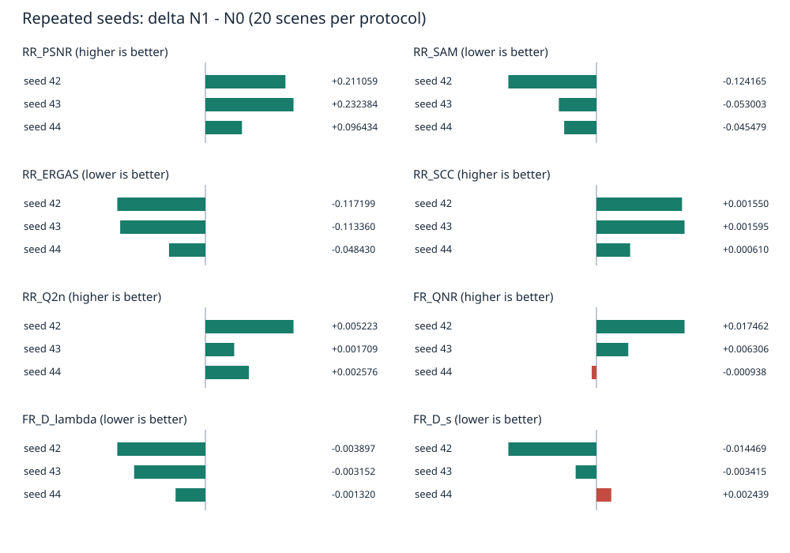

### 시드43

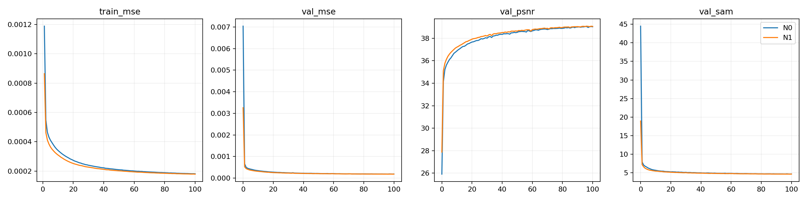

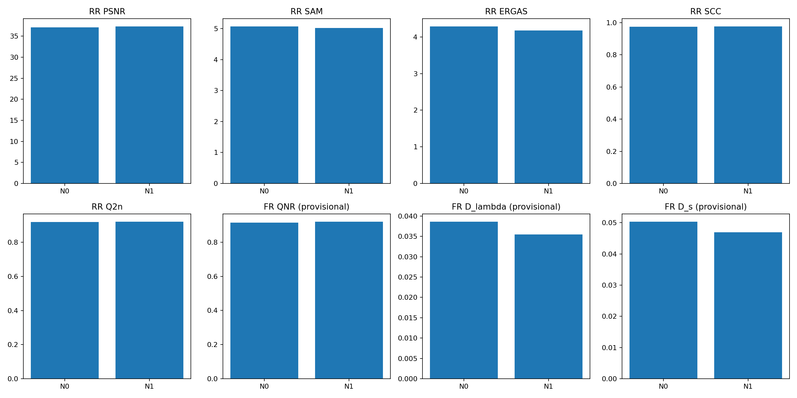

### 시드44

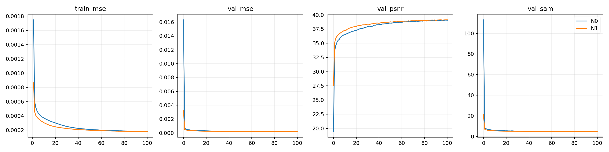

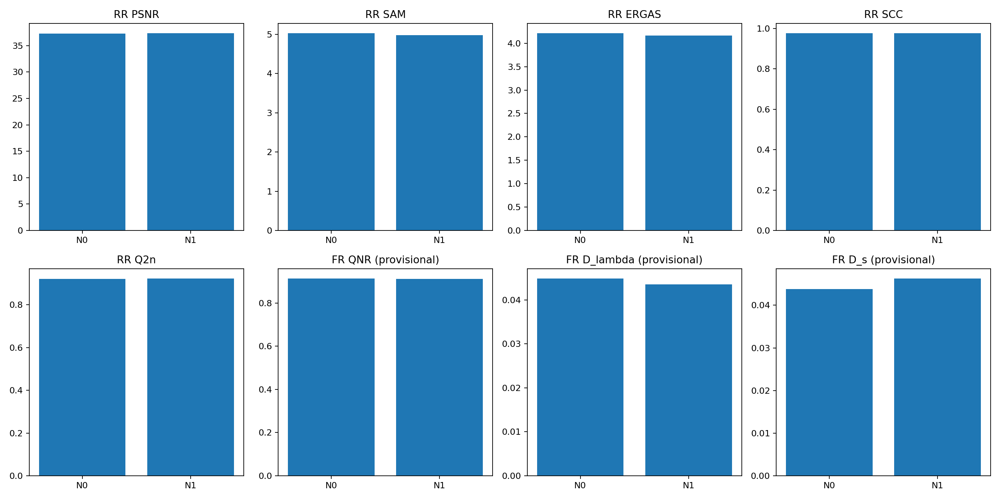

<a id="images"></a>

## 6. 결과 이미지

학습 전에 고정한 0부터 시작하는 RR 장면1·8·11·13·19를 각 반복 시드에서 표시합니다. 패널 순서는 LR MS nearest 확대·PAN·N1 예측·GT입니다. RGB 밴드[2,1,0]를 사용하고 MS 패널은 해당 장면 GT의1·99백분위 대비를 공유합니다. 전체 장면을 표시하며 별도 crop을 선택하지 않았습니다. FR에는 GT가 없습니다. N0의 같은 장면 이미지는 각 결과 폴더에 함께 보관했습니다.

### 시드43 N1

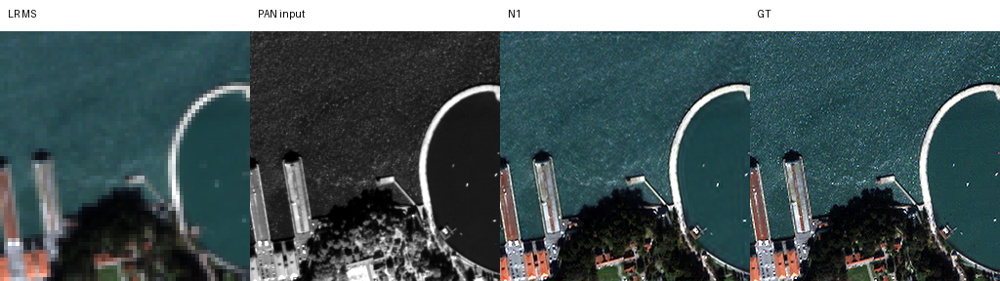

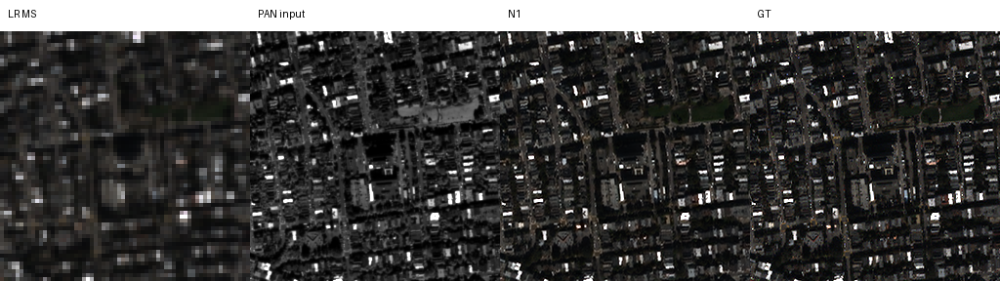

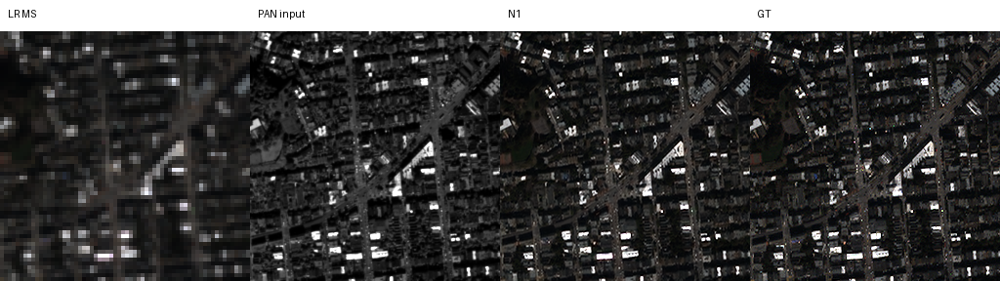

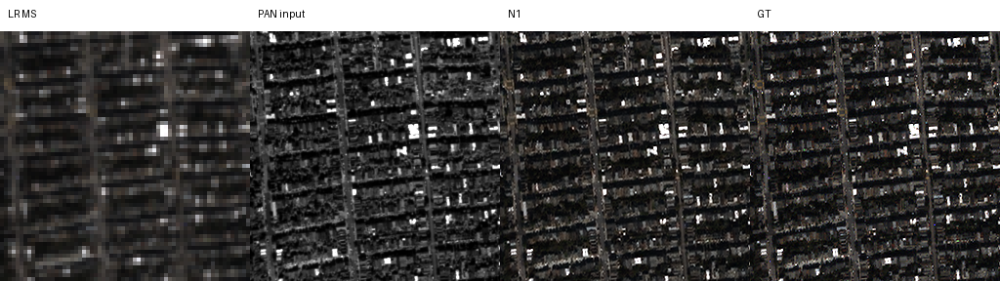

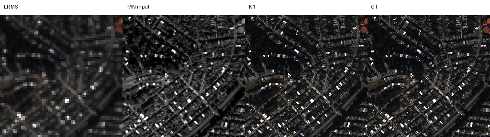

### 시드44 N1


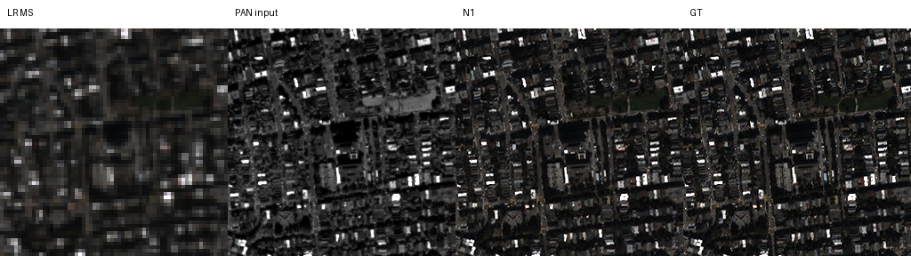

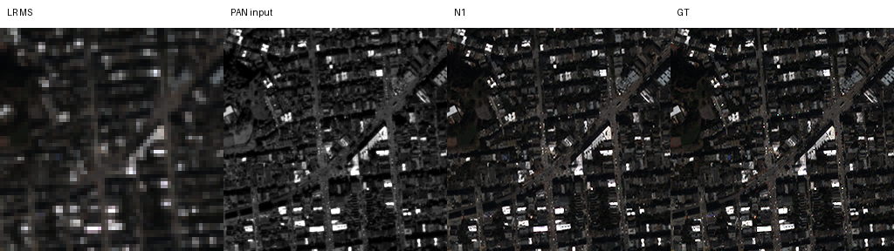

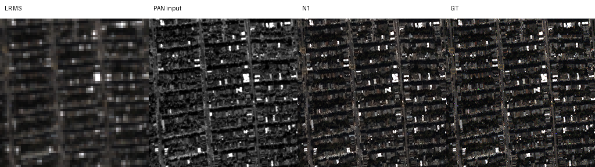

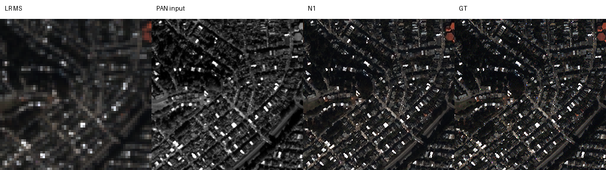

<a id="evidence"></a>

## 7. 재현 자료

[집계 설정](config.json) · [검증·집계 코드](prepare.py) · [통합 숫자](results/summary.json) · [보존 검증](results/retention_verification.json) · [manifest](manifest.json)

실제 학습된 초기·best·latest 가중치12개를 [checkpoints](checkpoints/)에 보관했습니다. 시드42 가중치는 선행33번을 참조합니다. 각 시드의 원본 설정·데이터 해시·고정 장면 선택·소스 snapshot·실행 코드는 [seed43](provenance/seed43/)과 [seed44](provenance/seed44/)에, 전체 장면별 지표와 compact epoch 기록은 [seed43 결과](results/seed43/)와 [seed44 결과](results/seed44/)에 보관했습니다.

원본 실행 코드의 학습 당시 설정을 유지했습니다. prepare.py는 Python 표준 라이브러리만 사용해 원본 해시·validation best·장면 평균을 검증하고 보고서를 다시 만듭니다. --register를 지정하면 공용 실험 목록5개도 갱신합니다. 학습이나 Git 커밋·푸시는 수행하지 않습니다.

```bash
python SSA-MRN/experiments/performance/38_ms_anchored_normalization_seed_repeat/prepare.py
python SSA-MRN/common/verify.py --research-track performance --experiment 38
```

이번 보관 검증은 원본 manifest와 복사된 파일의 바이트 일치, 기록된 validation best, RR·FR 전체 장면 평균을 확인했습니다. 원본 H5로 추론·지표를 다시 계산하거나 반복 가중치를 strict load한 검증은 수행하지 않았습니다. 학습 당시 preflight 기록은 별도로 보존했습니다.

## 8. 개선 여부와 다음 단계

**부분 개선·최종 채택 보류**로 판정합니다. RR 이득은 세 시드에서 반복됐으나 FR 개선은 일관되지 않습니다. 다음에는 지표의 수치 대응을 확인하고, 동일 조건의 추가 센서·독립 holdout에서 검증합니다. 이번 test 결과에 맞춰 사후 선택한 설정을 독립 검증 성능으로 보고하지 않습니다.
