# 국소 MS 통계 기반 가역 정규화

**연구 분야:** 기존 성능 개선

**실험자:** 송준현

**변경 내용:** 33번 N1의 샘플별 전체 MS 평균·표준편차를 5×5 이웃의 위치별 공통 통계 지도로 바꿨습니다. 네트워크 구조·파라미터 수·MSE는 유지했습니다.

| 확인된 결과 | 상태 | 개선 여부 |
|---|:---:|:---:|
| 3 seed 평균 RR PSNR −0.13345 dB·SAM +0.06825°, 잠정 FR QNR −0.00370입니다. seed44 FR에 일부 이득이 있지만 모든 seed의 RR·validation은 악화했습니다. 채택을 보류합니다. | 평가&nbsp;완료<br>seed42·43·44 | 부분&nbsp;개선 |

[실험 목록](../../../README.md#performance-experiments) · [수치](#results) · [그래프](#graphs) · [이미지](#images) · [재현 자료](#evidence)

## 1. 목적과 상태

[33번 MS 기준 가역 정규화](../33_ms_anchored_reversible_normalization/README.md)는 LR MS의 샘플 전체 통계를 사용했습니다. 밝기·대비가 위치마다 달라지는 영상에서는 국소 통계가 유리할 수 있다는 가설로 범위를 5×5 이웃으로 바꿨습니다. 이 이득을 가정하고 성능 향상으로 기록하지 않습니다.

seed42·43·44의 두 군 모두 새 초기화에서 100 epoch 학습을 완료했습니다. 각 군의 validation-selected best와 마지막 latest에 대해 RR·FR 각각 전체20장을 평가했습니다. 마지막 확인 기록은 2026-10-17 01:39:18 KST입니다. 소량 smoke와 연속 실행 reference는 최종 성능 집계에 포함하지 않았습니다.

대조군은 **global N1**입니다. 무정규화 원본 N0와의 비교가 아니며, 33번의 과거 결과를 그대로 재현했다고 주장하지 않습니다. 이번 실행에서 새로 학습한 두 군 사이의 paired 비교입니다.

## 2. 변경한 구조와 비교 조건

기준 N1은 DN/2047의 LR MS에서 샘플별 전체 C×H×W의 모집단 평균 μ와 표준편차 σ를 계산합니다. 같은 스칼라로 PAN·제공 LMS·MS를 `(x−μ)/σ` 변환하고 네트워크 출력을 `prediction×σ+μ`로 복원합니다.

변경군은 각 LR 위치에서 **전체 밴드×5×5 이웃**의 통계를 계산합니다. reflect padding2, FP32 `v=max(E[x²]−μ²,0)`, `σ=sqrt(max(v,0.01²))`입니다. 평균과 하한 적용된 scale 지도를 bilinear `align_corners=False`로 HR에 확대하여 PAN·LMS 정규화와 출력 역변환에 공통으로 사용합니다. LR MS에는 LR 지도를 사용합니다. GT·다른 배치 샘플은 통계에 포함하지 않습니다. 입력 LMS 자체를 새로 만들거나 리샘플링하지 않습니다.

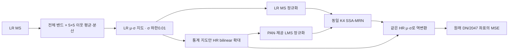

| 조건 | 두 군 공통 |
|---|---|
| 데이터 | QuickBird만 사용, train17,139·validation1,905, RR20·FR20 |
| 내부 특징 차원 / 공간 배율 | K=4 / 4배 |
| 전처리 | 원시 DN/2047, 제공 LMS, 입력·평가 예측 clipping 없음 |
| 초기화 / 순서 | 동일 seed의 같은 initial.pt, 별도 CUDA Generator(seed+100000), 실제 순서 해시 일치 |
| 학습 | seed42·43·44 각각100 epoch, micro32·유효64, Adam 기본 옵션, 고정 lr1e-4 |
| 정밀도 | 학습 AMP FP16, 통계·역변환·MSE·validation/test FP32, TF32 끔, GradScaler 시작1024 |
| 장치 | 같은 Tesla T4×2, GPU0 global N1 / GPU1 local |
| 파라미터 | 각각426,654개, 추가 학습 파라미터 없음 |
| best | epoch0 포함 전체 validation MSE 최솟값, 정확히 동률이면 먼저 나온 checkpoint |
| 사전 고정 | 창5×5·σ하한0.01, sweep/select 없음, test로 조정하지 않음 |

두 군의 초기 **가중치**는 같지만 정규화가 달라 초기 **출력**은 다릅니다. 유효64의 마지막 불완전 batch는 실제 원소 수로 MSE를 평균했습니다. EMA·FFL·W2 가지·게이트는 추가하지 않았습니다. 6개 학습 모두 AMP 업데이트 생략0회였습니다.

<a id="results"></a>

## 3. 정량 결과

### Validation 선택

| seed | global best epoch | local best epoch | global MSE | local MSE | local 변화율 |
|---|---:|---:|---:|---:|---:|
|42|98|98|0.000182232081|0.000186288794|+2.226%|
|43|99|99|0.000181547076|0.000186047914|+2.479%|
|44|94|98|0.000179905279|0.000184996928|+2.830%|

MSE·PSNR·SAM은 전체 validation 분할입니다. 기록의 ERGAS·SCC·Q2n은 앞32개 고정 패치의 보조 진단이며 전체 validation 지표가 아닙니다. test를 보고 best를 재선택하지 않았습니다.

### Best: 3 seed 평균과 표본 표준편차

각 seed에서 20장 평균을 구한 후 세 seed의 평균·표본 SD를 계산했습니다. paired 변화는 같은 seed의 local−global이며 독립60장 실험의 SD가 아닙니다. 세 seed만으로 통계적 유의성이나 다른 센서 일반화를 주장하지 않습니다.

| 지표 | global N1, 평균 ± SD | local, 평균 ± SD | paired 변화, 평균 ± SD |
|---|---:|---:|---:|
|RR PSNR ↑|37.314573 ± 0.038042|37.181128 ± 0.069319|-0.133446 ± 0.031910|
|RR SAM ↓|4.998975 ± 0.018135|5.067229 ± 0.013468|0.068253 ± 0.004931|
|RR ERGAS ↓|4.179608 ± 0.016685|4.252246 ± 0.033018|0.072637 ± 0.016639|
|RR 잠정 SCC ↑|0.975880 ± 0.000183|0.974819 ± 0.000501|-0.001061 ± 0.000321|
|RR 잠정 Q2n ↑|0.922237 ± 0.001672|0.919474 ± 0.000622|-0.002764 ± 0.001055|
|FR 잠정 Dλ ↓|0.039925 ± 0.004113|0.042631 ± 0.002315|0.002706 ± 0.003403|
|FR 잠정 Ds ↓|0.045296 ± 0.002274|0.046441 ± 0.002925|0.001145 ± 0.001758|
|FR 잠정 QNR ↑|0.917096 ± 0.003801|0.913400 ± 0.001064|-0.003696 ± 0.004811|

### Best: seed별 RR 주요 지표

| seed | 지표 | global N1 | local | local−global | 개선 장면 |
|---|---|---:|---:|---:|---:|
|42|PSNR ↑|37.271415|37.101249|-0.170165|0/20|
|42|SAM ↓|4.992239|5.063750|+0.071512|0/20|
|42|ERGAS ↓|4.198433|4.290252|+0.091819|0/20|
|43|PSNR ↑|37.329068|37.216631|-0.112437|0/20|
|43|SAM ↓|5.019515|5.082095|+0.062580|0/20|
|43|ERGAS ↓|4.173751|4.235854|+0.062103|0/20|
|44|PSNR ↑|37.343237|37.225503|-0.117734|1/20|
|44|SAM ↓|4.985173|5.055841|+0.070668|0/20|
|44|ERGAS ↓|4.166641|4.230631|+0.063990|1/20|

### Best: seed별 FR

| seed | 지표 | global N1 | local | local−global | 개선 장면 |
|---|---|---:|---:|---:|---:|
|42|잠정 Dλ ↓|0.040777|0.045076|+0.004299|0/20|
|42|잠정 Ds ↓|0.042697|0.044060|+0.001363|9/20|
|42|잠정 QNR ↑|0.918728|0.913378|-0.005350|1/20|
|43|잠정 Dλ ↓|0.035452|0.040473|+0.005021|1/20|
|43|잠정 Ds ↓|0.046921|0.049705|+0.002784|0/20|
|43|잠정 QNR ↑|0.919808|0.912347|-0.007461|0/20|
|44|잠정 Dλ ↓|0.043545|0.042343|-0.001201|16/20|
|44|잠정 Ds ↓|0.046268|0.045557|-0.000711|10/20|
|44|잠정 QNR ↑|0.912751|0.914475|+0.001724|11/20|

FR에는 GT가 없습니다. ratio=4의 보관된 33번 metrics를 유지했습니다. RR SCC·Q2n의 독립 기준 대응, FR PAN 축소·보간의 공식 센서 MTF/위상 및 MATLAB 대응은 미검증이므로 해당 지표는 잠정 값입니다.

### Latest: 마지막 epoch100 보조 결과

| 지표 | global N1, 평균 ± SD | local, 평균 ± SD | paired 변화, 평균 ± SD |
|---|---:|---:|---:|
|RR PSNR ↑|37.316538 ± 0.069615|37.148493 ± 0.066314|-0.168045 ± 0.018847|
|RR SAM ↓|5.019275 ± 0.026325|5.067362 ± 0.008976|0.048087 ± 0.017399|
|RR ERGAS ↓|4.182057 ± 0.032996|4.264658 ± 0.033734|0.082601 ± 0.011959|
|RR 잠정 SCC ↑|0.975921 ± 0.000419|0.974674 ± 0.000411|-0.001246 ± 0.000233|
|RR 잠정 Q2n ↑|0.922030 ± 0.001402|0.919488 ± 0.001467|-0.002542 ± 0.001784|
|FR 잠정 Dλ ↓|0.042152 ± 0.004051|0.043187 ± 0.001291|0.001035 ± 0.002771|
|FR 잠정 Ds ↓|0.043708 ± 0.003505|0.045893 ± 0.006655|0.002184 ± 0.003397|
|FR 잠정 QNR ↑|0.916467 ± 0.004213|0.913371 ± 0.006532|-0.003096 ± 0.003869|

latest의 결과로 best 선택 규칙을 바꾸지 않습니다. 전체 장면 숫자와 모든 seed의 best/latest는 [원본 결과](results/), [평균·SD](results/seed_statistics.json), [동일 장면 변화량](results/paired_scene_deltas.json)에 있습니다.

## 4. 기준선 대비 차이와 해석

모든 seed에서 validation MSE가 높아졌고 RR PSNR·SAM·ERGAS·SCC·Q2n 평균도 악화했습니다. 같은 20장에 대한 세 번의 반복에서 PSNR·ERGAS·SCC는 총59/60개 paired 평가, SAM·Q2n은60/60개에서 악화했습니다. 이는 서로 독립인60장이라는 뜻이 아닙니다.

seed44의 잠정 FR QNR은 +0.001724, Dλ는 -0.001201, Ds는 -0.000711로 개선했습니다. 그러나 seed42·43에서는 FR 평균이 모두 악화했고 3 seed 평균 QNR도 낮아졌습니다. 따라서 일부 FR 이득은 기록하되 전체 개선이나 반복적으로 안정적인 이득으로 채택하지 않습니다.

마지막 train MSE도 세 seed 모두 local이 높습니다. validation만 악화한 과적합이라고 단정하기보다 이 국소 변환이 현재 모델·학습 조건에서 복원을 어렵게 했을 가능성을 고려합니다. 공간마다 다른 좌표에서 합성곱을 수행하는 효과, 통계 지도 확대, 패치와 전체 장면의 경계 차이, 평탄부 증폭은 원인 후보이며 이번 결과만으로 인과를 분리하지 못했습니다.

validation scale 평균은 global0.03880, local0.03379입니다. σ하한 적용 비율은 global 샘플0%, local LR위치0.492%로 측정 단위가 다릅니다. 대부분 위치가 하한에 묶여 실패했다는 설명은 이 통계로 지지되지 않습니다. 원본 통계 지도와 장면별 기록을 보존했습니다.

| seed | global 학습 구간, 분 | local 학습 구간, 분 | global validation 합계, 분 | local validation 합계, 분 |
|---|---:|---:|---:|---:|
|42|47.57|49.16|3.09|3.27|
|43|48.12|49.29|3.09|3.27|
|44|47.99|48.85|3.09|3.25|

학습 구간에는 구간 내 checkpoint 비용이 포함되고 데이터 적재·validation·test·압축 시간은 제외됩니다. 전체 세션 시간과 다릅니다. 학습 peak 할당은 global2.980GiB, local2.981GiB입니다. 장면별 forward 시간과 첫 장면의 warmup3회·반복5회 중앙값은 각 `evaluations/*/results.json`에 기록했습니다. 이 수치를 이전 FP32·유효32 실험과 같은 조건의 속도 비교로 취급하지 않습니다.

## 5. 학습·평가 그래프

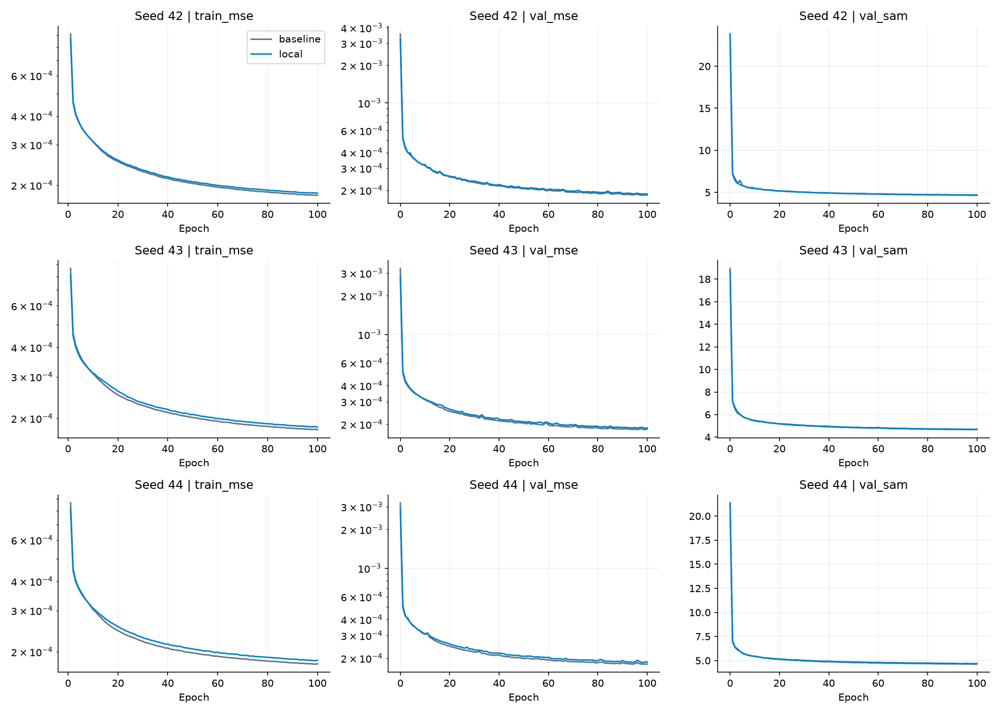

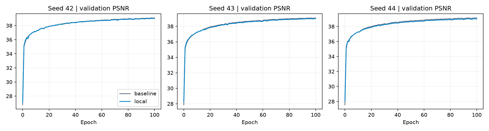

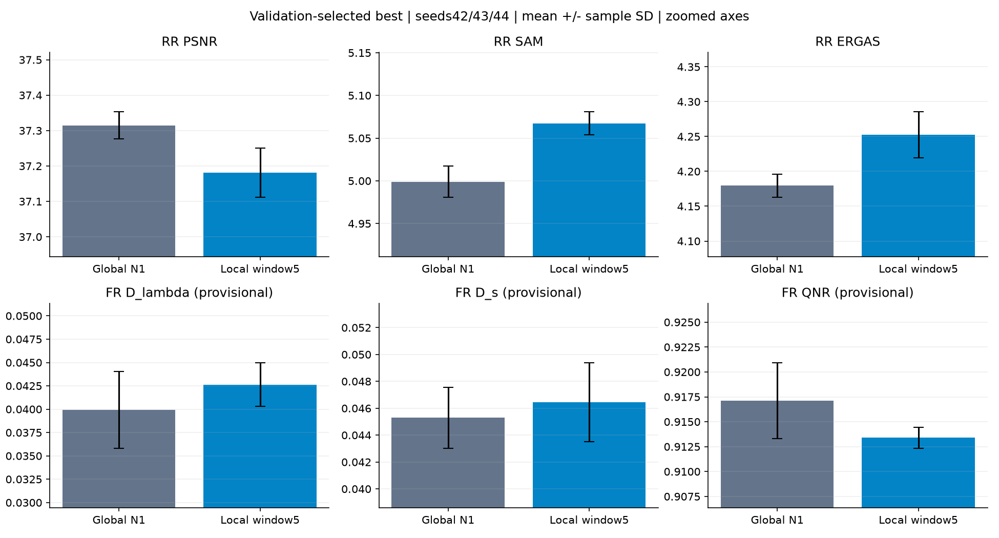

비교 그래프는 작은 차이를 보기 위해 y축을 확대했습니다. 오차 막대는 시드 간 표본 SD이며 FR 지표는 잠정 값입니다.

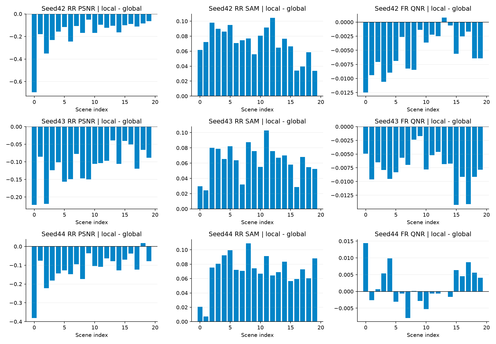

<a id="images"></a>

## 6. 결과 이미지

평가 전에 고정한 seed42의 0기준 장면1·8·11·13·19를 이 순서로 표시합니다. tile은 전체 장면입니다. 각 패널은 **LR MS 최근접 표시 · PAN 입력 · local 예측 · GT** 순서입니다. baseline은 수치 비교로 남기고 예측 패널에 추가하지 않았습니다. RGB[2,1,0], 동일 GT의 밴드별1/99 percentile 대비를 사용했습니다. 화면 표시 범위 제한과 학습·평가 출력 clipping을 구분합니다. FR에 GT를 만들지 않았습니다.

### 장면 1

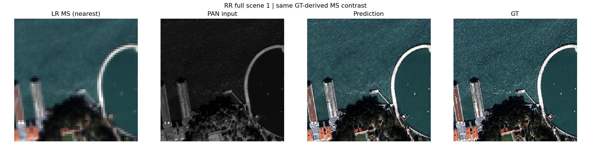

### 장면 8

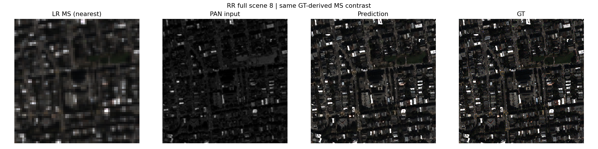

### 장면 11

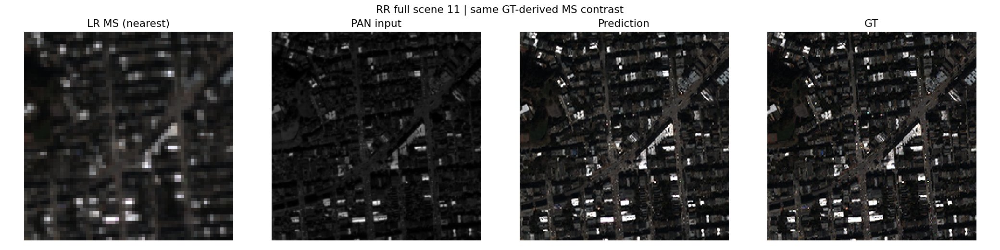

### 장면 13

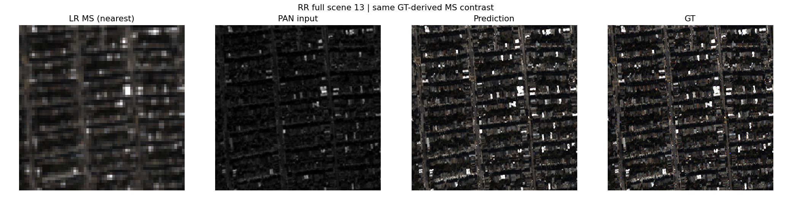

### 장면 19

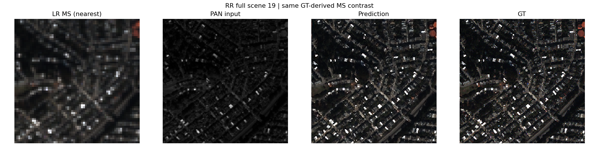


[seed43의 동일 고정 장면](results/seed_43/local/evaluations/best/)과 [seed44의 동일 고정 장면](results/seed_44/local/evaluations/best/)도 원본 그대로 보존했습니다. 모든 seed의 best/latest 예시와 통계 지도를 결과에서 확인할 수 있습니다.

아래 통계 지도는 seed42의 같은 RR 장면1입니다. 두 그림 모두 μ0-1, σ0.01-0.5의 같은 표시 범위입니다. global은 샘플 스칼라를 화면 크기로 표시했고 local은 확대된 위치별 지도입니다. 표시 범위는 출력 clipping 조건이 아닙니다.

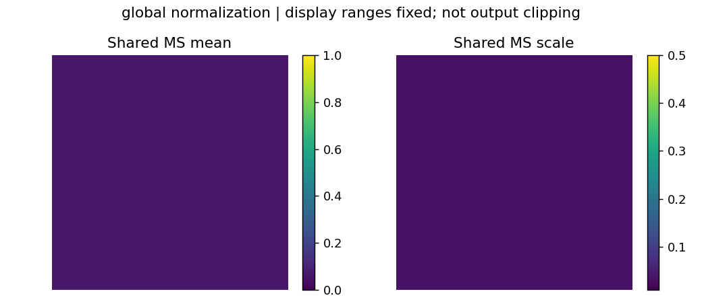

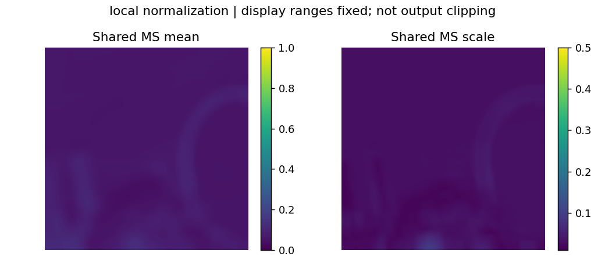

<a id="evidence"></a>

## 7. 재현 자료

- [실제 조건·예시 선택](config.json), [원본 프로토콜](provenance/experiment.json), [군별 설정](provenance/configs/), [환경](provenance/environment_contract.json), [데이터 분할·해시](provenance/data_contract.json)를 보존했습니다.
- [원본 초기·best/latest 가중치15개](checkpoints/), [학습 당시 원본 소스](provenance/code/), [원본 ZIP 해시](provenance/archive.json), [현재 파일 manifest](manifest.json)를 보존했습니다. checkpoint 내부 설정은 수정하지 않았습니다.
- [전체 결과](results/), [분석·검증 근거](results/analysis.json), [원본 파일 대응](results/source_artifact_map.json)를 연결합니다. 완료된 상세 로그·smoke 가중치는 게시하지 않습니다.
- 원본 ZIP CRC·모든 manifest 항목·실행 소스 해시·3 seed 공통 초기값·실제 배치 순서·전체 데이터 사용·epoch0 포함 best 선택·평가된 가중치 해시·20장 평균을 확인했습니다. 초기3개와 best/latest12개 strict load 및12개 합성 CPU 유한 출력을 확인했습니다. 이전 train export의 가중치·이력·이미 평가된 결과도 그대로임을 확인했습니다. 원본 비공개 H5 성능 재평가는 수행하지 않았습니다.

```bash
python SSA-MRN/common/verify.py --experiment 39 --research-track performance
python SSA-MRN/experiments/performance/39_local_ms_anchored_reversible_normalization/prepare.py
```

`model.py`는 보관된 global/local 구현의 진입점입니다. `run.py`는 동일 실행 소스를 포함한 Kaggle 단일 셀이며 기본은 smoke입니다. 원본 QB를 Input으로 연결하고 smoke 통과 후 PHASE를 final_train/final_test, SEED를42·43·44로 진행합니다. 새 실행은 새 RUN_TAG로 시작하고, 재개는 동일 조건의 최신 누적 결과만 사용합니다. 기존33번 가중치를 이번 구조 변경 코드로 재개하지 않습니다. 실제 학습 소스·기반 버전·해시는 원본 snapshot·manifest에 보존했습니다.

## 8. 개선 여부와 다음 단계

**부분 개선·채택 보류**로 기록합니다. 이 표기는 seed44의 일부 잠정 FR 지표 이득을 뜻하며, 전체 성능 향상을 뜻하지 않습니다. 3 seed 평균의 모든 주요 RR·FR 지표가 악화했고 모든 seed의 validation도 불리하므로 현재 window5 구성은 기준 모델로 채택하지 않습니다. 잠정 지표의 독립 검증·다른 센서 일반화는 아직 없습니다.

세 seed의 계획된 학습·평가는 끝났습니다. 창 크기나 global/local 혼합을 후속으로 검토한다면 새 실험으로 사전 고정하고 validation으로 선택해야 합니다. 이번 test를 보고 계수·창·best 기준을 바꾼 결과를 같은 반복 비교에 합치지 않습니다.
