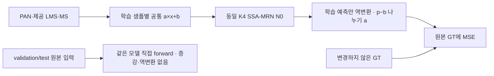
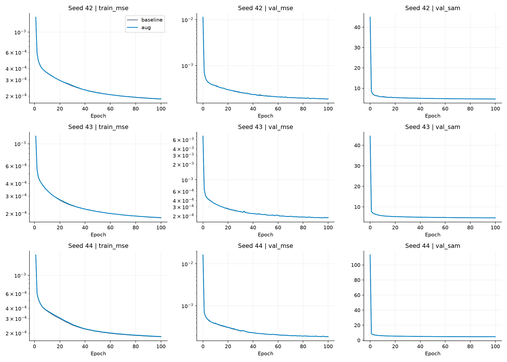
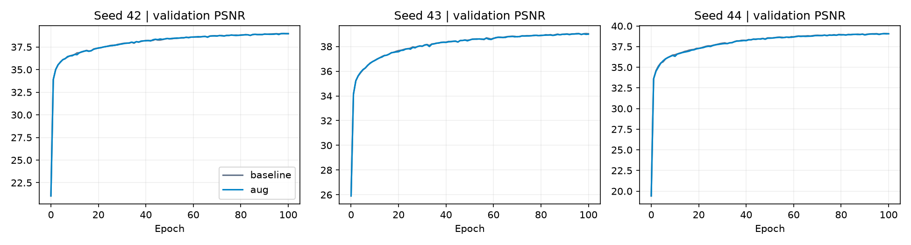
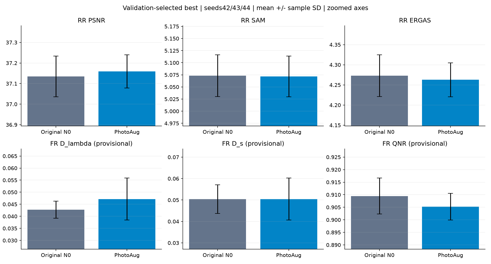
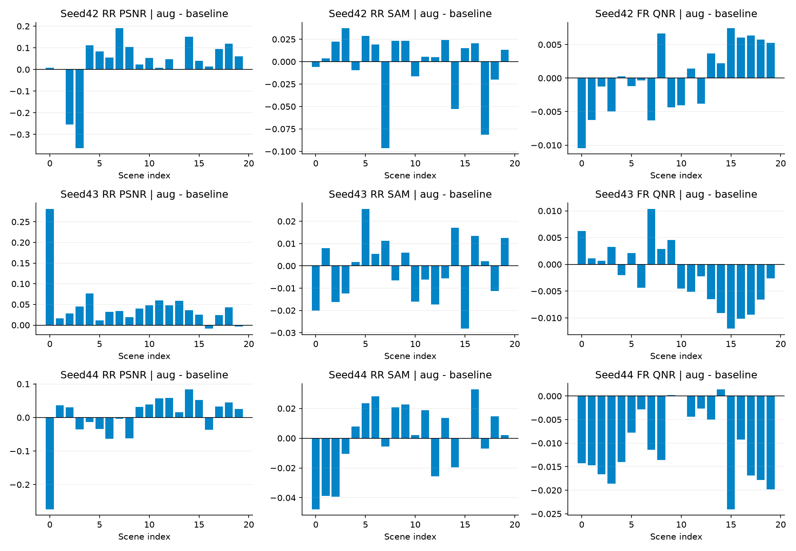
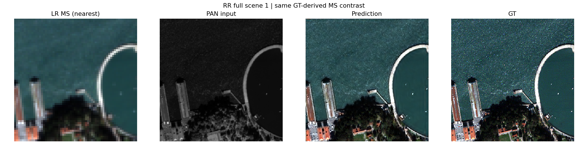
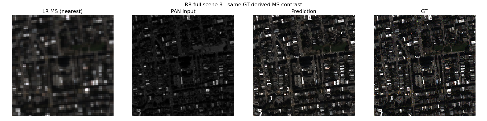
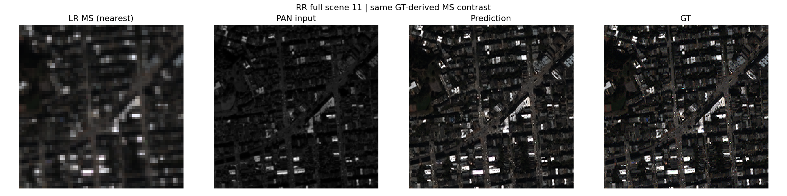
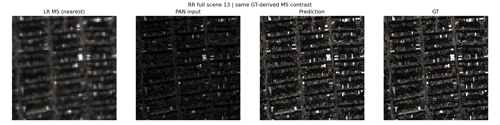
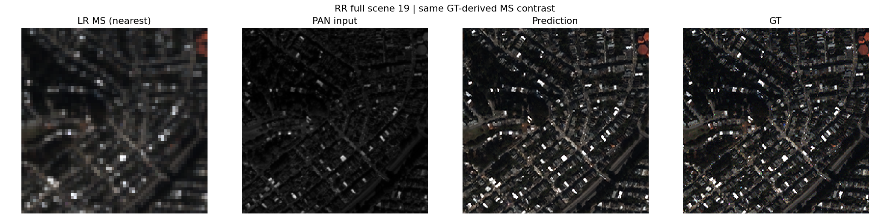

# 공통 밝기·대비 증강

**연구 분야:** 기존 성능 개선

**실험자:** 송준현

**변경 내용:** 원본 SSA-MRN의 학습 PAN·제공 LMS·MS에 샘플별 같은 gain·offset을 적용하고, 예측을 원래 좌표로 되돌려 MSE를 계산했습니다. 네트워크와 validation/test 입력은 유지했습니다.

| 확인된 결과 | 상태 | 개선 여부 |
|---|:---:|:---:|
| 3 seed 평균 RR PSNR +0.02416 dB·SAM −0.00144°, 잠정 FR QNR −0.00422입니다. validation은2/3 seed에서 불리하고 FR 이득은 반복되지 않았습니다. 채택을 보류합니다. | 평가&nbsp;완료<br>seed42·43·44 | 부분&nbsp;개선 |

[실험 목록](../../../README.md#performance-experiments) · [수치](#results) · [그래프](#graphs) · [이미지](#images) · [재현 자료](#evidence)

## 1. 목적과 상태

학습 중 공통 밝기·대비 변화에 노출하면 특정 입력 분포에 대한 의존을 줄이고 RR 정확도와 FR 분광·공간 일관성을 높일 수 있는지 확인했습니다. 실제 센서 변화가 공통 affine 변환을 정확히 따른다는 가정은 독립 검증하지 않았습니다.

seed42·43·44의 두 군 모두 새 초기 가중치에서100 epoch 학습을 완료했습니다. validation MSE로 고른 best와 마지막 latest에 대해 RR·FR 각각20장 전체를 평가했습니다. 마지막 확인 기록은 2026-10-18 15:31:44 KST입니다. smoke와 연속 실행 reference는 최종 성능 비교에서 제외했습니다.

두 군 모두 **원본 N0**입니다. [33번](../33_ms_anchored_reversible_normalization/README.md)의 보존 N0 코드와 학습 설정을 사용하되, N1 정규화나 [39번 LocalNorm](../39_local_ms_anchored_reversible_normalization/README.md)을 추가하지 않았습니다. N1이 공통 gain·offset 효과를 상쇄할 수 있어 별개의 원본 모델 실험으로 구성했습니다. 과거 N0 보고서와 비트 단위 재현을 주장하지 않고 이번 동일 실행기 안의 비교를 해석합니다.

## 2. 변경한 구조와 비교 조건

각 학습 샘플에서 gain `a∈[0.9,1.1]`, offset `b∈[-0.01,0.01]`를 균등 분포로 독립 추출해 PAN·제공 LMS·MS에 같은 `a×x+b`를 적용했습니다. 모든 밴드·위치에 공통인 스칼라이며 샘플·epoch마다 바뀝니다. 범위는 학습 전에 고정했고 별도 sweep/select는 하지 않았습니다. offset은 DN/2047 좌표이며 약±20.47DN입니다.



변경군은 `mean(((f(T(x))−b)/a−GT)²)`를 학습했습니다. 이는 변환 GT에 대한 `mean((f(T(x))−(a×GT+b))²/a²)`와 같아 gain이 큰 샘플을 a²만큼 더 가중하는 효과를 제거합니다. 원본 GT·H5는 수정하지 않았고 별도 손실 항은 없습니다. baseline은 원본 입력에 대한 기존 MSE입니다.

validation/test에는 **증강·역변환·추론 평균**을 적용하지 않았습니다. 두 군이 사용하는 네트워크·추론 경로·초기 가중치와 초기 출력은 같습니다. bandwise gain, crop, 회전, 센서 잡음은 추가하지 않았습니다. 입력·예측을 clip하지 않아 증강 입력에 음수나1 초과 값이 생길 수 있습니다. saturation을 포함한 물리 센서 시뮬레이터는 아닙니다.

| 조건 | 두 군 공통 |
|---|---|
| 데이터 | QuickBird만 사용, train17,139·validation1,905, RR20·FR20 |
| 내부 특징 차원 / 공간 배율 | K=4 / 4배 |
| 전처리 | 원시 DN/2047, 제공 LMS, clip 없음 |
| 모델 / 파라미터 | 동일 SSA-MRN N0 / 각각426,654 |
| 학습 | seed42·43·44 각각100 epoch, micro32·유효64 |
| optimizer / LR | Adam 기본 옵션 / 고정1e-4, scheduler 없음 |
| 정밀도 | 학습 AMP FP16, 변환·역변환·MSE·validation/test FP32, TF32 끔, GradScaler 시작1024 |
| 난수 | 모델 초기화 / CUDA 샘플 순서(seed+100000) / CUDA 증강(seed+200000) 분리 |
| 선택 | epoch0 포함 전체 validation MSE 최저, 정확히 동률이면 먼저 나온 checkpoint |
| 장치 | 동일 Tesla T4×2, GPU0 baseline·GPU1 aug |

두 군이 같은 epoch 샘플 순서·증강 계획을 기록하되 baseline은 gain1·offset0을 적용합니다. 각 epoch 실제 적용 범위·샘플 수와 계획 해시를 확인했습니다. 6개 학습 모두 AMP 업데이트 생략0회였습니다. 마지막 불완전 유효 batch는 실제 원소 수로 평균했습니다. EMA·FFL·W2·N1·국소 정규화는 사용하지 않았습니다.

<a id="results"></a>

## 3. 정량 결과

### Validation 선택

| seed | baseline best epoch | aug best epoch | baseline MSE | aug MSE | aug 변화율 |
|---|---:|---:|---:|---:|---:|
|42|100|98|0.000187114912|0.000187435196|+0.1712%|
|43|96|96|0.000184140269|0.000184071824|-0.0372%|
|44|99|98|0.000182930159|0.000183379284|+0.2455%|

선택에는 전체 validation MSE만 사용했습니다. validation MSE·PSNR·SAM은 전체 분할이며 ERGAS·SCC·Q2n은 앞32개 고정 패치의 보조 지표입니다. test로 checkpoint를 다시 고르지 않았습니다.

### Best: 3 seed 평균 ± 표본 표준편차

| 지표 | baseline 평균 ± SD | aug 평균 ± SD | paired 변화 평균 ± SD |
|---|---:|---:|---:|
|RR PSNR ↑|37.1346139 ± 0.0988413|37.1587749 ± 0.0803844|0.0241610 ± 0.0233770|
|RR SAM ↓|5.0731914 ± 0.0428800|5.0717485 ± 0.0420227|-0.0014429 ± 0.0009255|
|RR ERGAS ↓|4.2726044 ± 0.0518258|4.2627003 ± 0.0421982|-0.0099041 ± 0.0120921|
|RR 잠정 SCC ↑|0.9746288 ± 0.0006937|0.9747454 ± 0.0006386|0.0001166 ± 0.0001906|
|RR 잠정 Q2n ↑|0.9190683 ± 0.0014170|0.9203991 ± 0.0011308|0.0013308 ± 0.0004804|
|FR 잠정 Dλ ↓|0.0427144 ± 0.0035603|0.0471547 ± 0.0086802|0.0044404 ± 0.0083163|
|FR 잠정 Ds ↓|0.0504438 ± 0.0066694|0.0504393 ± 0.0097599|-0.0000045 ± 0.0039760|
|FR 잠정 QNR ↑|0.9094856 ± 0.0071187|0.9052607 ± 0.0053300|-0.0042249 ± 0.0056403|

### Best: seed별RR

| seed | 지표 | baseline | aug | aug−baseline | 개선 장면 |
|---|---|---:|---:|---:|---:|
|42|PSNR ↑|37.0603557|37.0878573|+0.0275016|18/20|
|42|SAM ↓|5.1164040|5.1142902|-0.0021138|7/20|
|42|ERGAS ↓|4.3156315|4.3025875|-0.0130440|15/20|
|43|PSNR ↑|37.0966837|37.1423717|+0.0456879|18/20|
|43|SAM ↓|5.0725182|5.0706905|-0.0018277|10/20|
|43|ERGAS ↓|4.2871107|4.2669941|-0.0201166|18/20|
|44|PSNR ↑|37.2468023|37.2460957|-0.0007066|12/20|
|44|SAM ↓|5.0306519|5.0302648|-0.0003871|9/20|
|44|ERGAS ↓|4.2150712|4.2185195|+0.0034483|11/20|

### Best: seed별FR

| seed | 지표 | baseline | aug | aug−baseline | 개선 장면 |
|---|---|---:|---:|---:|---:|
|42|잠정 Dλ ↓|0.0446743|0.0402224|-0.0044519|19/20|
|42|잠정 Ds ↓|0.0571662|0.0614880|+0.0043218|3/20|
|42|잠정 QNR ↑|0.9012663|0.9013638|+0.0000975|10/20|
|43|잠정 Dλ ↓|0.0386047|0.0443517|+0.0057471|1/20|
|43|잠정 Ds ↓|0.0503365|0.0468382|-0.0034983|15/20|
|43|잠정 QNR ↑|0.9135016|0.9113346|-0.0021671|8/20|
|44|잠정 Dλ ↓|0.0448641|0.0568900|+0.0120260|0/20|
|44|잠정 Ds ↓|0.0438287|0.0429916|-0.0008371|9/20|
|44|잠정 QNR ↑|0.9136888|0.9030836|-0.0106052|3/20|

### Latest: epoch100의 보조 결과

| 지표 | baseline 평균 ± SD | aug 평균 ± SD | paired 변화 평균 ± SD |
|---|---:|---:|---:|
|RR PSNR ↑|37.1596381 ± 0.0859931|37.1698790 ± 0.1038965|0.0102409 ± 0.0227526|
|RR SAM ↓|5.0745909 ± 0.0436726|5.0680282 ± 0.0603803|-0.0065626 ± 0.0192057|
|RR ERGAS ↓|4.2627085 ± 0.0468217|4.2572811 ± 0.0583440|-0.0054274 ± 0.0116480|
|RR 잠정 SCC ↑|0.9747295 ± 0.0005965|0.9747841 ± 0.0007836|0.0000546 ± 0.0002026|
|RR 잠정 Q2n ↑|0.9187700 ± 0.0009022|0.9184045 ± 0.0027079|-0.0003655 ± 0.0026946|
|FR 잠정 Dλ ↓|0.0435479 ± 0.0022584|0.0445247 ± 0.0075074|0.0009768 ± 0.0069583|
|FR 잠정 Ds ↓|0.0497517 ± 0.0070702|0.0471319 ± 0.0066620|-0.0026198 ± 0.0038085|
|FR 잠정 QNR ↑|0.9093569 ± 0.0070576|0.9109136 ± 0.0062806|0.0015567 ± 0.0088569|

각 seed의20장 평균을 계산한 다음 세 seed의 평균·표본 SD를 구했습니다. paired 변화는 같은 seed의 aug−baseline입니다. 같은20장에 대한 반복이므로 독립60장 실험으로 해석하지 않습니다. 세 seed만으로 통계적 유의성을 주장하지 않습니다. 모든 지표와 장면별 결과는 [원본 결과](results/), [평균·SD](results/seed_statistics.json), [장면별 변화](results/paired_scene_deltas.json)에 있습니다.

FR에는 GT가 없습니다. 공간비율4의 보관된 metrics를 그대로 사용했습니다. SCC·Q2n의 독립 기준 대응과 FR PAN 열화의 공식 센서 MTF/위상·MATLAB 대응은 미검증이어서 잠정 지표로 표시합니다. 표시된 QNR 차이를 검증된 물리적 품질 차이로 확대 해석하지 않습니다.

## 4. 기준선 대비 차이와 해석

RR PSNR은 seed42·43에서 각각+0.02750·+0.04569dB, seed44에서−0.00071dB였습니다. 평균+0.02416dB는 작고 paired 시드 SD도0.02338dB입니다. SAM 평균 이득은−0.00144°로 매우 작으며 장면별 개선은26/60개 paired 평가에 그쳤습니다. 평균 개선이 대부분 장면의 개선을 뜻하지 않습니다. Q2n 평균은 세 seed 모두 좋아졌지만 ERGAS·SCC는 seed44에서 불리했습니다.

FR은 seed42의 분광 왜곡 감소와 공간 왜곡 증가가 상쇄되어 QNR 변화가+0.00010에 가깝습니다. seed43·44에서는 공간 지표가 개선되더라도 분광 Dλ가 악화하여 QNR은 각각−0.00217·−0.01061이었습니다. 전체 Ds 평균 변화는약−0.0000045로 사실상 비슷한 수준이며 Dλ는+0.00444, QNR은−0.00422입니다. RR과 FR을 함께 안정적으로 개선한다는 가설은 현재 구성에서 지지되지 않았습니다.

latest의 평균 QNR 변화는+0.0015567로 best와 부호가 다르고 paired SD는0.0088569입니다. 이는 checkpoint와 seed에 민감한 상충을 보여줍니다. test에서 유리한 latest를 보고 주 결과나 best 선택 규칙을 바꾸지 않습니다.

공통 affine 증강이 분광 관계를 보존하는 물리적 센서 변화와 같은지는 미검증입니다. offset의 상대 크기, PAN/MS 응답의 차이, 학습 분포와 실제 FR 분포의 불일치가 원인 후보이나 이번 비교로 각각의 인과를 분리하지 못했습니다. 단순 증강만으로 정규화 실험의 이득을 대체했다고 주장하지 않습니다. validation은2/3 seed에서 악화해 후보 선택 근거도 강하지 않습니다.

| seed | baseline 학습 구간, 분 | aug 학습 구간, 분 | baseline validation 합계, 분 | aug validation 합계, 분 |
|---|---:|---:|---:|---:|
|42|49.55|49.34|3.11|3.07|
|43|49.53|49.54|3.11|3.07|
|44|50.04|49.76|3.11|3.07|

학습 구간에는 구간 내 checkpoint 비용이 포함되고 데이터 적재·validation·test·ZIP은 제외됩니다. 전체 세션 시간이나 이론 연산량과 다릅니다. peak 메모리와 장면별 forward 시간·warmup3회 후 첫 장면5회 중앙값은 원본 validation/evaluation JSON에 보존했습니다. 이전 FP32·유효32 실험과 같은 조건의 속도 비교는 아닙니다.

## 5. 학습·평가 그래프







세 번째 그림은 작은 차이를 보기 위해 y축을 확대했습니다. 오차 막대는 시드 간 표본 SD이며 FR 수치는 잠정 값입니다.



<a id="images"></a>

## 6. 결과 이미지

평가 전에 고정한 seed42의0기준 장면1·8·11·13·19를 같은 순서로 표시합니다. tile은 전체 장면입니다. 각 그림은 **LR MS 최근접 표시 · PAN 입력 · aug 예측 · GT** 순서입니다. baseline은 수치 비교에 남기고 본문 예측 패널에는 추가하지 않았습니다. RGB[2,1,0], 동일 GT 밴드별1/99 percentile 대비이며 화면 표시 범위 제한과 학습·평가 clipping은 구분합니다. FR에 GT를 만들지 않았습니다.

### 장면 1



### 장면 8



### 장면 11



### 장면 13



### 장면 19



[seed43의 동일 장면](results/seed_43/aug/evaluations/best/)과 [seed44의 동일 장면](results/seed_44/aug/evaluations/best/)도 원본 그대로 보존했습니다. 모든 seed·군의 best/latest 예시와 원본 장면별 수치는 결과 폴더에 있습니다.

<a id="evidence"></a>

## 7. 재현 자료

- [조건·예시 선택](config.json), [원본 프로토콜](provenance/experiment.json), [군별 설정](provenance/configs/), [환경](provenance/environment_contract.json), [데이터 해시](provenance/data_contract.json)를 보존했습니다.
- [초기·best/latest15개 가중치](checkpoints/), [실제 학습 소스](provenance/code/), [원본 ZIP 해시](provenance/archive.json), [파일 manifest](manifest.json)를 보존했습니다. 원본 소스와 checkpoint 내부 설정은 변경하지 않았습니다.
- [전체 결과](results/), [검증·분석](results/analysis.json), [epoch별 증강 적용 확인](results/augmentation_verification.json), [원본 파일 대응](results/source_artifact_map.json)을 연결합니다. 상세 로그·smoke 가중치·예측 배열은 게시하지 않습니다.
- ZIP CRC·334개 원본 artifact 해시·실제 소스·3 seed 초기 가중치·실제 샘플/증강 계획·고정 증강 범위·원본 test 입력·epoch0 포함 validation best 선택·평가 가중치와 결과 해시·전체20장 평균을 검증했습니다. 초기3개와 best/latest12개 strict load 및12개 합성 CPU 유한 출력을 확인했습니다. 게시 과정의 원본 비공개 H5 재추론과 추가 학습은 수행하지 않았습니다.

```bash
python SSA-MRN/common/verify.py --experiment 41 --research-track performance
python SSA-MRN/experiments/performance/41_joint_photometric_augmentation/prepare.py
```

`model.py`는 같은 N0를 로드하는 진입점입니다. `run.py`는 당시 고정 소스를 포함한 Kaggle 단일 셀이며 기본은smoke입니다. 원본 QB를 연결하고 PHASE를smoke→final_train→final_test, SEED를42·43·44 순서로 진행합니다. 새 실행은 새 RUN_TAG, 재개는 동일 설정의 최신 누적 결과를 사용합니다. 과거 N1/LocalNorm checkpoint를 이 코드로 재개하지 않습니다. 코드 기반 버전과 해시는 원본 출처·snapshot에 보존했습니다.

## 8. 개선 여부와 다음 단계

**부분 개선·채택 보류**입니다. RR에는 작지만 관측된 이득이 있어 기록하며 FR 왜곡·QNR의 안정적인 개선과 validation 우위를 확인하지 못해 기준 모델로 채택하지 않습니다. seed44 RR 일부 악화와 seed별 FR 상충도 함께 남깁니다.

계획한3 seed의 학습·평가는 완료했습니다. 후속으로 gain만 적용하는 경우와 offset만 적용하는 경우를 분리하거나 강도를 바꾸려면 별도 실험에서 사전 고정하고 validation으로 선택해야 합니다. 현재 test를 보고 범위를 조정한 결과를 같은 반복 비교로 합치거나, latest를 주 결과로 바꾸지 않습니다. 공식 지표 대응과 센서 일반화는 별도 검증이 필요합니다.
