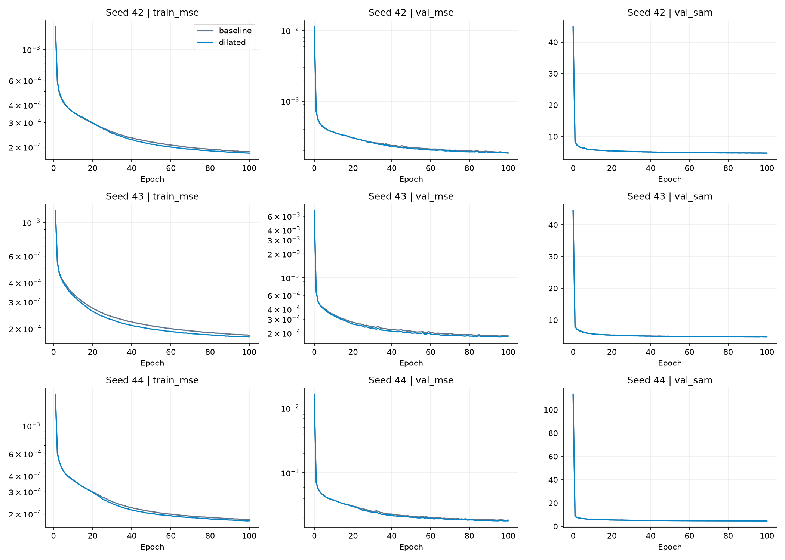
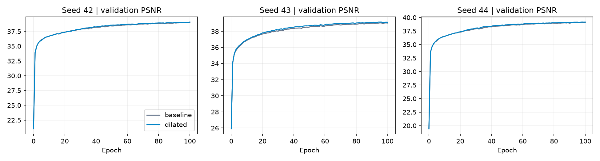
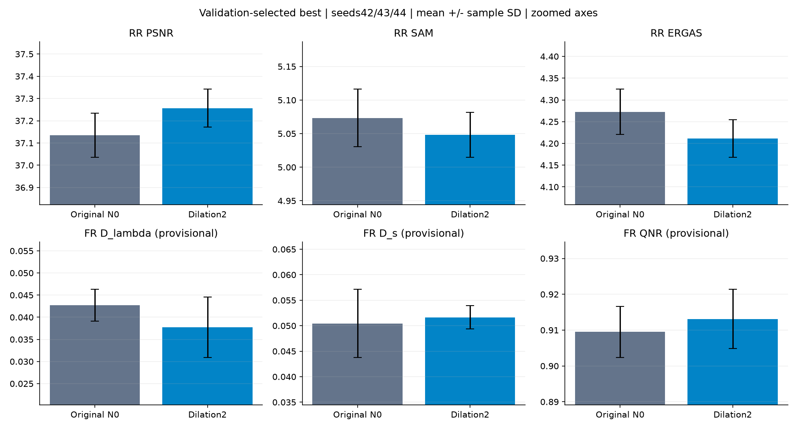
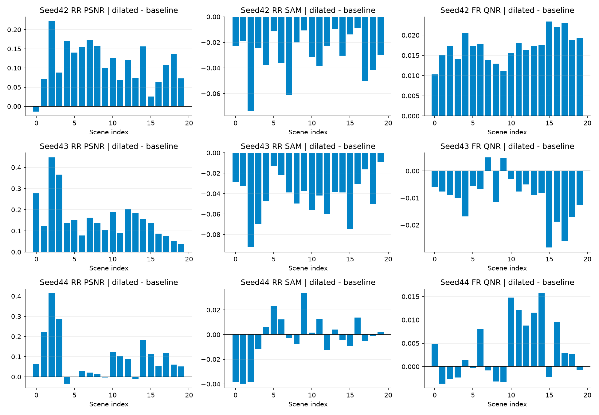
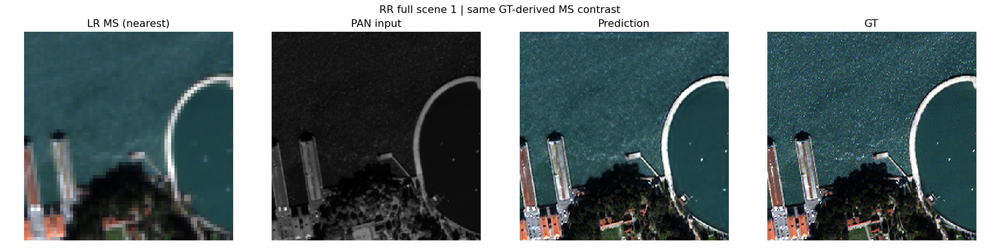
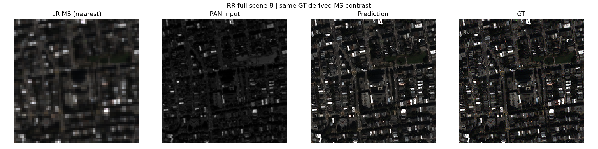
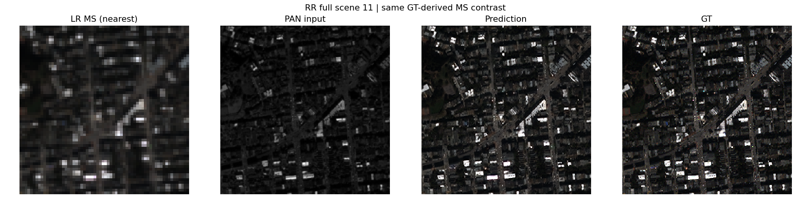
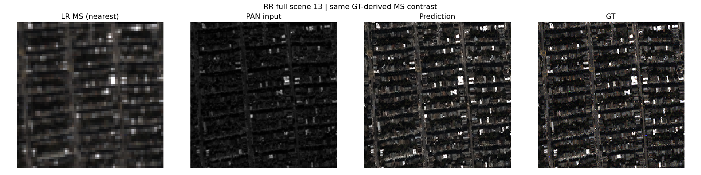
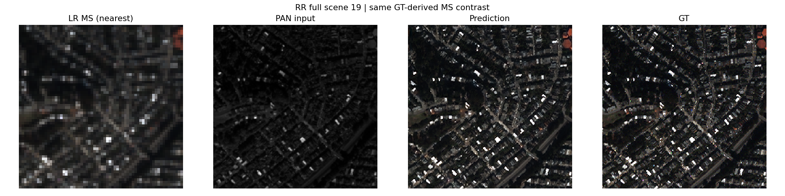

# 백본 일부 합성곱의 dilation 확장

**연구 분야:** 기존 성능 개선

**실험자:** 송준현

**변경 내용:** 원본 SSA-MRN N0 백본의 res2·res4 두 번째 3×3 합성곱만 dilation1·padding1에서 dilation2·padding2로 변경했습니다.

| 확인된 결과 | 상태 | 개선 여부 |
|---|:---:|:---:|
| 3seed 평균 RR PSNR +0.12171dB·SAM −0.02500°·ERGAS −0.06130입니다. 잠정 FR QNR +0.00360이나 Ds +0.00121로 공간 왜곡이 악화되고 seed별 상충이 있습니다. | 평가&nbsp;완료<br>3seed | 부분&nbsp;개선 |

[실험 목록](../../../README.md#performance-experiments) · [재현 자료](#evidence)

## 1. 목적과 상태

파라미터 수와 학습 손실을 유지하면서 일부 합성곱이 더 넓은 공간 문맥을 참조하면 복원 정확도가 높아지는지 확인했습니다. seed42·43·44 각각 두 군 모두 새 초기 가중치에서100 epoch를 완료하고 validation-selected best와 latest를 RR·FR 각각20장 전체에서 평가했습니다. 마지막 기록은 2026-10-18 22:01:16 KST입니다. smoke·재개 reference는 성능 비교에서 제외했습니다.

[33번 보존 N0](../33_ms_anchored_reversible_normalization/README.md)를 공통 기반으로 사용했습니다. N1·LocalNorm·PhotoAug·EMA·FFL·W2 변경을 혼합하지 않았습니다. 다른 실행기의 과거 수치와 비트 단위 재현을 주장하지 않습니다.

## 2. 변경한 구조와 비교 조건

변경 위치는 `core.res2.conv21`과 `core.res4.conv21`이며 각각 `core.backbone.1.conv21`·`core.backbone.3.conv21`과 동일 모듈입니다. kernel3×3·stride1·zero padding 방식·채널·활성화·융합 경로는 유지하고 dilation과 padding만 각각1에서2로 변경했습니다. 각 커널의 가중치는9개로 같지만 참조 범위는3×3에서5×5로 넓어집니다. 활성 백본8개 합성곱의 가장 긴 경로에서 이론적 수용 영역은17×17에서21×21이 됩니다. 이는 주의·다중 스케일 경로를 포함한 전체 모델 수용 영역을 뜻하지 않습니다.


baseline은 같은 위치의 dilation1·padding1입니다. 두 군 모두426,654개 파라미터이며 state_dict의 키·형상·초기 값은 같습니다. 연산의 참조 위치가 달라 **초기 출력은 같을 필요가 없습니다.** dilation은 state_dict에 저장되지 않으므로 올바른 arm으로 모델을 생성한 뒤 strict load해야 합니다. 설정과 실제 모듈의 geometry·alias를 별도로 검증했습니다.

| 조건 | 두 군 공통 |
|---|---|
| 데이터 | QuickBird만 사용, train17,139·validation1,905·RR20·FR20 |
| 모델 / 배율 | K=4 SSA-MRN N0 / 공간4배 |
| 전처리 | 원시 DN/2047, 제공 LMS, 입력·출력 clip 없음 |
| 학습 | seed42·43·44 각각100 epoch, micro32·유효64 |
| optimizer / LR | Adam 기본 옵션, 고정1e-4, scheduler 없음 |
| 손실 / 정밀도 | 기존 MSE, 학습 AMP FP16·MSE/평가 FP32, TF32 끔, GradScaler 시작1024 |
| 난수 | 모델 초기화와 CUDA 샘플 순서(seed+100000) 분리, 같은 seed 두 군의 실제 순서 일치 |
| best 선택 | epoch0 포함 전체 validation MSE 최저, 정확한 동률은 먼저 나온 checkpoint |
| 장치 | 동일 Tesla T4×2, GPU0 baseline·GPU1 dilated |

마지막 불완전 유효 batch는 실제 원소 수로 평균했습니다. 환경·데이터 해시와 GPU 정보는 원본 계약에 남겼습니다. 사전 고정한 dilation2 하나를 비교했으며 test를 이용한 후보 선택은 하지 않았습니다.

## 3. 정량 결과

### Validation 선택

| seed | baseline best epoch / MSE | dilated best epoch / MSE | 변화율 |
|---|---:|---:|---:|
|42|100 / 0.0001871149|100 / 0.0001821872|-2.634%|
|43|96 / 0.0001841403|96 / 0.0001786947|-2.957%|
|44|99 / 0.0001829302|98 / 0.0001790886|-2.100%|

모든 seed에서 validation MSE가 감소했습니다. validation MSE·PSNR·SAM은 전체1,905패치이며 ERGAS·SCC·Q2n validation 기록은 첫32패치 진단값입니다. 서로 같은 범위의 통계로 혼동하지 않습니다.

### Best의 3seed 평균과 표본 표준편차

각 seed는20장 평균이고 SD는 seed3개 간 표본 SD(ddof=1)입니다. 변화는 dilated−baseline이며60장 독립 표본의 SD가 아닙니다.

| 지표 | baseline 평균 ± SD | dilated 평균 ± SD | paired 변화 평균 ± SD |
|---|---:|---:|---:|
|RR PSNR ↑|37.1346139 ± 0.0988413|37.2563264 ± 0.0851897|0.1217125 ± 0.0337268|
|RR SAM ↓|5.0731914 ± 0.0428800|5.0481955 ± 0.0333890|-0.0249958 ± 0.0200913|
|RR ERGAS ↓|4.2726044 ± 0.0518258|4.2113058 ± 0.0431811|-0.0612986 ± 0.0192855|
|RR 잠정 SCC ↑|0.9746288 ± 0.0006937|0.9754681 ± 0.0006513|0.0008393 ± 0.0003425|
|RR 잠정 Q2n ↑|0.9190683 ± 0.0014170|0.9208991 ± 0.0018992|0.0018308 ± 0.0011403|
|FR 잠정 Dλ ↓|0.0427144 ± 0.0035603|0.0377466 ± 0.0068349|-0.0049678 ± 0.0103849|
|FR 잠정 Ds ↓|0.0504438 ± 0.0066694|0.0516519 ± 0.0022806|0.0012081 ± 0.0081824|
|FR 잠정 QNR ↑|0.9094856 ± 0.0071187|0.9130854 ± 0.0082533|0.0035998 ± 0.0135061|

### Seed별 best와 동일 장면 변화

| seed | 지표 | baseline | dilated | 변화 | 개선 장면 |
|---|---|---:|---:|---:|---:|
|42|PSNR|37.0603557|37.1711901|+0.1108344|19/20|
|42|SAM|5.1164040|5.0867225|-0.0296815|20/20|
|42|ERGAS|4.3156315|4.2571927|-0.0584388|20/20|
|42|SCC|0.9741276|0.9747707|+0.0006430|18/20|
|42|Q2n|0.9179463|0.9187393|+0.0007930|18/20|
|43|PSNR|37.0966837|37.2562197|+0.1595359|20/20|
|43|SAM|5.0725182|5.0301879|-0.0423303|20/20|
|43|ERGAS|4.2871107|4.2052563|-0.0818544|20/20|
|43|SCC|0.9743383|0.9755730|+0.0012347|20/20|
|43|Q2n|0.9185979|0.9216494|+0.0030515|20/20|
|44|PSNR|37.2468023|37.3415695|+0.0947671|17/20|
|44|SAM|5.0306519|5.0276762|-0.0029757|11/20|
|44|ERGAS|4.2150712|4.1714684|-0.0436028|16/20|
|44|SCC|0.9754205|0.9760605|+0.0006400|18/20|
|44|Q2n|0.9206607|0.9223085|+0.0016478|18/20|

| seed | 지표 | baseline | dilated | 변화 | 개선 장면 |
|---|---|---:|---:|---:|---:|
|42|D_lambda|0.0446743|0.0346502|-0.0100241|20/20|
|42|D_s|0.0571662|0.0492892|-0.0078769|20/20|
|42|QNR|0.9012663|0.9183502|+0.0170839|20/20|
|43|D_lambda|0.0386047|0.0455816|+0.0069770|1/20|
|43|D_s|0.0503365|0.0538404|+0.0035039|4/20|
|43|QNR|0.9135016|0.9035735|-0.0099282|2/20|
|44|D_lambda|0.0448641|0.0330079|-0.0118562|20/20|
|44|D_s|0.0438287|0.0518261|+0.0079973|4/20|
|44|QNR|0.9136888|0.9173325|+0.0036436|11/20|

### Latest 보조 기록

선택 규칙을 바꾸지 않고 epoch100도 보조 평가했습니다.

| 지표 | baseline 평균 ± SD | dilated 평균 ± SD | paired 변화 평균 ± SD |
|---|---:|---:|---:|
|RR PSNR ↑|37.1596381 ± 0.0859931|37.2931221 ± 0.1059489|0.1334840 ± 0.0208958|
|RR SAM ↓|5.0745909 ± 0.0436726|5.0340438 ± 0.0462815|-0.0405471 ± 0.0191022|
|RR ERGAS ↓|4.2627085 ± 0.0468217|4.1940823 ± 0.0546552|-0.0686261 ± 0.0130123|
|RR 잠정 SCC ↑|0.9747295 ± 0.0005965|0.9755791 ± 0.0007134|0.0008496 ± 0.0002354|
|RR 잠정 Q2n ↑|0.9187700 ± 0.0009022|0.9208969 ± 0.0019111|0.0021269 ± 0.0011650|
|FR 잠정 Dλ ↓|0.0435479 ± 0.0022584|0.0364975 ± 0.0071218|-0.0070503 ± 0.0093388|
|FR 잠정 Ds ↓|0.0497517 ± 0.0070702|0.0514212 ± 0.0018477|0.0016696 ± 0.0088056|
|FR 잠정 QNR ↑|0.9093569 ± 0.0070576|0.9144885 ± 0.0072794|0.0051315 ± 0.0117782|

RR은 GT가 있는 축소 해상도 평가, FR은 GT가 없는 원해상도 평가입니다. RR은 제공된 축소 해상도 H5의 PAN·LMS·MS·GT를 그대로 사용하므로 게시 과정에서 Wald 축소를 다시 생성하지 않았습니다. FR 코드는 PAN을 MS 크기로 cubic(order3)·reflect·anti-alias resize한 뒤23tap으로4배 보간합니다. 센서별 MTF 커널을 적용한 방식은 아니며, Dλ는 예측과 제공 LMS의 밴드 간 block UQI 차이, Ds는 예측/PAN과 LMS/보간 PAN 간 block UQI 차이(block32)로 계산합니다. RR 공간4배·QB 조건과 축소/보간 처리, FR 센서 MTF·정렬 조건은 보존한 metrics 코드와 원본 설정을 기준으로 합니다. 공식 MATLAB 지표 및 센서별 MTF·위상 대응을 독립 검증하지 않아 SCC·Q2n과 FR Dλ·Ds·QNR은 잠정 값으로 표시합니다. 추가적인 센서 일반화나 공식 벤치마크 우위를 주장하지 않습니다.

## 4. 해석과 비용

RR 평균 PSNR·SAM·ERGAS·SCC·Q2n은 모두 유리하며 seed별20장 평균도 같은 방향입니다. 특히 seed42·43 SAM은 각각20/20장 개선됐으나 seed44는11/20장으로 효과가 작습니다. 잠정 FR QNR은 seed43에서 악화되고 seed44도11/20장만 개선됐습니다. 평균 Ds 악화가 있어 분광·공간 개선이 함께 안정적으로 반복됐다고 판정하지 않습니다.

고정 HR4픽셀 테두리와 내부의 MSE를 별도로 기록했습니다. 이는 진단값이며 학습 손실이나 best 선택에는 사용하지 않았습니다. RR에서 내부·테두리의 픽셀 수 가중 평균이 전체 MSE와 일치함을 확인했습니다.

| seed | RR 전체 MSE 변화 | 내부 MSE 변화 | 테두리 MSE 변화 | 내부/테두리 개선 장면 |
|---|---:|---:|---:|---:|
|42|-0.000006334|-0.000006460|-0.000004418|19/20 · 13/20|
|43|-0.000008822|-0.000009019|-0.000005807|20/20 · 17/20|
|44|-0.000004827|-0.000004946|-0.000003016|19/20 · 13/20|

테두리 개선 장면 수는 내부보다 적습니다. padding의 영향이나 dilation의 성긴 샘플링은 후속 확인 대상이지만 이번 비교만으로 원인을 분리할 수 없습니다. 평균 내부·테두리 MSE 모두 감소해 테두리의 일괄 악화로 해석하지 않습니다.

| seed | baseline 학습, 분 | dilated 학습, 분 | baseline validation, 분 | dilated validation, 분 | peak allocated GiB, 두 군 |
|---|---:|---:|---:|---:|---:|
|42|47.94|49.73|3.05|3.35|2.977 / 2.977|
|43|48.05|49.80|3.05|3.34|2.977 / 2.977|
|44|48.31|49.79|3.05|3.35|2.977 / 2.977|

학습 시간은 기록된 active 구간 합으로 구간 내 checkpoint 비용을 포함하고 데이터 적재·validation·test·ZIP은 제외합니다. 이론적 커널 곱셈 수는 같지만 실제 학습 시간은 변경군이 약간 더 길었습니다. 장면별 forward 시간과 warmup 후 반복 측정, 평가 메모리는 원본 evaluation JSON에 보존했습니다. GPU 할당·연산 구현의 영향을 분리한 독립 속도 벤치마크는 아닙니다.

Best checkpoint의 첫 장면에서 warmup3회 후5회 forward 중앙값입니다. 전송·지표 계산을 제외하며 전체20장 평균 추론 시간과 다릅니다.

| seed | RR baseline / dilated, ms | FR baseline / dilated, ms | 평가 peak GiB baseline / dilated |
|---|---:|---:|---:|
|42|22.713 / 23.650|48.274 / 50.356|0.331 / 0.331|
|43|20.703 / 23.483|53.606 / 64.048|0.331 / 0.331|
|44|22.648 / 23.525|48.666 / 50.030|0.331 / 0.331|

## 5. 학습·평가 그래프









차이를 보기 위해 비교 그래프의 y축을 확대했습니다. 오차 막대는 seed 간 표본 SD입니다.

## 6. 결과 이미지

평가 전에 고정한 seed42의0기준 장면1·8·11·13·19를 표시합니다. 전체 장면의 **LR MS 최근접 표시 · PAN 입력 · dilated 예측 · GT** 순서이며 RGB[2,1,0], 동일 GT 밴드별1/99 percentile 대비를 사용합니다. 표시 범위 제한은 학습·평가 clipping과 다릅니다. FR에는 GT를 만들지 않았습니다.

### 장면 1



### 장면 8



### 장면 11



### 장면 13



### 장면 19



[seed43 동일 장면](results/seed_43/dilated/evaluations/best/)과 [seed44 동일 장면](results/seed_44/dilated/evaluations/best/)도 보존했습니다. baseline은 수치 비교와 원본 결과 폴더에 남겼습니다.

<a id="evidence"></a>

## 7. 재현 자료

- [실행 조건·예시 선택](config.json), [원본 프로토콜](provenance/experiment.json), [군별 설정](provenance/configs/), [환경](provenance/environment_contract.json), [데이터 해시](provenance/data_contract.json)를 보존했습니다.
- [초기·best/latest15개 원본 가중치](checkpoints/), [실제 소스](provenance/code/), [ZIP 해시](provenance/archive.json), [파일 manifest](manifest.json), [원본 파일 대응](results/source_artifact_map.json)을 남겼습니다. checkpoint 내부 config와 원본 소스는 수정하지 않았습니다.
- [검증·분석](results/analysis.json), [전체 수치·장면별 변화](results/)와 각 군의 compact history·배치 순서·evaluation 증거를 보존했습니다.
- ZIP CRC·333개 원본 artifact 해시·소스 일치·smoke 재개 증거·3seed 초기 가중치와 실제 순서·전체 데이터 사용·epoch0 포함 validation best·평가 가중치/결과 해시·RR/FR20장 평균을 검증했습니다. 15개 checkpoint strict load·12개 합성 CPU 유한 출력·실제 dilation/alias와 테두리 가중 MSE도 확인했습니다. 비공개 H5 재추론과 추가 학습은 수행하지 않았습니다.

```bash
python SSA-MRN/common/verify.py --experiment 42 --research-track performance
python SSA-MRN/experiments/performance/42_dilated_backbone_context/prepare.py
```

`model.py`에서 올바른 arm을 생성해야 dilation 설정까지 복구됩니다. `run.py`는 고정 소스를 포함한 Kaggle 단일 셀이며 기본smoke입니다. 원본 QB를 연결하고 smoke 후 seed별 final_train→final_test 순서로42·43·44를 진행합니다. 새 실행은 새 RUN_TAG를 사용하고 다른 구조의 checkpoint로 재개하지 않습니다. 실제 코드 버전·해시는 provenance에 보존했습니다.

## 8. 개선 여부와 다음 단계

**부분 개선**입니다. 세 seed의 validation과 RR 정확도 개선은 확인했으나 FR 공간 왜곡의 악화와 seed별 상충으로 기준 모델 자동 승격은 보류합니다. 현재 test를 보고 dilation 위치·강도나 best 규칙을 바꾸지 않습니다. 후속으로 위치별 영향 또는 밀집·확장 경로의 결합을 별도 가설로 사전 고정해 검증할 수 있습니다. 공식 지표 대응과 다른 센서의 재현은 별도 확인이 필요합니다.
