# MS 기준 가역 정규화와 저해상도 병렬 특징 용량 확장

**연구 분야:** 기존 성능 개선

**실험자:** 이병현

**변경 내용:** 원본 SSA-MRN에 입력별 MS 공통 가역 정규화(N1)와 저해상도 병렬 특징 가지(W2)를 단독·결합 적용한 네 군을 세 시드에서 비교했습니다.

| 확인된 결과 | 상태 | 개선 여부 |
|---|:---:|:---:|
| C3는 원본 대비 PSNR +0.7381dB이나 잠정 QNR -0.11599였습니다. 정규화 단독 C1의 평균 RR·FR은 개선됐으나 결합의 FR 악화 완화는 실패했습니다. | 평가 완료·3seed | 부분 개선 |

## 1. 목적과 상태

29번 W2의 RR 이득을 유지하면서 FR 공간 왜곡을 줄일 수 있는지 확인했습니다. 네 군×seed42·43·44의150에폭 학습과 각 validation best의 RR20·FR20 전체 평가를 마쳤습니다. 최종 학습은2026-10-19 17:43, 전체 평가는17:45(KST)에 끝났습니다. 같은20장면을12개 모델로 평가한 RR240·FR240회이며,480개 독립 영상 실험이 아닙니다. 기존 원본 기준 모델을 유지합니다.

## 2. 변경한 구조와 비교 조건

| 군 | 입력·출력 변환 | Backbone | 파라미터 수 |
|---|---|---|---:|
| C0 | 없음 | 원본 | 426,654 |
| C1 | N1 가역 정규화 | 원본 | 426,654 |
| C2 | 없음 | 원본+W2 | 2,853,918 |
| C3 | N1 가역 정규화 | 원본+W2 | 2,853,918 |

N1은 해당 LR MS의 밴드·공간 전체 모집단 평균 μ와 s=max(표준편차,0.01)를 구해 PAN·제공 LMS·MS에 같은(x−μ)/s를 적용하고 출력에 sy+μ를 적용합니다. GT·다른 샘플은 통계에 포함하지 않았습니다. W2는 backbone 입력 특징에 PixelUnshuffle(2) →256에서128채널1×1 Conv →128채널 잔차 블록8개 →128에서256채널1×1 Conv →PixelShuffle(2)를 병렬 적용해 원본 backbone 출력에 더합니다. 마지막 Conv는0으로 초기화했습니다. 실제 backbone과 추가 가지에는 BatchNorm이 없습니다.

아래는 C3의 흐름이며 다른 군의 차이는 위 표와 같습니다.

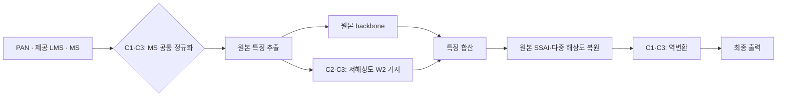

| 조건 | 실제 수행 |
|---|---|
| 데이터 | QB train17,139·validation1,905·RR20·FR20, 원본 해시 확인 |
| 모델·배율 | K4·공간4배, LRPAN·제공 LMS·원본 SSAI 유지 |
| 초기화·순서 | 시드별 공통 core 초기값·150개 epoch 순서 해시 일치 |
| 학습량 | 각150에폭, 전체 패치 사용·drop 없음, epoch당536회 업데이트 시도 |
| 배치·optimizer | effective/micro32, Adam 기본 betas·eps·weight_decay0 |
| 학습률 | 첫 에폭1e-4 →마지막 에폭1e-6, 에폭별 cosine |
| 손실·선택 | DN/2047 좌표의 최종 출력 MSE; epoch0 포함 최소 validation MSE, 동률은 먼저 나온 에폭 |
| 정밀도 | core AMP FP16; 통계·역변환·손실·validation·평가 FP32; TF32 off |
| 실행 | RTX3060Ti8GB, 최대2개 병렬, CPU1스레드·공유 FP32 mmap·pinned 전송·channels-last |
| CUDA 설정 | cuDNN autotune·deterministic convolution, deterministic algorithms warn-only·CUBLAS workspace 고정 |

실행 배치는 본 학습 전 두 W2 군의 처리 속도·메모리로 선택했습니다. validation/test로 최적화 조건을 고르지 않았습니다. 짧은 AMP 재개 검사를 통과했으며 첫 에폭 뒤 완료 로그 오류는 기존 모델·optimizer·scaler·RNG·shuffle·커서를 보존해 수정 후 재개했습니다. 원본 초기 학습 소스·설정·첫 에폭 가중치와 재개 근거는 provenance에 보존했습니다. FP16의 실제 업데이트 건너뜀은 아래에 모두 기록했으며 네 군의 실제 optimizer 업데이트 수가 완전히 같지는 않습니다.

## 3. 정량 결과

### Validation 선택과 업데이트

| 군 | seed | best epoch | best MSE | 실제 업데이트/80,400시도 | AMP skip |
|---|---:|---:|---:|---:|---:|
| C0 | 42 | 148 | 0.000173545674 | 80,380 | 20 |
| C0 | 43 | 147 | 0.000171707251 | 80,378 | 22 |
| C0 | 44 | 150 | 0.000171392315 | 80,379 | 21 |
| C1 | 42 | 148 | 0.000171736390 | 80,381 | 19 |
| C1 | 43 | 147 | 0.000170362277 | 80,385 | 15 |
| C1 | 44 | 150 | 0.000169243344 | 80,383 | 17 |
| C2 | 42 | 141 | 0.000132051044 | 80,382 | 18 |
| C2 | 43 | 150 | 0.000132143012 | 80,382 | 18 |
| C2 | 44 | 142 | 0.000132371603 | 80,381 | 19 |
| C3 | 42 | 141 | 0.000132976237 | 80,384 | 16 |
| C3 | 43 | 150 | 0.000133693053 | 80,384 | 16 |
| C3 | 44 | 130 | 0.000132896412 | 80,384 | 16 |

### RR20·FR20의 세 시드 평균±표본 SD

각 시드에서20장 평균을 구한 뒤 세 시드의 평균·표본 SD를 계산했습니다. 장면×시드60회를 독립 표본으로 취급하지 않았습니다.

| 군 | PSNR ↑ | SAM ↓ | ERGAS ↓ | SCC ↑ | Q2n ↑ |
|---|---:|---:|---:|---:|---:|
| C0 | 37.429252 ± 0.056069 | 4.941135 ± 0.020791 | 4.124113 ± 0.028404 | 0.976691 ± 0.000412 | 0.922992 ± 0.000703 |
| C1 | 37.530202 ± 0.006098 | 4.904639 ± 0.007933 | 4.075478 ± 0.003071 | 0.977444 ± 0.000061 | 0.924109 ± 0.000243 |
| C2 | 38.131651 ± 0.048387 | 4.597452 ± 0.008773 | 3.783471 ± 0.019364 | 0.981823 ± 0.000164 | 0.933811 ± 0.000186 |
| C3 | 38.167344 ± 0.023274 | 4.617891 ± 0.003872 | 3.771570 ± 0.011554 | 0.981845 ± 0.000213 | 0.933696 ± 0.000434 |

| 군 | QNR ↑ | D_lambda ↓ | D_s ↓ |
|---|---:|---:|---:|
| C0 | 0.913716 ± 0.015603 | 0.043863 ± 0.008940 | 0.044746 ± 0.007271 |
| C1 | 0.923714 ± 0.000411 | 0.040741 ± 0.003070 | 0.037391 ± 0.002974 |
| C2 | 0.840349 ± 0.029301 | 0.023049 ± 0.002088 | 0.139543 ± 0.030563 |
| C3 | 0.797724 ± 0.020525 | 0.025504 ± 0.002423 | 0.181038 ± 0.020666 |

### 원본 대비 시드별 차이

| 군 | seed | ΔPSNR dB | ΔSAM ° | Δ잠정 QNR | ΔDλ | ΔDs |
|---|---:|---:|---:|---:|---:|---:|
| C1 | 42 | +0.157568 | -0.053156 | +0.006713 | +0.000631 | -0.007839 |
| C1 | 43 | +0.092155 | -0.022003 | -0.003282 | +0.002060 | +0.001276 |
| C1 | 44 | +0.053128 | -0.034332 | +0.026563 | -0.012057 | -0.015500 |
| C2 | 42 | +0.709617 | -0.358182 | -0.061289 | -0.021537 | +0.082995 |
| C2 | 43 | +0.723404 | -0.331921 | -0.068665 | -0.010020 | +0.079701 |
| C2 | 44 | +0.674177 | -0.340947 | -0.090146 | -0.030885 | +0.121696 |
| C3 | 42 | +0.798654 | -0.344125 | -0.126184 | -0.014651 | +0.143716 |
| C3 | 43 | +0.746778 | -0.308624 | -0.145879 | -0.011519 | +0.159741 |
| C3 | 44 | +0.668845 | -0.316983 | -0.075911 | -0.028909 | +0.105419 |

### 장면별 개선 수

| 군·대조군 | RR PSNR | RR SAM | FR QNR | FR Dλ | FR Ds |
|---|---:|---:|---:|---:|---:|
| C1_vs_C0 | 52/60 | 55/60 | 39/60 | 27/60 | 41/60 |
| C2_vs_C0 | 60/60 | 60/60 | 4/60 | 51/60 | 2/60 |
| C3_vs_C0 | 60/60 | 60/60 | 3/60 | 49/60 | 3/60 |
| C3_vs_C1 | 60/60 | 60/60 | 3/60 | 49/60 | 3/60 |
| C3_vs_C2 | 37/60 | 9/60 | 19/60 | 27/60 | 20/60 |

각60회는 동일20장면의3시드 반복입니다. 정확한 시드·장면별 차이는[전체 paired 기록](results/paired_scene_deltas.json)에 보존했습니다.

## 4. 기준선 대비 차이와 해석

C1 정규화 단독은 원본 대비 세 시드 평균 PSNR +0.100950dB·SAM -0.036497°·잠정 QNR +0.009998였습니다. RR의 PSNR·SAM·ERGAS는3/3시드에서 개선됐지만 잠정 FR QNR은2/3시드에서만 개선됐습니다. seed43은 QNR −0.003282·Ds +0.001276·Dλ +0.002060으로 모두 악화했고, seed42도 Dλ는 +0.000631로 악화했습니다. 따라서 C1도 부분 개선이며 FR 이득의 시드 안정성을 확정하지 않습니다. 단일 센서·기존 탐색 benchmark 결과이며 기준 모델로 승격하지 않습니다.

C3 결합군은 원본 대비 PSNR +0.738092dB이나 잠정 QNR -0.115991였습니다. C2 W2 단독 대비 PSNR +0.035693dB·SAM +0.020439°·QNR -0.042625·Ds +0.041495로, 용량 확장의 FR 악화 완화 가설은 지지되지 않았습니다. C2 대비 C3의 SAM은3/3시드에서 악화했고 PSNR은2/3시드에서만 개선됐습니다. FR QNR은seed42·43에서 악화했지만 seed44는 +0.014235로 개선돼 시드별 방향도 달랐습니다. 원본 대비 C3의 QNR·Ds는3/3시드에서 악화했고 QNR 개선은60회 중3회뿐이었습니다. 정규화 이득과 W2 이득을 단순 합산할 수 없습니다.

요인 상호작용(C3−C2)−(C1−C0)의 평균은 PSNR -0.065257dB·QNR -0.052623입니다. 이는 이 조건에서 두 변경의 결합이 단독 이득의 합보다 불리했다는 관측이며 FR 악화의 물리적 원인까지 입증하지는 않습니다. 원본 대비 개선을 논문 수치 대비 개선으로 해석하지 않습니다. 29·33·40번과 학습량·정밀도·샘플 순서가 완전히 같지 않으므로 기존 숫자를 이 실험의 대조군으로 대신 쓰지 않습니다.

## 5. 학습·평가 그래프

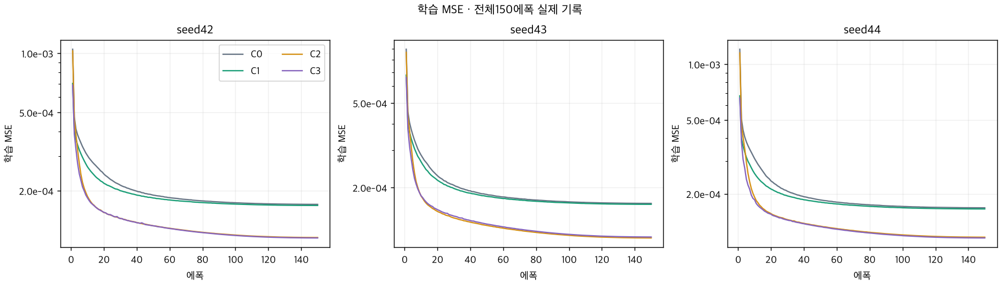

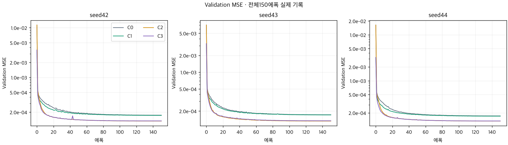

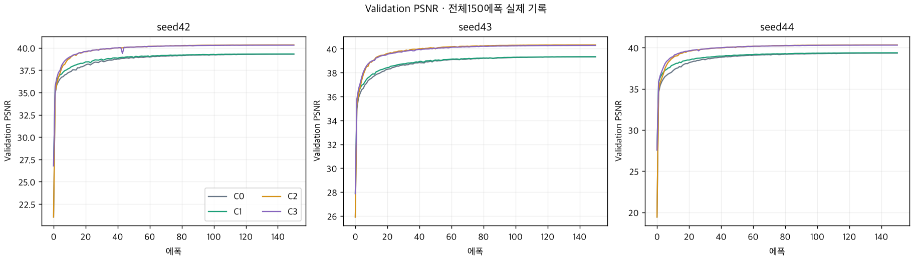

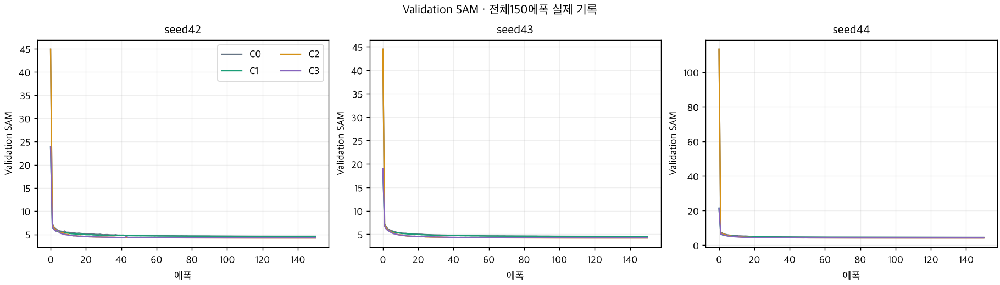

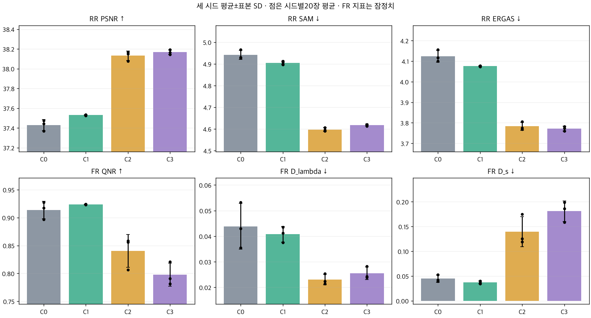

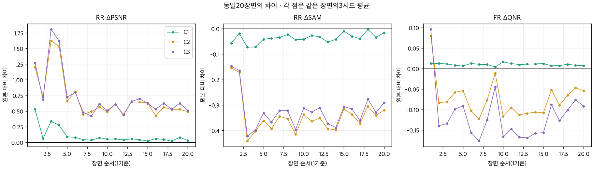

## 6. 결과 이미지

사전 고정한0기준 RR 장면1·8·11·13·19를 사용했습니다. LR MS nearest·PAN 입력·예측·GT 순서이며 RGB[2,1,0], MS 패널은 해당 장면 GT의1/99백분위 대비를 공유합니다. PAN은 별도 grayscale 대비입니다. 아래는 결합군 C3 seed42의 고정5장면이며 네 군·세 시드의 총60개 원본 패널도 모두 보존했습니다. test 결과로 장면·순서를 바꾸지 않았습니다. 지표에는 clipping·타일 분할·TTA를 사용하지 않았고 FR에는 GT를 만들지 않았습니다.

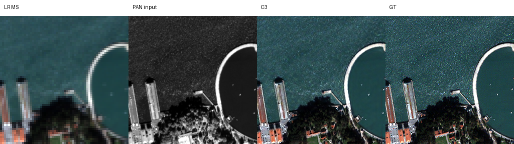

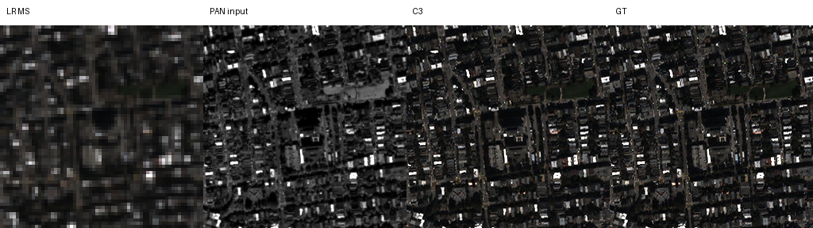

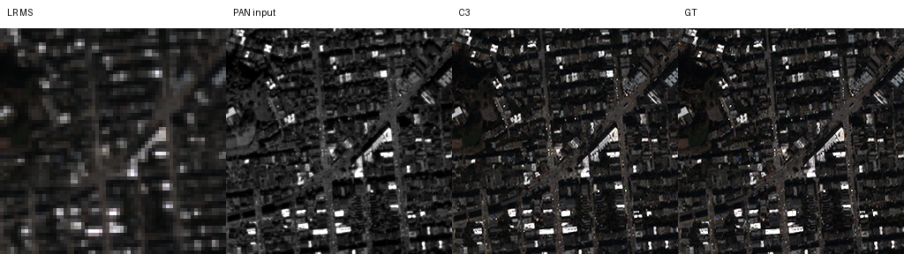

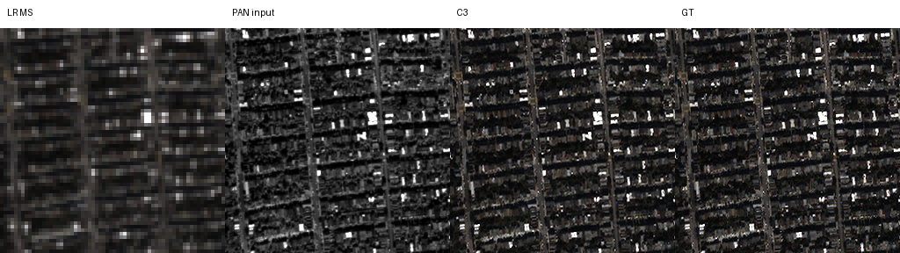

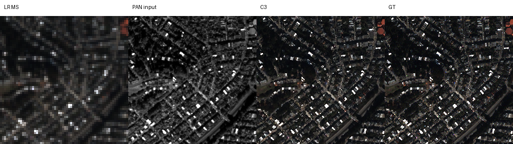

## 7. 재현 자료

[현행 모델](model.py) · [실제 학습·평가 실행기](train.py) · [2슬롯 제어기](run.py) · [설정](config.json) · [검증·보고서 재생성](prepare.py) · [요약](results/summary.json) · [시드·장면 차이](results/paired_scene_deltas.json) · [보관 검증](results/verification.json) · [가중치](checkpoints) · [원본 source snapshots](provenance/source_snapshots) · [원본 실행 설정](provenance/runtime_config.json) · [초기 학습 설정](provenance/initial_runtime_config.json) · [데이터·캐시 해시](provenance/data_manifest.json) · [서버 export manifest](provenance/server_export_manifest.json) · [완료 기록](provenance/all_complete.json) · [최종 보존 manifest](manifest.json)

원본 initial·best·latest36개와 로그 수정 전 두 군의 best·latest4개, 총40개 체크포인트를 바이트 그대로 보존했습니다. 첫 에폭 initial 두 개는 최종 보관 initial과 바이트가 같아 중복 저장하지 않았습니다. 원본 export220개 파일의 해시를 확인했고40개 strict load·CPU FP32 합성 유한 추론,12개 latest의 optimizer step·내부 best 상태와 실제 best 일치를 검증했습니다. 전체150에폭의 샘플 순서와 validation 최소 선택,24개 전체20장 지표 평균과 평가 가중치 해시,60개 고정 이미지도 확인했습니다. 이는 원본 H5의 새로운 전체 재추론이나 장시간 CUDA 강제 종료 복구 시험과 다릅니다. 데이터·공유 정규화 캐시·대량 예측 배열은 Git에 추가하지 않았습니다.

```bash
python SSA-MRN/experiments/performance/43_normalized_parallel_capacity/prepare.py
python SSA-MRN/common/verify.py --research-track performance --experiment 43
```

실제 서버 실행 폴더와 소스 경로는 provenance 원본 설정에 보존했습니다. 새 학습은 데이터 경로·runtime을 새 실행 위치로 명시적으로 구성하고 기존 완료 runtime을 덮어쓰지 않습니다. 자동 평가에는 validation best만 사용했으며 latest나 중간 에폭을 test로 재선택하지 않았습니다.

## 8. 개선 여부와 다음 단계

**부분 개선·결합 후보 채택 보류**입니다. 정규화 단독의 평균 이득과 결합군의 RR·FR 상충을 분리합니다. 다음에는 결합군의 공간 왜곡이 커진 장면과 추가 가지의 기여를 분석한 뒤 새 가설을 정합니다. 현재 결과만으로 통계 증강·고주파 제한·게이트 추가 학습을 자동 실행하지 않습니다. 추가 센서·독립 holdout 및 MATLAB 수치 대응은 미실시이며 기존 원본 기준을 유지합니다.
