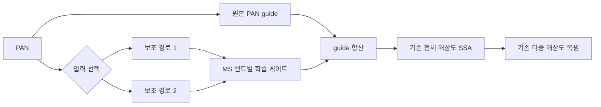
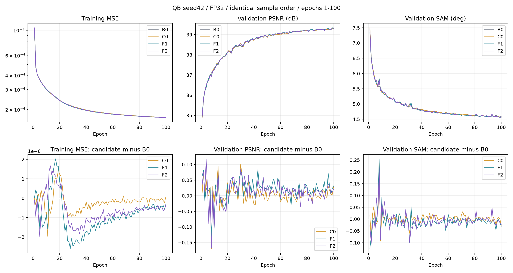
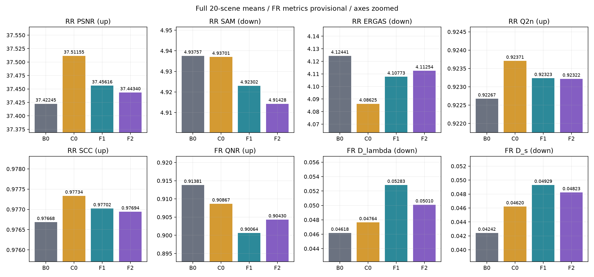
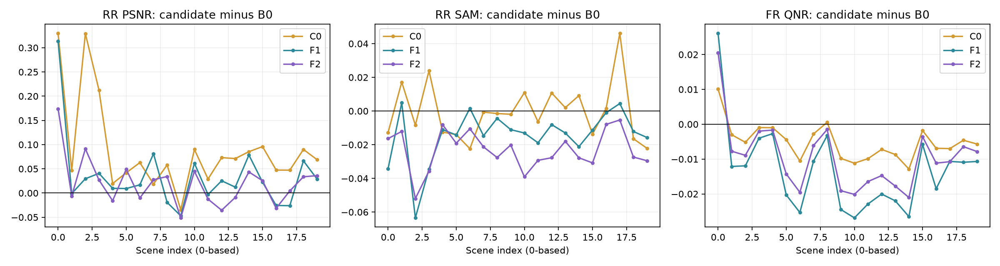
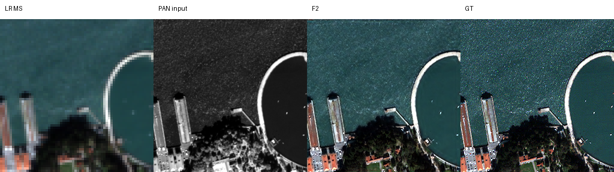
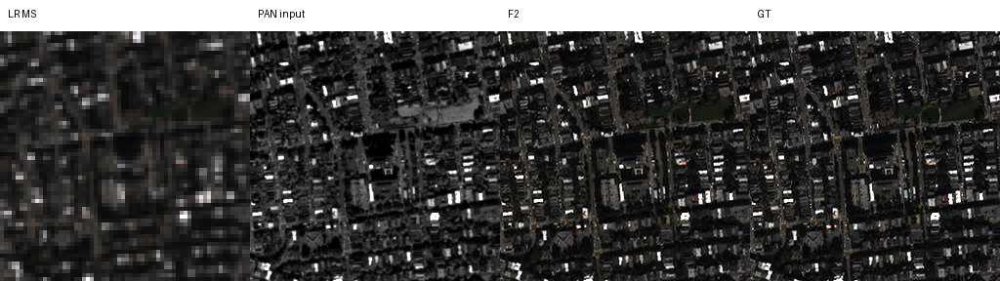
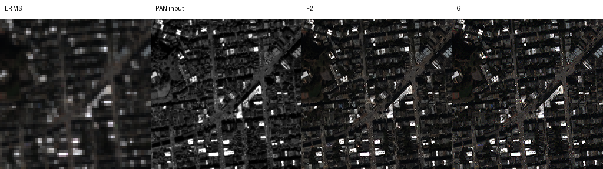
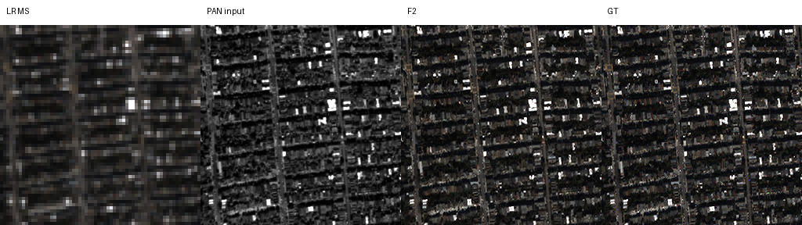
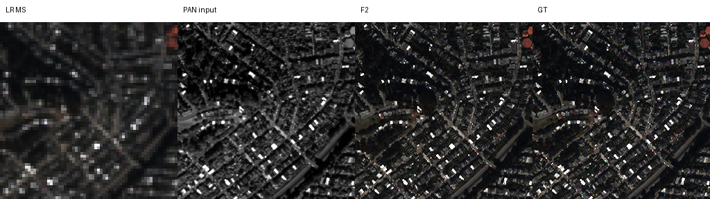

# 위상 보존 주파수 대역 안내

**연구 분야:** 기존 성능 개선

**실험자:** 이병현

**변경 내용:** 전체 해상도 SSA의 PAN guide에 두 소형 특징 경로와 MS 밴드별 게이트를 추가하고, 원본 PAN·고주파·중/고주파 입력을 동일 용량에서 비교했습니다.

| 확인된 결과 | 상태 | 개선 여부 |
|---|:---:|:---:|
| F2는 원본 대비 RR PSNR +0.02094dB·SAM −0.02329°이나 잠정 FR QNR −0.00951이었습니다. 동일 용량 C0 대비 PSNR·QNR도 낮았습니다. | 평가&nbsp;완료 | 부분&nbsp;개선 |

## 1. 목적과 상태

PAN의 공간 정보를 주파수 대역별로 제공하면 일반 convolution 특징 추가보다 RR·FR 복원이 좋아지는지 확인했습니다. QB seed42의 네 군을 각각100에폭 학습하고 validation-best의 RR20·FR20 전체를 평가했습니다. 학습은2026-10-20 01:08:09, 평가는01:08:46(KST)에 끝났습니다. 동일20장면을 네 모델에 반복 평가했으며 RR80·FR80개의 독립 장면을 확보한 것은 아닙니다. 기존 원본 기준 모델을 유지하고 후보 채택을 보류합니다.

## 2. 변경한 구조와 비교 조건

| 군 | 보조 경로1·2 입력 | 파라미터 |
|---|---|---:|
| B0 | 없음, 원본 | 426,654 |
| C0 | 원본 PAN·원본 PAN | 427,040 |
| F1 | 고주파·고주파 | 427,040 |
| F2 | 중주파·고주파 | 427,040 |

C0·F1·F2의 보조 경로는 각각 Conv(1→4,3×3) → PReLU → Conv(4→4,3×3)입니다. 두 경로를 MS 밴드 사이에 공유하고4밴드×2경로 게이트만 밴드별로 학습했습니다. 기존 PAN guide 출력에 보조 특징의 가중합을 더한 뒤 원본 SSA 연산을 적용했습니다. 게이트는0으로 초기화했고 공통 원본 core의 초기 가중치와 초기 출력을 확인했습니다. 원본 PAN·pan_down_up·다른 두 해상도 SSA 경로는 유지했습니다.

주파수 분해는 반경0.10·0.25 cycles/pixel의 고정 Gaussian 저역 마스크 G1·G2로 구성했습니다. reflect16픽셀 padding 후 복소2D FFT에 G1, G2−G1, 1−G2를 곱해 역변환하고 crop했습니다. 패딩 영상의 위상을 보존하며 세 대역의 합이 원본 PAN을 재구성합니다. 부드러운 마스크는 대역 경계가 겹칩니다. 패치와 전체 장면의 전역 FFT 경계·문맥 차이는 남아 있습니다. 이번 실험은 위상 자체를 학습하거나 위상 손실을 적용한 실험이 아닙니다.



| 조건 | 실제 수행 |
|---|---|
| 데이터 | QB train17,139·validation1,905·RR20·FR20, 원본 H5 해시 확인 |
| 구조 | K4·공간4배, 제공 LMS·LR MS·원본 attention/보간 유지 |
| 학습 | seed42·처음부터100에폭, 전체 패치 사용·drop 없음 |
| 초기화·순서 | 네 군의 공통 core 초기값·100개 epoch 샘플 순서 해시 일치 |
| 배치·optimizer | effective/micro32, Adam 기본 betas·eps·weight_decay0 |
| LR·손실 | LR1e-4 고정, DN/2047 좌표의 최종 출력 MSE |
| 선택 | epoch0 포함 전체 validation MSE 최소, 정확한 동률은 먼저 나온 epoch |
| 정밀도 | 학습·검증·FFT·평가 모두 FP32, TF32 off, AMP 비활성 |
| 장치·실행 | Ryzen5600X·RAM16GB·RTX3060Ti8GB, 최대2개 병렬 |
| 데이터 전송 | read-only FP32 mmap 공유, 배치별 pinned 전송, contiguous·CPU1스레드/프로세스 |
| CUDA | cuDNN autotune·deterministic convolution, deterministic algorithms warn-only·CUBLAS workspace 고정 |

독립적인 폐기 모델 두 개로 contiguous/CPU1, channels_last/CPU1, channels_last/CPU2를 실측해 contiguous/CPU1을 선택했습니다. validation/test 수치로 실행 설정을 선택하지 않았습니다. 선택 조합의 동시 학습 배치 중앙값은 약0.154초였고, 실제 네 군의 업데이트는 각각53,600회·skip0회입니다. 실행 순서·단독 실행 구간이 달라 군별 시간 합계를 구조 속도 비교로 해석하지 않습니다. 원본 학습 코드에 남아 있는 GradScaler/AMP 관련 안내 문자열은 비활성 API의 재사용이며, 실제 설정·호출·실행은 FP32입니다.

## 3. 정량 결과

### Validation으로 선택한 checkpoint

| 군 | best epoch | validation MSE ↓ | PSNR ↑ | SAM ↓ |
|---|---:|---:|---:|---:|
| B0 | 99 | 0.000172048643 | 39.313976 | 4.571251 |
| C0 | 100 | 0.000171444596 | 39.326732 | 4.570207 |
| F1 | 99 | 0.000171431248 | 39.336464 | 4.554830 |
| F2 | 99 | 0.000171568663 | 39.326171 | 4.556735 |

### RR20 전체 장면 평균

| 군 | PSNR ↑ | SAM ↓ | ERGAS ↓ | SCC ↑ | Q2n ↑ |
|---|---:|---:|---:|---:|---:|
| B0 | 37.422455 | 4.937565 | 4.124410 | 0.976683 | 0.922675 |
| C0 | 37.511554 | 4.937010 | 4.086250 | 0.977335 | 0.923706 |
| F1 | 37.456158 | 4.923024 | 4.107730 | 0.977022 | 0.923233 |
| F2 | 37.443398 | 4.914279 | 4.112539 | 0.976942 | 0.923216 |

### FR20 전체 장면 평균

| 군 | QNR ↑ | Dλ ↓ | Ds ↓ |
|---|---:|---:|---:|
| B0 | 0.913810 | 0.046176 | 0.042416 |
| C0 | 0.908666 | 0.047645 | 0.046203 |
| F1 | 0.900635 | 0.052832 | 0.049294 |
| F2 | 0.904302 | 0.050099 | 0.048228 |

RR PSNR은peak2047의 밴드별 PSNR을 장면 안에서 평균한 뒤20장을 평균했습니다. validation은 패치 집계로 RR 전체 장면 수치와 다릅니다. FR에는 GT가 없고 QNR·Dλ·Ds 및 Q2n·SCC의 MATLAB parity는 미검증 잠정 지표입니다. clipping·TTA·타일 분할 없이 validation-best를 평가했습니다.

### 대응 장면별 개선 수와 평균 차이

차이는 앞 군−뒤 군이며 PSNR·QNR은 양수, SAM은 음수가 개선입니다.

| 비교 | ΔPSNR dB | ΔSAM ° | Δ잠정 QNR | PSNR 개선 | SAM 개선 | QNR 개선 |
|---|---:|---:|---:|---:|---:|---:|
| C0 대 B0 | +0.089100 | -0.000555 | -0.005144 | 19/20 | 12/20 | 2/20 |
| F1 대 B0 | +0.033703 | -0.014541 | -0.013175 | 14/20 | 17/20 | 1/20 |
| F2 대 B0 | +0.020943 | -0.023286 | -0.009508 | 12/20 | 20/20 | 1/20 |
| F2 대 C0 | -0.068157 | -0.022731 | -0.004364 | 2/20 | 18/20 | 1/20 |
| F2 대 F1 | -0.012760 | -0.008745 | +0.003667 | 6/20 | 17/20 | 18/20 |

## 4. 기준선 대비 차이와 해석

F2는 B0보다 RR PSNR +0.020943dB·SAM −0.023286°였으나 잠정 QNR은 −0.009508로 악화했습니다. SAM은20/20장면에서 좋아졌지만 QNR은1/20장면에서만 좋아졌습니다. Dλ·Ds도 모두 악화해 RR·FR 동반 개선을 확인하지 못했습니다.

F2는 동일 용량 C0보다 SAM이 −0.022731° 좋아졌지만 PSNR −0.068157dB·ERGAS +0.026289·QNR −0.004364였습니다. 따라서 주파수 분해가 일반 PAN 특징 추가보다 전반적으로 우수하다는 가설은 지지되지 않았습니다. F2가 F1보다 QNR은 +0.003667 좋아졌지만 PSNR은 −0.012760dB였으므로 중주파 분리의 일관된 우위도 확인하지 못했습니다. C0도 B0보다 RR PSNR은 +0.089100dB이나 QNR −0.005144였고 채택하지 않습니다.

이 결과는 고정Gaussian 대역·게이트·전체 해상도 SSA 한 위치·QB 단일 시드의 결과입니다. 모든 주파수 접근이나 위상 학습의 가능성을 부정하는 결과로 확대하지 않습니다. 기존43번 등과 학습량·정밀도·스케줄이 달라 이번 B0를 대신하는 대조군으로 합치지 않습니다.

## 5. 학습·평가 그래프





비교 그래프는 작은 차이를 표시하기 위해 축을 확대했습니다. FR은 잠정 지표입니다.



## 6. 결과 이미지

사전 고정한0기준 RR 장면1·8·11·13·19를 사용했습니다. 각 이미지의 순서는 LR MS nearest·PAN 입력·예측·GT이며 RGB[2,1,0]입니다. MS 패널은 해당 장면 GT의1/99백분위 대비를 공유하고 PAN은 별도 grayscale 대비입니다. test 결과로 장면·순서를 재선택하지 않았습니다. 아래는 F2의 고정5장면이고 네 군의 전체20개 패널도 results에 보존했습니다. 미세한 수치 차이를 시각적 개선으로 단정하지 않습니다. FR에는 GT 이미지를 만들지 않았습니다.











## 7. 재현 자료

[모델](model.py) · [실제 학습·평가 실행기](train.py) · [2슬롯 제어기](run.py) · [설정](config.json) · [검증·그래프 재생성](prepare.py) · [요약](results/summary.json) · [장면별 차이](results/paired_scene_deltas.json) · [검증 결과](results/verification.json) · [원본 가중치](checkpoints) · [실제 서버 소스](provenance/training_source) · [원본 실행 설정](provenance/runtime_config.json) · [데이터 manifest](provenance/data_manifest.json) · [서버 export manifest](provenance/server_export_manifest.json) · [보존 manifest](manifest.json)

네 군의 initial·best·latest 총12개 checkpoint를 원본 바이트 그대로 보존했습니다. 서버 export76개 파일의 해시,12개 strict load·CPU FP32 합성 유한 추론, optimizer step53,600회, latest의 best 상태와 실제 best,100개 epoch 샘플 순서와 validation 최소 선택,8개 평가 JSON의 전체20장 집계·가중치 해시,20개 고정 이미지 존재를 검증했습니다. 새 H5 전체 추론이나 MATLAB 수치 정합을 다시 수행한 검증은 아닙니다.

```bash
python SSA-MRN/experiments/performance/44_phase_preserving_frequency_guidance/prepare.py --verify-only
python SSA-MRN/common/verify.py --research-track performance --experiment 44
```

`prepare.py`를 옵션 없이 실행하면 기록된 결과에서 그래프·요약·manifest를 재생성합니다. 실제 학습 당시 코드·설정은 provenance에 동결했으며 원본 서버 경로·해시는 해당 자료에 보존했습니다. 같은 runtime으로 새 실험을 덮어쓰지 않습니다.

## 8. 개선 여부와 다음 단계

**부분 개선·후보 채택 보류**입니다. F2의 RR 소폭 개선과 분광각 개선은 확인됐지만 잠정 FR 왜곡이 증가했고 동일 용량 대조군 대비 우위를 확보하지 못했습니다. 기존 원본 기준 모델을 유지합니다. 단일 QB seed42·기존 탐색 benchmark·독립 holdout 부재·MATLAB parity 미검증의 한계가 있습니다. 다음에는 대역별 게이트와 FR 왜곡 장면을 분석해 새 가설을 정한 뒤 반복 시드·추가 센서·관측 일치 제약을 검토합니다. 학습 cutoff·위상 손실·unrolling은 이번에 실행하지 않았습니다.
