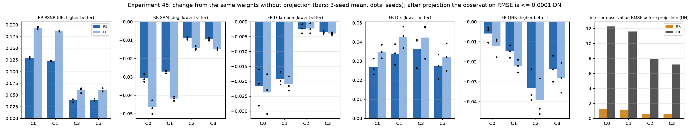

# 45. 추론 시 정확한 관측 일치 사영

**연구 분야:** 기존 성능 개선

**실험자:** 이병현

**변경 내용:** 새로 학습하지 않았습니다. [성능 43번](../43_normalized_parallel_capacity/README.md)의 12개 가중치(C0-C3 × seed42·43·44) 출력에, 추론할 때만 "출력을 관측 연산자로 열화하면 입력 MS와 정확히 같아지도록" 하는 최소 보정 사영을 적용해 RR20·FR20을 다시 평가했습니다. 학습 파라미터는 없습니다.

| 확인된 결과 | 상태 | 개선 여부 |
|---|:---:|:---:|
| 사영은 12개 모델 전부에서 RR PSNR·SAM을 개선했습니다(원본 크기 C0 +0.129 dB, 240/240장). 그러나 FR Ds는 모든 군에서 나빠졌고, W2 용량 군 C2는 Ds +0.036·QNR −0.033(0/60장 개선)이라 사전 기준(Ds −0.03 이하)에 미달했습니다. | 사전&nbsp;검증&nbsp;완료 | 성능&nbsp;비교&nbsp;아님 |

[실험 목록](../../../research/performance/README.md) · [수치](#results) · [그래프](#graphs) · [이미지](#images) · [재현 자료](#evidence)

## 1. 목적과 상태

[성능 29·43번](../43_normalized_parallel_capacity/README.md)의 W2 병렬 용량 확장은 RR PSNR을 약 +0.7 dB 높였지만 FR Ds를 크게 악화시켰습니다. 관측 연산자를 정확히 넣은 반복 복원(deep unfolding)으로 이 RR 이득을 지키면서 FR을 회복할 수 있는지 판단하려고, 학습하기 전에 가장 단순한 형태를 확인했습니다. 이미 학습된 출력에 정확한 관측 일치 층을 씌웠을 때 Ds가 줄어드는지 보는 검사입니다.

2026-10-20 02:00-02:13에 서버에서 실행했습니다. 옵티마이저 업데이트와 가중치 저장은 없습니다.

## 2. 변경한 구조와 비교 조건

| 항목 | 정의 |
|---|---|
| 관측 연산자 D | `common/observation.py`의 QB 관측: 밴드별 DLPan MTF 41탭 FIR, 복제 경계, 4배 추출(위상 2). [성능 3번](../../../research/performance/3_ms_observation/README.md)에서 train 내부 RMSE 2.2e-13 DN으로 확인된 연산자 |
| 사영 | `y' = argmin ‖y' − y‖²  s.t.  M·D·y' = M·MS` → `y' = y + Dᵀ Mᵀ λ`, `(M D Dᵀ Mᵀ) λ = M (MS − D y)` |
| 풀이 | 밴드별 공액 기울기(CG), FP32, 상대 잔차 1e-6, 최대 300회. Dᵀ는 자동 미분으로 구한 정확한 adjoint |
| P5 (주 변형) | M = MS 격자에서 가장자리 5화소를 뺀 내부(3번 확인 범위와 같음) |
| P0 (보조 변형) | M = MS 격자 전체 |
| 대상 | 43번 validation-best 가중치 12개. C0 원본, C1 MS 기준 정규화, C2 원본+W2, C3 정규화+W2 |
| 평가 | RR20·FR20 전체 장면, DN/2047 입출력, clipping 없음, `common/metrics.py` |

```mermaid
flowchart LR
 X[PAN · LMS · MS] --> N[43번 학습 모델 C0-C3]
 N --> Y[원본 출력 y]
 Y --> D[관측 연산자 D]
 MS[입력 MS] --> E[M·(MS − D·y)]
 D --> E
 E --> C[CG로 λ 풀이]
 C --> T[Dᵀ·Mᵀ·λ]
 Y --> S[y + Dᵀ·Mᵀ·λ]
 T --> S
 S --> O[관측 일치 출력 y′]
```

### 사전에 고정한 판정 기준

| 항목 | 기준 |
|---|---|
| 주 기준 (C2+P5 대 C2, 3시드 평균) | Ds −0.03 이하이고 PSNR −0.15 dB 이상이면 통과. 통과하면 "고용량 + 정확한 관측 층" 설계를 지지 |
| 큰 개선 후보 (C2+P5 대 C0 원본 출력) | PSNR +0.3 dB 이상이고 잠정 QNR −0.005 이상 |
| 나머지 | C0·C1·C3와 P0 변형은 판정 없이 함께 보고 |

<a id="results"></a>

## 3. 정량 결과

### 사전 확인

| 확인 | 결과 |
|---|---|
| 제약의 데이터 정합 (RR test 20장, 정답 GT) | D(GT) − MS의 RMSE: 내부 평균 0.000102 DN(최대 0.000125), 경계 0.000102 DN. RR에서는 정답도 이 제약을 FP32 정밀도로 만족합니다 |
| 사영 없는 출력의 재현 | 12개 모델의 RR·FR 평균이 43번 보관 평가와 최대 2.3e-7 차이로 같음 |
| 사영 정확도 | CG 81-83회, 상대 잔차 1e-6 이하, 사영 후 내부 관측 RMSE 0.0001 DN |
| 소스 일치 | 43번에 보존된 공용 모델·지표·원본 network는 저장소와 코드가 같음(줄바꿈과 끝 빈 줄만 다름) |

### 사영 전후 차이 (3시드 평균, 사영 후 − 사영 전)

| 군 | 변형 | PSNR ↑ | SAM ↓ | ERGAS ↓ | Q2n ↑ | Dλ ↓ | Ds ↓ | 잠정 QNR ↑ |
|---|---|---:|---:|---:|---:|---:|---:|---:|
| C0 | P5 | +0.1294 | −0.0307 | −0.0579 | +0.0021 | −0.0217 | +0.0267 | −0.0059 |
| C0 | P0 | +0.1940 | −0.0466 | −0.0872 | +0.0030 | −0.0238 | +0.0350 | −0.0120 |
| C1 | P5 | +0.1227 | −0.0272 | −0.0548 | +0.0020 | −0.0192 | +0.0337 | −0.0149 |
| C1 | P0 | +0.1867 | −0.0418 | −0.0841 | +0.0029 | −0.0210 | +0.0427 | −0.0221 |
| **C2** | **P5** | +0.0385 | −0.0090 | −0.0168 | +0.0007 | −0.0023 | **+0.0361** | −0.0332 |
| C2 | P0 | +0.0603 | −0.0143 | −0.0263 | +0.0009 | −0.0023 | +0.0423 | −0.0393 |
| C3 | P5 | +0.0394 | −0.0096 | −0.0169 | +0.0007 | −0.0036 | +0.0272 | −0.0236 |
| C3 | P0 | +0.0602 | −0.0148 | −0.0260 | +0.0009 | −0.0040 | +0.0321 | −0.0281 |

### 장면별로 좋아진 횟수 (3시드 × 20장 = 60)

| 군·변형 | PSNR | SAM | Dλ | Ds | QNR |
|---|---:|---:|---:|---:|---:|
| C0 P5 | 60/60 | 60/60 | 58/60 | 5/60 | 19/60 |
| C1 P5 | 60/60 | 60/60 | 58/60 | 6/60 | 12/60 |
| C2 P5 | 60/60 | 60/60 | 32/60 | 0/60 | 0/60 |
| C3 P5 | 60/60 | 60/60 | 42/60 | 0/60 | 0/60 |

P0도 같은 방향이었습니다(C0 PSNR 60/60, Ds 5/60).

### 사영 전 관측 불일치 (내부 RMSE, DN)

| 군 | RR | FR |
|---|---:|---:|
| C0 | 1.224 | 12.286 |
| C1 | 1.183 | 11.587 |
| C2 | 0.584 | 7.947 |
| C3 | 0.586 | 7.178 |

### 사전 기준 판정

| 기준 | 결과 | 판정 |
|---|---|---|
| 주 기준 (C2+P5 − C2) | Ds +0.0361, PSNR +0.0385 dB | **실패** |
| 큰 개선 후보 (C2+P5 − C0) | PSNR +0.7409 dB, QNR −0.1066 | **실패** |

RR PSNR은 peak 2047의 밴드별 값을 장면 안에서 평균한 뒤 20장을 평균했습니다. 3시드 평균은 시드별 20장 평균을 다시 평균한 값입니다. FR에는 GT가 없으며 QNR·Dλ·Ds·Q2n·SCC의 MATLAB 정합은 미검증입니다.

## 4. 기준선 대비 차이와 해석

- **관측 일치 사영은 RR을 확실히 개선합니다.** RR에서는 정답이 이 제약을 정확히 만족하므로, 출력을 제약 집합에 최소 거리로 옮기면 정답에 가까워지는 것이 예상된 결과입니다. 원본 크기 모델에서 효과가 크고(+0.12에서 +0.19 dB), 이미 관측과 잘 맞는 W2 군에서는 작았습니다(+0.04에서 +0.06 dB).
- **FR에서는 분광 지표와 공간 지표가 반대로 움직였습니다.** Dλ는 원본 크기 모델에서 약 절반으로 줄었지만(58/60장), Ds는 거의 모든 장면에서 커졌습니다.
- **W2 군의 FR 악화는 관측 불일치 때문이 아닙니다.** 사영 전 FR 관측 불일치는 C2(7.9 DN)가 C0(12.3 DN)보다 오히려 작습니다. 관측과 더 잘 맞는데도 Ds가 큽니다. 관측 일치를 강제해도 C2의 Ds는 더 나빠졌습니다(0/60장 개선). 따라서 관측 연산자만 정확히 넣는 unfolding으로는 이 문제를 풀 수 없다고 판단해 해당 학습은 진행하지 않습니다.
- **FR 지표에 대한 관찰입니다.** 모든 이상적인 결과가 만족해야 하는 관측 일관성(Wald 일관성)을 정확히 강제했는데 Ds가 나빠졌습니다. [성능 35번](../35_cross_scale_consistency/README.md)에서 validation 오차가 작을수록 Ds가 큰 경향(Spearman −0.57)과 같은 방향입니다. "RR을 높이면 FR이 나빠진다"는 맞바꿈의 일부가 toolbox 기본 Ds 정의의 성질일 가능성이 있지만, 이번 실험으로 확인하지는 않았습니다.
- 이 결과는 QB 한 센서, 43번 조건(150에폭 cosine·AMP 학습)의 가중치, 탐색에 반복 사용한 test에 한정됩니다.

<a id="graphs"></a>

## 5. 학습·평가 그래프



막대는 3시드 평균, 점은 시드별 값입니다. 진한 막대는 P5, 연한 막대는 P0입니다. 마지막 그래프는 사영 전 내부 관측 RMSE(DN)이며 사영 후에는 모두 0.0001 DN 이하입니다. 학습하지 않았으므로 학습 곡선은 없습니다.

<a id="images"></a>

## 6. 결과 이미지

새 모델을 학습하지 않았고 사영 출력 이미지는 저장하지 않았습니다. 장면별 전체 지표는 [projection.json](results/projection.json)에 있습니다. 같은 가중치의 사영 전 예시 패널은 [성능 43번](../43_normalized_parallel_capacity/README.md)에 있습니다.

<a id="evidence"></a>

## 7. 재현 자료

[관문 검사](prepare.py) · [설정과 사전 기준](config.json) · [실행 당시 설정](provenance/config.json) · [전체 결과](results/projection.json) · [완료 기록](results/complete.json) · [manifest](manifest.json)

평가한 가중치는 43번 폴더의 `checkpoints/<군>_QB_s<시드>/best.pt`이며, 해시는 결과 파일에 기록했습니다.

```bash
python SSA-MRN/experiments/performance/45_exact_observation_projection/prepare.py --data <QB_H5_폴더> --output <새_출력_폴더>
```

## 8. 개선 여부와 다음 단계

**성능 비교 아님**입니다. 학습 없는 관문 검사이며, 주 기준을 통과하지 못해 관측 일치 층을 넣은 학습은 진행하지 않았습니다. 기준 모델은 원본 A0로 유지합니다.

추론 시 사영은 학습 없이 RR을 높이는 후처리이지만, FR Ds·QNR을 함께 악화시켜 RR·FR 동반 개선 기준을 충족하지 못합니다. 다음 단계에서는 FR 판정을 QNR·Ds 하나에 의존하는 방식을 팀에서 검토할 필요가 있습니다. 예를 들어 HQNR이나 FR 관측 일관성을 함께 보고하는 방안이며, 결정 전까지 기존 기준을 유지합니다.
