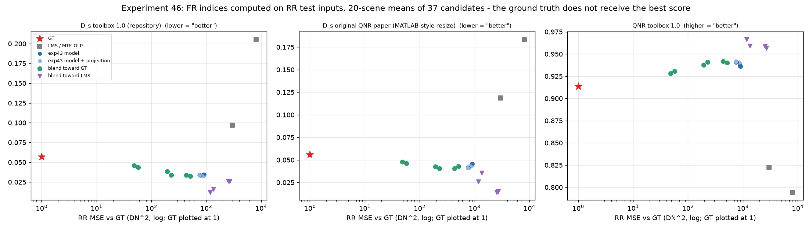
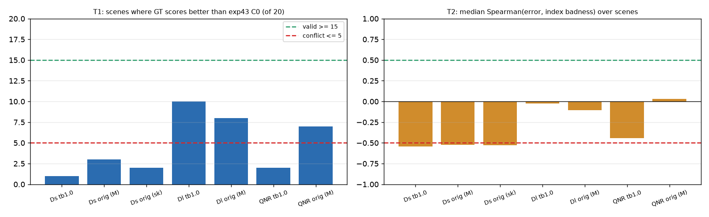

# 46. FR 공간 왜곡 지표의 축소 해상도 타당성 검증

**연구 분야:** 기존 성능 개선

**실험자:** 이병현

**변경 내용:** 새로 학습하지 않았습니다. 정답(GT)이 있는 RR test 입력을 FR 지표에 FR 입력처럼 그대로 넣고, 정답과의 거리를 아는 결과 37개(정답, LMS, MTF-GLP, 43번 모델 12개의 사영 전후, 정답·LMS 쪽 혼합)를 채점했습니다. 저장소의 FR 지표(DLPan-Toolbox 1.0 정의)와 원 QNR 논문 방식이 정답을 가장 좋게 채점하는지 확인했습니다.

| 확인된 결과 | 상태 | 개선 여부 |
|---|:---:|:---:|
| 정답의 Ds가 C0 모델보다 좋은 장면은 Toolbox 1.0에서 1/20, 원 논문 방식에서 2-3/20이었습니다. 정답과의 오차와 Ds 나쁨의 순위 상관은 −0.53에서 −0.54입니다. 사전 기준상 두 Ds 정의 모두 "정답 정확도와 충돌"입니다. | 사전&nbsp;검증&nbsp;완료 | 성능&nbsp;비교&nbsp;아님 |

[실험 목록](../../../research/performance/README.md) · [수치](#results) · [그래프](#graphs) · [이미지](#images) · [재현 자료](#evidence)

## 1. 목적과 상태

지금까지 RR을 크게 높인 변경(성능 27·29·43번 등)은 FR Ds·QNR을 거의 항상 악화시켰고, 판정 기준상 "RR·FR 동반 개선"을 넘지 못했습니다. [성능 35번](../35_cross_scale_consistency/README.md)에서는 validation 오차가 작은 모델일수록 FR Ds가 큰 경향(Spearman −0.57)이 나왔습니다. [성능 45번](../45_exact_observation_projection/README.md)에서는 정답도 만족하는 관측 일치 조건을 정확히 강제했는데도 Ds가 나빠졌습니다. 이 맞바꿈의 일부가 모델이 아니라 Ds 정의의 성질일 수 있다는 가설을 직접 확인했습니다.

FR 지표는 "축척이 바뀌어도 PAN과 MS의 관계가 유지된다"는 가정 위에 서 있습니다. 정답이 있는 축척(RR)에서 같은 지표를 계산해 정답이 가장 좋은 점수를 받는지 보는 것은 이 가정을 점검하는 표준적인 방법입니다.

2026-10-20 02:21-02:33에 Toolbox 1.0 지표를, 02:41-02:53에 원 논문 방식 지표를 서버에서 계산했습니다. 학습과 옵티마이저 업데이트는 없습니다. 지표 구현이 MATLAB과 같은지는 별도 PR(#105)에서 확인하고 있습니다.

## 2. 변경한 구조와 비교 조건

### 채점한 결과 (RR test 20장 각각)

| 후보 | 개수 | 내용 |
|---|---:|---|
| GT | 1 | 정답 |
| LMS | 1 | 제공된 업샘플 MS |
| MTF-GLP | 1 | [성능 36번](../36_gain_map_detail_injection/README.md)에서 구현한 고전 기법 |
| 43번 모델 | 12 | C0-C3 × seed42·43·44 validation-best |
| 43번 모델 + 사영 | 12 | 위 출력에 45번 P5 관측 일치 사영 |
| 정답 쪽 혼합 | 6 | C0·C2 seed42 출력과 GT를 (1−t)·예측 + t·GT, t = 0.25·0.5·0.75 |
| LMS 쪽 혼합 | 4 | C0·C2 seed42 출력과 LMS를 t = 0.25·0.5로 혼합 |

### 지표

| 지표 | 정의 |
|---|---|
| Dλ·Ds·QNR (Toolbox 1.0) | 저장소 `common/metrics.fr_metrics`. 고해상도 32블록 UQI, Dλ는 LMS 밴드 쌍 기준, Ds는 `interp23tap(축소 PAN)` 기준 |
| Dλ_K·HQNR | `1 − Q2n(LMS, MTF(F))`, HQNR = (1 − Dλ_K)(1 − Ds). DLPan `D_lambda_K.m`·`HQNR.m` 구조 |
| Dλ·Ds·QNR (원 논문 방식) | DLPan `flag_orig_paper=1` 분기. Dλ는 저해상도 MS 밴드 쌍(8블록), Ds는 Q(MS_LR, imresize(PAN, 1/4))(8블록)을 기준으로 비교 |
| 축소 방식 | 원 논문 방식에서 MATLAB식 bicubic 안티앨리어싱(문서화된 알고리즘의 Python 재현, 비트 검증 안 함)과 scikit-image를 모두 계산 |
| 정확도 | GT 대비 MSE·PSNR·SAM |

### 사전에 고정한 검사

| 검사 | 내용 | 정상 | 충돌 |
|---|---|---|---|
| T1 정답 순위 | 정답의 지표가 C0 세 시드 평균보다 좋은 장면 수 | 15/20 이상 | 5/20 이하 |
| T2 정확도 순위 | 장면별로 37개 후보의 "GT 대비 MSE"와 "지표의 나쁨" 사이 Spearman, 20장 중앙값 | +0.5 이상 | −0.5 이하 |
| T3 혼합 단조성 | 정답 쪽으로 75% 섞은 결과가 섞기 전보다 좋은 점수를 받은 장면 수 | 참고 | 참고 |
| 판정 | T1·T2가 모두 "충돌"이면 Ds가 정확도와 충돌, 모두 "정상"이면 일치, 그 외는 혼재 | | |

원 논문 방식은 Toolbox 1.0 실행이 끝난 뒤 추가했습니다. 같은 후보를 다시 만들었고(첫 실행 지표와 차이 0), 같은 T1-T3와 판정 규칙을 실행 전에 설정 파일에 고정했습니다.

<a id="results"></a>

## 3. 정량 결과

### 검사 결과

| 지표 | T1 정답이 나은 장면 | T2 순위 상관 | T3 정답 쪽 혼합이 나은 장면 (C0·C2) | 정답이 37개 중 최고 | 판정 |
|---|---:|---:|---:|---:|---|
| **Ds Toolbox 1.0** | 1/20 | −0.544 | 2·1 | 0/20 | **충돌** |
| **Ds 원 논문 (MATLAB식 축소)** | 3/20 | −0.525 | 5·3 | 0/20 | **충돌** |
| Ds 원 논문 (scikit-image 축소) | 2/20 | −0.528 | 2·1 | 0/20 | 충돌 |
| Dλ Toolbox 1.0 | 10/20 | −0.026 | 10·8 | 0/20 | 판정 없음 |
| Dλ 원 논문 | 8/20 | −0.104 | 9·6 | 0/20 | 판정 없음 |
| Dλ_K | 4/20 | −0.327 | 6·6 | | 판정 없음 |
| QNR Toolbox 1.0 | 2/20 | −0.444 | 6·1 | 0/20 | 판정 없음 |
| QNR 원 논문 (MATLAB식) | 7/20 | +0.029 | 9·6 | 0/20 | 판정 없음 |
| HQNR | 1/20 | −0.531 | 2·1 | | 판정 없음 |

### 대표 후보의 20장 평균

| 후보 | GT 대비 MSE (DN²) | Ds Toolbox 1.0 ↓ | Ds 원 논문 ↓ | QNR Toolbox 1.0 ↑ | HQNR ↑ |
|---|---:|---:|---:|---:|---:|
| **GT** | 0 | 0.0569 | 0.0558 | 0.9136 | 0.9190 |
| C2 + 정답 75% | 48 | 0.0461 | 0.0480 | 0.9283 | 0.9298 |
| C0 + 정답 50% | 229 | 0.0339 | 0.0403 | 0.9411 | 0.9422 |
| C2 seed42 | 772 | 0.0338 | 0.0412 | 0.9408 | 0.9418 |
| C0 seed42 | 915 | 0.0344 | 0.0457 | 0.9362 | 0.9416 |
| C0 + LMS 25% | 1,351 | **0.0163** | **0.0358** | **0.9591** | **0.9642** |
| MTF-GLP | 2,986 | 0.0967 | 0.1187 | 0.8224 | 0.8701 |
| LMS | 8,042 | 0.2056 | 0.1836 | 0.7944 | 0.7579 |

정답의 Ds(Toolbox 1.0)는 장면에 따라 0.034에서 0.160이었습니다. 전체 수치는 [validity.json](results/validity.json)과 [orig_paper.json](results/orig_paper.json)에 있습니다.

## 4. 기준선 대비 차이와 해석

- **두 Ds 정의 모두 RR에서 정답 정확도와 충돌했습니다.** 정답이 37개 결과 중 가장 좋은 Ds를 받은 장면은 하나도 없었습니다. 모델 출력을 정답 쪽으로 75% 섞으면 섞기 전보다 Ds가 나빠졌고(20장 중 18-19장), 흐린 LMS를 25% 섞으면 Ds가 가장 좋아졌습니다. 축소 방식을 바꿔도 결론이 같아, 구현 세부 차이로 생긴 결과로 보기 어렵습니다.
- **Ds는 아주 나쁜 결과는 걸러 냅니다.** LMS(0.206)와 MTF-GLP(0.097)는 모델보다 훨씬 나쁜 Ds를 받았습니다. 문제는 좋은 결과들 사이의 순위입니다. 정답 근처에서는 세부정보가 정확할수록 점수가 나빠집니다.
- **QNR·HQNR도 같은 Ds를 포함하므로 같은 경향을 보였습니다.** 원 논문 방식 QNR은 T2가 거의 0으로, 정확도를 구분하지 못했습니다.
- **판정에 주는 의미:** QB에서는 "Ds·QNR이 나빠졌다"가 "결과가 실제로 나빠졌다"를 뜻하지 않을 수 있습니다. 이 Ds로 FR 거부권을 행사하면 정확도를 높인 결과를 탈락시킬 수 있습니다.
- **여전히 남는 관찰:** RR 축척에서는 W2(C2)의 Ds가 C0와 거의 같았지만(0.0338 대 0.0344), FR에서는 0.14 대 0.045로 크게 벌어졌습니다([성능 43번](../43_normalized_parallel_capacity/README.md)). 이 격차는 이번에 측정한 정의상 편향(정답 0.057 대 모델 0.034, 약 0.02)보다 훨씬 크고 FR에서만 나타납니다. 또 [성능 35번](../35_cross_scale_consistency/README.md)에서 W2는 정답이 있는 다른 축척(한 번 더 축소)에서도 오차가 원본보다 컸습니다. 따라서 W2가 축척이 바뀌면 원본과 다르게 동작한다는 점은 Ds 편향과 별개로 남아 있습니다.
- **한계:** RR 축척에서 확인한 것이며, FR에서의 동작을 직접 증명하지는 않습니다. QB 한 센서, 탐색에 반복 사용한 test에 한정됩니다. MATLAB 수치 정합은 #105에서 확인 중입니다.

<a id="graphs"></a>

## 5. 학습·평가 그래프



37개 후보의 20장 평균입니다. 가로축은 GT 대비 MSE(로그, GT는 1에 표시), 세로축은 각 지표입니다. 빨간 별(정답)이 가장 좋은 점수를 받지 못합니다.



점선은 사전 기준입니다. Ds 세 가지는 T1·T2 모두 "충돌" 구간에 있습니다. 학습하지 않았으므로 학습 곡선은 없습니다.

<a id="images"></a>

## 6. 결과 이미지

새 모델을 학습하지 않았고 후보 출력 이미지는 저장하지 않았습니다. 43번 모델의 예시 패널은 [성능 43번](../43_normalized_parallel_capacity/README.md)에 있습니다.

<a id="evidence"></a>

## 7. 재현 자료

[Toolbox 1.0 검사](prepare.py) · [원 논문 방식 추가 검사](evaluate.py) · [설정과 사전 기준](config.json) · [첫 실행 당시 설정](provenance/config_prepare_run.json) · [추가 실행 당시 설정](provenance/config_evaluate_run.json) · [Toolbox 1.0 결과](results/validity.json) · [원 논문 방식 결과](results/orig_paper.json) · [manifest](manifest.json)

```bash
python SSA-MRN/experiments/performance/46_fr_spatial_index_validity/prepare.py --data <QB_H5_폴더> --output <출력1>
python SSA-MRN/experiments/performance/46_fr_spatial_index_validity/evaluate.py --data <QB_H5_폴더> --output <출력2> --reference <출력1>/validity.json
```

## 8. 개선 여부와 다음 단계

**성능 비교 아님**입니다. 지표 타당성 검증이며 기준 모델은 원본 A0로 유지합니다.

QB에서는 저장소의 FR Ds(두 정의 모두)가 정답에 가까운 결과를 더 나쁘게 채점했습니다. 판정 기준 변경은 팀이 결정할 사항입니다. 제안은 다음과 같습니다.
- RR(3시드 이상)을 주 판정으로 둡니다.
- 정답이 있는 다른 축척의 오차와 FR 관측 일관성을 보조 판정으로 씁니다.
- QNR·Ds·HQNR은 문헌 비교용으로 계속 보고하되 거부권으로 쓰지 않습니다.
- 새 FR 지표는 이 검증(정답이 가장 좋은 점수를 받는지)을 통과한 경우에만 판정에 씁니다.

다음 확인 항목은 #105의 MATLAB 구현으로 같은 GT 채점을 재현하는 것과 다른 센서(GF2·WV3)에서의 반복입니다.
