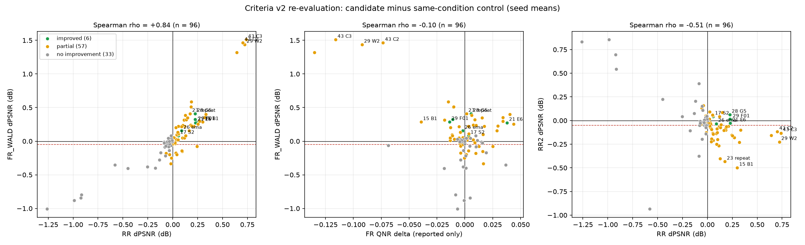
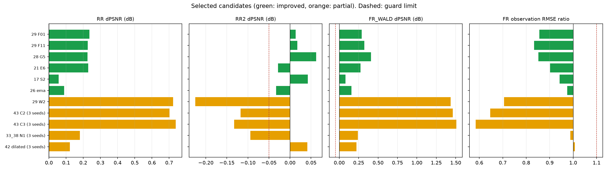

# 47. 정답 기반 판정 기준(v2)과 기존 후보 재평가

**연구 분야:** 기존 성능 개선

**실험자:** 이병현

**변경 내용:** 새로 학습하지 않았습니다. [성능 46번](../46_fr_spatial_index_validity/README.md)에서 FR Ds·QNR이 QB에서 정답을 가장 좋게 채점하지 못한다는 결과가 나와, 정답(GT)이 있는 시험만으로 판정하는 기준 v2를 측정 전에 고정했습니다. 저장된 가중치가 있는 기존 실험 43개 묶음(후보 96개, 모델 평가 169회)을 같은 도구로 다시 평가했습니다.

| 확인된 결과 | 상태 | 개선 여부 |
|---|:---:|:---:|
| 후보 96개 중 개선 6, 부분 개선 57, 개선 없음 33입니다. 기존 test 값이 있는 모델은 모두 0.0005 이내로 재현됐습니다. 후보의 FR QNR 변화와 정답이 있는 FR 장면 시험(FR_WALD)의 PSNR 변화는 순위 상관이 −0.10으로 거의 무관했습니다. RR 이득은 FR_WALD 이득과 +0.84로 함께 움직였지만, 한 단계 더 거친 축척(RR2)과는 −0.51로 반대로 움직였습니다. | 평가&nbsp;완료 | 성능&nbsp;비교&nbsp;아님 |

[실험 목록](../../../research/performance/README.md) · [수치](#results) · [그래프](#graphs) · [이미지](#images) · [재현 자료](#evidence)

## 1. 목적과 상태

지금까지 판정은 "RR과 FR(QNR)이 함께 좋아져야 개선"이었습니다. 그런데 [성능 46번](../46_fr_spatial_index_validity/README.md)에서 Ds(Toolbox 1.0·원 논문 방식 모두)가 정답을 모델 출력보다 나쁘게 채점했습니다(T1 1/20·2-3/20, 순위 상관 −0.54·−0.53). 이런 지표로 거부권을 행사하면 실제로 좋아진 후보를 탈락시킬 수 있습니다. 그래서 다음 두 가지를 했습니다.

1. 정답이 있는 시험만으로 판정하는 기준 v2를 정하고, 측정 전에 [config.json](config.json)에 고정했습니다.
2. 같은 도구로 기존 후보를 모두 다시 채점해, 예전 판정 중 무엇이 바뀌는지 확인했습니다.

2026-10-20 03:34-03:41에 묶음 1(성능 29-44번), 04:30-04:48에 묶음 2·3(성능 4-28번, SSAI 1-12번)을 서버(RTX 3060 Ti)에서 실행했습니다. 학습과 옵티마이저 업데이트는 없습니다.

## 2. 변경한 구조와 비교 조건

### 판정 기준 v2

| 구분 | 내용 |
|---|---|
| 주 판정 (RR) | PanCollection RR 20장. 같은 조건 대조군 대비 시드 평균 PSNR > 0, SAM < 0, ERGAS < 0. 3시드면 PSNR이 3시드 중 2개 이상에서 개선 |
| 보조 판정 1: RR2 | RR test 장면을 데이터셋과 같은 Wald 열화로 한 번 더 1/4 축소한 입력. 정답 = RR MS. 시드 평균 ΔPSNR ≥ −0.05 dB, ΔSAM ≤ +0.02° |
| 보조 판정 2: FR_WALD | FR test 장면을 같은 열화로 1/4 축소한 입력. 정답 = 실제 FR MS. 같은 허용폭 |
| 보조 판정 3: FR_OBS | FR 출력을 MS 관측 연산자로 줄였을 때 실제 FR MS와의 내부 RMSE(DN, 가장자리 5화소 제외). 대조군 대비 1.10배 이하 |
| 참고만 보고 | FR QNR·Dλ·Ds, RR SCC·Q2n, RR2·FR_WALD ERGAS |
| 판정 | **개선** = 주 판정과 보조 판정 3개 모두 통과 / **부분 개선** = 주 판정은 통과했지만 보조 판정 중 하나 이상 미달, 또는 PSNR·SAM·ERGAS 중 일부만 개선 / **개선 없음** = PSNR·SAM·ERGAS 모두 개선 없음 |
| 채택 | 기준 모델 교체에는 3시드가 추가로 필요합니다. 단일 시드 결과는 시드를 함께 표시합니다 |
| 새 FR 지표 | 46번의 정답 순위 검사를 통과해야 판정에 넣을 수 있습니다 |
| 허용폭 근거 | 성능 43번 C0의 RR 시드 표준편차(PSNR 0.056 dB, SAM 0.021°) |

### 열화와 평가 조건

| 항목 | 조건 |
|---|---|
| 도구 | [common/evaluation_protocol.py](../../../common/evaluation_protocol.py) |
| MS 열화 | `common/observation.SensorObservation`(QB DLPan MTF, 41탭, ×4, 위상 2). 성능 3번에서 감사했고, 45번에서 RR 정답을 줄이면 RR MS와 1e-4 DN 이내로 일치 |
| PAN 열화 | DLPan MTF_PAN(QB GNyq 0.15, 41탭, 경계 복제)과 같은 ×4 위상 2 샘플링 |
| LMS | `interp23tap`. RR·FR test H5의 LMS를 0 DN 차이로 재현 |
| 장면 | RR 20장·FR 20장 전체. 장면 단위로 열화해 패치 경계 영향이 없음 |
| 정밀도 | FP32 추론, float64 DN 지표, 클리핑 없음, TF32 끔 |
| 가중치 | 각 실험이 보관한 validation 최소 MSE best. test로 다시 고르지 않음 |
| 모델 | 각 실험의 보존 소스로 다시 만들고 `strict=True`로 로드. 공통 네트워크 코드는 보존본과 줄바꿈만 달라 동일 |

### 재평가 범위

| 묶음 | 실험 | 비고 |
|---|---|---|
| 1 | 성능 29, 30, 33·38, 39, 40, 41, 42, 43, 44 | 18개 후보·51개 모델. 40번은 이번이 첫 test 평가 |
| 2 | 성능 4-26, 28 | 62개 후보. 28번 대조군은 28번이 실제로 쓴 23번 원본 모델(100에폭 내 best) |
| 3 | SSAI 1-9, 12 | 16개 후보. SSAI 5-12는 SSAI 4번 A0가 대조군. SSAI 2 R1은 A0 가중치에 면적 보정만 적용 |
| 제외 | 성능 1(비교 후보 없음), 2·3(가중치 없음), 27(모델 소스 미보존), 31·32(짧은 탐색), 34(같은 조건 대조군 없음), 35·36·45·46(학습 없는 검사), 37(단독 모델 모듈 없음), 14번의 30에폭 손실 탐색(100에폭 대조군과 학습량 다름), SSAI 10(21·45에폭에서 중단), SSAI 11(분석), 가변 배율·GF2·WV3 | |

성능 17-20번에서 validation 탐색만 하고 test는 하지 않았던 후보 18개도 이번에 처음 test로 평가했습니다.

<a id="results"></a>

## 3. 정량 결과

### 재현 확인

기존에 test 값이 보관된 모델은 RR PSNR과 FR QNR이 모두 0.0005 이내로 다시 나왔습니다(묶음 1에서 40번을 뺀 47개, 묶음 2·3에서 보관값이 있는 100개). 서로 다른 실험이 같은 기준선을 재학습한 경우(33 N0·40 A0·41·42 기준선 seed42 등)는 파일은 달라도 지표가 소수 넷째 자리까지 같았습니다.

### 판정 분포

| 묶음 | 후보 | 개선 | 부분 개선 | 개선 없음 | 주 판정 통과 | 그중 RR2 미달 |
|---|---:|---:|---:|---:|---:|---:|
| 1 (성능 29-44) | 18 | 2 | 15 | 1 | 15 | 13 |
| 2 (성능 4-28) | 62 | 4 | 38 | 20 | 29 | 24 |
| 3 (SSAI) | 16 | 0 | 4 | 12 | 3 | 3 |
| 합계 | 96 | **6** | 57 | 33 | 47 | 40 |

### 세 보조 판정을 모두 통과한 후보 ("개선")

| 실험 | 대조군 → 후보 | 시드 | RR ΔPSNR / ΔSAM | RR2 ΔPSNR / ΔSAM | FR_WALD ΔPSNR / ΔSAM | 관측 오차 배율 | ΔQNR(참고) | 기존 판정 |
|---|---|---|---|---|---|---:|---:|---|
| 성능 29 | R0 → F01 | 42 | +0.236 / −0.154 | +0.013 / −0.111 | +0.288 / −0.186 | 0.856 | −0.0137 | 부분 개선 |
| 성능 29 | R0 → F11 | 42 | +0.226 / −0.144 | +0.017 / −0.084 | +0.324 / −0.193 | 0.834 | −0.0108 | 부분 개선 |
| 성능 28 | G0 → G5 | 46 | +0.225 / −0.130 | +0.062 / −0.041 | +0.409 / −0.173 | 0.852 | +0.0056 | 부분 개선 |
| 성능 21 | E0 → E6 | 42 | +0.229 / −0.193 | −0.029 / −0.189 | +0.275 / −0.193 | 0.902 | +0.0379 | 부분 개선 |
| 성능 26 | baseline → ema | 42 | +0.089 / −0.024 | −0.033 / +0.005 | +0.156 / −0.030 | 0.975 | −0.0018 | 부분 개선 |
| 성능 17 | S0 → S2 | 42 | +0.056 / −0.052 | +0.043 / −0.088 | +0.081 / −0.062 | 0.942 | +0.0034 | 부분 개선(test 미평가) |

모두 단일 시드입니다. 29 F01·F11은 28 G5의 학습 데이터 기반 PAN·blur 보정기 두 개를 원본 복원 뒤에 붙인 구조라, 세 후보가 같은 계열입니다. 17·21번은 50에폭 탐색 실험입니다.

### RR 이득이 컸지만 RR2에서 막힌 후보

| 실험 | 대조군 → 후보 | 시드 | RR ΔPSNR | RR2 ΔPSNR / ΔSAM | FR_WALD ΔPSNR / ΔSAM | 관측 오차 배율 | ΔQNR(참고) |
|---|---|---|---:|---|---|---:|---:|
| 성능 43 | C0 → C3 | 3 | +0.738 | −0.133 / +0.191 | +1.509 / −0.430 | 0.584 | −0.1160 |
| 성능 29 | R0 → W2 | 42 | +0.723 | −0.225 / +0.102 | +1.437 / −0.463 | 0.706 | −0.0922 |
| 성능 43 | C0 → C2 | 3 | +0.702 | −0.117 / +0.124 | +1.464 / −0.442 | 0.647 | −0.0734 |
| 성능 21 | E0 → E1 | 42 | +0.335 | −0.099 / −0.110 | +0.398 / −0.196 | 0.934 | +0.0404 |
| 성능 15 | B0 → B1 | 42 | +0.300 | −0.498 / +0.036 | +0.285 / −0.108 | 1.211 | −0.0393 |
| 성능 33·38 | N0 → N1 | 3 | +0.180 | −0.094 / +0.098 | +0.241 / −0.104 | 0.988 | +0.0076 |
| 성능 23 | original → repeat | 46 | +0.176 | −0.434 / +0.008 | +0.408 / −0.130 | 0.953 | +0.0015 |

43 C2·C3는 FR_WALD에서 20/20장·3/3시드 모두 개선했습니다. RR2에서는 C3가 3/3시드, C2가 2/3시드에서 나빠졌습니다.

### 기존 판정에서 바뀐 실험

| 실험 | 기존 | v2 (가장 좋은 후보) | 바뀐 이유 |
|---|---|---|---|
| 성능 17, 21, 26, 28, 29 | 부분 개선 | **개선** (S2, E6, ema, G5, F01·F11) | QNR 하락이나 일부 지표 혼재가 판정에서 빠지고, 정답 기반 보조 판정을 모두 통과 |
| 성능 33·38 | 개선(seed42) / 부분 개선 | 부분 개선 | 3시드 RR2 미달 |
| SSAI 1 | 개선 | 부분 개선 | RR2 SAM +0.050° |
| 성능 40 | 판단 보류 | 부분 개선 | 첫 test 평가. A1·A3가 RR2 미달 |
| SSAI 3 | 판단 보류 | 부분 개선 | RR2 미달 |
| 성능 13, 24, 25, 39, SSAI 4, SSAI 5 | 부분 개선 | 개선 없음 | RR PSNR·SAM·ERGAS가 모두 나빠짐 |
| 성능 12 (K6) | 비교 기준 | 개선 없음 | K4 대비 RR 세 지표 모두 나빠짐 |

나머지 실험은 판정 이름이 같습니다. 다만 FR 쪽 근거가 QNR에서 정답 기반 시험으로 바뀌었습니다.

<details>
<summary>후보 96개 전체 결과</summary>

시드 평균 차이(후보 − 같은 조건 대조군)입니다. PSNR 단위는 dB, SAM 단위는 도(°)입니다. ✗는 해당 보조 판정 미달입니다. 장면별 값은 [results/groups](results/groups)에 있습니다.

| 실험 | 대조군 → 후보 | 시드 | RR ΔPSNR / ΔSAM / ΔERGAS | RR2 ΔPSNR / ΔSAM | FR_WALD ΔPSNR / ΔSAM | 관측 오차 배율 | ΔQNR(참고) | 판정 |
|---|---|---|---|---|---|---:|---:|---|
| 성능 29 | R0 → W2 | 42 | +0.723 / -0.354 / -0.350 | -0.225 / +0.102 ✗ | +1.437 / -0.463 | 0.706 | -0.0922 | 부분 개선 |
| 성능 29 | R0 → W3 | 42 | +0.642 / -0.253 / -0.311 | -0.156 / +0.022 ✗ | +1.320 / -0.358 | 0.799 | -0.1349 | 부분 개선 |
| 성능 29 | R0 → F01 | 42 | +0.236 / -0.154 / -0.114 | +0.013 / -0.111 | +0.288 / -0.186 | 0.856 | -0.0137 | **개선** |
| 성능 29 | R0 → F11 | 42 | +0.226 / -0.144 / -0.110 | +0.017 / -0.084 | +0.324 / -0.192 | 0.834 | -0.0108 | **개선** |
| 성능 30 | final_baseline → final_ffl | 42 | -0.055 / -0.007 / +0.025 | +0.133 / -0.005 | -0.005 / -0.009 | 1.024 | -0.0022 | 부분 개선 |
| 성능 33·38 | N0 → N1 | 42·43·44 | +0.180 / -0.074 / -0.093 | -0.094 / +0.098 ✗ | +0.240 / -0.104 | 0.988 | +0.0076 | 부분 개선 |
| 성능 39 | global → local | 42·43·44 | -0.133 / +0.068 / +0.073 | +0.076 / +0.001 | -0.280 / +0.086 ✗ | 1.041 | -0.0037 | 개선 없음 |
| 성능 40 | A0 → A1 | 42 | +0.054 / -0.051 / -0.034 | -0.133 / +0.136 ✗ | +0.102 / -0.057 | 0.996 | +0.0162 | 부분 개선 |
| 성능 40 | A0 → A2 | 42 | -0.033 / -0.020 / +0.013 | +0.005 / +0.102 ✗ | -0.199 / -0.018 ✗ | 0.994 | +0.0008 | 부분 개선 |
| 성능 40 | A0 → A3 | 42 | +0.211 / -0.124 / -0.117 | -0.062 / +0.228 ✗ | +0.222 / -0.164 | 0.981 | +0.0175 | 부분 개선 |
| 성능 41 | baseline → aug | 42·43·44 | +0.024 / -0.001 / -0.010 | +0.092 / +0.109 ✗ | -0.036 / -0.006 | 0.994 | -0.0042 | 부분 개선 |
| 성능 42 | baseline → dilated | 42·43·44 | +0.122 / -0.025 / -0.061 | +0.041 / +0.101 ✗ | +0.220 / -0.045 | 1.007 | +0.0036 | 부분 개선 |
| 성능 43 | C0 → C1 | 42·43·44 | +0.101 / -0.036 / -0.049 | -0.200 / +0.103 ✗ | +0.236 / -0.062 | 0.943 | +0.0100 | 부분 개선 |
| 성능 43 | C0 → C2 | 42·43·44 | +0.702 / -0.344 / -0.341 | -0.117 / +0.124 ✗ | +1.464 / -0.442 | 0.647 | -0.0734 | 부분 개선 |
| 성능 43 | C0 → C3 | 42·43·44 | +0.738 / -0.323 / -0.353 | -0.132 / +0.191 ✗ | +1.509 / -0.430 | 0.584 | -0.1160 | 부분 개선 |
| 성능 44 | B0 → C0 | 42 | +0.089 / -0.001 / -0.038 | -0.136 / +0.096 ✗ | +0.218 / +0.010 | 1.053 | -0.0051 | 부분 개선 |
| 성능 44 | B0 → F1 | 42 | +0.034 / -0.015 / -0.017 | -0.078 / +0.045 ✗ | +0.009 / -0.026 | 1.071 | -0.0132 | 부분 개선 |
| 성능 44 | B0 → F2 | 42 | +0.021 / -0.023 / -0.012 | +0.014 / +0.036 ✗ | +0.032 / -0.027 | 1.068 | -0.0095 | 부분 개선 |
| 성능 4 | baseline → interp23 | 42 | +0.056 / -0.043 / -0.032 | -0.211 / +0.077 ✗ | +0.221 / -0.040 | 0.933 | +0.0032 | 부분 개선 |
| 성능 4 | baseline → lr_correction | 42 | -0.040 / -0.004 / +0.016 | +0.157 / +0.003 | +0.003 / +0.010 | 0.962 | -0.0031 | 부분 개선 |
| 성능 4 | baseline → high_frequency | 42 | -0.062 / -0.023 / +0.028 | -0.018 / +0.096 ✗ | -0.074 / -0.012 ✗ | 1.011 | -0.0038 | 부분 개선 |
| 성능 5 | baseline → interp23_output | 42 | -0.014 / -0.004 / +0.007 | +0.053 / +0.063 ✗ | -0.037 / +0.009 | 1.009 | +0.0003 | 부분 개선 |
| 성능 6 | baseline → interp23 | 42·43·44 | +0.042 / -0.019 / -0.023 | -0.193 / +0.044 ✗ | +0.095 / -0.014 | 1.058 | -0.0116 | 부분 개선 |
| 성능 6 | baseline → interp23_input | 42·43·44 | +0.058 / -0.021 / -0.028 | -0.144 / +0.066 ✗ | +0.110 / -0.024 | 0.962 | +0.0036 | 부분 개선 |
| 성능 7 | baseline → band_gated_hf | 42 | -0.175 / +0.009 / +0.080 | -0.106 / -0.108 ✗ | -0.399 / +0.009 ✗ | 1.027 | +0.0010 | 개선 없음 |
| 성능 8 | baseline → mtf_aug | 46 | -0.006 / -0.006 / +0.001 | +0.051 / -0.012 | -0.051 / +0.009 ✗ | 1.040 | -0.0014 | 부분 개선 |
| 성능 9 | A0 → A1 | 46 | -0.035 / -0.006 / +0.018 | +0.002 / -0.019 | -0.076 / -0.001 ✗ | 0.965 | +0.0127 | 부분 개선 |
| 성능 9 | A0 → A2 | 46 | -0.004 / +0.009 / +0.005 | -0.047 / +0.093 ✗ | +0.013 / -0.012 | 0.995 | +0.0112 | 개선 없음 |
| 성능 9 | A0 → A3 | 46 | -0.071 / +0.023 / +0.033 | -0.009 / -0.082 | -0.215 / +0.048 ✗ | 0.943 | +0.0007 | 개선 없음 |
| 성능 10 | B1 → B2 | 42 | +0.116 / -0.018 / -0.054 | -0.265 / +0.103 ✗ | +0.316 / -0.041 | 1.099 | -0.0182 | 부분 개선 |
| 성능 11 | A0 → A1 | 42 | -0.254 / +0.082 / +0.163 | +0.041 / -0.020 | -0.383 / +0.105 ✗ | 1.186 ✗ | -0.0016 | 개선 없음 |
| 성능 12 | k4 → k6 | 42 | -0.034 / +0.014 / +0.014 | -0.047 / -0.092 | -0.138 / +0.013 ✗ | 0.982 | -0.0014 | 개선 없음 |
| 성능 13 | B1 → B2 | 42 | -0.120 / +0.009 / +0.058 | +0.203 / -0.158 | -0.171 / +0.017 ✗ | 0.892 | +0.0191 | 개선 없음 |
| 성능 14 | k4 → edge_0.1 | 42 | -0.066 / -0.012 / +0.032 | -0.042 / +0.033 ✗ | -0.180 / +0.003 ✗ | 0.985 | +0.0098 | 부분 개선 |
| 성능 15 | B0 → B1 | 42 | +0.300 / -0.108 / -0.148 | -0.498 / +0.036 ✗ | +0.285 / -0.108 | 1.211 ✗ | -0.0393 | 부분 개선 |
| 성능 16 | B1 → B1_AA | 42 | -0.020 / +0.002 / +0.009 | +0.033 / -0.021 | -0.061 / +0.025 ✗ | 1.368 ✗ | -0.0686 | 개선 없음 |
| 성능 17 | S0 → S1 | 42 | +0.019 / -0.034 / -0.010 | -0.029 / +0.059 ✗ | +0.047 / -0.015 | 1.011 | -0.0052 | 부분 개선 |
| 성능 17 | S0 → S2 | 42 | +0.056 / -0.052 / -0.045 | +0.043 / -0.088 | +0.081 / -0.062 | 0.942 | +0.0034 | **개선** |
| 성능 17 | S0 → S3 | 42 | +0.100 / +0.058 / -0.070 | -0.127 / -0.038 ✗ | +0.051 / +0.081 ✗ | 0.945 | -0.0131 | 부분 개선 |
| 성능 17 | S0 → R1 | 42 | +0.037 / -0.009 / -0.041 | -0.225 / -0.089 ✗ | +0.027 / -0.002 | 0.947 | +0.0020 | 부분 개선 |
| 성능 17 | S0 → R2 | 42 | -0.579 / +0.768 / +0.349 | -0.935 / +0.647 ✗ | -0.352 / +0.785 ✗ | 0.851 | +0.0367 | 개선 없음 |
| 성능 17 | S0 → M1 | 42 | +0.117 / -0.044 / -0.087 | -0.067 / -0.104 ✗ | +0.049 / -0.035 | 0.876 | +0.0031 | 부분 개선 |
| 성능 17 | S0 → I1 | 42 | +0.130 / -0.070 / -0.103 | -0.073 / -0.189 ✗ | +0.083 / -0.057 | 1.024 | -0.0111 | 부분 개선 |
| 성능 17 | S0 → I2 | 42 | -0.086 / +0.208 / +0.040 | -0.375 / +0.058 ✗ | -0.013 / +0.209 ✗ | 0.909 | +0.0149 | 개선 없음 |
| 성능 18 | N0 → N1 | 42 | -0.053 / +0.024 / +0.033 | -0.197 / +0.217 ✗ | -0.037 / +0.020 | 0.991 | -0.0001 | 개선 없음 |
| 성능 18 | N0 → N2 | 42 | +0.185 / +0.046 / -0.091 | -0.099 / +0.071 ✗ | +0.509 / +0.006 | 0.947 | -0.0103 | 부분 개선 |
| 성능 18 | N0 → N3 | 42 | +0.187 / -0.013 / -0.101 | -0.070 / +0.030 ✗ | +0.588 / -0.070 | 1.052 | -0.0147 | 부분 개선 |
| 성능 18 | N0 → N4 | 42 | +0.183 / +0.011 / -0.096 | -0.081 / +0.043 ✗ | +0.512 / -0.031 | 0.998 | -0.0100 | 부분 개선 |
| 성능 18 | N0 → N5 | 42 | +0.031 / +0.019 / -0.005 | -0.024 / +0.086 ✗ | +0.202 / +0.028 ✗ | 1.016 | -0.0127 | 부분 개선 |
| 성능 19 | C0 → C1 | 42 | +0.244 / -0.188 / -0.143 | -0.154 / -0.003 ✗ | -0.079 / -0.136 ✗ | 0.936 | +0.0250 | 부분 개선 |
| 성능 19 | C0 → C2 | 42 | -1.260 / +0.342 / +0.778 | +0.831 / +0.263 ✗ | -1.008 / +0.334 ✗ | 0.834 | -0.0067 | 개선 없음 |
| 성능 19 | C0 → C3 | 42 | -0.917 / +0.370 / +0.572 | +0.543 / +0.403 ✗ | -0.796 / +0.371 ✗ | 0.927 | -0.0085 | 개선 없음 |
| 성능 19 | C0 → C4 | 42 | -0.989 / +0.256 / +0.608 | +0.854 / +0.170 ✗ | -0.878 / +0.250 ✗ | 0.902 | -0.0007 | 개선 없음 |
| 성능 19 | C0 → C5 | 42 | -0.921 / +0.369 / +0.580 | +0.696 / +0.271 ✗ | -0.845 / +0.357 ✗ | 0.840 | +0.0048 | 개선 없음 |
| 성능 20 | D0 → D1 | 42 | -0.012 / -0.100 / +0.020 | -0.128 / -0.096 ✗ | -0.251 / -0.044 ✗ | 1.109 ✗ | -0.0004 | 부분 개선 |
| 성능 20 | D0 → D2 | 42 | +0.033 / -0.087 / -0.006 | -0.038 / -0.144 | -0.175 / -0.040 ✗ | 1.012 | -0.0039 | 부분 개선 |
| 성능 20 | D0 → D3 | 42 | +0.096 / -0.113 / -0.044 | -0.086 / -0.181 ✗ | -0.151 / -0.052 ✗ | 1.021 | +0.0159 | 부분 개선 |
| 성능 20 | D0 → D4 | 42 | +0.042 / -0.114 / -0.013 | -0.094 / -0.103 ✗ | -0.199 / -0.039 ✗ | 0.962 | +0.0012 | 부분 개선 |
| 성능 20 | D0 → D5 | 42 | +0.092 / -0.096 / -0.040 | -0.248 / -0.060 ✗ | -0.142 / -0.029 ✗ | 0.946 | +0.0032 | 부분 개선 |
| 성능 20 | D0 → D6 | 42 | -0.020 / -0.110 / +0.023 | -0.032 / -0.164 | -0.333 / -0.054 ✗ | 0.952 | +0.0166 | 부분 개선 |
| 성능 21 | E0 → E1 | 42 | +0.335 / -0.222 / -0.197 | -0.099 / -0.110 ✗ | +0.398 / -0.196 | 0.934 | +0.0404 | 부분 개선 |
| 성능 21 | E0 → E2 | 42 | +0.166 / -0.165 / -0.095 | -0.103 / -0.093 ✗ | +0.154 / -0.140 | 0.909 | +0.0287 | 부분 개선 |
| 성능 21 | E0 → E3 | 42 | +0.320 / -0.229 / -0.192 | -0.229 / -0.117 ✗ | +0.352 / -0.202 | 0.884 | +0.0342 | 부분 개선 |
| 성능 21 | E0 → E4 | 42 | +0.190 / -0.172 / -0.114 | -0.064 / -0.142 ✗ | +0.229 / -0.171 | 0.952 | +0.0297 | 부분 개선 |
| 성능 21 | E0 → E5 | 42 | +0.269 / -0.193 / -0.160 | -0.179 / -0.103 ✗ | +0.298 / -0.198 | 0.946 | +0.0343 | 부분 개선 |
| 성능 21 | E0 → E6 | 42 | +0.229 / -0.193 / -0.140 | -0.029 / -0.189 | +0.275 / -0.193 | 0.902 | +0.0379 | **개선** |
| 성능 21 | E0 → E7 | 42 | +0.253 / -0.160 / -0.137 | -0.161 / -0.108 ✗ | +0.257 / -0.124 | 0.902 | +0.0437 | 부분 개선 |
| 성능 22 | F0 → F1 | 42 | -0.078 / +0.044 / +0.048 | -0.052 / +0.065 ✗ | -0.088 / +0.034 ✗ | 1.040 | +0.0099 | 개선 없음 |
| 성능 22 | F0 → F2 | 42 | -0.015 / +0.037 / +0.002 | -0.140 / -0.036 ✗ | +0.024 / +0.055 ✗ | 1.045 | -0.0037 | 개선 없음 |
| 성능 22 | F0 → F3 | 42 | -0.024 / +0.037 / +0.012 | -0.036 / -0.036 | +0.031 / +0.041 ✗ | 1.028 | -0.0065 | 개선 없음 |
| 성능 22 | F0 → F4 | 42 | -0.001 / +0.006 / -0.007 | -0.045 / -0.038 | +0.017 / +0.023 ✗ | 1.010 | +0.0018 | 부분 개선 |
| 성능 22 | F0 → F5 | 42 | -0.449 / +0.237 / +0.248 | +0.226 / +0.124 ✗ | -0.403 / +0.238 ✗ | 1.096 | -0.0185 | 개선 없음 |
| 성능 23 | original → repeat | 46 | +0.176 / -0.092 / -0.098 | -0.434 / +0.008 ✗ | +0.408 / -0.129 | 0.953 | +0.0015 | 부분 개선 |
| 성능 23 | original → F0 | 46 | +0.127 / -0.085 / -0.071 | -0.403 / -0.049 ✗ | +0.384 / -0.118 | 0.965 | +0.0062 | 부분 개선 |
| 성능 24 | B1 → B1_alpha_bounded | 42 | -0.085 / +0.010 / +0.040 | +0.392 / -0.150 | -0.025 / -0.003 | 0.939 | +0.0159 | 개선 없음 |
| 성능 25 | B0 → B0_DS | 42 | -0.043 / +0.026 / +0.019 | -0.012 / +0.018 | -0.084 / +0.056 ✗ | 0.971 | +0.0101 | 개선 없음 |
| 성능 26 | baseline → ema | 42 | +0.089 / -0.024 / -0.040 | -0.033 / +0.005 | +0.156 / -0.030 | 0.975 | -0.0018 | **개선** |
| 성능 28 | G0 → G3 | 46 | +0.136 / -0.061 / -0.065 | -0.046 / +0.075 ✗ | +0.320 / -0.083 | 0.862 | +0.0089 | 부분 개선 |
| 성능 28 | G0 → G4 | 46 | +0.148 / -0.091 / -0.075 | +0.086 / +0.124 ✗ | +0.350 / -0.112 | 0.868 | +0.0154 | 부분 개선 |
| 성능 28 | G0 → G5 | 46 | +0.225 / -0.130 / -0.116 | +0.062 / -0.041 | +0.409 / -0.173 | 0.852 | +0.0056 | **개선** |
| SSAI 1 | A0 → A1 | 42 | +0.055 / -0.035 / -0.026 | +0.051 / +0.050 ✗ | +0.020 / -0.022 | 0.979 | +0.0077 | 부분 개선 |
| SSAI 2 | A0 → R1 | 42 | -0.000 / +0.001 / +0.000 | +0.000 / +0.000 | -0.000 / +0.001 | 1.000 | -0.0000 | 개선 없음 |
| SSAI 3 | A0 → A2 | 42 | +0.023 / -0.025 / -0.009 | -0.057 / +0.035 ✗ | -0.021 / -0.015 | 0.941 | +0.0090 | 부분 개선 |
| SSAI 4 | A0 → A1 | 42 | -0.014 / +0.041 / +0.008 | +0.008 / -0.025 | +0.033 / +0.047 ✗ | 1.007 | -0.0007 | 개선 없음 |
| SSAI 4 | A0 → A2 | 42 | -0.013 / +0.012 / +0.010 | -0.054 / -0.011 ✗ | +0.045 / +0.014 | 0.993 | +0.0051 | 개선 없음 |
| SSAI 4 | A0 → A3 | 42 | -0.016 / +0.023 / +0.009 | -0.073 / +0.061 ✗ | +0.084 / +0.017 | 1.038 | +0.0099 | 개선 없음 |
| SSAI 5 | A0 → M25 | 42 | -0.035 / +0.023 / +0.019 | -0.005 / +0.003 | -0.009 / +0.031 ✗ | 1.006 | -0.0027 | 개선 없음 |
| SSAI 5 | A0 → M50 | 42 | -0.071 / +0.027 / +0.038 | -0.029 / +0.028 ✗ | -0.075 / +0.012 ✗ | 1.032 | +0.0043 | 개선 없음 |
| SSAI 6 | A0 → D6 | 42 | -0.002 / +0.004 / +0.002 | +0.015 / -0.012 | -0.007 / +0.009 | 1.046 | -0.0046 | 개선 없음 |
| SSAI 7 | A0 → D7 | 42 | -0.006 / +0.016 / +0.006 | +0.046 / -0.069 | +0.010 / +0.021 ✗ | 0.945 | -0.0030 | 개선 없음 |
| SSAI 8 | A0 → N1 | 42 | -0.053 / +0.051 / +0.033 | +0.150 / +0.009 | -0.007 / +0.055 ✗ | 1.040 | -0.0047 | 개선 없음 |
| SSAI 8 | A0 → N2 | 42 | +0.010 / +0.004 / -0.001 | -0.028 / +0.001 | +0.052 / -0.011 | 0.960 | -0.0019 | 부분 개선 |
| SSAI 9 | A0 → A1 | 42 | -0.031 / +0.017 / +0.021 | +0.005 / +0.045 ✗ | -0.037 / +0.018 | 1.016 | -0.0002 | 개선 없음 |
| SSAI 9 | A0 → A2 | 42 | -0.035 / +0.017 / +0.021 | -0.022 / -0.020 | -0.003 / +0.009 | 0.973 | -0.0001 | 개선 없음 |
| SSAI 12 | A0 → B2 | 42 | -0.045 / +0.004 / +0.024 | +0.110 / -0.067 | +0.044 / -0.025 | 1.101 ✗ | +0.0012 | 개선 없음 |
| SSAI 12 | A0 → B3 | 42 | +0.050 / -0.009 / -0.020 | +0.059 / +0.039 ✗ | +0.132 / -0.033 | 0.988 | -0.0041 | 부분 개선 |

</details>

## 4. 기준선 대비 차이와 해석

- **QNR 변화는 정답 기반 FR 성능 변화를 거의 설명하지 못했습니다.** 96개 후보에서 ΔQNR과 FR_WALD ΔPSNR의 순위 상관은 −0.10입니다. QNR이 0.005 넘게 떨어졌는데 FR_WALD PSNR은 0.05 dB 넘게 오른 후보가 16개(W2·C2·C3·F01·F11 등)였고, 반대 경우도 9개였습니다. 지금까지 "FR 악화"로 판정한 근거 중 상당수가 46번에서 확인한 Ds 편향과 같은 방향입니다.
- **RR 이득은 같은 축척의 다른 장면에서도 유지됐습니다.** RR ΔPSNR과 FR_WALD ΔPSNR의 순위 상관은 +0.84입니다. FR_WALD는 학습·RR과 같은 축척이지만 RR과 다른 FR test 장면이므로, RR 이득이 특정 20장면에만 맞춘 결과는 아닙니다.
- **한 단계 더 거친 축척(RR2)에서는 반대 방향이었습니다.** RR ΔPSNR과 RR2 ΔPSNR의 순위 상관은 −0.51입니다. 주 판정을 통과한 47개 중 40개가 RR2에서 미달했고, 그중 35개는 RR2만 미달했습니다. RR을 많이 올린 후보일수록 학습 축척에 더 특화되는 경향으로 보입니다.
- **RR2 허용폭은 RR2 자체의 시드 잡음보다 좁았습니다.** 3시드 대조군 네 가지(성능 6, 33·38, 39, 43)에서 RR2 시드 표준편차는 PSNR 0.025-0.084 dB, SAM 0.035-0.096°였습니다. 허용폭(−0.05 dB, +0.02°)은 RR 시드 편차로 정했습니다. 그래서 RR2 SAM 하나로만 미달한 단일 시드 후보(41 aug, 42 dilated, 44 F2 등)는 잡음일 수 있습니다. 반면 43 C3·C1처럼 3시드 모두 나빠진 경우는 실제 경향입니다. 판정은 측정 전에 고정한 기준 그대로 두었습니다.
- **정답이 있는 시험만으로는 목표 축척(FR, 학습보다 4배 세밀)을 직접 볼 수 없습니다.** FR_WALD는 학습과 같은 축척이고 RR2는 4배 거칩니다. FR 축척에서는 정답 없이 관측 일치(FR_OBS)만 볼 수 있습니다. W2·C2·C3는 이 관측 오차를 29-42% 줄였습니다. 이는 FR 출력이 관측된 MS와 더 잘 맞는다는 뜻이지만, 세부정보까지 맞다는 증거는 아닙니다.
- **"개선" 6개 중 3개가 같은 계열입니다.** 성능 28 G5와 이 보정기를 원본에 붙인 29 F01·F11입니다. 이 계열은 RR2에서도 나빠지지 않은 드문 경우입니다.
- **한계:** QB 한 센서이고, 탐색에 반복 사용한 test입니다. "개선" 6개는 모두 단일 시드입니다. 17·21번은 50에폭 탐색이라 100에폭 결과와 직접 비교할 수 없습니다. 지표 구현의 MATLAB 정합은 PR #105 범위이며, QNR류의 절대값은 MATLAB과 차이가 확인됐습니다(판정에는 쓰지 않음).

<a id="graphs"></a>

## 5. 학습·평가 그래프



96개 후보의 시드 평균 차이입니다. 왼쪽은 RR과 FR_WALD, 가운데는 참고 지표 QNR과 FR_WALD, 오른쪽은 RR과 RR2입니다. 빨간 점선은 보조 판정 허용폭(−0.05 dB)입니다. 초록은 개선, 주황은 부분 개선, 회색은 개선 없음입니다.



개선 6개와 RR 이득이 큰 부분 개선 후보의 RR·RR2·FR_WALD PSNR 차이와 관측 오차 배율입니다. 점선은 허용폭입니다. SAM 허용폭 미달(예: 42 dilated의 RR2 SAM)은 이 그림에 나타나지 않으므로 표를 함께 봅니다. 학습하지 않았으므로 학습 곡선은 없습니다.

<a id="images"></a>

## 6. 결과 이미지

새 모델을 학습하지 않았고 재평가 출력 이미지는 저장하지 않았습니다. 각 후보의 예시 패널은 원래 실험 보고서에 있습니다.

<a id="evidence"></a>

## 7. 재현 자료

[평가 도구](../../../common/evaluation_protocol.py) · [묶음별 평가](evaluate.py) · [판정·요약](run.py) · [설정과 사전 기준](config.json) · [묶음 1 실행 당시 코드·설정](provenance/tier1) · [판정 요약](results/summary.json) · [묶음별 장면 단위 결과](results/groups) · [manifest](manifest.json)

묶음 1 실행 뒤 묶음 2·3을 추가하면서 `evaluate.py`·`run.py`·`config.json`을 바꿨습니다. 묶음 1 결과 JSON에 기록된 해시와 일치하는 당시 파일을 `provenance/tier1`에 보존했습니다. 판정 기준(`criteria_v2`)과 평가 도구는 바꾸지 않았습니다.

```bash
python SSA-MRN/experiments/performance/47_ground_truth_criteria_reevaluation/run.py --data <QB_H5_폴더> --output <출력> --tiers 1 2 3
python SSA-MRN/experiments/performance/47_ground_truth_criteria_reevaluation/run.py --output SSA-MRN/experiments/performance/47_ground_truth_criteria_reevaluation/results/groups
```

두 번째 명령은 저장된 묶음 결과로 판정만 다시 계산합니다.

## 8. 개선 여부와 다음 단계

**성능 비교 아님**입니다. 판정 기준을 바꾸고 기존 후보를 다시 채점한 실험이며, 기준 모델은 원본 SSA-MRN K4로 유지합니다. 어떤 후보도 자동으로 승격하지 않습니다.

다음 확인 항목은 아래와 같습니다.
- **3시드 반복 후보:** "개선"을 받은 28 G5 계열(29 F01·F11 포함)과 21 E6입니다. 모두 단일 시드라 기준 모델 교체 조건(3시드)을 아직 채우지 못했습니다.
- **RR2 약점 보완:** RR 이득이 가장 큰 W2·C2·C3는 RR2만 남은 문제입니다. 여러 축척을 함께 학습해 RR2를 지키면서 이득을 유지하는지 확인합니다.
- **규칙 반영:** 기준 v2를 저장소 판정 규칙(AGENTS.md·README의 판정 기준)에 반영합니다. RR2 허용폭을 RR2 자체의 시드 편차로 다시 정할지는 이번 결과를 본 뒤의 변경이므로, 반영할 경우 이후 실험부터 적용하고 47번 판정은 바꾸지 않습니다.
