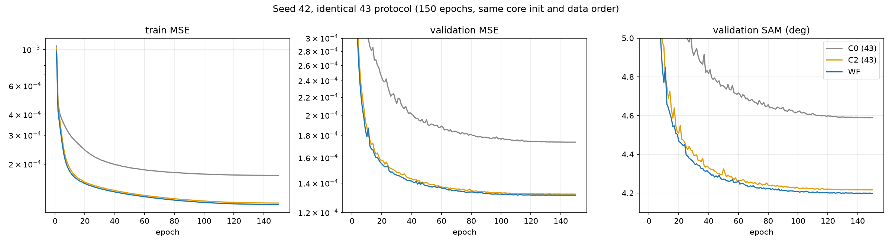
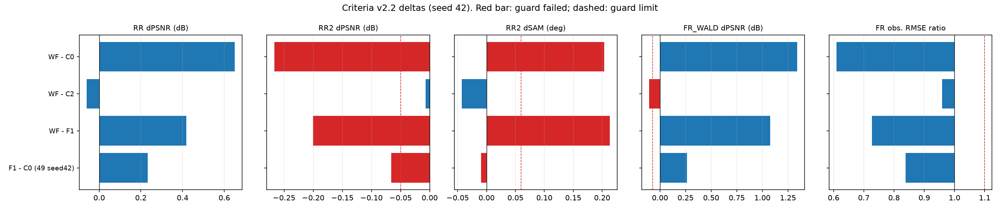
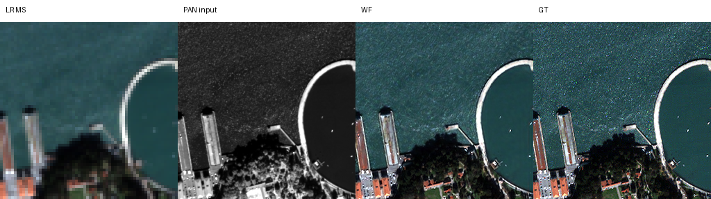
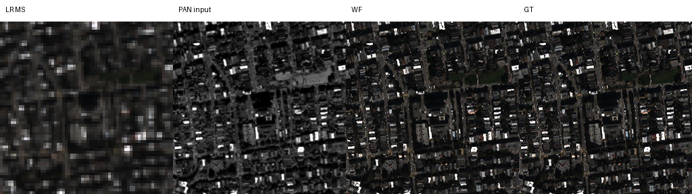
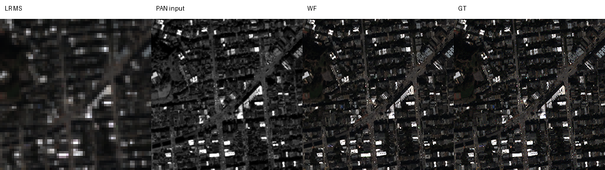
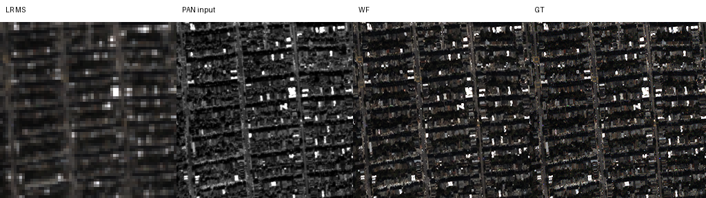
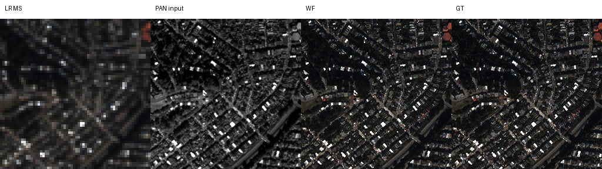

# 48. 저해상도 병렬 특징 용량(W2)과 관측 오차 보정기(G5)의 결합

**연구 분야:** 기존 성능 개선

**실험자:** 이병현

**변경 내용:** 43번 C2(원본 + W2 저해상도 병렬 가지) 뒤에 28번 G5의 관측 오차 보정기 두 개를 붙였습니다(WF). 보정기는 출력을 MS 관측으로 줄였을 때의 오차와 PAN 고주파 차이를 입력으로 받아 출력을 고칩니다.

| 확인된 결과 | 상태 | 개선 여부 |
|---|:---:|:---:|
| seed42에서 원본(C0) 대비 RR PSNR +0.650 dB·SAM −0.372°, FR_WALD +1.341 dB, 관측 오차 0.61배였지만 RR2가 −0.266 dB·SAM +0.204°로 미달했습니다. W2 단독(C2)과 RR2가 거의 같아(−0.007 dB), 보정기가 W2의 RR2 미달을 없애지 못했습니다. | 평가&nbsp;완료<br>seed42 | 부분&nbsp;개선 |

[실험 목록](../../../research/performance/README.md) · [수치](#results) · [그래프](#graphs) · [이미지](#images) · [재현 자료](#evidence)

## 1. 목적과 상태

[성능 47번](../47_ground_truth_criteria_reevaluation/README.md) 재평가에서 다음 두 계열이 나왔습니다.

| 계열 | RR ΔPSNR | FR_WALD ΔPSNR | RR2 | v2.2 판정 |
|---|---:|---:|---|---|
| W2(43 C2·C3, 29 W2) | +0.70에서 +0.74 dB | +1.44에서 +1.51 dB | −0.12에서 −0.23 dB로 미달 | 부분 개선 |
| G5 보정기(28 G5, 29 F01·F11) | +0.23 dB | +0.29에서 +0.41 dB | 통과(+0.01에서 +0.06 dB) | 개선 |

W2는 이득이 가장 크지만 한 단계 더 거친 축척(RR2)에서 나빠집니다. G5 보정기는 이득이 작지만 RR2에서도 나빠지지 않았습니다. 보정기는 축척과 무관한 관측 관계(MTF로 줄인 출력과 실제 MS의 차이)에 묶여 있기 때문으로 추정합니다. 두 구조를 결합하면 W2의 이득을 유지하면서 RR2 미달을 없앨 수 있는지 확인합니다.

같은 큐에서 성능 49번(G5 계열 3시드 재현, 별도 보고)을 함께 실행합니다.

## 2. 변경한 구조와 비교 조건

| 군 | 구조 | 파라미터 | 학습 |
|---|---|---:|---|
| C0 | 원본 SSA-MRN K4 | 426,654 | 43번 가중치 재사용 |
| C2 | 원본 + W2 | 2,853,918 | 43번 가중치 재사용 |
| F1 | C0 + G5 보정기 두 개(29 F01과 같은 구조) | 461,804 | 49번에서 새로 학습 |
| **WF** | C2 + G5 보정기 두 개 | 2,889,068 | **새로 학습(seed 42)** |

| 조건 | 내용 |
|---|---|
| 학습 절차 | 43번과 동일: 150에폭, batch·micro 32, Adam, 에폭별 cosine 1e-4 → 1e-6, AMP FP16, cuDNN deterministic, TF32 끔, channels_last |
| 데이터 순서 | 시드별 `seed+100000` 생성기. 같은 시드의 43번 대조군과 같은 순서 |
| 초기값 | core(W2 포함)는 43번과 같은 경로로 만들어 같은 시드의 43번 초기값과 동일. 보정기는 `seed+1000`으로 따로 초기화해 F1과 WF가 같은 값을 공유. 보정기 마지막 층이 0이라 학습 전 출력은 각각 C0·C2와 같음 |
| 보정 상수 | 29번 `calibration.json`(학습 데이터로 정한 PAN 가중치·blur 커널, 28번과 동일) |
| 캐시 | 43번 절차로 다시 만들고 43번 manifest와 바이트 단위로 같은지 확인 |
| 선택 | epoch0 포함 최소 validation MSE, 동률이면 먼저 나온 에폭 |
| 동시 실행 | 결과에 영향을 주지 않는 동시 실행 수만 1-4에서 측정해 선택(아래) |

### 측정 전에 고정한 판정

| 구분 | 내용 |
|---|---|
| 주 판정 | WF seed 42 대 C0 seed 42, [판정 기준 v2.2](../../../docs/judgement_criteria.md) |
| 진단 1 | WF 대 C2: 보정기가 W2의 RR2 미달을 없애는지. 결정 항목은 C0 대비 WF의 RR2 보조 판정 |
| 진단 2 | WF 대 F1: 보정기 위에 W2가 더하는 몫 |
| 다음 단계 조건 | C0 대비 WF가 "개선"이고 RR ΔPSNR ≥ +0.40 dB(W2 이득의 절반 이상)이면 seed 43·44 반복을 제안(별도 승인) |
| 참고 | FR QNR·Dλ·Ds, validation 곡선 |

<a id="results"></a>

## 3. 정량 결과

2026-10-20 07:00-10:32(KST)에 WF seed 42를 150에폭 학습했습니다. 80,400회 갱신 중 18회는 AMP 오버플로로 건너뛰었습니다. validation 최소 MSE는 149에폭(1.3133e-4)이고, 43번 C2 seed 42(141에폭, 1.3205e-4)보다 0.5% 낮았습니다. 학습 후 [정답 기반 평가 도구](../../../common/evaluation_protocol.py)로 RR·RR2·FR_WALD·FR을 각 20장 평가했습니다. C0·C2는 43번 가중치를, F1은 같은 큐에서 학습한 49번 seed 42 가중치를 사용했습니다.

### 20장 평균 (seed 42)

| 군 | RR PSNR ↑ | RR SAM ↓ | RR ERGAS ↓ | RR2 PSNR ↑ | RR2 SAM ↓ | FR_WALD PSNR ↑ | FR_WALD SAM ↓ | FR 관측 오차(DN) ↓ | QNR(참고) |
|---|---:|---:|---:|---:|---:|---:|---:|---:|---:|
| C0 | 37.3671 | 4.9651 | 4.1554 | **38.2343** | **4.4493** | 36.0851 | 4.5107 | 24.191 | 0.9171 |
| F1 | 37.5991 | 4.8080 | 4.0428 | 38.1684 | 4.4399 | 36.3492 | 4.3422 | 20.291 | 0.9235 |
| C2 | **38.0767** | 4.6069 | **3.8055** | 37.9749 | 4.6961 | **37.5309** | 4.0613 | 15.389 | 0.8558 |
| WF | 38.0172 | **4.5935** | 3.8319 | 37.9680 | 4.6531 | 37.4256 | **4.0344** | **14.761** | 0.8261 |

### v2.2 판정 (후보 − 대조군, seed 42)

| 비교 | RR ΔPSNR / ΔSAM / ΔERGAS | RR2 ΔPSNR / ΔSAM | FR_WALD ΔPSNR / ΔSAM | 관측 오차 배율 | 판정 |
|---|---|---|---|---:|---|
| **WF − C0 (주 판정)** | +0.650 / −0.372 / −0.324 | −0.266 / +0.204 ✗ | +1.341 / −0.476 | 0.610 | **부분 개선** |
| WF − C2 (진단 1) | −0.060 / −0.013 / +0.026 | −0.007 / −0.043 | −0.105 / −0.027 ✗ | 0.959 | 부분 개선 |
| WF − F1 (진단 2) | +0.418 / −0.214 / −0.211 | −0.200 / +0.213 ✗ | +1.076 / −0.308 | 0.727 | 부분 개선 |
| F1 − C0 (49번 seed 42, 참고) | +0.232 / −0.157 / −0.113 | −0.066 / −0.009 ✗ | +0.264 / −0.169 | 0.839 | 부분 개선 |

✗는 [판정 기준 v2.2](../../../docs/judgement_criteria.md)의 보조 판정 미달입니다(RR2 ΔPSNR ≥ −0.05 dB·ΔSAM ≤ +0.06°, FR_WALD ΔPSNR ≥ −0.07 dB·ΔSAM ≤ +0.04°, 관측 오차 1.10배 이하).

장면별로 보면 WF는 C0보다 RR PSNR 20/20장, FR_WALD 20/20장에서 높았지만 RR2는 4/20장에서만 높았습니다. C2와 비교하면 RR 7/20장, RR2 10/20장, FR_WALD 6/20장에서 높았습니다.

## 4. 기준선 대비 차이와 해석

- **가설은 지지되지 않았습니다.** 보정기를 붙여도 RR2는 W2 단독(C2)과 거의 같았습니다(−0.007 dB, SAM −0.043°). C0 대비 RR2 미달(−0.266 dB, +0.204°)이 그대로 남았습니다. W2가 거친 축척에서 약해지는 성질은 출력 뒤의 관측 보정으로는 고쳐지지 않았습니다.
- **W2 위에서 보정기가 더한 몫은 작았습니다.** validation MSE는 C2보다 0.5% 낮았지만, test에서는 RR PSNR −0.060 dB·FR_WALD −0.105 dB로 오히려 조금 낮았습니다. 관측 오차만 4% 더 줄었습니다. RR 차이는 43번 C0 시드 편차(0.056 dB) 수준이라 단일 시드로 방향을 확정하지 않습니다.
- **W2의 큰 이득은 그대로였습니다.** C0 대비 RR +0.65 dB, FR_WALD +1.34 dB, 관측 오차 39% 감소는 43번 C2와 같은 수준입니다.
- **사전 조건에 따른 다음 단계:** "C0 대비 개선 + RR ΔPSNR ≥ +0.40 dB" 조건을 RR2 때문에 채우지 못했습니다. 그래서 WF의 seed 43·44 반복은 제안하지 않습니다.
- **참고(49번):** 같은 절차의 F1 seed 42도 RR2가 −0.066 dB로 허용폭(−0.05 dB)을 조금 넘었습니다. 29 F01(+0.013 dB)·28 G5(+0.062 dB)와 방향이 다릅니다. F1의 판정은 49번의 3시드 평균으로 정합니다.
- **한계:** WF는 단일 시드입니다. QB 한 센서이며, 탐색에 반복 사용한 test입니다. QNR류는 참고 지표입니다.

<a id="graphs"></a>

## 5. 학습·평가 그래프



seed 42의 실제 150에폭 기록입니다. C0·C2는 43번 기록입니다. 세 군은 core 초기값과 에폭별 데이터 순서가 같습니다. WF의 validation 곡선은 C2와 거의 겹치고, 후반에 약간 낮습니다.



빨간 막대는 보조 판정 미달, 점선은 허용폭입니다.

<a id="images"></a>

## 6. 결과 이미지

학습 전에 고정한 RR 장면 1·8·11·13·19(0부터 센 번호)입니다. 왼쪽부터 LR MS(최근접 확대), PAN, WF 예측, GT입니다. RGB는 밴드 [2,1,0]이며, MS 패널은 같은 장면 GT의 1/99 백분위 대비를 공유합니다.











<a id="evidence"></a>

## 7. 재현 자료

[모델](model.py) · [학습](train.py) · [실행 관리](run.py) · [판정 평가](evaluate.py) · [설정과 사전 판정](config.json) · [실행 당시 설정](provenance/runtime_config.json) · [사전 검사](provenance/preflight/checks.json) · [동시 실행 측정](provenance/preflight/optimization.json) · [v2.2 평가 결과](results/v22_s42.json) · [학습 기록](results/WF_QB_s42/history.json) · [RR](results/WF_QB_s42/evaluation/RR.json) · [FR](results/WF_QB_s42/evaluation/FR.json) · [가중치(initial·best·latest)](checkpoints/WF_QB_s42) · [manifest](manifest.json)

- **사전 검사:** 서버에서 F1·WF의 core 초기값이 43번 C0·C2의 기록된 초기 해시와 seed 42·43·44 모두 같았습니다. 학습 전 출력이 C0·C2와 정확히 같았고, 보정 경로는 28번 G5와 오차 0이었습니다. 4개 군 모두 AMP 2회 갱신·재개 검사를 통과했습니다.
- **첫 사전 검사 시도:** 첫 시도는 G5 참조 모듈의 메모리 배치(channels_last)를 맞추지 않아 6e-8 차이로 멈췄습니다([기록](provenance/preflight/failure_preflight.json)). 배치를 맞춘 뒤 차이 0으로 통과했고, 학습은 그 뒤 시작했습니다.
- **캐시:** 43번 런타임이 서버에서 정리돼 있어 원본 H5에서 다시 만들었습니다. 8개 배열 모두 43번 manifest와 바이트 단위로 같았습니다.
- **동시 실행:** 1-4개 동시 실행의 전체 처리량이 초당 196-207패치로 같아(GPU 포화), 결과를 먼저 받을 수 있는 순차 실행(1개)을 선택했습니다.
- **F1 가중치:** 비교에 쓴 F1 seed 42 가중치는 49번 결과와 함께 보존합니다.

```bash
python SSA-MRN/experiments/performance/48_parallel_capacity_observation_refinement/run.py --mode prepare
python SSA-MRN/experiments/performance/48_parallel_capacity_observation_refinement/run.py --mode optimize
python SSA-MRN/experiments/performance/48_parallel_capacity_observation_refinement/run.py --mode run
python SSA-MRN/experiments/performance/48_parallel_capacity_observation_refinement/evaluate.py --runtime <런타임> --data <QB_H5_폴더> --output <출력.json>
```

## 8. 개선 여부와 다음 단계

**부분 개선**(seed 42)입니다. 원본 대비 RR·FR_WALD·관측 일치는 크게 좋아졌지만 RR2 보조 판정에서 미달했습니다. 기준 모델은 원본 SSA-MRN K4로 유지합니다.

W2와 G5 보정기의 결합은 W2의 RR2 약점을 해결하지 못했습니다. RR2 약점을 다루려면 출력 뒤 보정이 아니라 학습 쪽 접근(여러 축척의 학습 쌍 등)이 필요합니다. 다만 현재 학습 패치(64×64)로는 한 단계 더 거친 축척의 쌍을 만들기 어렵습니다. 그 전에 G5 계열 자체의 재현성은 49번 3시드 결과로 확인합니다.
