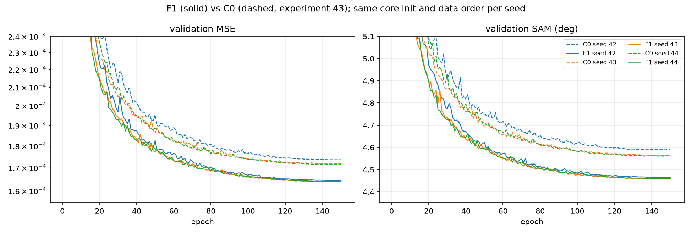
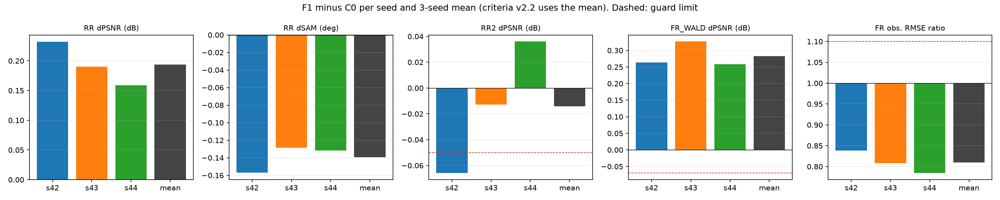
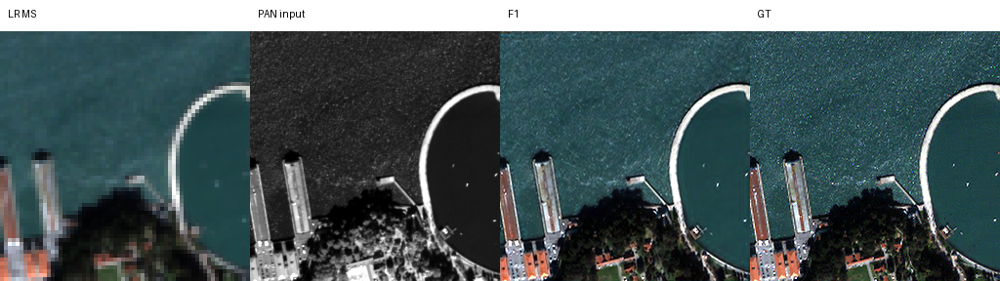
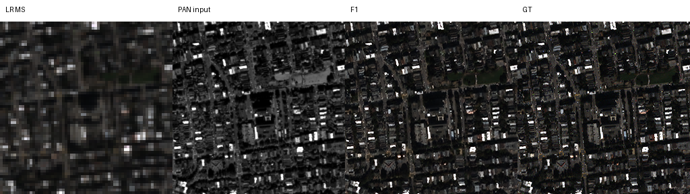
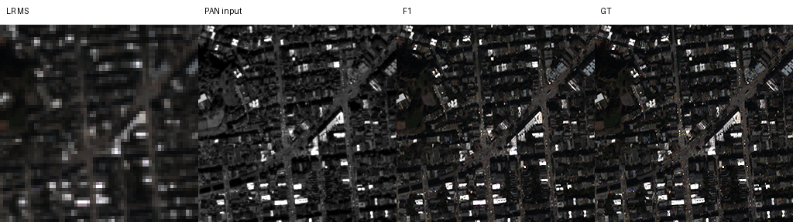
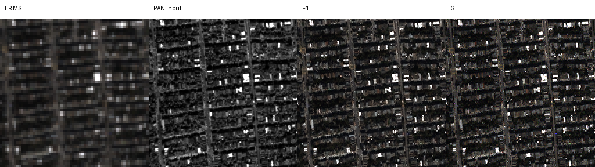
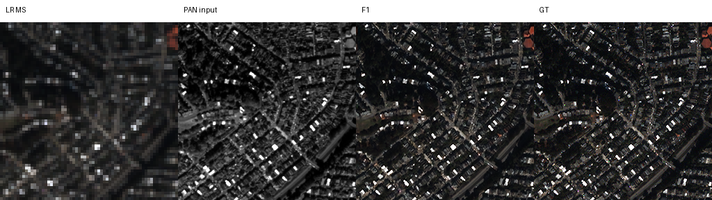

# 49. 관측 오차 보정기(G5) 계열의 3시드 재현

**연구 분야:** 기존 성능 개선

**실험자:** 이병현

**변경 내용:** 원본 SSA-MRN K4 뒤에 28번 G5의 관측 오차 보정기 두 개를 붙인 F1(29번 F01과 같은 구조)을 43번과 같은 절차로 seed 42·43·44에서 학습했습니다. 43번 C0(원본) 3시드와 비교했습니다.

| 확인된 결과 | 상태 | 개선 여부 |
|---|:---:|:---:|
| 3시드 평균으로 원본 대비 RR PSNR +0.194 dB·SAM −0.139°·ERGAS −0.095, FR_WALD +0.283 dB, 관측 오차 0.81배였고 RR2는 −0.014 dB·SAM −0.089°로 허용폭 안이었습니다. 판정 항목을 모두 통과했습니다. RR은 3/3시드·20/20장에서 개선됐습니다. | 평가&nbsp;완료<br>3seed | 개선 |

[실험 목록](../../../research/performance/README.md) · [수치](#results) · [그래프](#graphs) · [이미지](#images) · [재현 자료](#evidence)

## 1. 목적과 상태

[성능 47번](../47_ground_truth_criteria_reevaluation/README.md) 재평가에서 RR 이득이 의미 있게 크면서 모든 판정 항목을 통과한 후보는 G5 보정기 계열(28 G5 seed 46, 29 F01·F11 seed 42)뿐이었습니다. 하지만 모두 단일 시드이고 학습 절차도 서로 달라, 기준 모델 교체 조건(3시드 평균 "개선")을 채우지 못했습니다. 같은 절차의 3시드로 이 결과가 재현되는지 확인했습니다.

2026-10-20 10:32-19:51(KST)에 F1 세 군을 순서대로 150에폭씩 학습했습니다. 학습 코드·큐·런타임은 [성능 48번](../48_parallel_capacity_observation_refinement/README.md)과 공유했습니다. 학습이 모두 끝난 뒤 20:14-20:20에 정답 기반 평가를 했습니다.

## 2. 변경한 구조와 비교 조건

| 군 | 구조 | 파라미터 | 시드 | 학습 |
|---|---|---:|---|---|
| C0 | 원본 SSA-MRN K4 | 426,654 | 42·43·44 | 43번 가중치 재사용 |
| **F1** | C0 + G5 보정기 두 개 | 461,804 | 42·43·44 | **새로 학습** |

보정기는 첫 복원 결과를 받아 두 번 고칩니다. 각 단계의 입력은 다음과 같습니다.
- 현재 출력, LMS, PAN
- 출력을 MTF로 흐린 뒤 MS 크기로 줄였을 때 실제 MS와의 차이(관측 오차)
- 보정 PAN과 현재 출력에서 만든 PAN의 차이 중 고주파

마지막 층을 0으로 초기화해 학습 시작 때의 출력은 원본과 같습니다.

| 조건 | 내용 |
|---|---|
| 학습 절차 | 43번과 동일: 150에폭, batch·micro 32, Adam, 에폭별 cosine 1e-4 → 1e-6, AMP FP16, cuDNN deterministic, TF32 끔, channels_last |
| 초기값·순서 | 같은 시드의 C0와 core 초기값(43번 기록 해시와 일치)·에폭별 데이터 순서가 같음. 보정기는 `seed+1000`으로 초기화 |
| 보정 상수 | 29번 `calibration.json`(학습 데이터로 정한 PAN 가중치·blur 커널) |
| 선택 | epoch0 포함 최소 validation MSE |
| 평가 | [판정 기준 v2.2](../../../docs/judgement_criteria.md), [정답 기반 평가 도구](../../../common/evaluation_protocol.py). 여러 시드는 시드 평균으로 판정 |
| 사전 고정 | 판정 방식은 학습 전 [config.json](config.json)에 고정 |

<a id="results"></a>

## 3. 정량 결과

### validation 선택

| 시드 | C0 best validation MSE | F1 best validation MSE | 변화 | F1 best 에폭 | 건너뛴 갱신 |
|---|---:|---:|---:|---:|---:|
| 42 | 1.7355e-4 | 1.6440e-4 | −5.3% | 148 | 19 |
| 43 | 1.7171e-4 | 1.6382e-4 | −4.6% | 147 | 19 |
| 44 | 1.7139e-4 | 1.6391e-4 | −4.4% | 146 | 20 |

건너뛴 갱신은 AMP 오버플로로 80,400회 중 건너뛴 횟수입니다.

### 20장 평균 (3시드 평균)

| 군 | RR PSNR ↑ | RR SAM ↓ | RR ERGAS ↓ | RR2 PSNR ↑ | RR2 SAM ↓ | FR_WALD PSNR ↑ | FR_WALD SAM ↓ | FR 관측 오차(DN) ↓ | QNR(참고) |
|---|---:|---:|---:|---:|---:|---:|---:|---:|---:|
| C0 | 37.4293 | 4.9411 | 4.1241 | **38.1990** | 4.4883 | 36.1366 | 4.4891 | 24.572 | 0.9137 |
| **F1** | **37.6229** | **4.8019** | **4.0288** | 38.1848 | **4.3990** | **36.4196** | **4.3318** | **19.904** | 0.9211 |

### v2.2 판정 (F1 − C0)

| 시드 | RR ΔPSNR / ΔSAM / ΔERGAS | RR2 ΔPSNR / ΔSAM | FR_WALD ΔPSNR / ΔSAM | 관측 오차 배율 | ΔQNR(참고) |
|---|---|---|---|---:|---:|
| 42 | +0.232 / −0.157 / −0.113 | −0.066 / −0.009 | +0.264 / −0.168 | 0.839 | +0.0064 |
| 43 | +0.190 / −0.129 / −0.095 | −0.013 / −0.165 | +0.327 / −0.154 | 0.808 | −0.0132 |
| 44 | +0.159 / −0.132 / −0.079 | +0.036 / −0.093 | +0.258 / −0.149 | 0.784 | +0.0290 |
| **평균 (판정)** | **+0.194 / −0.139 / −0.095** | **−0.014 / −0.089** | **+0.283 / −0.157** | **0.810** | +0.0074 |

평균이 주 판정(RR 세 지표 개선)과 보조 판정 3개를 모두 통과해 **개선**입니다. v2.2에서는 시드 평균으로 판정하며, seed 42 단독의 RR2(−0.066 dB)는 허용폭(−0.05 dB)을 넘었습니다.

장면별(3시드 평균)로 F1은 C0보다 RR 20/20장, FR_WALD 20/20장, RR2 9/20장에서 PSNR이 높았습니다.

## 4. 기준선 대비 차이와 해석

- **G5 보정기의 이득이 같은 절차의 3시드에서 재현됐습니다.** RR +0.194 dB는 43번 C0의 RR 시드 표준편차(0.056 dB)의 약 3.5배이며, 세 시드 모두 +0.16 dB 이상이었습니다. validation MSE도 세 시드 모두 4-5% 낮았습니다.
- **이득은 같은 축척의 다른 장면에서도 유지됐습니다.** FR_WALD는 +0.28 dB로 RR보다 컸고, 20/20장에서 개선됐습니다.
- **FR에서 관측된 MS와 더 잘 맞습니다.** 관측 오차가 19% 줄었습니다. 보정기가 관측 오차를 직접 입력으로 받기 때문에 예상된 방향이지만, 이 감소는 저역(MS로 보이는 대역)에 대한 것이고 FR의 고역 세부 품질을 보장하지는 않습니다.
- **RR2는 거의 그대로입니다.** PSNR −0.014 dB, SAM −0.089°로 거친 축척에서도 손해가 거의 없었습니다. 이 점이 W2 계열([성능 50번](../50_w2_branch_inference_scaling/README.md)에서 세부 주입 세기의 축척 의존성 확인)과 다릅니다. 다만 seed 42 단독으로는 허용폭을 조금 넘어, 시드에 따라 흔들림이 있습니다.
- **이득의 크기는 이전 단일 실행보다 조금 작습니다.** 29 F01(29번 절차, seed 42)은 +0.236 dB, 28 G5(seed 46)는 +0.225 dB였습니다. 이번 3시드 평균은 +0.194 dB입니다. 절차가 달라 직접 합치지 않습니다.
- **한계:** QB 한 센서이고, 탐색에 반복 사용한 test(20장)입니다. QNR류는 참고 지표입니다. FR 축척의 고역 품질은 정답이 없어 판단하지 못합니다. 보정 상수(PAN 가중치·blur 커널)는 QB 학습 데이터로 정한 값이라, 다른 센서에서는 다시 정해야 합니다.

<a id="graphs"></a>

## 5. 학습·평가 그래프



실선은 F1, 점선은 43번 C0입니다. 같은 색은 같은 시드입니다(core 초기값·데이터 순서 동일). 세 시드 모두 F1이 학습 내내 낮은 validation MSE·SAM을 보였습니다.



시드별 차이와 3시드 평균입니다. 판정에는 평균(회색)을 씁니다. 빨간 점선은 허용폭입니다.

<a id="images"></a>

## 6. 결과 이미지

학습 전에 고정한 RR 장면 1·8·11·13·19(0부터 센 번호)입니다. 왼쪽부터 LR MS(최근접 확대), PAN, F1 예측(seed 42), GT입니다. RGB는 밴드 [2,1,0]이며, MS 패널은 같은 장면 GT의 1/99 백분위 대비를 공유합니다. seed 43·44의 같은 장면은 각 결과 폴더에 있습니다.











<a id="evidence"></a>

## 7. 재현 자료

[설정과 사전 판정](config.json) · [v2.2 평가 결과(장면별)](results/v22_s42_44.json) · 시드별 [학습 기록·RR·FR](results/) · [가중치(initial·best·latest)](checkpoints/) · [큐 완료 기록](provenance/all_complete.json) · [manifest](manifest.json)

코드는 [48번 폴더](../48_parallel_capacity_observation_refinement/)의 `model.py`(F1)·`train.py`·`run.py`·`evaluate.py`입니다. 실행 당시 설정·사전 검사·캐시 검증 기록도 48번 `provenance`에 있습니다. 세 시드의 best·latest 해시는 학습 완료 기록과 일치하고, 학습 완료 기록의 실행 계약 해시(fingerprint)는 48번 실행 당시 설정과 같습니다.

```bash
python SSA-MRN/experiments/performance/48_parallel_capacity_observation_refinement/run.py --mode run
python SSA-MRN/experiments/performance/48_parallel_capacity_observation_refinement/evaluate.py --runtime <런타임> --data <QB_H5_폴더> --output <출력.json> --arms C0 F1 --seeds 42 43 44 --comparisons F1:C0
```

## 8. 개선 여부와 다음 단계

**개선**(3시드 평균)입니다. G5 관측 오차 보정기는 원본 대비 RR·FR_WALD·관측 일치를 함께 개선하면서 RR2를 지켰습니다. 이로써 판정 기준 v2.2의 기준 모델 교체 조건(3시드 이상에서 평균 판정 "개선")을 채웠습니다.

이번 결과로 기준 모델을 자동으로 바꾸지 않습니다. F1을 새 기준 모델로 쓸지는 팀이 결정합니다. 결정 전에 확인할 만한 항목은 다음과 같습니다.
- 다른 센서(GF2·WV3)에서 보정 상수를 다시 정한 뒤에도 같은 방향인지
- 보정기의 추가 비용(파라미터 +35,150개, 전체 해상도 연산 두 번)
