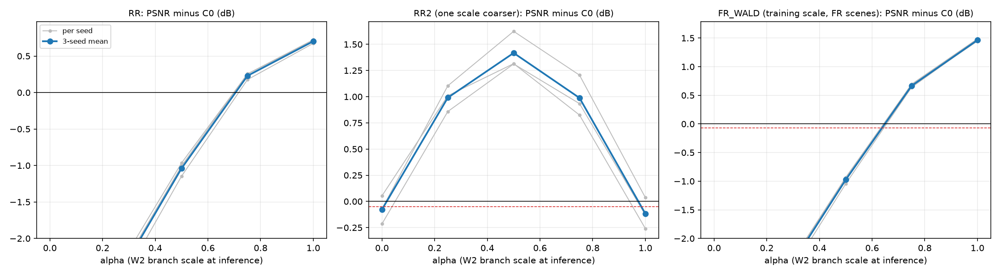
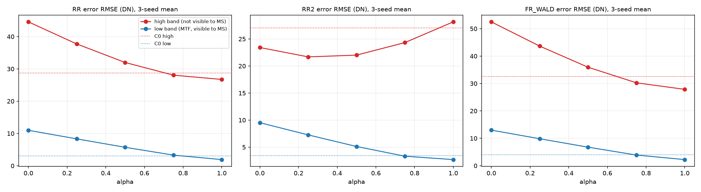

# 50. W2 가지 출력의 추론 시 축소 진단

**연구 분야:** 기존 성능 개선

**실험자:** 이병현

**변경 내용:** 새로 학습하지 않았습니다. 43번 C2(원본 + W2 저해상도 병렬 가지) 가중치에서 backbone 출력을 `원본(x) + α·W2가지(x)`로 바꿔 추론만 했습니다(α = 0, 0.25, 0.5, 0.75, 1). RR·RR2·FR_WALD 오차를 MS 관측으로 보이는 저역과 보이지 않는 고역으로 나눠 봤습니다.

| 확인된 결과 | 상태 | 개선 여부 |
|---|:---:|:---:|
| RR과 FR_WALD는 α가 클수록 좋아졌지만(RR은 20/20장 α=1 최고), RR2는 α=0.5에서 가장 좋았습니다(C0 대비 +1.42 dB, 17/20장). α를 0.5에서 1로 키우면 RR2의 고역 오차가 22.0에서 28.2 DN으로 늘었습니다. W2의 RR2 미달은 세부정보를 넣는 세기가 학습 축척에 맞춰진 탓으로 보입니다. | 사전&nbsp;검증&nbsp;완료 | 성능&nbsp;비교&nbsp;아님 |

[실험 목록](../../../research/performance/README.md) · [수치](#results) · [그래프](#graphs) · [이미지](#images) · [재현 자료](#evidence)

## 1. 목적과 상태

W2 가지는 RR에서 가장 큰 이득을 냈지만(43번 C2: C0 대비 RR +0.70 dB, FR_WALD +1.46 dB), 한 단계 더 거친 축척(RR2)에서는 3시드 평균 −0.12 dB로 미달했습니다([성능 47번](../47_ground_truth_criteria_reevaluation/README.md)). [성능 48번](../48_parallel_capacity_observation_refinement/README.md)에서는 관측 오차 보정기를 붙여도 이 미달이 그대로였습니다. 다음 두 질문을 학습 없이 확인했습니다.

1. RR2 미달은 W2 가지의 출력에서 생기는가?
2. 늘어난 RR2 오차는 MS 관측으로 볼 수 없는 고역에 있는가? (그렇다면 관측 기반 보정으로는 고칠 수 없습니다.)

2026-10-20 17:38-17:44(KST)에 서버에서 실행했습니다. 같은 서버에서 49번 학습이 돌고 있어, 진단은 별도 프로세스를 낮은 우선순위로 돌렸습니다. 진단은 49번 학습의 계산에 관여하지 않습니다.

## 2. 변경한 구조와 비교 조건

| 항목 | 내용 |
|---|---|
| 모델 | 43번 C0·C2 validation best, seed 42·43·44. 가중치는 바꾸지 않음 |
| 변경 | C2의 `Parallel.forward`만 추론 시 `original(x) + α·branch(x)`로 교체. α = 0, 0.25, 0.5, 0.75, 1 |
| 시험 | RR 20장, RR2(RR 장면을 같은 Wald 열화로 한 번 더 축소, 정답 = RR MS), FR_WALD(FR 장면 축소, 정답 = FR MS), FR 관측 오차 |
| 오차 분해 | 오차 e = 예측 − 정답. 저역 = QB MTF로 흐린 e(MS 관측이 보는 대역), 고역 = e − 저역. 전체 화소 RMSE(DN) |
| 도구 | [common/evaluation_protocol.py](../../../common/evaluation_protocol.py), FP32 추론, float64 지표 |
| 제한 | α를 test로 골라 모델을 바꾸지 않음. 진단 전용 |

측정 전에 [config.json](config.json)에 다음 해석 기준을 고정했습니다.
- **H1:** α가 0에서 1로 갈 때 RR은 오르는데 RR2가 내려가면, W2 가지가 RR2 미달의 원인입니다.
- **H2:** α를 키울 때 RR2의 고역 오차 증가가 저역 증가보다 크면, 늘어난 오차는 관측으로 볼 수 없는 대역에 있습니다.
- **확인:** α=1은 47번 C2 값을 재현해야 합니다.

<a id="results"></a>

## 3. 정량 결과

α=1 결과는 47번 C2와 같았습니다(RR PSNR seed42 38.0767, seed43 38.1680, seed44 38.1502). 아래는 3시드 평균입니다.

| 설정 | RR PSNR ↑ | RR SAM ↓ | RR2 PSNR ↑ | RR2 SAM ↓ | FR_WALD PSNR ↑ | FR_WALD SAM ↓ | FR 관측 오차 ↓ |
|---|---:|---:|---:|---:|---:|---:|---:|
| C0 | 37.429 | 4.941 | 38.199 | 4.488 | 36.137 | 4.489 | 24.57 |
| C2 α=0 | 33.323 | 7.222 | 38.121 | 5.065 | 31.694 | 6.589 | 31.81 |
| C2 α=0.25 | 34.847 | 6.254 | 39.189 | 4.551 | 33.366 | 5.667 | 26.74 |
| C2 α=0.5 | 36.390 | 5.414 | **39.616** | **4.253** | 35.162 | 4.859 | 22.12 |
| C2 α=0.75 | 37.658 | 4.803 | 39.187 | 4.258 | 36.803 | 4.258 | 18.30 |
| C2 α=1 | **38.132** | **4.597** | 38.082 | 4.613 | **37.601** | **4.047** | **15.89** |

### 오차의 저역·고역 (RMSE, DN, 3시드 평균)

| 설정 | RR 저역 | RR 고역 | RR2 저역 | RR2 고역 | FR_WALD 저역 | FR_WALD 고역 |
|---|---:|---:|---:|---:|---:|---:|
| C0 | 3.02 | 28.75 | 3.41 | 27.04 | 3.96 | 32.59 |
| C2 α=0 | 10.99 | 44.56 | 9.52 | 23.42 | 12.98 | 52.49 |
| C2 α=0.25 | 8.33 | 37.72 | 7.26 | **21.69** | 9.85 | 43.64 |
| C2 α=0.5 | 5.72 | 31.98 | 5.12 | 22.01 | 6.77 | 35.94 |
| C2 α=0.75 | 3.30 | 28.05 | 3.33 | 24.33 | 3.89 | 30.25 |
| C2 α=1 | **1.91** | **26.73** | **2.70** | 28.16 | **2.24** | **27.86** |

### 장면별 최적 α (3시드 평균 PSNR 기준)

| 시험 | α=0 | 0.25 | 0.5 | 0.75 | 1 |
|---|---:|---:|---:|---:|---:|
| RR | 0 | 0 | 0 | 0 | **20** |
| RR2 | 0 | 0 | **17** | 3 | 0 |

### C0 대비 판정 항목 (3시드 평균, 참고)

| 설정 | RR ΔPSNR / ΔSAM / ΔERGAS | RR2 ΔPSNR / ΔSAM | FR_WALD ΔPSNR / ΔSAM | 관측 오차 배율 |
|---|---|---|---|---:|
| α=0.5 | −1.039 / +0.472 / +0.560 | +1.417 / −0.235 | −0.975 / +0.370 | 0.90 |
| α=0.75 | +0.229 / −0.138 / −0.106 | +0.988 / −0.230 | +0.666 / −0.231 | 0.74 |
| α=1 | +0.702 / −0.344 / −0.341 | −0.117 / +0.124 | +1.464 / −0.442 | 0.65 |

α=0.75는 v2.2의 모든 항목을 통과하는 값이지만, test를 보고 고른 값이므로 모델 변경 근거로 쓰지 않습니다.

## 4. 기준선 대비 차이와 해석

- **H1은 부분적으로 맞았습니다.** α를 키우면 RR(20/20장)과 FR_WALD는 계속 좋아졌습니다. RR2는 α=0.5까지 크게 좋아지다가(C0 대비 +1.42 dB) 그 뒤로 나빠졌습니다. RR2 미달은 W2 가지에서 생기지만, 가지가 해로운 것이 아니라 **세기가 거친 축척에 맞지 않는 것**입니다. 거친 축척에서도 가지의 절반 세기는 원본보다 훨씬 좋았습니다.
- **H2는 맞았습니다.** RR2에서 α를 키우면 저역 오차는 9.5에서 2.7 DN으로 계속 줄었고, 고역 오차는 α=0.25-0.5에서 가장 낮다가(21.7-22.0) α=1에서 28.2로 늘었습니다. 넘치는 부분은 MS 관측으로 볼 수 없는 고역 세부입니다. 48번의 관측 오차 보정기가 RR2를 고치지 못한 이유와 맞습니다.
- **학습 축척에서는 같은 현상이 없습니다.** RR과 FR_WALD는 고역 오차도 α=1까지 계속 줄었습니다. W2가 넣는 세부의 세기는 학습 축척에 맞춰져 있고, 축척이 바뀌면 과해집니다.
- **α=0은 C0가 아닙니다.** core가 가지와 함께 학습돼 가지를 빼면 RR이 4.1 dB 떨어집니다. 이 진단은 가지의 "세기"만 바꾼 것이며, 가지 없이 학습한 모델과 같지 않습니다.
- **FR에 대한 함의(확인 불가):** FR은 학습보다 4배 세밀한 축척이라, 그곳에서도 α=1이 최적이라는 보장이 없습니다. FR에는 고역을 잴 정답이 없어 이번 진단으로 판단할 수 없습니다.
- **한계:** QB 한 센서, 탐색에 반복 사용한 test, 43번의 세 시드입니다. 저역·고역 분해는 MTF 저역통과를 기준으로 한 근사입니다.

<a id="graphs"></a>

## 5. 학습·평가 그래프



회색은 시드별, 파란색은 3시드 평균입니다. 빨간 점선은 v2.2 허용폭입니다. RR과 FR_WALD는 α에 따라 계속 오르지만, RR2는 α=0.5에서 정점을 찍고 내려갑니다.



빨간색은 고역(MS로 보이지 않음), 파란색은 저역(MS로 보임)입니다. 점선은 C0입니다. RR2에서만 고역 오차가 α=0.5 이후 다시 늘어납니다. 학습하지 않았으므로 학습 곡선은 없습니다.

<a id="images"></a>

## 6. 결과 이미지

진단 출력 이미지는 저장하지 않았습니다. C2의 예시 패널은 [성능 43번](../43_normalized_parallel_capacity/README.md)에 있습니다.

<a id="evidence"></a>

## 7. 재현 자료

[진단 코드](diagnose.py) · [설정과 사전 해석 기준](config.json) · [장면별 전체 결과](results/diagnose.json) · [manifest](manifest.json)

결과 JSON에는 사용한 가중치 6개와 코드·설정·평가 도구·데이터의 해시가 기록돼 있습니다. 가중치 해시는 저장소의 43번 가중치와 일치합니다.

```bash
python SSA-MRN/experiments/performance/50_w2_branch_inference_scaling/diagnose.py --data <QB_H5_폴더> --output <출력.json>
```

## 8. 개선 여부와 다음 단계

**성능 비교 아님**입니다. 학습하지 않은 진단이며 기준 모델은 원본 SSA-MRN K4로 유지합니다.

W2의 RR2 미달은 고칠 수 없는 구조 한계가 아니라 세부 주입 세기의 축척 의존성으로 보입니다. test로 세기를 고르지 않는 해결책이 필요합니다. 다음 실험으로 **축척 혼합 학습**을 제안합니다.
- 현재 64×64 학습 패치로도 2배 거친 학습 쌍(PAN 32×32, MS 8×8)은 만들 수 있습니다.
- 원래 축척과 2배 거친 축척을 섞어 C2를 학습해, 네트워크가 축척에 맞는 세기를 배워 RR 이득을 지키면서 RR2를 통과하는지 확인합니다.
- 대조군은 43번 C2·C0입니다.
