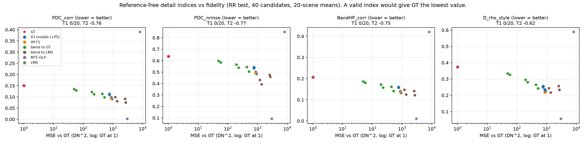

# 51. 정답 없는 FR 세부 지표 후보의 타당성 검증

**연구 분야:** 기존 성능 개선

**실험자:** 이병현

**변경 내용:** 새로 학습하지 않았습니다. 정답 없이 FR 세부 품질을 재는 지표 후보 4개를 만들고, [성능 46번](../46_fr_spatial_index_validity/README.md)의 정답 순위 검사로 판정에 쓸 수 있는지 확인했습니다. 네 지표 모두 결과의 세부가 PAN과 얼마나 닮았는지를 잽니다.

| 확인된 결과 | 상태 | 개선 여부 |
|---|:---:|:---:|
| 네 지표 모두 정답을 C0 모델보다 나쁘게 채점했습니다(20장 중 0장에서 정답이 우세). 정답과의 오차와 지표 나쁨의 순위 상관은 −0.62에서 −0.77로, 정답에 가까울수록 지표가 나빠졌습니다. PAN 세부를 그대로 베끼는 MTF-GLP가 가장 좋은 점수를 받았습니다. 네 지표 모두 "충돌"이라 판정에 쓰지 않습니다. | 사전&nbsp;검증&nbsp;완료 | 성능&nbsp;비교&nbsp;아님 |

[실험 목록](../../../research/performance/README.md) · [수치](#results) · [그래프](#graphs) · [이미지](#images) · [재현 자료](#evidence)

## 1. 목적과 상태

판정 기준은 정답이 있는 시험(RR·RR2·FR_WALD)과 FR 관측 오차(저역)만 쓰기 때문에, 실제 목표인 FR 축척의 세부 품질은 재지 못합니다. 46번에서 Ds가 실패한 뒤, 다른 형태의 정답 없는 세부 지표가 정답 순위 검사를 통과하는지 확인했습니다. 통과한 지표가 있으면 이후 FR 보조 판정 후보로 제안할 계획이었습니다.

2026-10-20 20:41-21:00(KST)에 서버에서 실행했습니다. 학습과 옵티마이저 업데이트는 없습니다.

## 2. 변경한 구조와 비교 조건

### 지표 후보 (모두 낮을수록 좋음)

| 지표 | 정의 |
|---|---|
| PDC_corr | MS 해상도에서 PAN ≈ Σ w_b·MS_b + c를 최소제곱으로 맞춘 뒤(입력만 사용), 결과로 합성한 흑백 영상과 PAN의 고주파(PAN MTF 저역을 뺀 성분) 상관. 1 − 상관 |
| PDC_nrmse | 위 두 고주파의 차이 RMSE를 PAN 고주파 RMSE로 나눈 값 |
| BandHP_corr | 결과 각 밴드의 고주파와 PAN 고주파의 상관 평균. 1 − 상관 |
| D_rho_style | 4×4 창 안의 결과 밴드와 PAN의 국소 상관(Scarpa 등 2022의 아이디어). 1 − 상관의 평균. 저자 코드와 비교하지 않은 자체 구현 |

### 검사 (46번과 같은 방식, 측정 전에 [config.json](config.json)에 고정)

| 항목 | 내용 |
|---|---|
| 데이터 | RR test 20장. RR PAN·LMS·MS를 FR 입력처럼 넣고, 정답은 정확도 측정에만 사용 |
| 후보 (장면당 40개) | 정답, LMS, MTF-GLP, 43번 C0-C3 × 3시드(45번 P5 사영 전후), C0·C2 seed42와 정답·LMS 혼합, 49번 F1 × 3시드 |
| T1 정답 순위 | 정답의 지표가 C0 세 시드 평균보다 좋은 장면 수. 정상 15/20 이상, 충돌 5/20 이하 |
| T2 정확도 순위 | 장면별 "정답 대비 MSE"와 "지표 나쁨"의 Spearman, 20장 중앙값. 정상 +0.5 이상, 충돌 −0.5 이하 |
| T3·T4 | 정답 쪽으로 75% 섞은 결과가 섞기 전보다 좋은 장면 수, 정답이 40개 중 1등인 장면 수 (참고) |
| 판정 | T1·T2 모두 정상이면 통과, 모두 충돌이면 충돌, 그 외 혼재 |
| 재현 확인 | 같은 후보의 Toolbox 1.0 Ds가 46번 결과와 같아야 함 |

<a id="results"></a>

## 3. 정량 결과

재현 확인: 정답·LMS·C0 seed42의 Ds가 46번 결과와 차이 0으로 같았습니다.

| 지표 | T1 정답 우세 | T2 순위 상관 | T3 정답 쪽 혼합이 나은 장면 (C0·C2) | T4 정답 1등 | 판정 |
|---|---:|---:|---:|---:|---|
| PDC_corr | 0/20 | −0.758 | 0 · 0 | 0/20 | **충돌** |
| PDC_nrmse | 0/20 | −0.765 | 0 · 0 | 0/20 | **충돌** |
| BandHP_corr | 0/20 | −0.749 | 0 · 0 | 0/20 | **충돌** |
| D_rho_style | 0/20 | −0.621 | 0 · 0 | 0/20 | **충돌** |

### 대표 후보의 20장 평균

| 후보 | 정답 대비 MSE (DN²) | PDC_corr | PDC_nrmse | BandHP_corr | D_rho_style |
|---|---:|---:|---:|---:|---:|
| **정답** | 0 | 0.151 | 0.638 | 0.206 | 0.374 |
| C0 + 정답 75% | 57 | 0.129 | 0.584 | 0.180 | 0.326 |
| C0 + 정답 50% | 229 | 0.112 | 0.539 | 0.158 | 0.280 |
| C2 seed42 | 772 | 0.110 | 0.535 | 0.157 | 0.254 |
| F1 seed42 | 866 | 0.092 | 0.491 | 0.136 | 0.217 |
| C0 seed42 | 915 | 0.090 | 0.484 | 0.133 | 0.225 |
| C0 + LMS 25% | 1,351 | 0.081 | 0.393 | 0.125 | 0.217 |
| MTF-GLP | 2,986 | **0.002** | **0.091** | **0.010** | **0.056** |
| LMS | 8,042 | 0.391 | 0.852 | 0.421 | 0.589 |

## 4. 기준선 대비 차이와 해석

- **PAN 유사도로 FR 세부를 재는 방식은 QB에서 정답을 판별하지 못했습니다.** 네 지표 모두 정답에 가까워질수록 점수가 나빠졌고, PAN 세부를 그대로 주입하는 MTF-GLP가 1등이었습니다. 정답 쪽으로 75% 섞은 결과는 20장 모두에서 섞기 전보다 나쁜 점수를 받았습니다.
- **원인은 정답 자체가 PAN과 다르다는 점입니다.** 정답 MS를 흑백으로 합성해도 PAN 고주파와의 상관이 0.85 정도이고(PDC_corr 0.15), 차이는 PAN 고주파 크기의 64%였습니다. PAN 센서의 감도 범위가 MS 네 밴드의 가중합과 다르고, 실제 색 세부는 밴드마다 세기가 달라서입니다. 그래서 "PAN과 닮을수록 좋다"는 지표는 PAN 복사를 상으로 줍니다. 46번 Ds가 실패한 이유와 같은 구조입니다.
- **지표 구현보다는 가정의 문제입니다.** 흑백 합성 방식(PDC), 밴드별 고주파(BandHP), 국소 창 상관(D_rho_style)이 모두 같은 방향으로 실패했습니다.
- **판정 기준에는 넣지 않습니다.** [판정 기준 v2.3](../../../docs/judgement_criteria.md)의 근거에 이 결과를 추가했습니다. FR 세부 품질은 정량으로 재지 못하는 한계로 두고, 기준 모델 교체 시에는 FR·RR2 비교 이미지로 정성 확인합니다.
- **한계:** RR 축척에서 확인한 것이며, FR 축척에서의 동작을 직접 증명하지는 않습니다. QB 한 센서이고 탐색에 반복 사용한 test입니다. "정답 수준만큼만 닮았는가"처럼 목표값을 두는 양방향 변형은 검사하지 않았습니다(목표값을 test 정답으로 정하면 안 되므로 학습·검증 데이터에서 정해야 함).

<a id="graphs"></a>

## 5. 학습·평가 그래프



40개 후보의 20장 평균입니다. 가로축은 정답 대비 MSE(로그, 정답은 1에 표시), 세로축은 각 지표입니다. 타당한 지표라면 빨간 별(정답)이 가장 낮아야 하지만, 네 지표 모두 정답이 가장 높은 쪽에 있고 PAN을 베끼는 MTF-GLP(보라)가 가장 낮습니다. 학습하지 않았으므로 학습 곡선은 없습니다.

<a id="images"></a>

## 6. 결과 이미지

지표 검사 출력 이미지는 저장하지 않았습니다. 같은 날 FR 세부를 눈으로 확인한 C0·F1·C2·C3의 FR·RR2 비교 이미지는 [성능 49번](../49_observation_refinement_seed_repeat/README.md)에 있습니다.

<a id="evidence"></a>

## 7. 재현 자료

[검사 코드](prepare.py) · [설정과 사전 기준](config.json) · [장면별 전체 결과](results/validity.json) · [완료 기록](results/complete.json) · [manifest](manifest.json)

```bash
python SSA-MRN/experiments/performance/51_fr_detail_index_validity/prepare.py --data <QB_H5_폴더> --output <출력> --reference SSA-MRN/experiments/performance/46_fr_spatial_index_validity/results/validity.json
```

## 8. 개선 여부와 다음 단계

**성능 비교 아님**입니다. 지표 타당성 검증이며 판정에 쓸 새 FR 지표는 없습니다.

46번과 이번 결과로, QB에서 PAN 유사도 기반의 정답 없는 FR 지표는 정답을 거꾸로 채점한다는 점이 두 번 확인됐습니다. 이 방향의 지표 탐색은 여기서 멈추고, FR에서도 통할 가능성은 축척 강건성(RR2 보조 판정)과 FR 비교 이미지로 판단합니다. 남은 정량 방법은 거친 축척으로 학습한 모델을 더 세밀한 RR에서 정답으로 채점하는 "축척 올림 재현"입니다.
